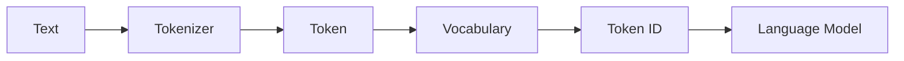
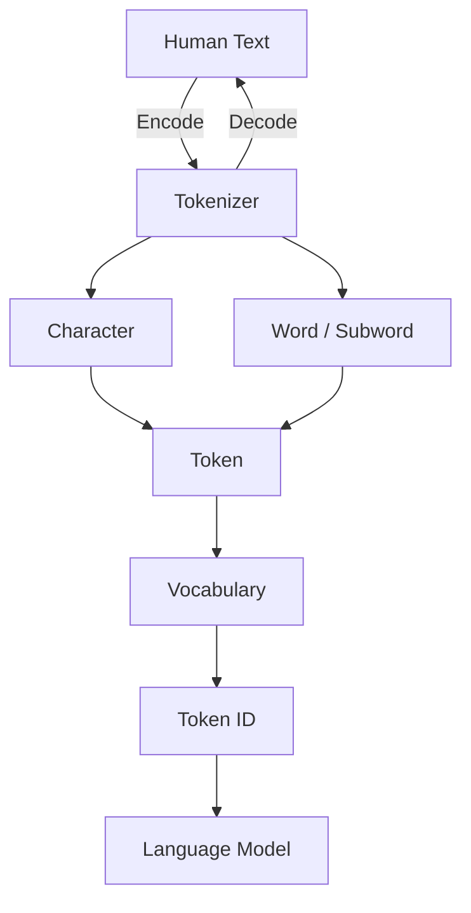

# 2. 分词器（Tokenizer）——文本离散化与词元表示

> **本章目标**
>
> 第一章中，我们实现了一个Character Bigram Language Model，但它有一个明显的问题：
>
> **第一章按字符切分文本，虽然实现简单，但序列较长，也难以复用常见词根和子词结构。现代 LLM 通常采用 Subword 或 Byte-level Tokenizer，在词表规模、序列长度和未知文本处理能力之间折中。**
>
> 本章要回答：**为什么 LLM 不直接处理文字，而要先经过 Tokenizer？** 最终，我们将从零实现一个简化版 Tokenizer，并逐步演进到现代大语言模型使用的 BPE（Byte Pair Encoding）。

---

# 本章学习目标

完成本章后，你应该能够回答：

* 为什么模型不能直接处理字符串？Character、Word 和 Token 有什么区别？
* 什么是 Vocabulary（词表）？什么是 Token ID？Encode 和 Decode 是什么？
* 什么是 `<UNK>`？为什么 GPT、Qwen、Llama 的 Token 数量都不一样？
* 为什么现代 LLM 常采用 Subword 或 Byte-level 方案，而不是纯 Character 或纯 Word？

---

## 一、第一章留下的问题

回顾第一章，训练数据是逐字符处理的：`current = text[i]; next = text[i+1]`。看起来没问题，但如果训练数据变成 `I love AI.`，模型实际看到的是：

```text
I · (space) · l · o · v · e · (space) · A · I · .
```

其中 `love` 被拆成 4 个 Token。模型可以通过后续网络学习这些字符的组合规律，并非“永远无法理解单词”；问题在于序列变长，训练和推理成本上升，而且常见词和词根不能直接作为一个可复用单位。中文按字切分也有类似权衡：覆盖范围较好，但“人工智能”等常见词组需要跨多个位置组合。

因此 Character Tokenizer 的主要局限是：

> **单位过细，导致序列较长，并把更多组合工作留给后续模型。**

---

## 二、为什么不能直接使用单词（Word）？

既然 Character 太小，很自然会想到直接用 **Word** 切分：`I love AI → I / love / AI`。看起来很合理，但真正训练语言模型时，Word Tokenizer 会遇到三个问题：

**问题一：新词（Out-of-Vocabulary）**——假设训练时词表里只有 `cat`、`dog`，用户输入 `cats` 怎么办？词表里根本没有这个词，模型直接无法处理，这就是现代 NLP 最经典的问题之一：**OOV**。

**问题二：词表容易膨胀**——`play / playing / played / player / players / ...` 若每个词形都作为独立 Word，覆盖更多语料和领域时 Vocabulary 会快速增大；固定词表仍无法收录所有未来输入。

**问题三：浪费训练数据**——`play / playing / played` 其实都来自同一个词根 `play`。如果完全切成不同的 Word，模型就无法共享这个词根，学习效率下降。

Character 太细、Word 太粗，现代 LLM 选择了折中方案：

```text
Character（粒度细）→ 序列通常较长
Word     （粒度粗）→ OOV / 大词表 / 统计共享不足
Subword  （折中）  →  现代 LLM 的常见选择
```

> **多数现代 LLM 使用子词或字节级方法，在词表大小、序列长度与覆盖能力之间折中。**

### BPE 在做什么

**字节对编码（Byte Pair Encoding, BPE）** 是一种从数据里学合并规则的方法。以字符级 BPE 为例：

1. 初始词表是语料中出现过的所有字符（byte-level 则是 256 个字节）；
2. 统计相邻符号对的出现频率，例如 `l o`、`o w`、`e r`；
3. 把频率最高的一对合并成一个新符号，加入词表；
4. 重复“统计—合并”若干次，直到词表达到目标大小。

训练结束后，词表里既有单字符，也有 `low`、`er`、`est` 这样的子词。编码新文本时，按学到的合并优先级反复合并，直到没有可合并的相邻对。

一个简化例子：语料里 `low`、`lower`、`lowest` 频繁出现，BPE 可能先合并 `l o`、再合并 `lo w`，最后得到 `low`；`er`、`est` 也可能各自成为子词。这样常见词只占一个 Token，罕见词拆成更小的已知片段，既压缩序列，又避免 `<UNK>`。

BPE 是**数据驱动的压缩规则**，不是语言学分词：它不保证切出来的片段对应词根或语法单位。词表大小是超参数：词表越大，序列越短，但 Embedding/输出层参数越多；词表越小，序列越长，长尾字符更容易被拆碎。WordPiece、Unigram 和 SentencePiece 是相近但目标不同的子词方案，具体实现要看模型卡。

---

## 三、什么是 Token？

`Token` 并不等于 `Word`。Token 的定义是：

> **Tokenizer 切分出来、供模型学习的最小语言单位。**

例如 `playing`：

| 切分方式 | 结果 |
| --- | --- |
| Character | `p / l / a / y / i / n / g` |
| Word | `playing` |
| Subword（可能） | `play / ing` |
| Subword（也可能） | `pla / ying` |

具体怎么切完全取决于 Tokenizer，所以 Token 不是固定的，**它是 Tokenizer 的输出**。

---

## 四、Tokenizer 的职责

> **Tokenizer 的职责，就是把人类能够理解的文本，转换成模型能够处理的 Token ID。**

整个流程如下：



这一整条 Text → Token ID 的过程叫 **Encode（编码）**；反过来，把模型输出的 Token ID 还原成文字，叫 **Decode（解码）**。从这里开始，Language Model 再也不会看到 `hello world`，它真正看到的是 `[3,2,4,4,5,0,7,5,6,4,1]`。

第二章实验，我们就会亲手实现这条 Text → Token → Token ID 的流水线。

### 完整机制：从 Text 到 Token ID 再回到 Text

把上面那条流水线按执行顺序展开，一次完整的 Encode/Decode 会经过五个阶段：

| 阶段 | 输入 | 操作 | 产物 |
| --- | --- | --- | --- |
| 规范化（Normalization） | 原始字符串 | 统一 Unicode 形式、处理多余空白 | 规范化文本 |
| 预切分（Pre-tokenization） | 规范化文本 | 按空格、标点或正则规则切成片段 | 片段列表 |
| 子词切分（Subword Merge） | 片段列表 + 合并规则 | 按合并表把片段拆成词表内的子词 | Token 列表 |
| 映射 ID | Token 列表 + Vocabulary | 用词表把每个 Token 换成整数下标 | Token ID 序列 |
| 解码（Decode） | Token ID 序列 | 反查 Token、拼接并还原空白 | 文本 |

前四个阶段属于 Encode，最后一个属于 Decode；子词切分依赖的合并表由 BPE 训练得到，见实验 2.5 与 2.6。**完成判据**：每个 ID 都落在 $[0,|V|)$ 内，且 `decode(encode(text))` 能还原原文——无损方案（如 byte-level）下这条往返等式应当成立。**失败边界**：一旦出现 `<UNK>`，往返就不可逆；规范化或合并规则与训练时不一致，也会让同一段文本得到不同的 ID，因此训练与推理必须共用同一份 Tokenizer 配置。

### 特殊词元与字节级回退

词表里不只有“文字”。模型还需要一些**特殊词元（special tokens）** 来表达结构：

| 词元 | 作用 |
|---|---|
| `BOS` / `<s>` | 序列开始 |
| `EOS` / `</s>` | 序列结束，生成时的重要停止条件 |
| `PAD` | 批次补齐；通常不参与损失 |
| `UNK` | 未登录词；byte-level 方案通常不需要 |
| `<|im_start|>`、`<|im_end|>` 等 | 对话角色与回合边界，由 Chat Template 使用 |

特殊词元也是词表里的 ID，但它们**不是普通文本**：训练时要按模板插入，推理时要按同一模板拼接，并正确设置 `eos_token_id`。如果训练和推理使用不同的特殊词元，模型可能不会停、认错角色，或把标记当成正文生成。

**字节级 BPE（Byte-level BPE）** 是另一种常见方案：先把文本转成 UTF-8 字节，再从 256 个字节符号开始做 BPE。这样任何字符串都能被表示，不会出现 `<UNK>`；代价是中文、emoji 等字符可能占用多个字节/词元，序列更长。GPT-2 使用 byte-level BPE；Llama 系列使用 SentencePiece BPE，并通过 byte fallback 处理未登录字符；Qwen 等模型也采用 byte-level BPE。具体词表与合并规则必须看模型卡，不能只看“都是 BPE”就假定兼容。

> **一句话**：Tokenizer 不只是“切词”，它还定义了特殊词元、字节回退和对话边界；这些都会影响训练与推理的一致性。

---

## 五、本章知识地图



---

# 本章实验预告

本章依然遵循**代码演进** 原则，不会推倒重写第一章：

| 实验      | 内容                | 在上一章基础上的变化                                   |
| ------- | ------------------- | -------------------------------------------- |
| **2.1**| Character Tokenizer | 增加 `encode()` / `decode()`，Language Model 不变 |
| **2.2**| Word Tokenizer      | 输入由字符升级为单词                                   |
| **2.3**| `<UNK>` Token | 观察 Word Tokenizer 如何处理 OOV |
| **2.4**| Subword 理论 | 解释 Character 与 Word 之间的折中 |
| **2.5**| 手工执行 BPE 合并 | 理解 BPE 的基本规则 |
| **2.6**| Mini BPE Tokenizer | 训练并运行一个简化的 BPE Tokenizer |

这些章节不修改第一章的 Language Model，重点是在 Text 和 Language Model 之间补齐 Tokenizer 与 Token ID 两个环节。这也是本书始终坚持的原则：

> **Every chapter evolves the previous chapter, never rewrites it.**

---

# 下一章预告

完成本章后，文本已经变成了一串整数。但这些整数只是**编号**，`3` 和 `4` 相邻不代表这两个 Token 含义相近，模型也无法对编号直接做加权求和。下一章 **第3章 Embedding——Token 的向量表示** 会解释：为什么 Token ID 不能直接输入神经网络，以及如何把每个编号换成一个可训练的向量。
