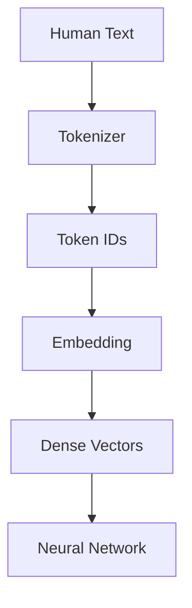
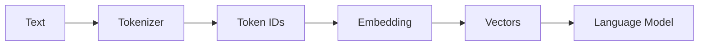

# 3. 嵌入（Embedding）——词元（Token）的向量表示

> **本章目标**
>
> 第二章中，我们实现了简化的 Character、Word 和 BPE Tokenizer，能够把文本转换成 Token ID 序列。但新的问题来了：**这些编号到底代表什么？Token ID 是否已经包含词义？**
>
> 本章将回答一个基础问题：**为什么不应把 Token ID 当作具有大小关系的连续数值直接计算？** 随后用查表实现一个最小版 Embedding Layer。

---

# 本章学习目标

完成本章后，你应该能够回答下面几个问题：

- 为什么 Token ID 不能直接输入神经网络？什么是 One-Hot Encoding？
- 什么是 Embedding？Embedding Matrix 是什么？为什么叫 Lookup Table？
- Embedding 如何随训练目标和梯度更新？什么条件下相似上下文可能形成相似表示？
- GPT 的第一层到底做了什么？

---

## 一、第二章留下的问题

第二章最后，Tokenizer 已经完成 `Text → Tokenizer → Token IDs`，例如 `I love AI` 编码为 `[2,3,1]`。`2,3,1` 这样的整数序列本身并不表达 `I, love, AI` 的含义。

---

## 二、Token ID 没有任何语义

观察 `cat` 和 `dog` 两个词，Tokenizer 可能得到 `cat → 128`，`dog → 129`。`129 > 128` 并不表示 `dog` 比 `cat` "更大"。Token ID 只是**Vocabulary 中的编号**，就像学生学号 `1001, 1002, 1003` 之间没有任何数学意义，Token ID 也是一样。

再看一个例子，假设 Vocabulary 为 `{apple:0, banana:1, car:2, computer:3}`，`computer > banana` 没有语义，因为 `0,1,2,3` 只是编号。若把这些 ID 当作标量输入普通线性层，就会人为引入大小和距离关系；标准做法是把 ID 作为查表索引，而不是数值特征。

---

## 三、神经网络真正需要什么？

神经网络真正擅长处理的是**向量（Vector）**，例如 `[0.13, 0.42, 0.77, ...]`。因为向量之间可以计算距离、方向、相似度、线性组合，这些都是神经网络能够学习的。因此真正的数据流应该变成：

Embedding 就是连接**离散 Token** 与**连续向量** 之间的桥梁。

### 完整机制：从 Token ID 到可训练向量

| 阶段 | 输入 | 操作 | 产物 |
| --- | --- | --- | --- |
| 建表 | 词表大小 `V`、向量维度 `d` | 随机初始化一个 `V × d` 的矩阵 | Embedding Matrix（可训练参数） |
| 查表 | Shape 为 `(T,)` 的 Token ID 序列 | 以每个整数作为行下标取出一行 | Shape 为 `(T, d)` 的向量序列 |
| 入网 | `(T, d)` 向量 | 拼接或逐位置送入后续 Linear | 隐藏表示 |
| 回传 | Loss 对输出的梯度 | 反向传播只把梯度写回本批被查到的行 | 更新后的向量 |

**完成判据**：查表后 Shape 必然是 `(T, d)`，`d` 在整个训练中保持不变；同一个 Token 无论出现在哪个位置，查到的都是同一行。**失败边界**：Embedding 只编码“是哪个 Token”，不含位置与上下文——`[I, love]` 与 `[love, I]` 查表后是同一组向量，只是顺序不同，位置信息要由后续章节补上（第 6 章靠拼接顺序，第 11 章引入位置编码）；此外，从未被任何样本查到过的行不会获得梯度，会长期停留在初始值（更新细节见第 7 章）。

### 余弦相似度、权重共享与维度

Embedding 是向量，比较两个 Token 是否相近时，常用**余弦相似度（Cosine Similarity）**：

$$
\cos(a,b)=\frac{a\cdot b}{\lVert a\rVert\lVert b\rVert}
$$

它只看向量方向，不受长度影响。点积则同时受方向和长度影响；如果向量已经做过 L2 归一化，点积与余弦相似度等价。注意：**余弦相似度高不等于语义一定相近**，它只是训练后几何结构的一种观察，仍要在具体任务上验证。

**权重共享（Weight Tying）** 指输入 Embedding 矩阵与输出 `lm_head` 共用同一组权重。词表大小为 $V$、维度为 $d$ 时，两份矩阵各有 $V\times d$ 个参数；共享可以省下一份，并让“输入表示”和“输出分类”落在同一空间。GPT-2 等模型使用权重共享；也有模型选择不共享，具体看架构与训练配置。

Embedding 维度 $d$ 和词表大小 $V$ 共同决定参数量 $V\times d$。$d$ 越大，表示容量越高，但矩阵乘法和显存也越大；$d$ 太小则限制表示能力。这个取舍要和模型宽度、层数、数据量一起看，不能单独说“维度越大越好”。

静态 Embedding 只给每个 Token 一个固定向量；同一个词在不同上下文中的不同含义，要等 Transformer 的上下文化表示（ contextual representation）来区分。第 10、11 章会看到这个过程。

### 静态词向量：Word2Vec 与 GloVe

Embedding 矩阵不是只能随机初始化后等语言模型来训。早期有一类专门学习**静态词向量**的方法：

- **Word2Vec**：用上下文预测词（CBOW），或用词预测上下文（Skip-gram）。Skip-gram 的负采样目标大致是：

$$
\mathcal{L}
=
-\log\sigma(v_w^\top v_c)
-
\sum_{k=1}^{K}\log\sigma(-v_w^\top v_{c_k})
$$

  正样本是真实上下文词，负样本从噪声分布中抽；训练后，经常出现在相似上下文里的词会有相近向量。

- **GloVe**：从全局词共现矩阵出发，拟合“词向量点积 ≈ 共现次数对数”的目标。

这些方法得到的词向量是**静态的**：一个词只有一个向量，无法区分 `bank` 是银行还是河岸。GPT/Transformer 的 Embedding 只是“输入身份向量”，真正的上下文区分发生在 Attention/FFN 之后；因此不要把“词向量”和“上下文化表示”混为一谈。

---

## 四、本章知识地图

从这里开始，离散的 Token ID 被映射到可学习的**连续向量空间（Continuous Vector Space）**，后续神经网络将在这些向量上进行计算。

---

# 本章实验安排

本章在第二章 Tokenizer 的基础上补充 Embedding，安排如下：

| 章节 | 内容 | 目标 |
|------|------|------|
| **3.1**| Token ID 与 One-Hot | 解释为什么编号不能直接参与连续计算 |
| **3.2**| Embedding Matrix | 用查表把 Token ID 转成稠密向量 |
| **3.3**| Embedding 如何学习语义 | 说明梯度如何更新向量，以及如何解释相似性 |

---

# 本章最终工程

完成本章后，我们的工程将演进为：

这也是现代 GPT 在进入 Transformer Block 之前的完整数据流。

---

# 本章一句话总结

前两章解决的是**如何把文字变成 Token ID**。第三章解决的是**如何把 Token ID 映射成可学习向量**。从这里开始，数据进入神经网络能够执行线性变换和梯度更新的连续表示空间。

下一章，我们就来看看这些向量如何被真正"用"起来——**神经网络（Neural Network）** 会接手它们，完成第一次真正的预测。
