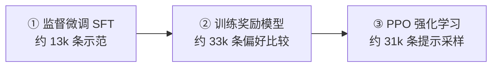
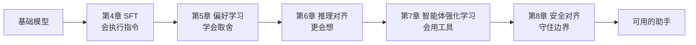
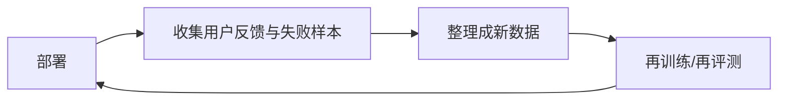

# 1. 模型对齐（Alignment）——从基础模型到对话助手

> **读之前**：完成第一部分即可（至少读到第 13 章，理解语言模型的基本训练流程）。你不需要机器学习背景，但要知道"模型是一个预测下一个词元的网络"。
>
> **读完你能做到**：分清基础模型、指令模型与对齐模型；用自己的话解释 SFT、奖励模型、PPO 各自在做什么；知道后面第 4～8 章分别解决哪类问题。

第一部分我们从零训练了一个小型语言模型：它会预测下一个词元（Token），能续写文本，但还不是一个稳定的助手。第二部分要回答的就是：**怎样把"文本补全器"变成"能听指令、符合偏好、守住安全边界的助手"？**

先说明一件容易混淆的事：**本部分的实验会换基座。** 第一部分的 nanoGPT 用来理解模型结构和预训练闭环；从实验 1.1 起改用公开的 Qwen2.5 权重，后续微调也从章节指定的公开基座开始，**不是继续训练你手里的 nanoGPT**。两者建模思路相同，但模型实现、词表、权重和对话格式不能直接互换。

**本部分怎么读**：

- 第 1 章建立全局地图；第 2、3 章补数据基础；第 4～8 章是对齐的五步；第 9～12 章是支撑它们的工程体系；第 13 章总结。
- 每章开头有"读之前"和"读完你能做到"，结尾有"本章小结"和思考题；编号子章（1.1、4.2……）只做实践，概念回到正章查。
- 硬件要求见前言 P0.3；代码跑不通时，先按前言 P0.6 的顺序排查版本和依赖。

---

## 一、先看两种回答

假设我们有两个模型，都见过大量文本。给它们同一个请求：

```text
帮我写一封请假邮件。
```

**基础模型（Base Model）**可能这样续写：

```text
邮件（Email）是一种电子通信方式，起源于……它由以下几个部分组成……
```

它在"接着写一段关于邮件的文字"，而不是"帮你请假"。

**指令模型（Instruct Model）**则可能这样回答：

```text
好的，以下是一封请假邮件模板：

主题：请假申请（3 月 12 日）
正文：您好，我因发烧需请假一天，工作已交接给同事……
```

（以上是行为示意，不是固定实测输出。实验 1.1 会让你亲眼看到两种模型的差异。）

同一个请求，为什么一个在"讲邮件"，一个在"写邮件"？这不是模型突然变聪明了，而是**训练目标和使用方式变了**。

基础模型的训练任务是"给定前文，预测下一个词元"。它见过问答、对话和指令，所以用合适的提示（prompting）也能完成一些任务；但它的默认行为仍然是**续写**，指令跟随、角色保持、该停就停这些**行为**并不稳定。

指令模型则在此基础上又训练了一步：让它反复看到"用户提出请求 → 助手给出高质量回答"，于是"按助手方式回应"变成了更稳定的行为倾向。

> **一句话**：基础模型的能力是"原材料"，对齐做的是"把原材料加工成能稳定使用的助手"。

---

## 二、三个名字：Base、Instruct、Aligned

这三个词经常被混用，先把关系定清楚。

| | **基础模型（Base Model）** | **指令模型（Instruct Model）** |
|---|---|---|
| 训练到哪一步 | 只做完预训练（Pretraining） | 在基础模型之上继续做后训练（Post-training） |
| 训练信号 | 任意文本，每个位置预测下一个词元 | "指令 → 期望回答"，通常只对回答部分算损失 |
| 默认行为 | 文本续写 | 对话，需要对话模板（Chat Template）包裹角色 |
| 权重命名 | 通常没有后缀：`Qwen2.5-0.5B`、`gpt-2` | 常带后缀：`-Instruct`、`-chat`、`-it` |
| 与对方的关系 | 原材料 | 同一架构、同一参数规模，但**权重已经被继续训练过** |

几个名词顺手解释：

- **预训练（Pretraining）**：在海量原始文本上做自监督学习。标签不用人写，直接拿"下一个词元"当答案。第 2 章会展开三种学习范式。
- **后训练（Post-training）**：预训练之后所有训练阶段的统称。本书讲的监督微调（SFT）、偏好学习、推理对齐、安全对齐都属于后训练。
- **监督微调（Supervised Fine-Tuning, SFT）**：用成对的"指令 → 期望回答"示范继续训练，是后训练的第一阶段。第 4 章展开。
- **对话模板（Chat Template）**：把"角色 + 内容"的消息序列渲染成模型认识的文本格式。Qwen2.5 的样子是：

  ```text
  <|im_start|>user
  帮我写一封请假邮件。<|im_end|>
  <|im_start|>assistant
  ```

  训练和推理必须使用同一套模板，否则指令模型可能表现得又像基础模型。第 4 章会系统讲。
- **检查点（Checkpoint）**：训练过程中保存的权重快照。有了它，才能从别人的成果继续训练，而不必每次从头开始。

**怎么快速判断一份权重是哪一类？** 最省事的线索是名字后缀：`-Instruct`、`-chat`、`-it` 通常表示做过指令微调。但后缀只是线索，不是保证——具体还要看模型卡（model card）和训练数据。

还有一点容易误解：**两个版本的差异不等于"换个提示词"。** `Qwen2.5-0.5B` 和 `Qwen2.5-0.5B-Instruct` 架构、参数量、词表相同，但**权重不同**。实验 1.1 会专门验证这一点。

最后，**对齐模型（Aligned Model）是比指令模型更宽的概念**。对齐包含 SFT、偏好学习、推理对齐、安全对齐等一整族方法；指令模型只是"指令微调后"这一类产物。关系是：

> **对齐模型 ⊃ 指令模型**（Aligned Model ⊃ Instruct Model）

一个指令模型是对齐模型的一个实例；但以推理为主的 `DeepSeek-R1`、以安全为主的模型，不一定带 `-Instruct` 后缀，它们同样属于对齐模型。

---

## 三、对齐到底在优化什么

本书用**对齐（Alignment）**指：

> 让模型的实际行为更符合人类意图、偏好与安全约束的训练和评估工作。

这句话听起来抽象，拆开看只有两个关键词：**训练信号**和**代理指标**。

- **训练信号**：训练时真正被优化的那个量。预训练时是"下一个词元预测得准不准"，后训练时可能是"回答像不像示范""哪个回答更受偏好"。
- **代理指标（proxy metric）**：训练信号的具体数值形式，比如损失（Loss）或奖励分数。它只是人类期望的**近似**。

**把代理指标做好，不等于满足了人类期望。** 预训练损失降得很低，只说明模型很会猜下一个词元；不代表它会当助手。反过来，奖励分数很高，也不代表回答真的更有用。

再换到用户视角：预训练优化的是"下一个词元猜得准不准"，用户在意的是"回答有没有用、诚不诚实、安不安全"。两个目标有交集，但不等价。所以后训练要换数据、换条件、换参与计算损失的位置，而不是只把预训练多跑几遍。

打个比方：一个学识渊博的人，也得学会看提问者的需求来组织解释。对齐要改的正是这种**表达与行为方式**。

但对齐不只是"换个说法"。**SFT、偏好优化和推理训练都会更新参数，既可能带来新事实、新技能，也可能损伤已有能力。** 因此"能力"和"对齐"是两个分析角度，不能假设训练只动其中一个：

| | 能力（Capability） | 对齐（Alignment） |
|---|---|---|
| 回答的问题 | 模型"能不能做到"（知识、推理、代码） | 模型"愿不愿意、会不会按人的方式做" |
| 主要来自 | 预训练 | 预训练之后的训练 |
| 常见衡量 | MMLU、GSM8K 等能力基准 | 指令跟随、有帮助性、安全性 |
| 类比 | 一个人的学识 | 一个人的职业素养与表达习惯 |

表中的 MMLU 和 GSM8K 是两类常见基准（benchmark）：前者是覆盖数十个学科的多选题，后者是小学数学应用题，都在问"模型会不会做题"。第 12 章会讨论这类评测本身的局限。

---

## 四、InstructGPT：三步把补全器变成助手

2022 年的 InstructGPT 是这条流水线的代表性工作。它把"让模型听话"拆成三步：



**第一步：SFT。** 标注员针对请求写高质量回答，用这些"指令 → 回答"示范微调基础模型。论文中 SFT 用了约 13,000 条提示。做完这一步，模型已经能模仿助手的回答方式。

**第二步：训练奖励模型（Reward Model, RM）。** 对同一个提示，让模型生成多个回答，再由标注员排序：哪个更好？把"问题 + 回答"喂给奖励模型，让它学会给回答打分，使被偏好的回答分数更高。论文中用了约 33,000 条提示；每条提示可以产生多组比较，所以"提示数"不等于"比较对数"。

奖励模型学到的分数就是前面说的**代理指标**：它近似人类偏好，不是绝对真理。

**第三步：PPO 强化学习。** 用**近端策略优化（Proximal Policy Optimization, PPO）**按奖励分数更新生成模型。模型生成回答 → 奖励模型打分 → PPO 调整参数，让高分回答更可能出现。

这里还要加一项 **KL 散度惩罚**。KL 散度衡量两个概率分布的差异；惩罚项约束新模型不要偏离参考模型（通常是 SFT 模型）太远。为什么需要它？因为奖励模型只是个近似，如果模型拼命刷高分，可能把回答变得又长又怪——分数上去了，人却不满意。KL 惩罚能减轻这种"刷分"，但不能彻底杜绝。

论文里有一个常被引用的结果：在其用户提示分布和人工偏好评估下，标注员更偏好 1.3B 的 InstructGPT 回答，而不是 175B 的 GPT-3。这说明**模型规模和助手体验不是一回事**；但它不证明小模型在所有知识或推理任务上更强。

> **注意**：这是 2022 年的配方，不是今天的唯一做法。后面会看到 DPO 等更简单的方法。

---

## 五、HHH：好助手的三条标准

对齐要让模型变成什么样？Anthropic 提出的 **HHH** 框架被业界广泛采用：

| 维度 | 含义 | 反例 |
|---|---|---|
| **有帮助（Helpful）** | 真正完成任务，而不是回避或敷衍 | 问"怎么写请假邮件"，它讲邮件发展史 |
| **无害（Harmless）** | 不输出有害、违法、危险内容 | 问危险操作，它真的给出步骤 |
| **诚实（Honest）** | 不编造，承认不确定，不误导 | 不知道答案却一本正经地胡编 |

三个维度经常互相冲突：

- 太追求"有帮助"，可能伤害"无害"：有问必答，也包括危险问题；
- 太强调"无害"，容易变成"什么都拒绝"的过度防御；
- "诚实"要求承认不知道，但用户往往希望问题被解决。

**对齐工作的一大部分，就是在这些目标之间做权衡。** 后面会看到：SFT 主要让模型"会执行"，偏好学习细化"怎样算更有帮助"，安全对齐主要守住"无害"，推理对齐提升"真的会做"。

---

## 六、一张地图：后面五章分别在做什么



| 章节 | 解决什么问题 | 你会亲手做什么 |
|---|---|---|
| 第 4 章 SFT | 模型不稳定地听指令 | 构造对话模板和损失掩码，用 LoRA 微调一个小模型 |
| 第 5 章 偏好学习 | 多个回答之间不会取舍 | 训练奖励模型，用 DPO 做偏好优化 |
| 第 6 章 推理对齐 | 推理题正确率不够 | 观察推理模型与对话模型的差异，理解可验证奖励 |
| 第 7 章 Agentic RL | 多轮工具使用与长程任务 | 环境、轨迹与结果奖励 |
| 第 8 章 安全对齐 | 有害输出与越权风险 | 用 Llama Guard 搭一条输入/输出审核链路 |

**这个顺序是本书的讲解顺序，不是所有模型必须遵循的单向配方。** 实际训练中数据和目标可以混合、交替。比如 DeepSeek-R1 的流程是"冷启动 SFT → 推理 RL → 拒绝采样构造数据 → 再 SFT → 再 RL"，并不是简单地把五步各跑一遍。

先记住这五步各自解决什么问题就够了。方法名（DPO、GRPO、ORPO、SimPO……）会在对应章节出现，不需要现在背。

---

## 七、对齐不等于 RLHF，也不是一次训练

一个常见误解是"对齐 = RLHF"。实际上：

- **对齐是目标**：让模型行为符合人类意图。
- **RLHF 是手段之一**：用人类反馈训练奖励模型，再用强化学习优化。
- 此外还有 SFT、DPO、宪法式 AI、安全训练等方法。

另一个误解是"对齐训练一次就结束"。真实产品是一个循环：



用户使用产生反馈，反馈变成训练数据，模型变好又吸引更多使用。这就是**数据飞轮（data flywheel）**。它也是为什么现代对齐强调"上线只是开始"。

> **工程视角**：ChatGPT 的体验不只来自模型架构，还来自后训练、反馈数据和产品工程。预训练能力和后训练质量都重要，不是"规模"被"对齐"取代了。

---

## 本章实验

- [1.1 基础模型（Base Model）与指令模型（Instruct Model）的输出行为对比](<./1.1%20基础模型（Base%20Model）与指令模型（Instruct%20Model）的输出行为对比.md>)：用同一句提示分别喂给 `Qwen2.5-0.5B` 和 `Qwen2.5-0.5B-Instruct`，观察续写与对话的差异，再验证对话模板的作用。

## 本章小结

- 基础模型只做完预训练，默认行为是续写；指令模型在其权重上继续训练，默认行为是对话；对齐模型是更宽的概念，包含指令模型。
- 对齐优化的是"行为是否符合人类期望"，代理指标（Loss、奖励分数）只是近似，做好指标不等于对齐成功。
- InstructGPT 的三步是 SFT → 奖励模型 → PPO（带 KL 惩罚）；这是代表性配方，不是唯一做法。
- HHH（有帮助、无害、诚实）经常互相冲突，对齐工作的一大部分是做权衡。
- 第 4～8 章分别解决"会执行、会取舍、更会想、会用工具、守边界"，顺序是讲解顺序，不是固定配方。

> **一句话记住本章**：预训练给能力，后训练给行为；能力与对齐要分别评估。

## 下一章预告

在进入具体微调之前，先回答一个更基础的问题：预训练和 SFT 都可以用"预测下一个词元"的交叉熵，为什么一个能从原始文本自动构造标签，另一个需要人写期望回答？

> **第 2 章 三种学习范式（Learning Paradigms）——监督学习、无监督学习与自监督学习**

---

## 思考题

1. 用自己的话解释 Base Model 与 Instruct Model 的区别。只看输出，你会用哪三个特征区分它们？
2. 在预训练数据里加入高质量对话，可能改善哪些行为？为什么仍不能保证模型稳定地听指令、保持诚实和安全？
3. 一个只做过 SFT、没做过偏好学习的模型，用户最可能抱怨什么？为什么？

---

## 参考资料

- OpenAI《Training language models to follow instructions with human feedback》（InstructGPT）：https://arxiv.org/abs/2203.02155
- Anthropic《Training a Helpful and Harmless Assistant with Reinforcement Learning from Human Feedback》（HHH）：https://arxiv.org/abs/2204.05862
- Andrej Karpathy《State of GPT》（预训练 → SFT → RLHF 全链路）：https://www.youtube.com/watch?v=bZQun8Y4L2A
- 李宏毅《ChatGPT 原理》（中文入门）：https://www.bilibili.com/video/BV1Ns4y1p7hW
- HuggingFace《Alignment Handbook》（动手代码）：https://github.com/huggingface/alignment-handbook

---

## 附录：对齐方法速查（读到后面再回来看）

| 方法 | 核心思想 | 所属阶段 |
|---|---|---|
| 监督微调（SFT） | 直接模仿示范 | 基础 |
| RLHF / PPO | 奖励模型打分 + 强化学习 | 偏好学习 |
| DPO | 用模型自身概率构造偏好损失，免去显式奖励模型 | 偏好学习 |
| ORPO | SFT 项 + 优势比偏好项，无需独立参考模型 | 偏好学习 |
| SimPO | 长度归一化对数概率 + 奖励间隔 | 偏好学习 |
| GRPO | 组内相对奖励，免去价值模型 | 偏好学习 / 推理 |
| RLAIF / 宪法式 AI | 用 AI 反馈或原则替代部分人工标注 | 偏好学习 / 安全 |
| 过程监督（Process Supervision） | 监督推理过程的每一步 | 推理 |
| 安全训练（Safety Training） | 红队、护栏、安全分类器 | 安全 |

现在不需要记住这张表。等第 5、6、7 章讲到对应方法时，再回来对照即可。
