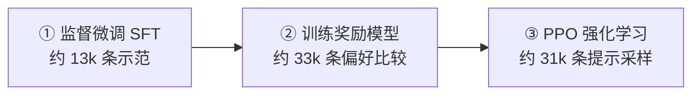
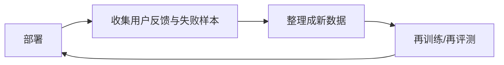

# 1. 模型对齐（Alignment）——从基础模型到对话助手

> **读之前**：完成第一部分即可（至少读到第 13 章，理解语言模型的基本训练流程）。你不需要机器学习背景，但要知道“模型是一个预测下一个词元的网络”。
>
> **读完你能做到**：分清基础模型、指令模型与对齐模型；说清对齐目标、奖励/监督信号、训练范式和优化算法四层关系；知道第 4～8 章分别解决哪类问题；看到一个新方法时，能判断它属于“奖励设计”还是“参数更新算法”。

第一部分我们从零训练了一个小型语言模型：它会预测下一个词元（Token），能续写文本，但还不是一个稳定的助手。第二部分要回答的是：

> **怎样把“文本补全器”变成“能听指令、符合偏好、守住安全边界的助手”？**

**本部分的实验会更换基座。** 第一部分的 nanoGPT 用来理解模型结构和预训练闭环；从实验 1.1 起改用公开的 Qwen2.5 权重，后续微调也从章节指定的公开基座开始，**不是继续训练第一部分得到的 nanoGPT**。两者建模思路相同，但模型实现、词表、权重和对话格式不能直接互换。

本部分的主线是：

- 第 1 章建立全局地图；
- 第 2、3 章补数据与学习范式；
- 第 4～8 章讲后训练的几类任务；
- 第 9～13 章讲支撑它们的训练、推理与评测工程；
- 第 14 章总结。

编号子章（1.1、4.2 等）只做实践，概念回到正章查。硬件要求见前言 P0.3；代码跑不通时，先按 P0.6 排查版本和依赖。

---

## 一、两种回答的行为差异

假设有两个模型，都见过大量文本。给它们同一个请求：

```text
帮我写一封请假邮件。
```

**基础模型（Base Model）** 可能这样续写：

```text
邮件（Email）是一种电子通信方式，起源于……它由以下几个部分组成……
```

它在“接着写一段关于邮件的文字”，而不是“帮你请假”。

**指令模型（Instruct Model）** 则可能这样回答：

```text
好的，以下是一封请假邮件模板：

主题：请假申请（3 月 12 日）
正文：您好，我因发烧需请假一天，工作已交接给同事……
```

（以上是行为示意，不是固定实测输出。实验 1.1 会用 2×2 对照和 8 个任务，把两种模型的差异变成逐题通过数。）

同一个请求，为什么一个在“讲邮件”，一个在“写邮件”？这不是模型突然变聪明了，而是**训练目标和使用方式变了**。

基础模型的训练任务是“给定前文，预测下一个词元”。它见过问答、对话和指令，所以用合适的提示也能完成一些任务；但它的默认行为仍然是**续写**，指令跟随、角色保持、该停就停这些行为并不稳定。

指令模型则在此基础上又训练了一步：让它反复看到“用户提出请求 → 助手给出高质量回答”，于是“按助手方式回应”变成更稳定的行为倾向。

> **一句话**：基础模型的能力是“原材料”，后训练做的是“把原材料加工成能稳定使用的助手”。

---

## 二、模型命名与基础术语

### Base、Instruct、Aligned

| | 基础模型（Base Model） | 指令模型（Instruct Model） |
|---|---|---|
| 训练到哪一步 | 只做完预训练（Pretraining） | 在基础模型之上继续做后训练（Post-training） |
| 训练信号 | 任意文本，每个位置预测下一个词元 | “指令 → 期望回答”，通常只对回答部分算损失 |
| 默认行为 | 文本续写 | 对话，需要对话模板（Chat Template）包裹角色 |
| 权重命名 | 通常没有后缀：`Qwen2.5-1.5B`、`gpt-2` | 常带后缀：`-Instruct`、`-chat`、`-it` |
| 与对方的关系 | 原材料 | 同一架构、同一参数规模，但**权重已经被继续训练过**|

**对齐模型（Aligned Model）是比指令模型更宽的概念。** 对齐包含 SFT、偏好学习、推理对齐、安全对齐等一整族方法；指令模型只是“指令微调后”这一类产物：

> **对齐模型包含指令模型：指令模型是对齐模型的一个子集。**

以推理为主的 DeepSeek-R1、以安全为主的模型，不一定带 `-Instruct` 后缀，但它们同样属于对齐模型。

### 四个基础术语

- **预训练（Pretraining）**：在海量原始文本上做自监督学习。标签不用人写，直接拿“下一个词元”当答案。第 2 章会展开三种学习范式。
- **后训练（Post-training）**：预训练之后所有训练阶段的统称。SFT、偏好学习、推理对齐、安全对齐都属于后训练。
- **监督微调（Supervised Fine-Tuning, SFT）**：用“指令 → 期望回答”示范继续训练，是后训练的第一阶段。第 4 章展开。
- **检查点（Checkpoint）**：训练过程中保存的权重快照。有了它，才能从别人的成果继续训练，而不必每次从头开始。

对话模板（Chat Template）把“角色 + 内容”的消息序列渲染成模型认识的文本格式。训练和推理必须使用同一套模板，否则指令模型可能表现得又像基础模型。第 4 章会系统讲。

**怎么快速判断一份权重是哪一类？** 最省事的线索是名字后缀：`-Instruct`、`-chat`、`-it` 通常表示做过指令微调。但后缀只是线索，不是保证——具体还要看模型卡（model card）和训练数据。

还有一点容易误解：**两个版本的差异不等于“换个提示词”。**`Qwen2.5-1.5B` 和 `Qwen2.5-1.5B-Instruct` 架构、参数量、词表相同，但权重不同。实验 1.1 会专门验证这一点。

---

## 三、对齐目标：能力与行为

本书用**对齐（Alignment）** 指：

> 让模型的实际行为更符合人类意图、偏好与安全约束的训练和评估工作。

这句话听起来抽象，拆开只有两个关键词：**训练信号** 和**代理指标**。

- **训练信号**：训练时真正被优化的量。预训练时是“下一个词元预测得准不准”，后训练时可能是“回答像不像示范”“哪个回答更受偏好”。
- **代理指标（proxy metric）**：训练信号的具体数值形式，比如损失（Loss）或奖励分数。它只是人类期望的**近似**。

**把代理指标做好，不等于满足了人类期望。** 预训练损失降得很低，只说明模型很会猜下一个词元；不代表它会当助手。反过来，奖励分数很高，也不代表回答真的更有用。

### 能力与对齐的区别与相互影响

| | 能力（Capability） | 对齐（Alignment） |
|---|---|---|
| 回答的问题 | 模型“能不能做到”（知识、推理、代码） | 模型“愿不愿意、会不会按人的方式做” |
| 主要来源 | 预训练 | 预训练之后的训练与系统约束 |
| 常见衡量 | MMLU、GSM8K 等能力基准 | 指令跟随、有帮助性、安全性、诚实性 |
| 类比 | 一个人的学识 | 一个人的职业素养与表达习惯 |

但对齐不只是“换个说法”。**SFT、偏好优化和推理训练都会更新参数，既可能带来新事实、新技能，也可能损伤已有能力。** 因此“能力”和“对齐”是两个分析角度，不能假设训练只动其中一个。

表中的 MMLU 和 GSM8K 是两类常见基准（benchmark）：前者覆盖数十个学科的多选题，后者是小学数学应用题，都在问“模型会不会做题”。第 13 章会讨论这类评测本身的局限。

### 对齐税（Alignment Tax）

对齐训练可能让模型“更听话”，但也可能让某些基础能力回退：代码、数学、长文写作或少数语言的表现下降。这种“为了对齐付出的能力代价”常被称为**对齐税（Alignment Tax）**。

它不是必然规律，也不是“对齐一定降智”。是否出现、出现多少，取决于：

- 对齐数据是否覆盖目标任务，是否过度集中在短问答；
- 是否只用 SFT 覆盖了原有能力，是否混入预训练/指令回放数据；
- 偏好目标是否奖励了长度、格式或迎合，而牺牲事实性；
- KL/正则是否过强，训练是否过拟合；
- 评测是否只看安全指标，没有回归测试原能力。

因此，后训练不能只报“安全分上升”，还要在同一基座、同一评测协议下报告**能力回归**。缓解手段包括数据混合、经验回放（replay）、KL 约束、早停和分阶段训练；没有一种能保证零退化。

### HHH：好助手的三条标准

Anthropic 提出的 **HHH** 框架被业界广泛采用：

| 维度 | 含义 | 反例 |
|---|---|---|
| **有帮助（Helpful）**| 真正完成任务，而不是回避或敷衍 | 问“怎么写请假邮件”，它讲邮件发展史 |
| **无害（Harmless）**| 不输出有害、违法、危险内容 | 问危险操作，它真的给出步骤 |
| **诚实（Honest）**| 不编造，承认不确定，不误导 | 不知道答案却一本正经地胡编 |

三个维度经常互相冲突：

- 太追求“有帮助”，可能伤害“无害”：有问必答，也包括危险问题；
- 太强调“无害”，容易变成“什么都拒绝”的过度防御；
- “诚实”要求承认不知道，但用户往往希望问题被解决。

**对齐工作的一大部分，就是在这些目标之间做权衡。** 后面会看到：SFT 主要让模型“会执行”，偏好学习细化“怎样算更有帮助”，安全对齐主要守住“无害”，推理对齐提升“真的会做”。

---

## 四、目标、奖励、范式与算法四层框架

后训练的方法很多，但先分清四层，后面的章节就不会缠在一起：

| 层次 | 回答什么 | 例子 | 不是什么 |
|---|---|---|---|
| **对齐目标**| 希望模型最终表现出什么行为 | 有用、诚实、无害；推理正确；任务完成 | 不是一个损失函数或某个模型 |
| **奖励/监督信号**| 用什么信号判断“好” | 示范答案、成对偏好、规则验证器、环境终态 | 不是对齐目标本身 |
| **训练范式**| 用什么数据与流程组织训练 | SFT、RLHF、RLVR、DPO、知识蒸馏 | 不是某个优化器 |
| **优化算法/损失**| 参数具体怎么更新 | 交叉熵、PPO、GRPO | 不是奖励来源，也不是目标 |

把四层对应到后面几章：

| 章节 | 对齐目标 | 主要信号 | 代表方法 | 是不是 RL |
|---|---|---|---|---|
| 第 4 章 SFT | 学会按示范执行指令 | 指令—回答示范 | 交叉熵 | **不是**|
| 第 5 章 偏好学习 | 回答更符合偏好 | 成对偏好、奖励模型 | RLHF、PPO、DPO、GRPO | **部分是**|
| 第 6 章 推理对齐 | 推理任务答对、格式可控 | 可验证答案、过程奖励 | RLVR + PPO/GRPO | **是**|
| 第 7 章 Agentic RL | 在环境里完成任务 | 环境终态、工具结果 | 轨迹级 PPO/GRPO | **是**|
| 第 8 章 安全对齐 | 降低有害输出与滥用风险 | 安全数据、分类器、红队信号 | SFT、偏好训练、护栏 | 部分是 |

> **这个顺序是本书的讲解顺序，不是所有模型必须遵循的单向配方。** 实际训练中数据和目标可以混合、交替。比如 DeepSeek-R1 的流程是“冷启动 SFT → 推理 RL → 拒绝采样构造数据 → 再 SFT → 再 RL”，并不是简单地把五步各跑一遍。

这张表也解释了为什么 GRPO 会在第 5、6、7 章重复出现：

> **算法可以复用，奖励来源和问题设置不同。**

- 第 5 章问“哪个回答更符合偏好”；
- 第 6 章问“答案是否正确”；
- 第 7 章问“任务是否在环境里完成”。

---

## 五、奖励与监督信号：现有技术分类

奖励设计不是“随便写一个打分函数”。不同信号的成本、密度和失败模式不同。

| 信号 | 怎么来 | 代表方法 | 主要局限 |
|---|---|---|---|
| 示范（demonstration） | 人工或强模型写出期望回答 | SFT | 只教“像不像”，不直接表达偏好 |
| 成对偏好（pairwise preference） | 人对两个回答排序 | RLHF、DPO、GRPO | 标注贵，存在长度/风格偏差 |
| AI 反馈（AI feedback） | 模型裁判、批评与修订 | RLAIF、Constitutional AI | 继承裁判模型的偏好与错误 |
| 可验证结果（verifiable reward） | 答案比对、单元测试、证明检查 | RLVR | 只适用于结果可判定的任务 |
| 过程奖励（process reward） | 步骤标签、Monte Carlo 估计 | PRM | 标注贵，步骤标准主观 |
| 环境终态（environment reward） | 工具结果、任务成功/失败 | Agentic RL | 稀疏、昂贵，可能有环境噪声 |
| 校准置信度（calibrated confidence） | 决策正确率与置信度是否一致 | RLCD（新兴） | 公开细节有限，尚非主线 |
| 格式/长度约束 | 规则检查、长度惩罚 | format reward、length penalty | 容易挤压内容质量 |

### 人类或模型给出的信号

- **示范**：直接给“应该怎么答”。SFT 用它，优点是稳定、易实现；缺点是不告诉模型“两个都不错时选哪个”。
- **成对偏好**：给 chosen / rejected。奖励模型（Reward Model, RM）就是把这类数据学成一个打分器。RM 是代理指标，不是对齐目标，也可能被刷分。
- **AI 反馈**：用模型裁判或原则化批评替代部分人工标注，成本低、可扩展，但会把裁判模型的偏见一起学进去。

### 程序化信号

- **可验证奖励（RLVR）**：奖励来自规则验证器，不需要偏好奖励模型。数学题比对答案、代码跑测试、证明交给检查器，都属于这一类。
- **过程奖励（PRM）**：给推理的中间步骤打分，缓解“只看最后答案”的稀疏性。代价是步骤标注或 Monte Carlo 估计很贵，而且模型可能迎合 PRM。
- **环境终态**：在 Agent 任务里，奖励来自工具结果或任务是否完成，而不是某段文本的分数。

RLVR 适合“结果可判定”的任务，因此能低成本扩展；它不适用于没有可靠验证器的开放写作、主观建议和长尾任务。**验证器是规则程序，RM 是学习出来的打分器，两者不是一回事。**

### 辅助信号

- **校准置信度（RLCD）**：让模型说“0.9”时，实际正确率真的接近 90%。这是 2026 年出现的新兴决策校准范式，公开细节有限，暂不作为本书主线。
- **格式/长度约束**：JSON 能否解析、回答是否超长。它们适合作辅助项，不应替代“内容是否正确”的主奖励，否则模型会学会“格式漂亮但内容空”。

---

## 六、训练范式与优化算法

### 常见训练范式

| 范式 | 信号来源 | 是否在线 | 典型算法 | 备注 |
|---|---|---|---|---|
| SFT | 示范 | 否 | 交叉熵 | 监督学习，不是 RL |
| RLHF | 人类偏好 → 奖励模型 | 是 | PPO、GRPO | 经典 InstructGPT 路线 |
| RLAIF | AI 反馈 / 原则 | 通常是 | PPO、GRPO | Constitutional AI 常用 |
| RLVR | 规则验证器 | 是 | PPO、GRPO | 推理任务主线 |
| RLCD | 校准置信度 | 是 | 未公开细节 | 决策模型的新兴范式 |
| DPO 家族 | 成对偏好 | 否 | DPO、IPO、ORPO、SimPO、KTO | 离线偏好优化，**不是 RL**|
| 知识蒸馏 | 教师分布/文本 | 否 | CE、KL | 监督式分布对齐 |

几个容易混的缩写：

- **RLHF（Reinforcement Learning from Human Feedback，基于人类反馈的强化学习）**：用人类偏好训练奖励模型，再用 PPO/GRPO 优化策略。广义上也可指“SFT → 奖励模型 → RL”的整套流程；本书说 RLHF 时，通常指“奖励来自人类偏好”的这一支。
- **RLVR（Reinforcement Learning with Verifiable Rewards，可验证奖励强化学习）**：奖励来自规则验证器，不需要人类偏好奖励模型。
- **RLAIF（Reinforcement Learning from AI Feedback，基于 AI 反馈的强化学习）**：奖励或偏好标签来自模型裁判/原则批评，而不是人工逐对标注；它仍可能继承裁判偏差。
- **RLCD（Reinforcement Learning for Calibrated Decisions，面向校准决策的强化学习）**：奖励目标是“置信度与实际正确率对齐”，不是人类偏好或答案验证。

### 常见优化算法/损失

| 方法 | 类型 | 需要什么 | 在线采样？ | 备注 |
|---|---|---|---|---|
| 交叉熵（CE） | 监督损失 | 示范标签 | 否 | SFT 的基础 |
| REINFORCE / 策略梯度 | 策略优化 | 奖励、baseline | 是 | 理解 PPO/GRPO 的基础 |
| PPO | 策略优化 | 奖励、critic、参考模型 | 是 | RLHF/RLVR/Agent 都能用 |
| GRPO | 策略优化 | 组内奖励，通常无 critic | 是 | 偏好/推理/Agent 都能用 |
| DPO | 偏好损失 | 成对偏好、参考模型 | 否 | **不是 RL**|
| IPO / ORPO / SimPO / KTO | 偏好目标 | 成对或单边偏好 | 否 | DPO 的变体/替代 |
| 拒绝采样 / Best-of-N | 数据构造或推理时选择 | 验证器/RM | 否 | 不更新梯度，不算 RL 算法 |
| 知识蒸馏（KD） | 监督损失 | 教师分布/文本 | 否 | 第 4.3 节 |

### 新方法的三层归类

1. **奖励/监督信号从哪来？**
   示范、偏好、验证器、环境、过程奖励，还是校准置信度？

2. **它是训练范式还是优化算法？**
   RLHF、RLVR、RLCD 是范式/奖励来源；PPO、GRPO 是优化算法；DPO 是偏好损失。

3. **在线还是离线？需要哪些额外模型？**
   是否需要 critic、RM、参考模型、环境 rollout？

这样再看 Jev/RLCD、RLAIF、PRM、DPO 变体，就不会都挤在“强化学习”一个筐里。

---

## 七、InstructGPT：四层框架的实例

2022 年的 InstructGPT 是这条流水线的代表性工作。它把“让模型听话”拆成三步：



**第一步：SFT。** 标注员针对请求写高质量回答，用这些“指令 → 回答”示范微调基础模型。论文中 SFT 用了约 13,000 条提示。做完这一步，模型已经能模仿助手的回答方式。

**第二步：训练奖励模型（Reward Model, RM）。** 对同一个提示，让模型生成多个回答，再由标注员排序：哪个更好？把“问题 + 回答”喂给奖励模型，让它学会给回答打分，使被偏好的回答分数更高。论文中用了约 33,000 条提示；每条提示可以产生多组比较，所以“提示数”不等于“比较对数”。

奖励模型学到的分数就是前面说的**代理指标**：它近似人类偏好，不是绝对真理。

**第三步：PPO 强化学习。** 用**近端策略优化（Proximal Policy Optimization, PPO）** 按奖励分数更新生成模型。模型生成回答 → 奖励模型打分 → PPO 调整参数，让高分回答更可能出现。

这里还要加一项 **KL 散度惩罚**。KL 散度衡量两个概率分布的差异；惩罚项约束新模型不要偏离参考模型（通常是 SFT 模型）太远。为什么需要它？因为奖励模型只是近似，如果模型拼命刷高分，可能把回答变得又长又怪——分数上去了，人却不满意。KL 惩罚能减轻这种“刷分”，但不能彻底杜绝。

论文里有一个常被引用的结果：在其用户提示分布和人工偏好评估下，标注员更偏好 1.3B 的 InstructGPT 回答，而不是 175B 的 GPT-3。这说明**模型规模和助手体验不是一回事**；但它不证明小模型在所有知识或推理任务上更强。

> **注意**：这是 2022 年的配方，不是今天的唯一做法。后面会看到 DPO 等更简单的方法。

---

## 八、对齐的范畴与迭代过程

对齐与 RLHF 并不等价：

- **对齐是目标**：让模型行为符合人类意图。
- **RLHF 是手段之一**：用人类反馈训练奖励模型，再用强化学习优化。
- 此外还有 SFT、DPO、宪法式 AI、安全训练等方法。

另一个误解是“对齐训练一次就结束”。真实产品是一个循环：



用户使用产生反馈，反馈变成训练数据，模型变好又吸引更多使用。这就是**数据飞轮（data flywheel）**。它也是为什么现代对齐强调“上线只是开始”。

> **工程视角**：ChatGPT 的体验不只来自模型架构，还来自后训练、反馈数据和产品工程。预训练能力和后训练质量都重要，不是“规模”被“对齐”取代了。

---

## 本章实验

- [1.1 基础模型（Base Model）与指令模型（Instruct Model）的输出行为对比](<./1.1%20基础模型（Base%20Model）与指令模型（Instruct%20Model）的输出行为对比.md>)：用 `Qwen2.5-1.5B` 和 `Qwen2.5-1.5B-Instruct` 做 2×2 对照（原始文本 / 对话模板），再用 8 个协议任务统计通过数，观察后训练改变了哪些行为。

## 本章小结

- 基础模型只做完预训练，默认行为是续写；指令模型在其权重上继续训练，默认行为是对话；对齐模型是更宽的概念，包含指令模型。
- 对齐优化的是“行为是否符合人类期望”，代理指标（Loss、奖励分数）只是近似，做好指标不等于对齐成功。
- 对齐可能带来“对齐税”：安全/偏好提升的同时，代码、数学或长尾能力可能回退；要单独做能力回归评测。
- 对齐技术要分四层看：目标、奖励/监督信号、训练范式、优化算法/损失。
- SFT 不是 RL；RLHF/RLVR 是奖励来源或训练范式；PPO/GRPO 是优化算法；DPO 是离线偏好损失，不是 RL。
- InstructGPT 的三步是 SFT → 奖励模型 → PPO（带 KL 惩罚）；这是代表性配方，不是唯一做法。
- HHH（有帮助、无害、诚实）经常互相冲突，对齐工作的一大部分是做权衡。
- 第 4～8 章分别解决“会执行、会取舍、更会想、会用工具、守边界”，顺序是讲解顺序，不是固定配方。

> **一句话记住本章**：预训练给能力，后训练给行为；能力与对齐要分别评估，奖励、范式、算法要分开看。

## 下一章预告

在进入具体微调之前，先回答一个更基础的问题：预训练和 SFT 都可以用“预测下一个词元”的交叉熵，为什么一个能从原始文本自动构造标签，另一个需要人写期望回答？

> **第 2 章 三种学习范式（Learning Paradigms）——监督学习、无监督学习与自监督学习**

---

## 思考题

1. 用自己的话解释 Base Model 与 Instruct Model 的区别。只看输出，你会用哪三个特征区分它们？
2. 把 GRPO、RLHF、DPO、RLVR 分别归入“奖励来源 / 训练范式 / 优化算法”，并说明理由。
3. 为什么奖励模型分数很高，不代表对齐成功？举一个奖励劫持的例子。
4. 一个只做过 SFT、没做过偏好学习的模型，用户最可能抱怨什么？为什么？

---

## 参考资料

- OpenAI《Training language models to follow instructions with human feedback》（InstructGPT）：https://arxiv.org/abs/2203.02155
- Anthropic《Training a Helpful and Harmless Assistant with Reinforcement Learning from Human Feedback》（HHH）：https://arxiv.org/abs/2204.05862
- Andrej Karpathy《State of GPT》（预训练 → SFT → RLHF 全链路）：https://www.youtube.com/watch?v=bZQun8Y4L2A
- 李宏毅《ChatGPT 原理》（中文入门）：https://www.bilibili.com/video/BV1Ns4y1p7hW
- HuggingFace《Alignment Handbook》（动手代码）：https://github.com/huggingface/alignment-handbook
