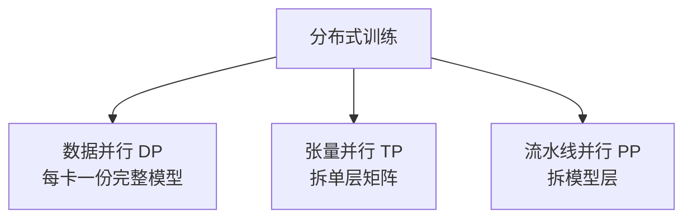
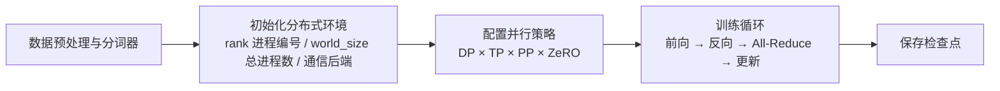

# 10. 大模型训练栈（LLM Training Stack）——现代大模型训练工程

> **读之前**：读完第 9 章，知道参数、梯度、优化器状态和激活值都占显存。
>
> **读完你能做到**：算清一个模型训练需要多少显存；说清数据并行、张量并行、流水线并行各拆什么；理解 ZeRO 三个阶段分别在省什么；知道混合精度、梯度检查点和梯度累积的取舍。

---

## 一、单卡为什么装不下

第 9 章算过一笔账：70B 参数模型，按 BF16 参数 + BF16 梯度 + FP32 主权重与 Adam 状态估算，仅模型状态就约 **1.12 TB**，还没算激活和临时缓冲。

单张 80 GB 的 A100/H100 装不下；即使换更大的卡，也仍然需要把训练拆开。所以第一个工程问题是：

> **如何把一个模型拆分到多张 GPU 上协同训练？**

答案有三个维度：拆数据、拆层、拆层内矩阵。

---

## 二、三种并行：拆什么

| 并行方式 | 拆的对象 | 一句话 | 代价 |
|---|---|---|---|
| 数据并行（Data Parallel, DP） | 数据 | 每张卡保存完整模型，处理不同数据 | 每卡都要装下完整模型 |
| 张量并行（Tensor Parallel, TP） | 单层内的矩阵 | 把一次矩阵乘法拆到多张卡上算 | 层内通信频繁 |
| 流水线并行（Pipeline Parallel, PP） | 模型的层 | 不同层放不同卡，像流水线 | 有等待（气泡），调度复杂 |

### 数据并行

最直观：N 张卡各自拿一份完整模型，分别处理不同数据切片；每个训练步结束时，用**全归约（All-Reduce）**把各卡梯度求和取平均，再各自更新。

可以想成 N 个厨师各拿一本完整菜谱，做不同的菜；做完后互相通报"我这边的调味经验"，再统一调整。

优点是实现简单、扩展性好；缺点是**每张卡都要装下完整模型**。70B 模型仅模型状态就超过单卡显存，所以数据并行必须和模型并行配合。

### 张量并行

把一层里的矩阵切开。例如 `Y = XW`，可以按列切 `W`，每张卡算一部分输出，再组合结果。

这就像一道菜有切菜、配料、炒制几道工序，几个人同时做不同部分，但需要频繁交接。

由于层内通信频繁，张量并行组通常优先放在高速互联（如 NVLink）内，但也可以跨机部署，取决于带宽和规模。

### 流水线并行

按层分段：第 1～10 层放卡 A，第 11～20 层放卡 B……前向在段边界传激活，反向还要传激活梯度。

这就像流水线：A 做完传给 B，B 做完传给 C。为了避免 B 等 A，会把一个批次拆成多个微批次（micro-batch），让 A 在处理下一个微批次时，B 还在处理上一个。

但流水线启动和排空时，总有一些阶段在等待，这部分空闲叫**气泡（Bubble）**。气泡比例取决于阶段数、微批次数量和调度方式，不是固定值。

### 三维并行

把三者组合：模型按层分段（PP），段内做矩阵切分（TP），不同模型副本组处理不同数据（DP）。

不是每个任务都要同时开三个维度：小模型可能只需要 DP 或 ZeRO，大模型还可能加入上下文并行、专家并行。

---

## 三、ZeRO：把重复的状态切掉

数据并行有一个巨大浪费：**每张卡都保存一份完整的参数、梯度、优化器状态**。64 张卡就是 64 份。

**零冗余优化器（Zero Redundancy Optimizer, ZeRO，微软 2020）**的核心思想：把这些重复内容**切分**到不同卡上，每张卡只保存 1/N，需要时再通信取回。

可以想成：每个厨师不再各带一整套工具，而是把工具分给不同的人，谁用谁借。

ZeRO 分三个阶段，逐级切分：

| 策略 | 切分的内容 | 每卡字节数 | 4 卡、1B 参数模型的每卡小计 |
|---|---|---|---|
| 普通 DP | 不切分 | \(16P\) | 16 GB |
| ZeRO-1 | FP32 主权重与 Adam 状态 | \(4P+12P/N\) | 7 GB |
| ZeRO-2 | 再切分梯度 | \(2P+14P/N\) | 5.5 GB |
| ZeRO-3 | 再切分参数 | \(16P/N\) | 4 GB |

表中 \(P\) 是参数数目，\(N\) 是数据并行组卡数。以 1B 参数、4 卡为例：

- 普通 DP：每卡 `16 × 1e9 = 16 GB`；
- ZeRO-1：每卡 `4 + 12/4 = 7 GB`；
- ZeRO-2：每卡 `2 + 14/4 = 5.5 GB`；
- ZeRO-3：每卡 `16/4 = 4 GB`。

几点边界：

- 这些数字只算**持久模型状态**，不含激活、临时通信缓冲和预取；
- ZeRO-3 在前向/反向时还要临时聚合参数，运行峰值高于 \(16P/N\)；
- 卡数越多，切分收益越大，但通信也越多；
- **ZeRO 不是张量并行**：它仍然让每张卡处理不同数据，只是把冗余存储改成共享分片；
- \(N=1\) 时三条公式都回到 \(16P\)，没有跨卡收益。

**CPU 卸载（Offload）**是另一条轴：把优化器状态或参数放到主机内存，用 PCIe（主机与 GPU 之间的总线）换显存。单卡也能获益，但 GPU 仍要算参数、激活和传输缓冲，不会"显存彻底解放"；速度通常也会变慢。

---

## 四、混合精度、梯度检查点、梯度累积

除了并行，还有三个几乎所有训练脚本都会用到的技巧。

**混合精度训练（Mixed Precision / AMP）**：让矩阵乘法用 FP16/BF16，同时在敏感路径保留更高精度。

- FP16/BF16 每个数占 2 字节，FP32 占 4 字节，所以低精度张量能省一半空间；
- 但"低精度张量的字节数减半"不等于"整个训练峰值显存减半"，也不保证端到端快 2～4 倍；
- **FP32 主权重**的作用是：参数更新往往很小，如果直接在低精度权重上更新，可能被舍入掉；保留一份 FP32 主权重，更新完再转回低精度；
- BF16 动态范围大，通常不需要 loss scaling（放大损失以避免梯度下溢）；FP16 范围小，常需要缩放梯度。

**梯度检查点（Gradient Checkpointing）**：只保存部分激活，反向传播时重算其余激活。

- 省显存，但多花计算；
- 节省比例和时间代价取决于检查点粒度、序列长度和模型，没有固定百分比；
- 调用 `gradient_checkpointing_enable()` 后，要确认模型处于 `train()` 模式，且反向路径真的生效。

**梯度累积（Gradient Accumulation）**：一次处理多个微批次，累积梯度，到更新边界再更新一次参数。

- 目的：用小显存模拟大批次；
- 纯 DP/ZeRO 下，`有效批次 = 微批次 × 累积步数 × 数据并行卡数`；
- 只有正确处理损失归一化、有效词元数和更新频率，才接近真正的大批次；随机层和浮点归约仍可能带来差异。

---

## 五、通信与框架

分布式训练的本质是"算 + 通信"交替。最常用的通信原语：

- **全归约（All-Reduce）**：各卡把自己的梯度贡献出去，最后每卡都拿到全局梯度之和；
- **全收集 / 归约-散射（All-Gather / Reduce-Scatter）**：ZeRO 取回和分发参数时使用。

这些原语由 NVIDIA 集合通信库（NCCL）在 NVLink/InfiniBand（GPU 间高速互联）上实现。通信库的性能直接决定扩展效率。

| 框架 | 出品方 | 定位 |
|---|---|---|
| Megatron-LM | NVIDIA | 张量并行/流水线并行的代表性实现 |
| DeepSpeed | 微软 | ZeRO 的发明者，Stage 1～3 + Offload |
| Accelerate | HuggingFace | 轻量封装，一份代码在单卡/多卡/多机间切换 |
| FSDP | PyTorch 官方 | 完全分片数据并行，现代微调常用 |
| Colossal-AI / veScale | 社区 | 更大规模训练的探索（序列并行、异构并行等） |

**一次大规模训练的启动流程**：

**检查点容易被忽视**：分布式训练动辄数天，一张卡故障就可能毁掉全部进度。要么频繁保存全量检查点（几十 GB 到 TB 级），要么用异步保存 + 定期重启，要么用第三部分 7.2 讲的断点恢复思想。**训练系统首先得可靠，其次才是快。**

> **延伸：TPU 生态**。Google 的 TPU 是另一条路线：PaLM 540B 用 6144 块 TPU v4 训练，软件栈围绕 XLA 编译器 + JAX + ICI 互联。理念差异是"谁来做分片"——GPU 阵营用 Megatron/DeepSpeed 显式配置，TPU 阵营更倾向"写单设备逻辑，让编译器自动分片"。显存账本和并行思想是通用的。

---

## 本章对应的实验

- [10.1 使用 Accelerate 与 DeepSpeed 配置分布式训练——零冗余优化器（ZeRO）实战](<./10.1%20使用%20Accelerate%20与%20DeepSpeed%20配置分布式训练——零冗余优化器（ZeRO）实战.md>)：在单卡上对比基线、梯度检查点、ZeRO-2 + CPU 卸载三种配置的显存与耗时；多卡才能验证真正的跨卡分片。

## 本章小结

- 70B 模型仅模型状态约 1.12 TB，单卡装不下，必须拆。
- 数据并行拆数据、张量并行拆单层矩阵、流水线并行拆层；三者可以组合。
- ZeRO 把重复的参数/梯度/优化器状态分片，分三个阶段；它省的是存储冗余，不是把计算变成张量并行。
- 混合精度省低精度张量的空间；梯度检查点用计算换显存；梯度累积用小批次模拟大批次。
- 通信（All-Reduce、All-Gather、Reduce-Scatter）决定扩展效率；检查点决定长任务能否恢复。
- 具体能省多少、快多少，取决于模型、硬件、网络和实现，必须实测。

> **一句话记住本章**：并行解决"装不下"，ZeRO 解决"重复存"，混合精度/检查点/累积解决"显存不够用"。

## 下一章预告

模型训练出来了，接下来要服务大量用户。推理系统和训练系统关心的问题完全不同：训练追求吞吐，推理还要关心每个请求的延迟。

> **第 11 章 大模型推理栈（LLM Inference Stack）——现代大模型推理工程**

---

## 思考题

1. 数据并行、张量并行、流水线并行各拆什么？各自的主要瓶颈是什么？
2. ZeRO-1/2/3 分别切分什么？为什么 ZeRO-3 的实际峰值高于 \(16P/N\)？
3. 梯度检查点省显存的代价是什么？什么情况下不值得用？
4. 为什么"混合精度训练"不等于"显存减半、速度翻倍"？

---

## 参考资料

- Rajbhandari et al.《ZeRO: Memory Optimizations Toward Training Trillion Parameter Models》：https://arxiv.org/abs/1910.02054
- Shoeybi et al.《Megatron-LM》：https://arxiv.org/abs/1909.08053
- Narayanan et al.《Efficient Large-Scale Language Model Training on GPU Clusters Using Megatron-LM》：https://arxiv.org/abs/2104.04473
- HuggingFace Accelerate 文档：https://huggingface.co/docs/accelerate/
- DeepSpeed 文档：https://www.deepspeed.ai/
