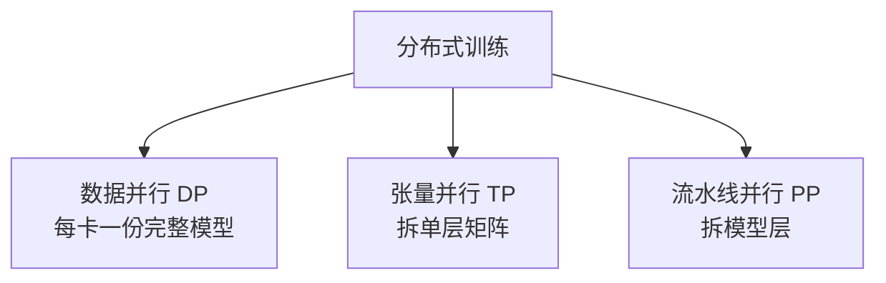
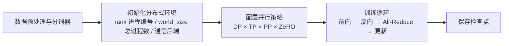

# 10. 大模型训练栈（LLM Training Stack）——现代大模型训练工程

> **读之前**：读完第 9 章，知道参数、梯度、优化器状态和激活值都占显存。
>
> **读完你能做到**：算清一个模型训练需要多少显存；说清数据并行、张量并行、流水线并行各拆什么；理解 ZeRO 三个阶段分别在省什么；知道混合精度、梯度检查点和梯度累积的取舍。

---

## 一、单卡显存瓶颈

第 9 章算过一笔账：70B 参数模型，按 BF16 参数 + BF16 梯度 + FP32 主权重与 Adam 状态估算，仅模型状态就约 **1.12 TB**，还没算激活和临时缓冲。

单张 80 GB 的 A100/H100 装不下；即使换更大的卡，也仍然需要把训练拆开。所以第一个工程问题是：

> **如何把一个模型拆分到多张 GPU 上协同训练？**

答案有三个维度：拆数据、拆层、拆层内矩阵。

---

## 二、三种并行的切分对象

| 并行方式 | 拆的对象 | 一句话 | 代价 |
|---|---|---|---|
| 数据并行（Data Parallel, DP） | 数据 | 每张卡保存完整模型，处理不同数据 | 每卡都要装下完整模型 |
| 张量并行（Tensor Parallel, TP） | 单层内的矩阵 | 把一次矩阵乘法拆到多张卡上算 | 层内通信频繁 |
| 流水线并行（Pipeline Parallel, PP） | 模型的层 | 不同层放不同卡，像流水线 | 有等待（气泡），调度复杂 |

### 数据并行

最直观：N 张卡各自拿一份完整模型，分别处理不同数据切片；每个训练步结束时，用**全归约（All-Reduce）** 把各卡梯度求和取平均，再各自更新。

可以想成 N 个厨师各拿一本完整菜谱，做不同的菜；做完后互相通报"我这边的调味经验"，再统一调整。

优点是实现简单、扩展性好；缺点是**每张卡都要装下完整模型状态**。70B 模型在本章账本下超过单卡显存，因此普通复制式数据并行需要结合状态分片（ZeRO/FSDP）、模型并行或卸载；不一定必须采用 TP/PP。

### 张量并行

把一层里的矩阵切开。例如 `Y = XW`，可以按列切 `W`，每张卡算一部分输出，再组合结果。

这就像一道菜有切菜、配料、炒制几道工序，几个人同时做不同部分，但需要频繁交接。

由于层内通信频繁，张量并行组通常优先放在高速互联（如 NVLink）内，但也可以跨机部署，取决于带宽和规模。

### 流水线并行

按层分段：第 1～10 层放卡 A，第 11～20 层放卡 B……前向在段边界传激活，反向还要传激活梯度。

这就像流水线：A 做完传给 B，B 做完传给 C。为了避免 B 等 A，会把一个批次拆成多个微批次（micro-batch），让 A 在处理下一个微批次时，B 还在处理上一个。

但流水线启动和排空时，总有一些阶段在等待，这部分空闲叫**气泡（Bubble）**。气泡比例取决于阶段数、微批次数量和调度方式，不是固定值。

### 三维并行

把三者组合：模型按层分段（PP），段内做矩阵切分（TP），不同模型副本组处理不同数据（DP）。

不是每个任务都要同时开三个维度：小模型可能只需要 DP 或 ZeRO，大模型还可能加入上下文并行、专家并行。

---

## 三、ZeRO：把重复的状态切掉

数据并行有一个巨大浪费：**每张卡都保存一份完整的参数、梯度、优化器状态**。64 张卡就是 64 份。

**零冗余优化器（Zero Redundancy Optimizer, ZeRO，微软 2020）** 的核心思想：把这些重复内容**切分** 到不同卡上，每张卡只保存 1/N，需要时再通信取回。

可以想成：每个厨师不再各带一整套工具，而是把工具分给不同的人，谁用谁借。

ZeRO 分三个阶段，逐级切分：

| 策略 | 切分的内容 | 每卡字节数 | 4 卡、1B 参数模型的每卡小计 |
|---|---|---|---|
| 普通 DP | 不切分 | $16P$ | 16 GB |
| ZeRO-1 | FP32 主权重与 Adam 状态 | $4P+12P/N$ | 7 GB |
| ZeRO-2 | 再切分梯度 | $2P+14P/N$ | 5.5 GB |
| ZeRO-3 | 再切分参数 | $16P/N$ | 4 GB |

表中 $P$ 是参数数目，$N$ 是数据并行组卡数。以 1B 参数、4 卡为例：

- 普通 DP：每卡 `16 × 1e9 = 16 GB`；
- ZeRO-1：每卡 `4 + 12/4 = 7 GB`；
- ZeRO-2：每卡 `2 + 14/4 = 5.5 GB`；
- ZeRO-3：每卡 `16/4 = 4 GB`。

几点边界：

- 这些数字只算**持久模型状态**，不含激活、临时通信缓冲和预取；
- ZeRO-3 在前向/反向时还要临时聚合参数，运行峰值高于 $16P/N$；
- 卡数越多，切分收益越大，但通信也越多；
- **ZeRO 不是张量并行**：它仍然让每张卡处理不同数据，只是把冗余存储改成共享分片；
- $N=1$ 时三条公式都回到 $16P$，没有跨卡收益。

**CPU 卸载（Offload）** 是另一条轴：把优化器状态或参数放到主机内存，用 PCIe（主机与 GPU 之间的总线）换显存。单卡也能获益，但 GPU 仍要算参数、激活和传输缓冲，不会"显存彻底解放"；速度通常也会变慢。

---

## 四、混合精度、梯度检查点、梯度累积

除了并行，还有三个几乎所有训练脚本都会用到的技巧。

**混合精度训练（Mixed Precision / AMP）**：让矩阵乘法用 FP16/BF16，同时在敏感路径保留更高精度。

- FP16/BF16 每个数占 2 字节，FP32 占 4 字节，所以低精度张量能省一半空间；
- 但"低精度张量的字节数减半"不等于"整个训练峰值显存减半"，也不保证端到端快 2～4 倍；
- **FP32 主权重** 的作用是：参数更新往往很小，如果直接在低精度权重上更新，可能被舍入掉；保留一份 FP32 主权重，更新完再转回低精度；
- BF16 动态范围大，通常不需要 loss scaling（放大损失以避免梯度下溢）；FP16 范围小，常需要缩放梯度。

**梯度检查点（Gradient Checkpointing）**：只保存部分激活，反向传播时重算其余激活。

- 省显存，但多花计算；
- 节省比例和时间代价取决于检查点粒度、序列长度和模型，没有固定百分比；
- 调用 `gradient_checkpointing_enable()` 后，要确认模型处于 `train()` 模式，且反向路径真的生效。

**梯度累积（Gradient Accumulation）**：一次处理多个微批次，累积梯度，到更新边界再更新一次参数。

- 目的：用小显存模拟大批次；
- 纯 DP/ZeRO 下，`有效批次 = 微批次 × 累积步数 × 数据并行卡数`；
- 只有正确处理损失归一化、有效词元数和更新频率，才接近真正的大批次；随机层和浮点归约仍可能带来差异。

---

### 激活显存与序列并行

模型状态之外，训练显存的大头是**激活值（activations）**：前向时每一层保存的中间张量，反向传播要用。它大致随以下量增长：

- batch 大小 $B$；
- 序列长度 $S$；
- 隐藏维度 $H$；
- 层数 $L$；
- 注意力头数与**注意力后端**：朴素 eager 注意力会物化约 $B\times H_{\text{heads}}\times S^2$ 个分数元素；FlashAttention/内存高效后端则避免完整物化这项。

MLP 中间激活约随 $B\times S\times H$ 增长；注意力是否出现 $S^2$ 的**存储项**取决于后端、mask 表示及是否返回注意力权重，不能给所有实现统一加一个完整分数矩阵。即使用 FlashAttention，稠密注意力的**计算量仍随 $S^2$ 增长**。梯度检查点（重算）用更多计算换显存；序列并行则把相关激活的**序列维**切到多卡上，让每张卡只保存一段。

**序列并行（Sequence Parallelism, SP）** 和 TP 不同：TP 切隐藏维/矩阵，SP 切序列维，主要用于 LayerNorm、Dropout、残差等逐位置操作，减少每卡的激活占用。它通常要和 TP 配合，并在需要完整序列的操作（如某些注意力实现）处做通信。SP 不是“免费省显存”：切得越碎，通信和内核调度越多。

> 估算激活显存时，先确认实际后端是否物化平方项，再决定用 FlashAttention、重算、SP/CP 还是缩短序列；不要把二次计算量直接当成二次存储量，也不要只按参数量估算。

## 五、通信与框架

分布式训练的本质是"算 + 通信"交替。最常用的通信原语：

- **全归约（All-Reduce）**：各卡把自己的梯度贡献出去，最后每卡都拿到全局梯度之和；
- **全收集（All-Gather）**：例如分片训练中临时聚合参数；
- **归约-散射（Reduce-Scatter）**：例如汇总各卡梯度并将结果按分片交给对应卡，不能与参数聚合混为一步。

这些原语由 NVIDIA 集合通信库（NCCL）在 NVLink/InfiniBand（GPU 间高速互联）上实现。通信库的性能直接决定扩展效率。

| 框架 | 出品方 | 定位 |
|---|---|---|
| Megatron-LM | NVIDIA | 张量并行/流水线并行的代表性实现 |
| DeepSpeed | 微软 | ZeRO 的发明者，Stage 1～3 + Offload |
| Accelerate | HuggingFace | 轻量封装，一份代码在单卡/多卡/多机间切换 |
| FSDP | PyTorch 官方 | 完全分片数据并行，现代微调常用 |
| Colossal-AI / veScale | 社区 | 更大规模训练的探索（序列并行、异构并行等） |

**一次大规模训练的启动流程**：

**检查点容易被忽视**：分布式训练动辄数天，一张卡故障就可能毁掉全部进度。要么频繁保存全量检查点（几十 GB 到 TB 级），要么用异步保存 + 定期重启，要么用第三部分 6.3 讲的断点恢复思想。**训练系统首先得可靠，其次才是快。**

> **延伸：TPU 生态**。Google 的 TPU 是另一条路线：PaLM 540B 用 6144 块 TPU v4 训练，软件栈围绕 XLA 编译器 + JAX + ICI 互联。理念差异是"谁来做分片"——GPU 阵营用 Megatron/DeepSpeed 显式配置，TPU 阵营更倾向"写单设备逻辑，让编译器自动分片"。显存账本和并行思想是通用的。

---

## 六、现代训练系统的扩展

前面讲的是 DP/TP/PP/ZeRO 这组经典积木。真正训练千亿级模型时，还会遇到四类扩展：参数分片、专家并行、长序列并行和低精度训练。它们的共同点是：**不是替代前面的并行，而是在某个瓶颈上再加一层切分或压缩。**

| 扩展 | 主要解决 | 代价 |
|---|---|---|
| FSDP / FSDP2 | 单卡装不下参数、梯度、优化器状态 | 前向/反向前后的 all-gather、reduce-scatter 通信 |
| 专家并行（EP） | MoE 总参数太大，单卡放不下所有专家 | all-to-all 路由通信、负载不均衡 |
| 上下文并行（CP） | 单条序列太长，激活和注意力显存爆掉 | 注意力的跨卡通信、长序列 kernel 复杂度 |
| FP8 训练 | 进一步降低矩阵乘和激活的带宽/算力成本 | 缩放、数值稳定性和硬件支持 |

### FSDP 与 FSDP2：把参数也分片

ZeRO-3 和 FSDP 都在做“参数分片”，但实现路径不同：

- **ZeRO-3 / DeepSpeed**：在数据并行组内切分参数、梯度和优化器状态；计算相应模块前聚合所需参数，反向后对梯度做 reduce-scatter；参数释放与预取由配置决定。
- **FSDP（Fully Sharded Data Parallel）**：PyTorch 原生实现，通过模块/参数分组控制通信；全分片策略通常在前向前 all-gather、前向后重新分片，反向前再聚合，反向后归约并分片梯度。不是只在前向聚合一次。
- **FSDP2**：基于 `DTensor` 的按参数分片，用 `fully_shard` 组合模块，优化器应在分片后用这些参数初始化；`reshard_after_forward` 决定前向后是否释放完整参数、反向是否需要重聚合。它不是“另一个 ZeRO 阶段”，而是 PyTorch 生态里更现代的 FSDP 实现，具体配置以对应版本文档为准。

FSDP 的收益不是“免费省显存”：通信量会上升，层数越多、切得越碎，all-gather 次数越多。它适合“单卡装不下完整模型状态”的场景；如果单卡已经装得下，DP/ZeRO-1 往往更简单。

### MoE 与专家并行：总参数和激活参数分开

MoE 层把 FFN 换成多个专家，每个词元只路由到 top-k 个专家：

- **总参数量** 决定权重显存；
- **激活参数量** 决定每词元的主要计算量；
- **专家并行（Expert Parallelism, EP）** 把不同专家放到不同卡上；路由后需要 all-to-all 把词元发给对应专家，再把结果收回来。

这带来两个经典问题：

1. **负载不均衡**：某些专家被大量词元选中，其他专家空闲；需要容量因子、负载均衡损失或辅助路由策略。
2. **通信放大**：all-to-all 的代价随专家数、序列长度和并行度增长；EP 不是“越多卡越快”。

MoE 的显存账本要同时看“总参数”和“每卡实际驻留的专家”。推理时如果所有专家常驻，显存仍受总参数约束；只有把专家卸载或按需加载，才可能进一步降低常驻显存。

### 上下文并行：把序列维切开

TP 切的是隐藏维度，PP 切的是层，CP（Context Parallel）切的是**序列长度**。长上下文训练时，单条序列的激活和注意力矩阵可能先爆显存；CP 把序列分块到不同卡上，每张卡只保存一段。

难点在注意力：每个位置仍要看到其他卡上的 Key/Value，所以需要跨卡通信（如 ring attention 一类的分块注意力）。CP 适合“序列极长、单卡激活装不下”的场景；如果只是 batch 大，DP 更直接。

### FP8 训练：数值格式与缩放

FP8 常见两种格式：

- **E4M3**：尾数多、范围小，适合前向权重/激活；
- **E5M2**：范围大、尾数少，适合梯度等动态范围更大的张量。

训练时通常还要维护 FP32/BF16 的主权重和缩放因子，并对矩阵乘做分块缩放（scaling）。FP8 能降低带宽和算力成本，但对数值稳定性、缩放策略、硬件和内核支持要求很高；没有对应硬件时，转成 FP8 再反量化可能反而更慢。

### Offload：用带宽换显存

Offload 不是一种新的并行维度，而是把某个张量或状态从 GPU 显存搬到 CPU 内存（甚至 SSD），需要时再搬回来。

| 对象 | 常见场景 | 省的是什么 | 代价 |
|---|---|---|---|
| 优化器状态 | ZeRO-Offload、单卡训练大模型 | Adam 的 FP32 主权重、一阶/二阶矩 | 梯度与参数传输、CPU 更新和主机内存带宽开销 |
| 参数/层 | 训练参数卸载；推理中的 `device_map="auto"` 等加载方案 | 常驻权重 | 用到时搬回 GPU；推理自动映射不等于受支持的训练分片方案 |
| 激活 | 长序列训练 | 中间激活 | 换出/重算，调度复杂 |
| KV Cache | 长上下文推理 | 不活跃请求的 K/V | 换入换出受 PCIe/NVLink 限制 |
| 专家 | MoE 推理 | 不活跃专家 | 按需加载、all-to-all 或传输开销 |

**训练中的典型方案是 ZeRO-Offload**：将 FP32 主权重与 Adam 状态常驻 CPU，并在 CPU 上执行优化器更新；GPU 保留计算用低精度参数与必要的梯度/传输缓冲，具体梯度驻留方式取决于实现。每次更新主要跨主机链路搬运的是**GPU→CPU 的梯度**和**CPU→GPU 的更新后参数**，不是把全部 Adam 状态往返搬一遍。单卡也能使用卸载，但不会产生 $1/N$ 的跨卡分片收益。

值不值得，可以用传输量做个数量级判断：

$$
t_{\text{transfer}} \approx \frac{B}{BW_{\text{effective}}}
$$

- $B$：这一步要搬的字节数；
- $BW_{\text{effective}}$：实际可达带宽，不是理论峰值。

例如单卡 1B 参数的混合精度 AdamW，CPU 常驻的 FP32 主权重与 Adam 两个矩约为 $12P=12$ GB，这是**容量账本**，不是每步 PCIe 流量。若每次参数更新只传一次 FP32 梯度和一次 BF16 参数，则：

$$
B_{\mathrm{D2H}}=4P=4\ \mathrm{GB},\qquad B_{\mathrm{H2D}}=2P=2\ \mathrm{GB}
$$

以 PCIe 4.0 x16 单方向理论约 32 GB/s 粗估，**假设两次传输串行、不与计算重叠**，传输项约为 $(4+2)/32=0.1875$ 秒；若梯度也以 BF16 传输，则变成 $(2+2)/32=0.125$ 秒。两者均为教学假设，不是所有 offload 实现的固定流量或实测值。若每个累积微批次都向 CPU 传梯度，要乘以相应传输次数；多卡分片、bucket、精度转换和预取也会改账本。双向/计算重叠可能隐藏部分时间，实际带宽、CPU Adam 与主机内存访问又会增加开销，因此不能直接用这个串行估算充当完整训练步的通用下界。

几个工程细节：

- **pinned memory** 能提高异步传输效率，但会占用不可换出的主机内存；
- CPU 内存必须装得下被卸载的状态，否则会退到磁盘，速度再降一个量级；
- offload 的收益要看**完整一步时间**，不能只看“模型能加载”；
- 单卡 8 GB 上“能跑”不等于“值得跑”；如果吞吐要求高，优先量化、减小 batch/序列或换小模型。

**Offload、分片、量化解决的是不同问题**：

- 分片：把状态切到多张 GPU，靠卡间高速互联；
- 量化：降低每个权重的位数，减少存储和带宽；
- offload：把状态挪到更慢的存储，靠 PCIe/主机内存扩容。

三者可以组合，但不能互相冒充。比如“ZeRO-2 + CPU offload”既不是 ZeRO-3 的跨卡参数分片，也不是 4-bit 量化。

### 流水线气泡、DualPipe 与故障恢复

PP 的流水线在启动/排空阶段会有气泡；1F1B、交错流水线能减小气泡。**DualPipe** 一类做法把前向和反向进一步拆分、让两个方向的流水线重叠，目标是把气泡压得更小，但不是“零气泡保证”。

规模上去以后，**故障恢复** 和并行策略同样重要：

- 定期保存检查点，最好异步保存，避免训练停太久；
- 保存优化器状态、学习率调度器和数据加载位置，保证断点一致；
- 支持弹性重启和坏卡替换；
- 监控 straggler（慢卡）和通信重传，否则一张慢卡会拖慢整个同步组。

### 完整机制：从显存预算到并行配置

并行策略不是"选最先进的那种"，而是按顺序往显存预算里塞，塞不下再加下一层。

| 阶段 | 输入 | 操作 | 产物 |
|---|---|---|---|
| 1. 数模型状态 | 参数量 $P$、精度、优化器 | 按 $2P$（参数）+ $2P$（梯度）+ $12P$（FP32 主权重与 Adam 状态）估算 | 持久状态字节数 |
| 2. 估激活峰值 | 批大小、序列长度、层数、是否重算 | 估算或实测，并为临时缓冲与通信留空间 | 每卡峰值显存估计 |
| 3. 先降重复 | 数据并行度 $N$ | 上 ZeRO-1/2，必要时卸载优化器状态 | 分片后的账本（如 $2P+14P/N$） |
| 4. 再拆模型 | 单卡仍装不下 | 先加 TP 拆层内矩阵，仍不够再加 PP 按层分段 | DP × TP × PP 网格与每卡分片 |
| 5. 打通通信 | 网络拓扑（NVLink / InfiniBand / PCIe） | 把 TP 放进高带宽域，核算 all-reduce、all-gather 流量 | 通信预算与瓶颈点 |
| 6. 实测校准 | 一小段真实数据 | 测每卡峰值显存、单步时间、扩展效率 | 可复现的配置记录 |

**完成判据**：每卡峰值显存留有安全余量，单步时间随卡数增加仍有合理扩展效率，loss 曲线与单卡小规模基线对齐（同数据顺序、同精度、同有效批次）。**失败边界**：账本算得下但实测显存溢出，多半漏算了激活、碎片或预取；能跑但扩展效率骤降，说明瓶颈已经从显存转到通信或同步，此时继续加并行度只会更慢。

> **一句话**：现代训练系统不是“堆更多并行”，而是先找到瓶颈——显存、通信、序列长度还是数值精度——再加对应的那一层。

---

## 本章对应的实验

- [10.1 使用 Accelerate 与 DeepSpeed 配置分布式训练——零冗余优化器（ZeRO）实战](<./10.1%20使用%20Accelerate%20与%20DeepSpeed%20配置分布式训练——零冗余优化器（ZeRO）实战.md>)：在单卡上对比基线、梯度检查点、ZeRO-2 + CPU 卸载三种配置的显存与耗时；多卡才能验证真正的跨卡分片。

## 本章小结

- 70B 模型仅模型状态约 1.12 TB，单卡装不下，必须拆。
- 数据并行拆数据、张量并行拆单层矩阵、流水线并行拆层；三者可以组合。
- ZeRO 把重复的参数/梯度/优化器状态分片，分三个阶段；它省的是存储冗余，不是把计算变成张量并行。
- 混合精度省低精度张量的空间；梯度检查点用计算换显存；梯度累积用小批次模拟大批次。
- 激活显存取决于 batch、序列长度、头数与后端；eager 注意力会物化平方项，FlashAttention 可避免完整存储，但稠密注意力计算量仍是二次的。序列并行切相关激活的序列维，用通信换显存。
- 通信（All-Reduce、All-Gather、Reduce-Scatter）决定扩展效率；检查点决定长任务能否恢复。
- FSDP/FSDP2、专家并行、上下文并行和 FP8 分别扩展参数分片、MoE、长序列和低精度训练；它们不是互相替代。
- Offload 用 PCIe/主机内存换显存；CPU 常驻状态容量不等于每步链路流量，应按梯度 D2H、参数 H2D 的精度与次数估算，再考虑重叠和 CPU 更新成本。单卡 offload 不是跨卡分片。
- 具体能省多少、快多少，取决于模型、硬件、网络和实现，必须实测。

> **一句话记住本章**：并行解决"装不下"，ZeRO 解决"重复存"，混合精度/检查点/累积解决"显存不够用"。

## 下一章预告

模型训练出来了，接下来要服务大量用户。推理系统和训练系统关心的问题完全不同：训练追求吞吐，推理还要关心每个请求的延迟。

> **第 11 章 大模型推理机制（Inference Mechanisms）——KV Cache、批处理与量化**
>
> **第 12 章 推理服务系统（Inference Serving）——调度、并行与部署**

---

## 思考题

1. 数据并行、张量并行、流水线并行各拆什么？各自的主要瓶颈是什么？
2. ZeRO-1/2/3 分别切分什么？为什么 ZeRO-3 的实际峰值高于 $16P/N$？
3. 梯度检查点省显存的代价是什么？什么情况下不值得用？
4. 为什么"混合精度训练"不等于"显存减半、速度翻倍"？
5. FSDP 与 ZeRO-3 都在分片参数，它们的通信模式和适用场景有什么不同？专家并行为什么会引入 all-to-all？
6. 单卡 1B 模型把 12 GB 的 FP32 主权重与 Adam 状态常驻 CPU；若每次更新传一次 FP32 梯度到 CPU、一次 BF16 参数回 GPU，在双方向各 32 GB/s 且串行、不重叠的假设下，传输项是多少？若每个累积微批次都传梯度，该怎样改算？为什么 12 GB 不能直接充当每步流量？

---

## 参考资料

- Rajbhandari et al.《ZeRO: Memory Optimizations Toward Training Trillion Parameter Models》：https://arxiv.org/abs/1910.02054
- Shoeybi et al.《Megatron-LM》：https://arxiv.org/abs/1909.08053
- Narayanan et al.《Efficient Large-Scale Language Model Training on GPU Clusters Using Megatron-LM》：https://arxiv.org/abs/2104.04473
- Zhao et al.《PyTorch FSDP: Experiences on Scaling Fully Sharded Data Parallel》：https://arxiv.org/abs/2304.11277
- PyTorch FSDP2 `fully_shard` 官方文档：https://docs.pytorch.org/docs/stable/distributed.fsdp.fully_shard.html
- Fedus et al.《Switch Transformers: Scaling to Trillion Parameter Models with Simple and Efficient Sparsity》：https://arxiv.org/abs/2101.03961
- Micikevicius et al.《FP8 Formats for Deep Learning》：https://arxiv.org/abs/2209.05433
- DeepSpeed《ZeRO-Offload》教程：https://www.deepspeed.ai/tutorials/zero-offload/
- HuggingFace Accelerate 文档：https://huggingface.co/docs/accelerate/
- DeepSpeed 文档：https://www.deepspeed.ai/
