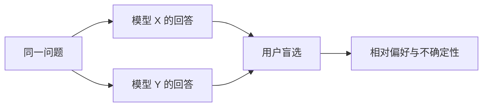
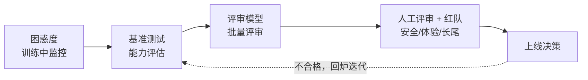

# 12. 大模型评测（LLM Evaluation）——评价方法与局限

> **读之前**：读完第 4～8 章，知道 SFT、偏好学习、推理对齐和安全对齐分别在优化什么。
>
> **读完你能做到**：看懂一个 benchmark 分数背后的条件；说清困惑度、基准测试、竞技场、大模型评审各自能证明什么、不能证明什么；知道为什么评测必须组合多种证据。

---

## 一、评测为什么比传统模型难

传统机器学习模型的评价很直接：分类看准确率，回归看误差。

但大语言模型输出的是**自由文本**：同一个问题可以有无数种"都合理"的回答，"哪个更好"本身就可能主观。更麻烦的是，能力维度太多：知识、推理、代码、写作、指令跟随、安全性、对话流畅度……一个分数说不完。

所以现代评测通常要组合多种证据，而不是只看一个总分。

做一次评测前，先回答三个问题：

1. **测什么**：知识、推理、代码，还是指令跟随与安全性？
2. **怎么测**：用什么提示词、采样参数、工具预算、评分协议？
3. **由谁判**：规则、可执行测试、评审模型，还是人？

这三个问题没定清楚，分数就没有可比性。

---

## 二、困惑度：能说明什么，不能说明什么

**困惑度（Perplexity, PPL）**是最古老的语言建模指标：

```math
\text{Perplexity} = \exp(\text{Cross Entropy Loss})
```

交叉熵损失衡量"模型对正确词元的预测有多意外"；取指数后，可以粗略理解为"模型每一步平均在多少个同样可能的候选词元之间犹豫"。

例如平均交叉熵为 `2.0`，则 `PPL = e^2 ≈ 7.39`，可以粗略说"模型的不确定性相当于在约 7.4 个候选之间选择"。

| 优点 | 局限 |
|---|---|
| 不需要人工标注，任何文本都能算 | 低 PPL 不等于会解题、会写代码、会对话 |
| 计算便宜，适合训练中监控 | 跨分词器不能直接比较 |

**为什么跨分词器不能比？** 词元切分变了，分母和预测事件也变了。同一个句子，A 分词器切成 20 个词元，B 切成 30 个，PPL 自然会不同。若要跨分词器比较，可以在相同文本上改用按字节归一化的每字节比特数（bits-per-byte），并说明编码与计算协议。

比较 PPL 还必须固定语料、预处理、上下文窗口、截断方式和损失掩码。**PPL 是语言建模的体温计，不是能力考试。**

---

## 三、基准测试：一个分数背后有很多条件

基准测试（Benchmark）不只是"有标准答案的题库"，它包含四部分：

> **任务与样本 + 输入与生成协议 + 评分方法 + 汇总规则**

选择题可以用精确匹配（exact match），代码题可以执行测试，开放问答可以用评分量表（rubric）、人工或大模型评审。

只有当以下条件都一致时，两个分数才有可比性：

- 题目版本、数据划分；
- 提示词/对话模板、少样本示例；
- 采样参数、输出预算；
- 答案提取方式、评分规则。

常见基准：

| 基准 | 测试内容 | 适合衡量 |
|---|---|---|
| MMLU | 57 个学科的多选题（约 1.4 万题） | 综合知识广度 |
| GSM8K | 小学数学应用题（约 8.5k 题） | 基础数学推理 |
| HumanEval | 164 道编程题，用单元测试判分 | 代码生成 |
| BBH | 23 个高难度推理任务 | 复杂推理 |
| MT-Bench | 多轮对话质量（GPT-4 打分） | 对话能力 |
| MMMU | 大学级多学科图文题 | 多模态理解 |

**怎么读一个分数？** 假设某模型在 MMLU 上得 70 分。它能说明：

- 在该版本题目、该提示协议下，模型答对了约 70%；
- 可以和其他同协议评测的模型做相对比较。

它不能说明：

- 模型在真实工作场景中 70% 的问题都能解决；
- 模型没有见过这些题（可能是污染）；
- 换一种提示、换一个语言，分数还一样。

### 三大局限

1. **数据污染（Data Contamination）**：题目或近似解答进入训练数据，分数可能包含记忆效应。文本去重、语义近重复检测、时间切分和新题集可以缓解，但"未检测到重复"不证明没有污染。
2. **基准饱和（Saturation）**：某个题集上正确率接近上限时，剩余题目区分能力下降。这时微小分差可能只是噪声。
3. **覆盖面不足**：固定样本只能覆盖目标场景的一部分。写作、建议、拒绝行为也能设计基准，但主观标准、文化背景和长尾更难覆盖。

还要报告**有限样本的不确定性**。例如二元正确率 0.4、样本量 10 时，粗略标准误约为：

```text
sqrt(0.4 × 0.6 / 10) ≈ 0.155
```

不是"误差只有几个百分点"。小样本宜用威尔逊（Wilson）区间；比较同一组题上的两个模型，宜用配对自助法（bootstrap）。如果取的是题库前 10 题而非代表性抽样，区间也不能修复抽样偏差。

---

## 四、竞技场：让人类盲选

Chatbot Arena 的典型流程：两个模型回答同一问题，用户不知道模型身份，投票选更好的一个。由成对胜负估计相对偏好分数（埃洛 Elo 或 Bradley–Terry 等成对比较模型）。



**优点**：直接收集真实人类偏好；匿名展示可以减轻品牌偏见。

**局限**：

- 用户和题目有选择偏差，专业领域覆盖不足；
- 投票质量和成本有限；
- 回答风格仍可能暴露来源，匿名不等于完全消除偏见；
- 分数依赖对手集合和投票人群，不是绝对能力单位。

竞技场反映的是"参与人群在该协议下的偏好"，不能替代面向具体产品场景的用户研究。

---

## 五、大模型评审：便宜，但有系统性偏差

**大模型评审（LLM-as-a-Judge）**用一个能力较强的模型当裁判，对回答打分或排序。


优点是成本远低于人工、速度快、可以批量评测。但裁判有系统性偏差：

| 偏差 | 表现 | 缓解 |
|---|---|---|
| 位置偏差 | 偏爱排在前面的回答 | 交换 A/B 顺序各评一次 |
| 长度偏差 | 偏爱更长的回答 | 评分标准明确"简洁加分"，或控制长度 |
| 自我偏好 | 偏爱同源模型 | 用第三方模型交叉评审 |
| 权威偏差 | 被"听起来专业"的说法带偏 | 要求引用具体证据 |

实验 12.1 会实现一个严格解析、允许平局、交换 A/B 的简化评审器。少量明显样本只能检查链路和暴露故障，不能验证一般可靠性。

正式使用前要固定评审模型版本、评分标准和提示词，记录解析失败率和顺序不一致率，并在目标领域的独立人工标注集上校准。

---

## 六、人工评测：仍然需要人

人工评审仍是重要证据来源，尤其适合复核安全边界、真实体验和专业长尾。但它不是自动正确的"最终真值"：标注者也有知识、偏好和注意力差异，需要清晰标准、盲评、多人独立标注和分歧仲裁。

人工标注还用于校准评审模型和任务指标。可以报告成对偏好一致率、Cohen's Kappa（一种衡量标注者一致性的统计量）等，但解释要结合标签分布、样本量和标注者间一致性。**`0.7` 不是通用上线阈值。**

---

## 七、评测体系：组合证据



这不是唯一顺序，也不表示各种方法互斥：同一个基准可以同时用规则和人工抽查。

**指标之间的不一致往往最有价值。** 例如规则分数上升，但用户体验下降，提示我们检查未覆盖的场景或评分偏差。

常见工具：

| 工具 | 出品方 | 特点 |
|---|---|---|
| lm-evaluation-harness | EleutherAI | 支持几十个基准，用统一命令评测模型 |
| OpenCompass | 上海 AI Lab | 常用的中文评测框架，提供可视化结果 |
| HELM | 斯坦福 CRFM | 强调多维度与透明，公开原始数据 |
| Chatbot Arena / AlpacaEval / MT-Bench | LMSYS / 各家 | 偏好类评测（Elo / 胜率） |

---

## 八、评测驱动迭代

**没有评测，就没有迭代。** 对齐的每一轮（SFT、偏好学习、推理对齐、安全对齐）都需要评测检查收益与退化；失败样本可以指导下一轮数据和训练。

但要注意：**不能反复针对同一测试集调优，还把它当作独立证据。** 正确做法是固定前后评测协议，保留未用于调优的留出集，并记录不确定性。第三部分实验 11.3 会在 Agent 场景实践"评测 → 定位 → 修复 → 再评测"的闭环。

> **评测不只是"打分"，它是数据飞轮的燃料——测出来的每一个失败样本，都是下一轮训练最有价值的数据。**

---

## 本章对应的实验

- [12.1 运行基准测试（Benchmark）并实现简化版大模型评审（LLM-as-a-Judge）](<./12.1%20运行基准测试（Benchmark）并实现简化版大模型评审（LLM-as-a-Judge）.md>)：用 lm-evaluation-harness 跑 GSM8K 小子集，再实现一个允许平局、交换 A/B 的简化评审器。

## 本章小结

- 自由文本没有唯一答案，评测要同时回答"测什么、怎么测、谁判"。
- PPL 衡量语言建模，不保证任务能力，也不能跨分词器直接比较。
- benchmark 分数是一组条件的产物；污染、饱和、覆盖不足和小样本误差都会限制结论。
- 竞技场提供特定人群和题目分布下的偏好证据，不是绝对能力分。
- 评审模型便宜但有位置、长度、自我偏好等偏差，需要交换、校准和人工复核。
- 组合证据比单个总分可靠；前后对比要固定协议，保留独立留出集。

> **一句话记住本章**：先定义场景和协议，再选指标；能相互校验的证据，比一个漂亮的总分更有用。

## 下一章预告

到这里，第二部分的概念和工程章节都讲完了。最后一章把整部分拼成一张地图，回答一个贯穿始终的问题：能力与对齐，到底是什么关系？

> **第 13 章 第二部分总结——从基础模型到现代 AI 助手**

---

## 思考题

1. 为什么 PPL 低的模型不一定回答得好？PPL 适合用来做什么？
2. Benchmark 污染是什么？如何判断一个评测集可能被"背过"？
3. LLM-as-a-Judge 有哪些系统性偏差？各举一个缓解办法。
4. 如果规则分数上升但用户满意度下降，你会先查什么？

---

## 参考资料

- EleutherAI《lm-evaluation-harness》：https://github.com/EleutherAI/lm-evaluation-harness
- 上海 AI Lab《OpenCompass》：https://github.com/open-compass/opencompass
- 斯坦福《HELM: Holistic Evaluation of Language Models》：https://crfm.stanford.edu/helm/
- LMSYS《Chatbot Arena》：https://chat.lmsys.org/
- Hendrycks et al.《Measuring Massive Multitask Language Understanding》（MMLU）：https://arxiv.org/abs/2009.03300
- Zheng et al.《Judging LLM-as-a-Judge with MT-Bench and Chatbot Arena》：https://arxiv.org/abs/2306.05685
