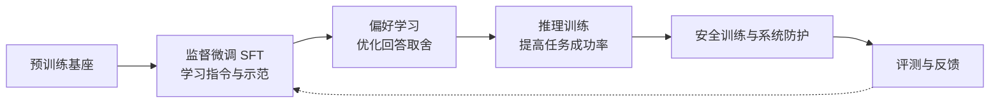
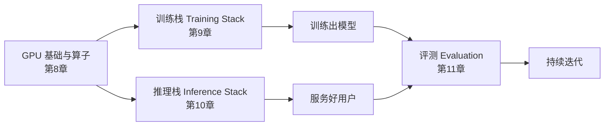

# 12. 第二部分总结——从基础模型到现代 AI 助手

第一部分我们理解了大语言模型**如何表示和生成语言**；第二部分回答了另一个问题：**如何在预训练基座上，通过数据、后训练和工程系统，构建更可用的 AI 助手？**

答案可以浓缩成一句话：**定义期望行为，构造学习信号，用合适的目标训练，再通过评测检验效果、成本与风险。** 第一部分的 nanoGPT 用于看清基本机制；本部分改用已有基础能力的开源基座，避免把后训练实验变成重新预训练一个模型。

## 一、从基础模型到对话模型：四类对齐任务

图中是**本书的讲解顺序，不是所有模型必须遵循的单向配方**。实际训练中各类数据和目标可以混合、交替，安全评测也应贯穿全程。

| 任务 | 解决什么问题 | 核心手段 | 一句话本质 |
|---|---|---|---|
| **监督微调 SFT（第4章）** | 指令执行、任务行为和输出格式不够稳定 | 指令-回答示范 + 对话模板（Chat Template）+ 损失掩码（Loss Mask） | 从示范中学习条件生成，也可能学习新知识与技能 |
| **偏好学习（Preference Learning，第5章）** | 多个回答之间存在质量与偏好差别 | 奖励模型（RM）+ 近端策略优化（PPO）、直接偏好优化（DPO）等 | 让“哪个更好”进入优化目标 |
| **推理对齐（Reasoning Alignment，第6章）** | 推理任务正确率、鲁棒性或计算效率不足 | 推理示范、可验证奖励、组相对策略优化（GRPO）等 | 用任务反馈改进解题策略，而非只看回答是否很长 |
| **安全对齐（Safety Alignment，第7章）** | 有害输出、误拒与系统滥用风险 | 安全数据、偏好训练、分类器、分层防护 | 同时约束模型行为与系统执行边界 |

这四类任务的共同点，是改变训练数据和优化目标，让模型更接近期望行为。后训练既可能带来新知识、新技能，也可能造成遗忘或能力退化；因此，“能力”和“对齐”是两个评价视角，不能假设训练只动其中一个。最终都要用对应的测试来验证。

## 二、方法选择：简化与代价

方法演进不是“新方法必然淘汰旧方法”。更有用的比较方式，是看**监督信号、计算成本和适用条件**：

| 问题 | 可选方法 | 简化与代价 |
|---|---|---|
| 如何利用偏好数据 | 基于人类反馈的强化学习（PPO-RLHF）、直接偏好优化（DPO）等 | DPO 省去显式奖励模型与在线强化学习循环，但仍依赖偏好数据质量、参考策略与分布覆盖；PPO 可利用在线采样反馈 |
| 如何减少强化学习训练中的价值模型开销 | PPO 的评论家模型（critic）、组相对策略优化（GRPO）的组内基线 | GRPO 不单独训练评论家模型，但需要组内采样；全对或全错组的相对奖励信号很弱 |
| 如何扩展安全反馈 | 人工标注、基于原则的批评修订、AI 偏好标注 | 批评修订可生成监督微调数据，AI 比较可生成偏好；仍需校准偏差并保留人工审核 |
| 如何构造监督微调数据 | 人工示范、合成数据、蒸馏、精选混合 | 来源不同不代表天然优劣；覆盖、正确性、去重和验证集都重要。Alpaca 与 LIMA 是不同实验，不是同一数据集逐步缩小 |

**组相对策略优化（GRPO）是策略优化方法，可验证奖励强化学习（RLVR）描述奖励来源。** 二者常组合使用，但 GRPO 也可以使用学习型奖励模型。理解一个新方法时，先问：它改变了哪种数据、哪个损失或哪段计算？又新增了什么假设与失败模式？

## 三、支撑这一切的工程体系

对齐决定了模型"应该表现成什么样子"，但真正让这一切在工业级规模上跑起来，离不开另一套工程体系——而它又建立在对图形处理器（GPU）硬件本身的理解之上：

- **GPU 基础与算子**（流式多处理器 SM / 显存层级 / 算子融合 / FlashAttention）帮助判断瓶颈是计算、访存还是调度；具体收益要测量，不能由技术名称推断；
- **训练栈（Training Stack）**（数据/张量/流水线并行、零冗余优化器 ZeRO、混合精度）帮助分摊模型状态、控制激活值和通信。按第 8、9 章的假设，70B 模型状态为 \(70\times10^9\times16\) 字节，即 **1.12 TB，尚未计激活值与临时缓冲**；
- **推理栈（Inference Stack）**（连续批处理 Continuous Batching + 分页注意力 PagedAttention + 量化）在显存、吞吐量与延迟之间做权衡。分页减少分配浪费，不会自动减少每个词元的 KV 数据量；
- **评测（Evaluation）**用固定任务与协议、自动验证、评审模型（Judge）和人工审核检验质量与风险，为下一轮迭代提供依据。它应贯穿数据准备、训练和服务，而非只在最后做一次。

工程章节可以归纳成一条方法：先算资源预算，再判断瓶颈，最后在一致条件下做对照。屋顶线模型（Roofline）、训练显存预算和键值缓存（KV Cache）的显存构成，提供的是解释框架；任何测量都要注明模型、精度、输入长度、并发量、预热和统计口径。单卡卸载（offload）的收益不能直接外推到多卡分片；10 道题的冒烟测试也只能说明链路跑通，不能证明规模规律。

## 四、第二部分知识地图

本部分的 12 章按"总纲 → 基础 → 对齐方法 → 工程支撑"四段递进：

| 章节 | 核心问题 | 关键概念 |
|---|---|---|
| **1 模型对齐 Alignment**（总纲） | 为什么 GPT 需要变成 ChatGPT | 能力 vs 对齐、HHH、InstructGPT 三步 |
| **2 三种学习范式**（基础） | 监督信号从哪来，怎样构造 | 监督 / 无监督 / 自监督、模型生成数据 |
| **3 数据工程**（基础） | 语料来源、清洗与配比 | Common Crawl→C4、清洗四关、去重、个人身份信息（PII）、质量筛选 |
| **4 监督微调 SFT**（对齐一） | 指令跟随能力的训练 | 对话模板、损失掩码、低秩适配与量化低秩适配（LoRA/QLoRA）、数据配比、对数几率蒸馏 |
| **5 偏好学习 Preference Learning**（对齐二） | 人类偏好的建模与优化 | 奖励模型 RM、基于人类反馈的强化学习与近端策略优化（RLHF/PPO）、DPO 推导、GRPO |
| **6 推理对齐 Reasoning Alignment**（对齐三） | 如何提高推理任务的成功率与效率 | 可验证奖励、R1 四阶段、测试时计算（test-time compute） |
| **7 安全对齐 Safety Alignment**（对齐四） | 如何降低风险并控制误拒 | 越狱 Jailbreak、提示注入、多层防护、宪法式 AI |
| **8 图形处理器（GPU）基础与算子**（工程） | 图形处理器的计算与访存如何形成约束 | 流式多处理器（SM）/张量核心（Tensor Core）、高带宽内存（HBM）/片上缓存（SRAM）、屋顶线模型（Roofline）、算子融合 |
| **9 训练栈 Training Stack**（工程） | 如何训练超大模型 | 三维并行（3D Parallel）、零冗余优化器（ZeRO）、显存预算 |
| **10 推理栈 Inference Stack**（工程） | 如何高效服务大量用户 | 预填充/解码 Prefill/Decode、连续批处理 Continuous Batching、分页注意力 PagedAttention |
| **11 评测 Evaluation**（工程） | 评价方法与局限 | 基准测试 Benchmark、评审偏差、多层评测体系 |
| **12 第二部分总结** | 完整知识地图 | 从基础模型到现代 AI 助手 |

**为什么要按这个顺序？** 第 1 章给出全局地图（预训练 → SFT → RLHF）；第 2、3 章补齐支撑全书的**两块地基**——范式决定"需要什么数据"，数据工程决定"语料来源、清洗与配比"；第 4~7 章沿着对齐流水线逐级递进（会执行 → 合偏好 → 会推理 → 有边界）；第 8~11 章回到工程支撑（硬件 → 训练 → 推理 → 评测）。**先知道"要训成什么样"，再学"怎么把它训出来、跑起来、评明白"**。

## 五、实验链路：已实现内容与机制观察

建议按“主章 → 本章实验 → 下一主章”阅读。最重要的连续训练路径是 **4.1 样本与监督位置 → 4.2 SFT 适配器 → 5.2 DPO**；4.3 的知识蒸馏是并列分支，产物写到独立目录，不进入 5.2 的适配器链；5.1 的奖励模型是帮助理解 PPO-RLHF 的旁支，DPO 不需要加载这个奖励模型。

| 实验段 | 应检查的产物或证据 | 不能据此宣称 |
|---|---|---|
| 3.1～4.1 数据与样本 | 保留结构的文本、清洗统计、词元前缀与有效标签（labels） | 已完成工业级数据治理或保证无污染 |
| 4.2～5.2 后训练 | 保存并能重载的适配器、固定模板、未参与训练的问题上前后输出 | 小数据训练一次就得到稳定、全面更强的助手 |
| 4.3 蒸馏分支 | 同词表校验、交叉熵（CE）与 KL 散度分项、\(\alpha=0\) 与 \(\alpha=0.5\) 的同条件对照 | KL 散度或一致率变化就代表回答质量提升 |
| 6.1 推理观察 | 最终答案、完成或截断状态、正确率与词元成本 | 已复现 GRPO 训练，或长思考本身证明更强 |
| 7.1 安全护栏 | 输入与输出审核、解析失败时的处理 | 一个分类器就能保证整个应用安全 |
| 8.1～10.2 工程实验 | 同口径计时与显存、明确的设备和输入配置 | 任意硬件上固定倍数加速或固定显存上限 |
| 11.1 评测 | 固定协议、实际调用的评审器、异常解析与位置偏差检查 | 极小样本差异证明普遍优劣 |

CUDA 算子、分布式训练和 vLLM 服务实验有各自的平台要求；10.2 提供本地推理的另一条路径。不能把“8 GB 显存”视为跨平台、跨序列长度的运行保证。示例需结合具体版本、驱动和硬件验证；未附完整环境与测量记录的显存、耗时说明只能作估算，不能当作实测基准。

## 六、参考资料与练习的对应关系

第零部分的感谢名单是来源与延伸阅读地图，不是要求第二部分逐个复现全部框架。基础网络和手写 GPT 在第一部分，多模态也在那里；Agent 与具身智能分别由第三、四部分承担。本部分应抓住与后训练和工程相关的方法论：

| 资料线索 | 本书对应练习 | 学完后应能回答 |
|---|---|---|
| Karpathy、Raschka：机制透明与从零实现 | 第一部分 nanoGPT；4.1～5.2 | 每个词元是否参与损失计算？训练产物怎样继续用于下一阶段？ |
| 吴恩达、李沐：优化、泛化与实验判断 | 第一部分优化基础；4.2、9.1、11.1 | 改进来自哪个变量？验证集与训练集是否分离？ |
| InstructGPT、李宏毅、DPO 与《Alignment Handbook》 | 第 1、4、5 章 | 示范、偏好和在线奖励分别怎样影响参数更新？ |
| R1、o1 | 第6章与6.1 | 奖励如何验证？训练算法、数据配方和推理预算有什么区别？ |
| Horace He、GPU Mode、FlashAttention | 第8章与8.1 | 当前受限于算力、访存还是调度？测量是否支持优化归因？ |
| DeepSpeed、Megatron、vLLM、Chip Huyen 及评测资料 | 第 9～11 章 | 显存、通信、吞吐量、延迟与质量如何共同约束系统？ |

MLA、DualPipe、CUTLASS、其他推理引擎和评测框架主要作为延伸阅读；了解定位不等于已经掌握实现。继续深入时，选一个机制读原论文、复算账本、构造对照，比同时安装很多框架更有价值。

## 七、一个重要的认知转变

> **回答流畅不等于知识可靠，奖励上升不等于任务全面改善，程序跑通也不等于效果已验证。**

能力与对齐需要共同评估。过度拒绝会损害可用性，过度迎合偏好可能牺牲诚实；需要用正常任务、风险任务和失败样本一起检查，而不是把某个指标单独最大化。

到这里，我们建立了构建、优化与评测助手的基本方法，并完成或了解了相应的教学实验；这不等于已经训练出可直接投入生产、足够安全的产品。模型可以生成计划或工具调用意图，但真正打开浏览器、读写文件、调用外部工具，还需要执行程序、状态管理与权限约束。第三部分将进入 **Agent（Use）**：

> **从生成回答与行动意图，到在受控系统里完成任务。**

---

## 附录：第二部分术语对照表

同一术语在正文中首次出现时给出中英文；下表汇总本部分的核心概念，便于交叉查阅。

| 中文 | English | 缩写 |
|---|---|---|
| 模型对齐 | Alignment | — |
| 预训练 | Pretraining | — |
| 后训练 | Post-training | — |
| 基础模型 | Base Model | — |
| 指令模型 | Instruct Model | — |
| 对齐模型 | Aligned Model | — |
| 监督微调 | Supervised Fine-Tuning | SFT |
| 基于人类反馈的强化学习 | Reinforcement Learning from Human Feedback | RLHF |
| 近端策略优化 | Proximal Policy Optimization | PPO |
| 直接偏好优化 | Direct Preference Optimization | DPO |
| 组相对策略优化 | Group Relative Policy Optimization | GRPO |
| 奖励模型 | Reward Model | RM |
| 评论家模型 | Critic | — |
| 偏好学习 | Preference Learning | — |
| 推理对齐 | Reasoning Alignment | — |
| 安全对齐 | Safety Alignment | — |
| 思维链 | Chain-of-Thought | CoT |
| 可验证奖励强化学习 | Reinforcement Learning with Verifiable Rewards | RLVR |
| 过程监督 | Process Supervision | — |
| 结果监督 | Outcome Supervision | — |
| 知识蒸馏 | Knowledge Distillation | KD |
| 对数几率（未归一化分数） | logits | — |
| 软标签 | Soft Label | — |
| 硬标签 | Hard Label | — |
| 温度 | Temperature | — |
| 交叉熵 | Cross-Entropy | CE |
| KL 散度 | Kullback–Leibler Divergence | KL |
| 词元 | Token | — |
| 分词器 | Tokenizer | — |
| 对话模板 | Chat Template | — |
| 损失掩码 | Loss Mask | — |
| 低秩适配 | Low-Rank Adaptation | LoRA |
| 量化低秩适配 | Quantized LoRA | QLoRA |
| 检查点 | Checkpoint | — |
| 适配器 | Adapter | — |
| 提示词 | Prompt | — |
| 上下文窗口 | Context Window | — |
| 幻觉 | Hallucination | — |
| 越狱 | Jailbreak | — |
| 护栏 | Guardrail | — |
| 红队测试 | Red Teaming | — |
| 个人身份信息 | Personally Identifiable Information | PII |
| 基准测试 | Benchmark | — |
| 困惑度 | Perplexity | PPL |
| 竞技场 | Arena | — |
| 大模型评审 | LLM-as-a-Judge | — |
| 连续批处理 | Continuous Batching | — |
| 分页注意力 | PagedAttention | — |
| 键值缓存 | Key-Value Cache | KV Cache |
| 量化 | Quantization | — |
| 预填充 | Prefill | — |
| 解码 | Decode | — |
| 首词元时延 | Time To First Token | TTFT |
| 每输出词元时延 | Time Per Output Token | TPOT |
| 词元间时延 | Inter-Token Latency | ITL |
| 图形处理器 | Graphics Processing Unit | GPU |
| 流式多处理器 | Streaming Multiprocessor | SM |
| 张量核心 | Tensor Core | — |
| 高带宽内存 | High Bandwidth Memory | HBM |
| 片上缓存 | Static Random-Access Memory | SRAM |
| 屋顶线模型 | Roofline Model | — |
| 算子 | Kernel / Operator | — |
| 零冗余优化器 | Zero Redundancy Optimizer | ZeRO |
| 数据并行 | Data Parallel | DP |
| 张量并行 | Tensor Parallel | TP |
| 流水线并行 | Pipeline Parallel | PP |
| 完全分片数据并行 | Fully Sharded Data Parallel | FSDP |
| 卸载 | Offload | — |
| 梯度检查点 | Gradient Checkpointing | — |
| 梯度累积 | Gradient Accumulation | — |

---

## 参考资料

- Andrej Karpathy《State of GPT》(第二部分全链路的总纲性演讲)：https://www.youtube.com/watch?v=bZQun8Y4L2A
- HuggingFace《Alignment Handbook》(对齐全流程代码，与第4、5章对应)：https://github.com/huggingface/alignment-handbook
- OpenAI《InstructGPT》(Alignment 流水线原点)：https://arxiv.org/abs/2203.02155
- DeepSeek《DeepSeek-R1》(推理对齐新范式)：https://arxiv.org/abs/2501.12948
- Chip Huyen《AI Engineering》(训练/推理/评测工程全景)：https://github.com/chiphuyen/aie-book
