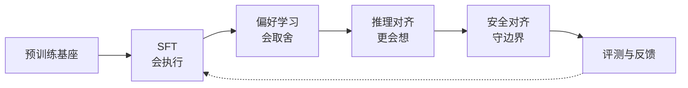
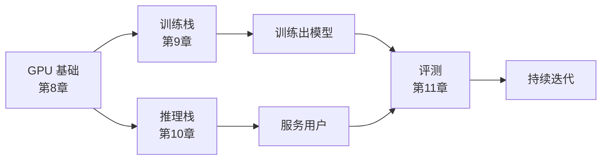

# 12. 第二部分总结——从基础模型到现代 AI 助手

> **读之前**：读完第 1～11 章。
>
> **读完你能做到**：用一条主线串起第二部分；说清对齐四类任务和工程三件套的关系；知道每个实验验证了什么、不能证明什么。

---

## 一、三句话总结

第一部分回答"模型怎么表示和生成语言"；第二部分回答"**怎么把预训练基座变成更可用的助手**"。

如果只记住三件事：

1. **对齐不是一次训练，而是一条流水线**：SFT 让模型会执行指令，偏好学习让它会取舍，推理对齐让它更会想，安全对齐让它守住边界。
2. **数据决定上限**：监督信号从哪来、质量如何、覆盖够不够，比"多跑几轮"更重要。
3. **工程决定能不能落地**：显存、带宽、通信、延迟、评测，每一个都会反过来限制算法选择。

---

## 二、一条主线

这是**本书的讲解顺序，不是所有模型必须遵循的单向配方**。实际训练中数据和目标可以混合、交替，安全评测应贯穿全程。

| 任务 | 解决什么问题 | 核心手段 | 本章实验 |
|---|---|---|---|
| **SFT**（第 4 章） | 指令执行、输出格式不稳定 | 指令-回答示范 + 对话模板 + 损失掩码 | 4.1、4.2 |
| **偏好学习**（第 5 章） | 多个回答之间不会取舍 | 奖励模型 + PPO，或 DPO | 5.1、5.2 |
| **推理对齐**（第 6 章） | 推理任务正确率不足 | 推理示范、可验证奖励、GRPO | 6.1 |
| **安全对齐**（第 7 章） | 有害输出与越权风险 | 安全数据、分类器、多层防护 | 7.1 |

四类任务的共同点，是改变训练数据和优化目标，让模型更接近期望行为。后训练既可能带来新知识、新技能，也可能造成遗忘或退化；所以"能力"和"对齐"要分别评估。

---

## 三、方法怎么选

方法演进不是"新方法必然淘汰旧方法"。更有用的比较方式是看**监督信号、计算成本和适用条件**：

| 问题 | 可选方法 | 简化与代价 |
|---|---|---|
| 如何利用偏好数据 | PPO-RLHF、DPO 等 | DPO 省去显式奖励模型和在线 RL，但仍依赖偏好数据质量；PPO 可利用在线采样反馈 |
| 如何减少价值模型开销 | PPO 的评论家、GRPO 的组内基线 | GRPO 不单独训练评论家，但需要组内采样；全对/全错组信号很弱 |
| 如何扩展安全反馈 | 人工标注、原则批评、AI 偏好 | 仍需校准偏差并保留人工审核 |
| 如何构造 SFT 数据 | 人工、合成、蒸馏、精选混合 | 来源不同不代表天然优劣；覆盖、正确性、去重都重要 |

**GRPO 是策略优化方法，RLVR 描述奖励来源。** 二者常组合，但 GRPO 也可以用学习型奖励模型。理解一个新方法时，先问：它改变了哪种数据、哪个损失或哪段计算？新增了什么假设和失败模式？

---

## 四、工程三件套

对齐决定"模型应该表现成什么样"，工程决定"能不能在真实资源下跑起来"：

- **GPU 基础**（SM / 显存层级 / 算子融合 / FlashAttention）：判断瓶颈是算力、访存还是调度；具体收益要测量。
- **训练栈**（数据/张量/流水线并行、ZeRO、混合精度）：分摊模型状态、控制激活和通信。70B 模型状态约 1.12 TB，这是所有并行策略的出发点。
- **推理栈**（连续批处理、分页注意力、量化）：在显存、吞吐和延迟之间做权衡。分页减少分配浪费，不会自动减少每个词元的 KV 数据量。
- **评测**（固定协议、自动验证、评审模型、人工审核）：为下一轮迭代提供依据，应贯穿全程。

工程章节可以归纳成一条方法：**先算资源预算，再判断瓶颈，最后在一致条件下做对照。** 任何测量都要注明模型、精度、输入长度、并发量、预热和统计口径。

---

## 五、知识地图

| 章节 | 核心问题 | 关键概念 |
|---|---|---|
| **1 模型对齐**（总纲） | 为什么 GPT 需要变成 ChatGPT | 能力 vs 对齐、HHH、InstructGPT 三步 |
| **2 三种学习范式**（基础） | 监督信号从哪来 | 监督 / 无监督 / 自监督、模型自举 |
| **3 数据工程**（基础） | 语料来源、清洗与配比 | Common Crawl→C4、四道清洗、去重、PII |
| **4 SFT**（对齐一） | 指令跟随 | 对话模板、损失掩码、LoRA/QLoRA、蒸馏 |
| **5 偏好学习**（对齐二） | 人类偏好 | 奖励模型、PPO、DPO、GRPO |
| **6 推理对齐**（对齐三） | 推理能力 | CoT、结果/过程监督、可验证奖励、R1 四阶段 |
| **7 安全对齐**（对齐四） | 风险边界 | 越狱、提示注入、多层防护、宪法式 AI |
| **8 GPU 基础**（工程） | 算力与访存约束 | SM/Tensor Core、HBM/SRAM、Roofline、算子融合 |
| **9 训练栈**（工程） | 怎么训练超大模型 | DP/TP/PP、ZeRO、混合精度、检查点 |
| **10 推理栈**（工程） | 怎么高效服务 | Prefill/Decode、连续批处理、PagedAttention |
| **11 评测**（工程） | 怎么评价 | Benchmark、Arena、LLM-as-a-Judge、污染 |
| **12 总结** | 知识地图 | 从基础模型到助手 |

**为什么按这个顺序？** 先知道"要训成什么样"（第 1 章），再补数据基础（第 2、3 章），然后沿对齐流水线逐级推进（第 4～7 章），最后看支撑这一切的工程体系（第 8～11 章）。

---

## 六、实验链路

建议按"主章 → 本章实验 → 下一主章"阅读。最重要的连续路径是：

> **4.1 样本与监督位置 → 4.2 SFT 适配器 → 5.2 DPO**

4.3 的知识蒸馏是并列分支，产物写到独立目录，不进入 5.2；5.1 的奖励模型是理解 PPO 的旁支，DPO 不需要加载它。

| 实验段 | 应检查的产物 | 不能据此宣称 |
|---|---|---|
| 3.1～4.1 数据与样本 | 保留结构的文本、清洗统计、有效标签 | 已完成工业级数据治理 |
| 4.2～5.2 后训练 | 可重载的适配器、固定模板、未见题前后输出 | 小数据训练一次就得到全面更强的助手 |
| 4.3 蒸馏 | 同词表校验、CE 与 KL 分项、同条件对照 | KL 变化就代表回答质量提升 |
| 6.1 推理观察 | 最终答案、截断状态、正确率与词元成本 | 已复现 GRPO，或长思考证明更强 |
| 7.1 安全护栏 | 输入/输出审核、解析失败处理 | 一个分类器能保证整个应用安全 |
| 8.1～10.2 工程实验 | 同口径计时与显存、设备和输入配置 | 任意硬件上的固定倍数加速 |
| 11.1 评测 | 固定协议、评审器版本、位置偏差检查 | 极小样本差异证明普遍优劣 |

CUDA 算子、分布式训练和 vLLM 实验有各自的平台要求；"8 GB 显存能跑"不是跨平台、跨序列长度的保证。未附完整环境和测量记录的显存、耗时只能算估算。

---

## 七、一个重要的认知转变

> **回答流畅不等于知识可靠，奖励上升不等于任务全面改善，程序跑通也不等于效果已验证。**

能力与对齐要共同评估。过度拒绝会损害可用性，过度迎合偏好可能牺牲诚实；要用正常任务、风险任务和失败样本一起检查，而不是把某个指标单独最大化。

学完第二部分，你已经知道怎么构建、优化和评测一个助手；但这不等于已经训练出可直接上线的产品。模型可以生成计划和工具调用意图，真正打开浏览器、读写文件、调用外部工具，还需要执行程序、状态管理和权限约束。

第三部分将进入 **Agent（Use）**：

> **从生成回答和行动意图，到在受控系统里完成任务。**

---

## 附录：第二部分术语对照表

同一术语在正文中首次出现时给出中英文；下表汇总本部分的核心概念，便于交叉查阅。

| 中文 | English | 缩写 |
|---|---|---|
| 模型对齐 | Alignment | — |
| 预训练 | Pretraining | — |
| 后训练 | Post-training | — |
| 基础模型 | Base Model | — |
| 指令模型 | Instruct Model | — |
| 对齐模型 | Aligned Model | — |
| 监督微调 | Supervised Fine-Tuning | SFT |
| 基于人类反馈的强化学习 | Reinforcement Learning from Human Feedback | RLHF |
| 近端策略优化 | Proximal Policy Optimization | PPO |
| 直接偏好优化 | Direct Preference Optimization | DPO |
| 组相对策略优化 | Group Relative Policy Optimization | GRPO |
| 奖励模型 | Reward Model | RM |
| 评论家模型 | Critic | — |
| 偏好学习 | Preference Learning | — |
| 推理对齐 | Reasoning Alignment | — |
| 安全对齐 | Safety Alignment | — |
| 思维链 | Chain-of-Thought | CoT |
| 可验证奖励强化学习 | Reinforcement Learning with Verifiable Rewards | RLVR |
| 过程监督 | Process Supervision | — |
| 结果监督 | Outcome Supervision | — |
| 知识蒸馏 | Knowledge Distillation | KD |
| 对数几率（未归一化分数） | logits | — |
| 软标签 | Soft Label | — |
| 硬标签 | Hard Label | — |
| 温度 | Temperature | — |
| 交叉熵 | Cross-Entropy | CE |
| KL 散度 | Kullback–Leibler Divergence | KL |
| 词元 | Token | — |
| 分词器 | Tokenizer | — |
| 对话模板 | Chat Template | — |
| 损失掩码 | Loss Mask | — |
| 低秩适配 | Low-Rank Adaptation | LoRA |
| 量化低秩适配 | Quantized LoRA | QLoRA |
| 检查点 | Checkpoint | — |
| 适配器 | Adapter | — |
| 提示词 | Prompt | — |
| 上下文窗口 | Context Window | — |
| 幻觉 | Hallucination | — |
| 越狱 | Jailbreak | — |
| 护栏 | Guardrail | — |
| 红队测试 | Red Teaming | — |
| 个人身份信息 | Personally Identifiable Information | PII |
| 基准测试 | Benchmark | — |
| 困惑度 | Perplexity | PPL |
| 竞技场 | Arena | — |
| 大模型评审 | LLM-as-a-Judge | — |
| 连续批处理 | Continuous Batching | — |
| 分页注意力 | PagedAttention | — |
| 键值缓存 | Key-Value Cache | KV Cache |
| 量化 | Quantization | — |
| 预填充 | Prefill | — |
| 解码 | Decode | — |
| 首词元时延 | Time To First Token | TTFT |
| 每输出词元时延 | Time Per Output Token | TPOT |
| 词元间时延 | Inter-Token Latency | ITL |
| 图形处理器 | Graphics Processing Unit | GPU |
| 流式多处理器 | Streaming Multiprocessor | SM |
| 张量核心 | Tensor Core | — |
| 高带宽内存 | High Bandwidth Memory | HBM |
| 片上缓存 | Static Random-Access Memory | SRAM |
| 屋顶线模型 | Roofline Model | — |
| 算子 | Kernel / Operator | — |
| 零冗余优化器 | Zero Redundancy Optimizer | ZeRO |
| 数据并行 | Data Parallel | DP |
| 张量并行 | Tensor Parallel | TP |
| 流水线并行 | Pipeline Parallel | PP |
| 完全分片数据并行 | Fully Sharded Data Parallel | FSDP |
| 卸载 | Offload | — |
| 梯度检查点 | Gradient Checkpointing | — |
| 梯度累积 | Gradient Accumulation | — |

---

## 参考资料

- Andrej Karpathy《State of GPT》(第二部分全链路的总纲性演讲)：https://www.youtube.com/watch?v=bZQun8Y4L2A
- HuggingFace《Alignment Handbook》(对齐全流程代码，与第4、5章对应)：https://github.com/huggingface/alignment-handbook
- OpenAI《InstructGPT》(Alignment 流水线原点)：https://arxiv.org/abs/2203.02155
- DeepSeek《DeepSeek-R1》(推理对齐新范式)：https://arxiv.org/abs/2501.12948
- Chip Huyen《AI Engineering》(训练/推理/评测工程全景)：https://github.com/chiphuyen/aie-book
