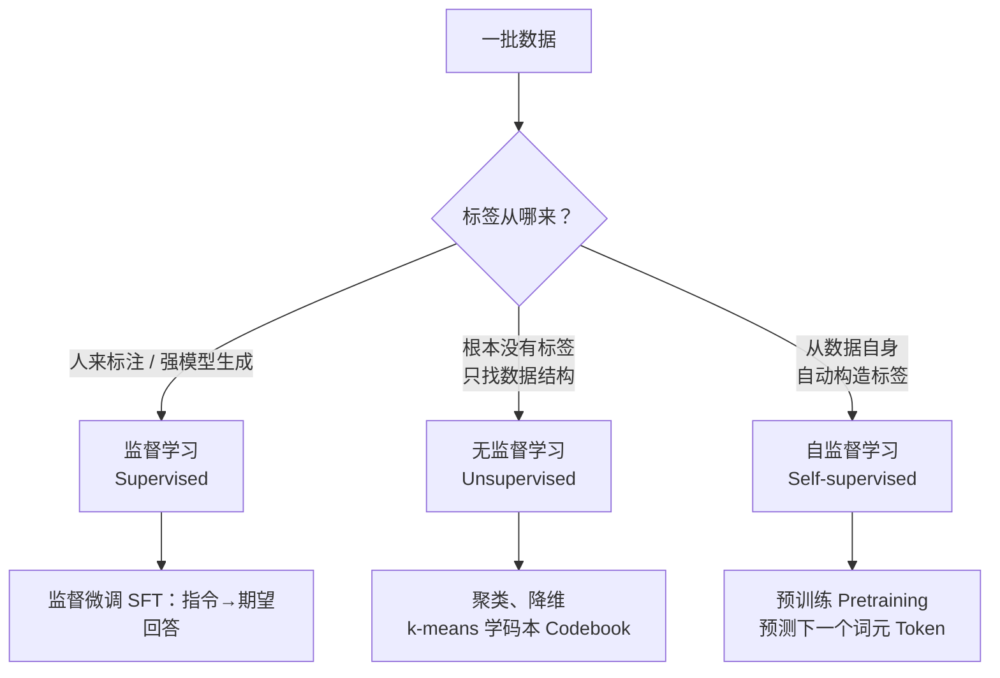

# 2. 三种学习范式（Learning Paradigms）——监督学习、无监督学习与自监督学习

> **本章目标**
>
> - 从**监督信号（supervision signal）如何构造、训练任务是什么**区分监督学习（Supervised Learning）、无监督学习（Unsupervised Learning）与自监督学习（Self-supervised Learning）；本章重点看“标签（Label）从哪来”
> - 理解为什么自监督学习是大模型能规模化的关键——它让"无需人工标注的海量文本"直接变成训练信号
> - 搞清无监督与自监督的本质区别（"找结构" vs "造标签做预测"），这是最容易混淆的一对概念
> - 理解"模型自举（model bootstrapping）"不是第四种范式，而是监督信号的生产者从人类换成模型
> - 建立一条关键认知：**范式决定了需要什么样的数据**——为下一章（数据工程）做铺垫

---

## 一、为何先区分学习范式

上一章我们建立了对齐（Alignment）的全局地图：预训练（Pretraining）得到一个基础模型（Base Model），再经过监督微调（SFT）、基于人类反馈的强化学习（RLHF）等环节变成助手。但有一个基础问题一直悬而未决：

> **预训练常用万亿级词元（Token），监督微调（SFT）则使用精选的指令与回答——同样是训练模型，为什么数据组织和规模常常不同？**

这里先要区分两种计数单位：**样本条数**和**词元（Token）数**。一条 SFT 样本通常是一段对话，长度可能只有几十个词元，也可能有几千个词元。说“10 万条样本”，只说明有 10 万段对话，并没有说明模型实际读了多少词元。

要估算训练量，应使用“样本条数 × 平均每条词元数”。例如 10 万条样本、每条平均 500 个词元，训练语料就是 `100000 × 500 = 50000000`，即 5000 万个词元。如果把“一条样本”误当成“一个词元”，就会把 5000 万说成 10 万，两者相差约 500 倍。同样，也不能拿“预训练用了多少词元”直接除以“SFT 用了多少条样本”，因为分子和分母的单位不同；要比较规模，应统一换算成词元数、训练步数或计算量。

单位统一之后，再看训练目标。预训练和常见的生成式 SFT 都可以使用下一词元预测（Next Token Prediction）的交叉熵（cross-entropy），但两者的**数据分布、条件输入和参与计算损失的词元范围**不同。SFT 通常只对回答部分计算损失，指令部分只作为条件输入。理解这些差异的好起点是：**标签（Label）到底从哪里来**。

而这正是机器学习里三个基础概念的分界线：

这张图是本书任务的入门分类，不是穷尽所有学习方法。预训练可以从文本自动取得目标，省去逐条写答案的成本；SFT 则需要与任务匹配的期望回答，来源可以是人工、模板、程序或模型。**两者都需要质量控制，数量取决于任务、预算和覆盖度，而不由范式单独决定。**

---

## 二、三种范式：一张表讲清楚

| 范式 | 标签（Label）从哪来 | 典型任务 | 在本书里的对应 |
|---|---|---|---|
| **监督学习**（Supervised Learning） | 数据中给定任务目标，可来自人工、程序或模型 | 分类、回归、翻译 | **监督微调（SFT）**：标签是与指令对应的期望回答 |
| **传统无监督方法**（Unsupervised Learning） | 不提供外部任务标签，直接建模数据结构或分布 | 聚类、降维、密度估计 | 第一部分的 **k-means 学音频码本（Codebook）** |
| **自监督学习**（Self-supervised Learning） | 从数据自身构造预测目标，无需逐条人工标答案 | 语言建模、对比学习 | **预训练（Pretraining）**：标签就是下一个词元（Token） |

把这张表落到“要准备什么数据”上，可以得到一条直接影响后面章节的结论：**训练范式决定了数据形态，也决定了质量检查的重点。**

- **自监督预训练**需要大量连续文本，标签由文本自身生成。数据工作的重点是语料覆盖、授权、去重、清洗与配比。
- **监督微调（SFT）**需要成对的“指令 → 期望回答”，标签可以来自人工、模板、程序或更强的模型。数据工作的重点是示范是否正确、覆盖是否足够、格式是否统一，以及哪些词元参与损失计算。
- **传统无监督方法**通常只需要未标注的数据本身，重点是特征表示、距离度量和聚类或降维目标，而不是“回答质量”。

下一章的数据工程主要服务前两类需求：先解决预训练语料的来源与清洗，再为第 4 章的 SFT 数据构造打基础。

**关键的一句**：预训练的目标词元来自原文的下一位置——`The cat is sleeping` 自己就能生成监督信号，例如用 `The cat is` 预测后续内容。这种“数据监督自己”的方式使海量文本可以提供训练信号。

> **可扩展性来自省去逐条写答案的成本，不是省去所有数据工作。** 原始网页仍需授权检查、清洗、去重与配比，不能未经处理就直接拿来训练。

### 它们是不是都“从零训练”？

不是。三种范式描述的是**监督信号从哪里来**，不是**参数从哪里初始化**。这两件事经常被混在一起。

- **从零训练（from scratch）**：随机初始化参数，所有参数都参与更新。第一部分的 nanoGPT 从零训练，用的是自监督预训练。
- **在已有权重上继续训练**：先加载一个预训练模型或指令模型，再按新目标更新全部或部分参数。本书第 4 章的 SFT 从 Qwen2.5 基础模型开始，不是从零训练；第 5 章的 DPO 又接着加载 SFT 产物。
- **传统无监督方法**：像 k-means、PCA 这样的算法，通常直接在特征上迭代，没有“先预训练一个神经网络”的步骤；也可以先用自监督模型提取特征，再做聚类或降维。

因此，“监督 / 无监督 / 自监督”和“从零训练 / 微调”是两个不同的维度。**你既可以从零训练一个自监督模型，也可以加载已有模型做自监督继续预训练；范式不会因为加载了已有权重就改变。**

### 训练过程有什么区别？

以神经网络为例，三者通常都要经过“前向计算 → 计算损失 → 反向传播 → 更新参数”，真正的区别在于**损失是跟什么比较**。

| 环节 | 监督学习 | 传统无监督方法（以 k-means 为例） | 自监督学习 |
|---|---|---|---|
| 数据 | 成对的 `(x, y)` | 只有 `x` | 只有 `x`，但会从 `x` 自动构造 `(x, y')` |
| 标签来源 | 人工、程序或强模型给定 | 没有外部标签 | 从数据自身生成伪标签 |
| 优化目标 | 预测值与标签的差距，如交叉熵、均方误差 | 簇内距离、重构误差等数据结构目标 | 预测值与伪标签的差距，如下一词交叉熵、对比损失 |
| 参数更新 | 反向传播 | 可能是交替优化，不一定用梯度 | 反向传播 |
| 本书例子 | 第 4 章 SFT | 第一部分 k-means 音频码本 | 预训练语言模型 |

具体看三个例子：

- **监督学习**：给模型一张图片和“猫”这个标签，模型预测“猫”的概率，损失衡量预测与标签的差距。SFT 也一样，只是 `x` 是对话上下文，`y` 是期望回答；训练时通常只对回答部分计算损失，指令部分不参与打分。
- **传统无监督**：k-means 没有“猫/狗”标签。它先随机选几个中心，把每个样本分给最近的中心，再重新计算中心，反复迭代，使簇内距离变小。它没有“预测下一个词”的损失，但并不是“没有目标函数”，目标就是簇内距离。
- **自监督**：从原文中取“今天天气真”，让模型预测下一个词“好”。标签“好”不是人写的，而是原文本来就有的。因此它仍然有输入、有标签、有损失，机制上仍是监督学习；特殊之处只在于标签由数据自动生成。

这也解释了一个常见误解：**自监督不是“没有监督”，而是“监督信号由数据自己提供”。** 无监督也不是“没有损失”，而是“没有外部标签，优化目标来自数据结构”。

### 三者有什么联系？

它们不是三个互斥的盒子，更不是互相替代的关系。

1. **可以在同一个模型上先后使用。** 典型流程是：自监督预训练 → 监督 SFT → 偏好学习/强化学习。前一步提供基础能力，后一步改变行为；第 4～6 章会沿着这条线展开。
2. **自监督可以看作“自动造标签的监督学习”。** 广义上，很多文献把自监督归入无监督；本书为了讲清训练信号，把它单独拿出来。判断时看“标签是不是从数据自身构造的”，而不是看名字。
3. **传统无监督常作为旁路工具。** 聚类、降维、向量量化可以用于数据分析、可视化和表示学习，但不一定参与大模型的主训练流程。
4. **边界存在灰区。** 伪标签、弱监督、对比学习等方法，可能同时带有监督和无监督的特征。实际研究中不必执着于“必须归到哪一类”，更重要的是说清楚：数据是什么、标签从哪里来、损失在优化什么。

所以，判断一个训练过程属于哪种范式，可以依次问三个问题：**有没有标签？标签是谁给的？损失在跟什么比较？** 这比记住名词定义更有用。

---

## 三、无监督 vs 自监督：别把这两个搞混

上一节从训练流程看了三种范式。这一节只处理最容易混淆的一对：无监督与自监督。两者都可以不依赖人工任务标签，因此有文献把自监督归入广义无监督学习。本书为了讲清训练信号，将它们分开讨论：

- **传统无监督方法**：例如 k-means 直接优化簇内距离，不需要每个样本对应一个人工类别标签。第一部分第 15.2 节的音频码本（Codebook）是例子。无监督还包括密度估计等任务，不能概括成“不预测任何东西”。
- **自监督学习**：从数据本身构造明确的预测目标，例如用前文预测下一个词元，或遮住一部分输入再重建。它也能学习结构与表示，不只是获得某种孤立的“预测能力”。

**入门时可记作：k-means 这类方法直接找结构，自监督先从数据中构造预测任务。** 这不是两类方法的绝对边界。

本书的语言模型预训练以自监督为主；SFT 使用期望回答作监督，既可能用人工示范，也可能用合成示范。后训练同样可以增加知识和技能。聚类则主要出现在表示分析、数据整理与向量量化环节，不能据此推断“只有自监督能训练语言能力”。

---

## 四、延伸：模型自举属于哪类范式

本书第二部分有一条贯穿始终的暗线——**"从依赖人类，到模型自举"**（合成数据 synthetic data、蒸馏 distillation、自指示 Self-Instruct）。你可能会问：模型自己生成数据、再训自己，这是无监督还是自监督？

更准确地说，**“自举”描述的是数据生产和模型迭代的循环，不是第四种训练范式**。它回答的是“训练数据从哪里来”，而不是“训练时用什么损失”。判断某一步属于哪种范式，仍然要看它使用的监督信号：用合成回答做 SFT，仍然是监督学习；如果循环里用奖励信号更新策略，那一步就是强化学习。

以第6章 DeepSeek-R1 的**拒绝采样监督微调（Rejection Sampling SFT）**为例，可简化为“生成候选 → 筛选 → 用保留的示范训练”：

1. 模型生成候选答案——**推理**，此时不更新参数；
2. 根据参考答案、测试或评分器筛选——**数据验证与选择**，不是一次训练，也不因自动化就成为自监督。参考答案和测试本身可能仍需人工构建；
3. 用筛出的回答做 SFT——**监督学习**，只是示范来自模型而不是逐条由人撰写。

可验证任务能用程序较低成本地检查候选，因此适合扩展循环；但验证并不免费，最终答案正确也不保证推理每一步正确。不能自动判定的任务仍可通过人工或模型评分迭代，只是成本、误判与偏差更难控制。

LIMA 的人工精选、Alpaca 的合成和 R1 的拒绝采样展示了不同数据策略，**并非人工必然被替代的单向路线**。关键是如何获得可信的监督信号，而不仅是减少标注人数。

---

## 本章总结

- 预训练从文本本身取得预测目标，属于自监督；SFT 用期望回答作监督，示范来源不限于人工。
- 范式决定数据形态：自监督预训练需要海量连续文本，SFT 需要成对的“指令 → 期望回答”，传统无监督方法只需要未标注数据本身。
- 范式与“是否从零训练”是两个维度：SFT 通常从预训练权重开始，DPO（属于偏好学习）又从 SFT 产物继续，但这不改变它们各自的训练信号类型。
- 三种范式可以在同一个模型上先后使用，不是互斥或互相替代的关系。
- 两者都可以使用词元交叉熵，但数据分布与损失覆盖范围不同；比较数据规模时，要先统一成词元数、训练步数或计算量。
- 自监督常被归入广义无监督，本书为教学分开讨论，不能以“是否有预测能力”划绝对边界。
- 模型自举描述迭代流程；候选生成、验证和 SFT 是不同步骤，自动验证不等于自监督学习。

> **一句话记住本章**：先看训练信号怎样构造，再决定如何准备和检查数据；不要仅凭有没有人手写答案判断范式。

## 下一章预告

既然范式决定了数据需求，那么接下来的问题就很自然了：**预训练需要的海量原始文本从哪来？为什么抓下来的网页不能直接训练？SFT 需要的成对数据又是怎么造出来的？**

下一章我们专门回答这些，把"数据工程"这条支撑起整个大模型的暗线讲清楚：

> **第3章 数据工程——语料来源、清洗与配比**

---

## 思考题

1. 为什么说"自监督学习"是大模型能规模化的前提？如果语言建模必须人工标注，会发生什么？
2. k-means 聚类属于哪种范式？它和"预测下一个 Token"的本质区别是什么？
3. 拒绝采样 SFT 中，候选生成、验证筛选和参数训练分别做什么？为什么“程序自动判定答案”不能直接等同于自监督学习？

---

## 参考资料

- Goodfellow et al.《Deep Learning》：https://www.deeplearningbook.org/
- Devlin et al.《BERT: Pre-training of Deep Bidirectional Transformers》：https://arxiv.org/abs/1810.04805
