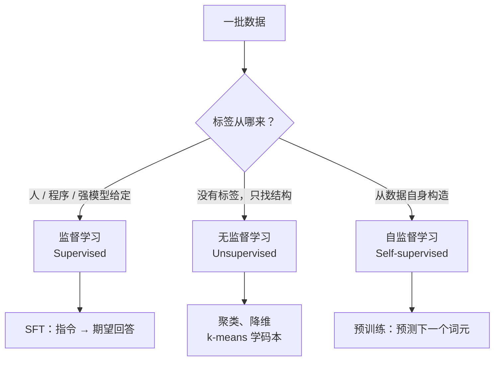

# 2. 三种学习范式（Learning Paradigms）——监督学习、无监督学习与自监督学习

> **读之前**：读完第 1 章，知道预训练和后训练的区别。
>
> **读完你能做到**：看到一种训练方法，能判断它属于监督、无监督还是自监督；理解为什么预训练可以用几乎"免费"的文本，而 SFT 需要人写答案；不再把"自监督"和"无监督"混为一谈。

---

## 一、从一个问题开始

第 1 章说：预训练之后还要做 SFT。但两者的数据规模差得很远：

- 预训练用**万亿级词元**的文本，几乎不需要人工标注；
- SFT 只用**几千到几十万条**"指令 → 期望回答"，每条都要有人（或强模型）准备。

同样是训练模型，为什么数据来源和规模差这么多？

答案藏在**标签（Label）从哪里来**。机器学习的训练本质上是在做"预测 → 和答案比较 → 调整参数"。关键就在于：这个"答案"是谁给的？

- 如果答案由人（或程序、或更强的模型）提供，就是**监督学习**；
- 如果根本没有答案，只能从数据本身找结构，就是**无监督学习**；
- 如果答案是从数据自身自动构造出来的，就是**自监督学习**。



---

## 二、三种范式，看标签从哪里来

| 范式 | 标签从哪来 | 典型任务 | 本书里的例子 |
|---|---|---|---|
| **监督学习**（Supervised Learning） | 数据中给定任务目标，可来自人工、程序或模型 | 分类、回归、翻译 | **SFT**：标签是与指令对应的期望回答 |
| **传统无监督**（Unsupervised Learning） | 不提供外部标签，直接建模数据结构或分布 | 聚类、降维、密度估计 | 第一部分 k-means 学音频码本（Codebook） |
| **自监督学习**（Self-supervised Learning） | 从数据自身构造预测目标，无需逐条人工标注 | 语言建模、对比学习 | **预训练**：标签就是下一个词元 |

用三个具体例子把区别落地。

**监督学习：给图片和标签。** 给模型一张猫的图片，同时告诉它"这是猫"。模型预测"猫"的概率，损失衡量预测与标签的差距。SFT 也一样，只是 `x` 是对话上下文，`y` 是期望回答；训练时通常只对回答部分算损失，指令部分只作为条件输入。

**传统无监督：只给数据，不给标签。** k-means 没有"猫/狗"标签。它先随机选几个中心，把每个样本分给最近的中心，再重新计算中心，反复迭代，让簇内距离变小。它没有"预测下一个词"的损失，但并不是"没有目标函数"——目标就是簇内距离。

**自监督：从数据里自动造答案。** 取原文"今天天气真"，让模型预测下一个词"好"。标签"好"不是人写的，而是原文本来就有的。它仍然有输入、有标签、有损失，机制上仍是监督学习；特殊之处只在于**标签由数据自动生成**。

所以有两个常见误解需要纠正：

> **自监督不是"没有监督"，而是"监督信号由数据自己提供"。**
>
> **无监督也不是"没有损失"，而是"没有外部标签，优化目标来自数据结构"。**

---

## 三、三种范式的训练过程有什么不同

以神经网络为例，三者通常都要经过"前向计算 → 计算损失 → 反向传播 → 更新参数"。真正的区别在于**损失是跟什么比较**。

| 环节 | 监督学习 | 传统无监督（以 k-means 为例） | 自监督学习 |
|---|---|---|---|
| 数据 | 成对的 `(x, y)` | 只有 `x` | 只有 `x`，但会自动构造 `(x, y')` |
| 标签来源 | 人工、程序或强模型给定 | 没有外部标签 | 从数据自身生成伪标签 |
| 优化目标 | 预测值与标签的差距（交叉熵、均方误差） | 簇内距离、重构误差等结构目标 | 预测值与伪标签的差距（下一词交叉熵、对比损失） |
| 参数更新 | 反向传播 | 可能是交替优化，不一定用梯度 | 反向传播 |
| 本书例子 | 第 4 章 SFT | 第一部分 k-means 音频码本 | 预训练语言模型 |

**一个关键区别：是否"从零训练"与属于哪种范式，是两个维度。**

- **从零训练（from scratch）**：随机初始化，所有参数都更新。第一部分的 nanoGPT 从零训练，用的是自监督预训练。
- **在已有权重上继续训练**：先加载一个模型，再按新目标更新全部或部分参数。第 4 章的 SFT 从 Qwen2.5 基础模型开始，不是从零训练；第 5 章的 DPO 又接着加载 SFT 产物。
- **传统无监督方法**：像 k-means、PCA 直接在特征上迭代，没有"先预训练一个神经网络"的步骤；也可以先用自监督模型提特征，再做聚类或降维。

因此，**"监督 / 无监督 / 自监督"回答的是"标签从哪来"，"从零训练 / 微调"回答的是"参数从哪初始化"**。加载了已有权重，不会改变范式；从零训练一个自监督模型，也仍然是自监督。

---

## 四、三者有什么联系

它们不是三个互斥的盒子，也不是互相替代的关系。

1. **可以在同一个模型上先后使用。** 典型流程是：自监督预训练 → 监督 SFT → 偏好学习/强化学习。前一步提供基础能力，后一步改变行为。
2. **自监督可以看作"自动造标签的监督学习"。** 广义上，很多文献把自监督归入无监督；本书为了讲清训练信号，把它单独拿出来。
3. **传统无监督常作为旁路工具。** 聚类、降维、向量量化可用于数据分析、可视化和表示学习，但不一定参与大模型的主训练流程。
4. **边界存在灰区。** 伪标签、弱监督、对比学习可能同时带有监督和无监督的特征。不必执着于"必须归到哪一类"，更重要的是说清楚：数据是什么、标签从哪来、损失在优化什么。

判断一个训练过程属于哪种范式，可以依次问三个问题：

> **有没有标签？标签是谁给的？损失在跟什么比较？**

这比背名词定义有用。

---

## 五、三个常见问题

### Q1：说"10 万条 SFT 样本"，到底是多少训练量？

这里要区分**样本条数**和**词元（Token）数**。一条 SFT 样本通常是一段对话，可能只有几十个词元，也可能有几千个。

要估算训练量，用"样本条数 × 平均每条词元数"。例如 10 万条、每条平均 500 个词元：

```text
100000 × 500 = 50,000,000 词元
```

即 5000 万词元，不是 10 万词元。如果把"一条样本"当成"一个词元"，会差约 500 倍。

同样，不能拿"预训练用了多少词元"直接除以"SFT 用了多少条样本"，因为分子分母单位不同。要比较规模，先统一成词元数、训练步数或计算量。

### Q2：无监督和自监督到底怎么分？

两者都可以不依赖人工标签，所以有文献把自监督归入广义无监督。本书为了讲清训练信号，把它们分开：

- **传统无监督**：直接优化数据结构目标，例如 k-means 最小化簇内距离、PCA 最大化方差。没有"从数据里造一个预测任务"这一步。
- **自监督**：先从数据里构造明确的预测目标，例如"用前文预测下一个词""遮住一部分再重建""判断两张图是否配对"，再像监督学习一样算损失、反向传播。

入门记法：**k-means 直接找结构，自监督先造预测任务。** 这不是绝对边界，但足够应付大多数判断。

### Q3：模型自己生成数据再训练自己，算哪种范式？

这是"模型自举（model bootstrapping）"，常见于合成数据（synthetic data）、蒸馏（distillation）、自指示（Self-Instruct）。

**"自举"描述的是数据生产和模型迭代的循环，不是第四种范式。** 它回答"训练数据从哪来"，不回答"训练时用什么损失"。判断某一步，仍然看它用的监督信号：

以 DeepSeek-R1 的拒绝采样 SFT（Rejection Sampling SFT）为例：

1. 模型生成候选答案——**推理**，此时不更新参数；
2. 根据参考答案、测试或评分器筛选——**数据验证与选择**，不是一次训练；
3. 用筛出的回答做 SFT——**监督学习**，只是示范来自模型而不是人。

可验证任务（数学、代码）能用程序较低成本地检查候选，因此适合扩展这种循环；但验证并不免费，答案正确也不保证推理过程正确。不能自动判定的任务仍可人工或模型评分，只是成本、误判和偏差更难控制。

---

## 本章小结

- 三种范式的分界线是**标签从哪来**：人/程序给定、没有标签、从数据自身构造。
- 预训练是自监督：标签是原文的下一个词元，所以海量文本可以直接用；SFT 是监督：需要成对的"指令 → 期望回答"。
- 自监督不是"没有监督"，无监督也不是"没有损失"。
- "属于哪种范式"和"是否从零训练"是两个维度：SFT 从预训练权重开始，仍然是监督学习。
- 三者可以在同一模型上先后使用，不是互斥关系；模型自举是数据迭代流程，不是新范式。
- 比较数据规模前先统一单位：样本条数 × 平均词元数 = 词元总量。

> **一句话记住本章**：先看标签从哪来，再决定要准备什么数据。

## 下一章预告

范式决定了数据需求：预训练需要海量原始文本，SFT 需要成对的指令与回答。接下来的问题是：**这些原始文本从哪来？抓下来的网页为什么不能直接训练？**

> **第 3 章 数据工程——语料来源、清洗与配比**

---

## 思考题

1. 为什么说自监督学习是大模型能规模化的前提？如果语言建模必须人工标注，会发生什么？
2. k-means 属于哪种范式？它和"预测下一个词元"的本质区别是什么？
3. 拒绝采样 SFT 中，候选生成、验证筛选和参数训练分别做什么？为什么"程序自动判定答案"不等于自监督？
4. 如果有人说"我们用了 100 万条数据"，你会追问哪两个问题才能判断训练量？

---

## 参考资料

- Goodfellow et al.《Deep Learning》：https://www.deeplearningbook.org/
- Devlin et al.《BERT: Pre-training of Deep Bidirectional Transformers》：https://arxiv.org/abs/1810.04805
