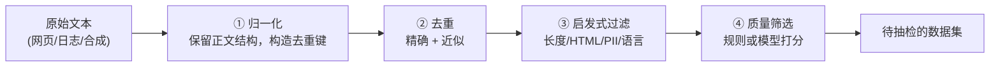

# 3. 数据工程——语料来源、清洗与配比

> **读之前**：读完第 2 章，知道预训练需要海量连续文本、SFT 需要成对的"指令 → 期望回答"。
>
> **读完你能做到**：说清一份预训练语料从哪来、要过哪几道清洗、每道在防什么；知道去重和隐私处理为什么不能省；理解数据配比没有通用答案。

---

## 一、为什么数据工程值得单独一章

第 2 章讲清了"需要什么数据"。但还有一个更前置的问题：**这些数据最初从哪来？拿到手的原始文本有多脏？怎么把它洗成能训练的样子？**

数据工程值得单独成章，不是因为它比模型结构"高级"，而是因为它决定三件很具体的事。

**第一，模型能看到什么。** 网页、书籍、代码、论文的比例不同，模型学到的东西就不同；训练语料里没出现过的语言、领域或表达方式，模型很难凭空掌握。

**第二，模型会重复看到什么。** 互联网上大量内容互相转载，一条新闻可能被几百个站点复制。不去重，模型就会把重复内容当成"重要规律"，既浪费训练词元，也让输出带上单一来源的语言风格。

**第三，哪些内容会被删掉。** 清洗规则在去掉广告、乱码和隐私信息的同时，也可能误删短问答、代码片段或少数语言。**删得干净不等于删得正确**，清洗效果必须用抽检和下游评测来检查。

所以，数据工程不是跑几个脚本就能完成的辅助工作，而是决定训练信号质量的基础环节。在模型和算力相近时，数据质量、覆盖度与配比往往决定训练结果的上限；但它不是唯一变量，不能替代模型结构、优化方法和评测。

---

## 二、语料从哪来：从原始网页到开源数据集

预训练语料包括网页、书籍、代码和学术文本。下面是几种常见的公开语料，**它们不是逐级清洗、彼此继承的同一条链**，使用前要核对版本、授权和数据来源：

| 数据集 | 来源 | 规模量级 | 特点 |
|---|---|---|---|
| **Common Crawl** | 大规模公开网页抓取 | 历年累计 PB 级 | 许多网页语料的源头；提供网页归档与文本提取，可能含广告、导航和模板 |
| **C4**（Colossal Clean Crawled Corpus） | Common Crawl 的英语清洗子集 | 约 750 GB | T5 使用的启发式清洗语料；不同变体口径不同 |
| **The Pile** | 网页、学术、代码、书籍等多源混合 | 约 825 GB | 强调多样性与配比，供 GPT-Neo、Pythia 等使用 |
| **RedPajama v1** | 按 LLaMA 公开配方整理的多源语料 | 约 1.2 万亿词元 | 以复现 LLaMA 数据配方为目标；后续版本目标不同 |
| **Dolma** | 网页、代码、学术、书籍等多源混合 | 约 3 万亿词元 | AI2 为 OLMo 整理，不是 LLaMA 配比复现 |

**中文场景**：中文语料同样要过来源与授权检查。实验 3.2 会比较分词器（Tokenizer）；配比时要明确按文档数、字符数还是词元数统计，不能假定"中文在任何词表下都更费词元"。

### 原始网页到底有多脏

从网页归档里提取出来的一段文本，可能长这样：

```text
首页 | 产品 | 价格 | 登录 | 注册
本站使用 Cookie 以改善体验，继续浏览即表示同意。
【广告】限时优惠，点击领取……
==========================================
机器学习是人工智能的一个分支。它研究计算机如何
利用经验改善系统性能，广泛应用于推荐、搜索与
自然语言处理等领域。
==========================================
上一篇：深度学习入门    下一篇：Transformer 详解
版权所有 © 2024 某某科技   京ICP备xxxx号
```

真正有用的只有中间那段正文。导航栏、Cookie 提示、广告、上下篇链接、版权声明这些**样板文本（Boilerplate）**，以及重复的页面模板，都要在清洗阶段处理掉。

删除比例依源数据、语言和规则而异，不是越高越好。删得太多会误伤正文，删得太少会留下噪声。

---

## 三、清洗流水线：四道关卡

为便于理解，先按四类环节组织。真实管线会调整顺序、重复执行，还需要授权检查、数据版本与评测集去污染；下面的流程不是完整工业实现：



| 关卡 | 做什么 | 需要注意什么 |
|---|---|---|
| **① 归一化** | 保留正文换行、缩进；为去重单独生成规范化键 | Unicode 规范化（NFKC）、空白折叠会改变代码、公式与格式，不要无条件覆盖正文 |
| **② 去重** | 哈希去除精确重复；用 MinHash/SimHash 等发现近似重复 | 降低记忆和分布偏移风险，同时检查误合并与训练/测试集重叠 |
| **③ 启发式过滤** | 长度、HTML/样板、PII、语言等规则 | 规则可能误杀短问答或代码；隐私检测、脱敏和合规审查不是同一件事 |
| **④ 质量筛选** | 统计特征、分类器或 LLM 评分 | 分数是代理指标，要用抽检和下游评测验证 |

### 去重：不是"省空间"的小事

重复数据的危害不止浪费存储：

- **导致过拟合（overfitting）**：模型反复看到同样的文本，会把它背下来，在没见过的数据上表现变差；
- **扭曲数据分布**：同一篇新闻被几十个站点转载，某些句子会在训练集里出现成百上千次，模型会误以为这类内容"非常重要"。

精确去重只能抓一模一样的文本。互联网上更多的是**近似重复（near-duplicate）**：改了标题、加了免责声明、模板只有日期不同。这时要用 MinHash / SimHash 等近似方法，工业界常用局部敏感哈希（Locality-Sensitive Hashing, LSH）分桶加速。近似去重会带来误合并的风险，需要抽样检查。

### 个人信息（PII）：合规红线

个人身份信息（Personally Identifiable Information, PII；邮箱、手机号、身份证号等）进入训练集，模型可能在生成时**泄露他人隐私**。这既是《通用数据保护条例》（General Data Protection Regulation, GDPR）等法规的合规要求，也是第 7 章安全对齐的一环。

一个泄露用户隐私的模型，效果再好也无法上线。因此隐私处理不能只靠"正则命中就删"：还需要来源授权、访问控制、脱敏、删除流程和更完整的实体识别。**"正则没命中"不等于"没有隐私风险"。**

### 质量筛选：值得花钱的一步

前几步能去掉"明显垃圾"，但筛不出"语法通顺却毫无信息量的水帖"。这一步要靠**打分**，有两条路线。

**路线一：规则打分（便宜、可解释）。** 用统计特征给文本打分，例如：

- **词汇多样性（Type-Token Ratio, TTR）**：不同词的数量 / 总词数，太低说明重复啰嗦；
- **标点/符号比例**：异常符号过多往往是乱码或机器生成垃圾；
- **语言置信度**：用语言检测器确认是不是目标语言。

**路线二：模型打分（成本与效果需验证）。** 用质量分类器或较强的 LLM，按任务相关性、信息密度等标准打 1～5 分。评分器可能偏爱某种文风、漏掉事实错误，需抽样校准，并监控被删掉的领域。

**为什么可能值得花钱？** 筛选能减少无效训练词元，但要把评分成本、覆盖损失与下游收益一起算。业界有"用高质量数据训更少词元"的成功案例，但这不等于"数据越少越好"；质量、覆盖度和数量要一起考虑。

---

## 四、数据配比：最后一块拼图

清洗出干净数据后，还有一个深刻影响效果的决策：**不同类型的数据各占多少？**

The Pile 强调多样性的价值，LLaMA 公开过自己的配比（网页、书籍、代码、学术等各占一定比例）。配比重要，是因为不同类型的数据"教"给模型的能力不同：

- **代码数据**有助于代码任务，也可能改善部分推理任务，但收益依质量、比例和评测而定；
- **书籍/长文本**提供长程依赖与连贯叙述的训练信号，还需要合适的上下文长度；
- **高质量对话**影响 SFT 后的交互体验，不能替代基座能力和评测；
- 某类数据占比过高，模型会带上那类数据的语言风格，例如通篇网页体或论坛语气。

**数据配比不存在一劳永逸的最优解，只能结合目标任务做实验。** 这也是为什么现代训练流程会把配比实验和模型调参放在同等重要的位置。

> **一句话**：在算力、模型和训练方法相近时，谁更理解自己的数据，谁就更有机会用同样的预算得到更好的模型。数据不是万能钥匙，它只是训练信号的上游。

---

## 本章对应的实验

| 实验 | 对应本章内容 | 你要亲手做什么 |
|---|---|---|
| [3.1 数据清洗实战](<./3.1%20数据清洗实战——从原始文本到训练语料.md>) | 第三节（清洗） | 用 7 条手工样本跑通"保留正文 → 去重键 → 精确去重 → 启发式过滤" |
| [3.2 中文场景下的分词器（Tokenizer）与数据处理](<./3.2%20中文场景下的分词器（Tokenizer）与数据处理.md>) | 第二节（中文语料延伸） | 对比中英文分词，检查编码、模板长度与回答边界 |

质量评分、近似去重与配比在 3.1 中只留了扩展位置，没有执行。

---

## 本章小结

- 数据工程决定模型能看到什么、重复看到什么、哪些内容被删掉；删得干净不等于删得正确。
- 公开语料不是一条逐级清洗的链；网页语料要先去掉导航、广告、版权声明等样板文本。
- 清洗常见四步：归一化、去重、启发式过滤、质量筛选；顺序和实现依数据调整。
- 去重防过拟合和分布扭曲；PII 处理是合规红线，正则删除不能代替完整合规审查。
- 质量分和删除比例都是代理指标，最终要看下游评测。
- 配比没有通用最优解，要明确计量单位并做实验。

> **一句话记住本章**：不是删得越多越好，而是让保留的数据更符合任务，同时避免丢掉有价值的训练信号。

## 下一章预告

数据清洗完，接下来要构造"指令 → 期望回答"的示范。但怎么让模型只看回答、不看问题？怎么保证训练和推理使用同一种对话格式？

> **第 4 章 监督微调（SFT）——指令跟随能力的训练**

---

## 思考题

1. 为什么从 Common Crawl 到 C4 会丢掉大部分原始内容？被丢掉的内容里，有没有可能误删了有价值的文本？如何降低误删？
2. 如果训练数据里有大量重复文本（比如某条新闻被转载 500 次），会对模型产生什么影响？精确去重能完全解决吗？
3. 为什么"用 LLM 给数据打分"这种看起来很贵的方法，反而可能比全量训练更省钱？
4. 如果让你为中文客服场景设计配比，你会先确定哪三件事，再开始实验？

---

## 参考资料

- Gao et al.《The Pile: An 800GB Dataset of Diverse Text for Language Modeling》：https://arxiv.org/abs/2101.00027
- Lee et al.《Deduplicating Training Data Makes Language Models Better》：https://arxiv.org/abs/2110.01962
- Raffel et al.《Exploring the Limits of Transfer Learning with a Unified Text-to-Text Transformer》（C4）：https://arxiv.org/abs/1910.10683
