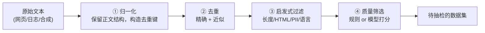

# 3. 数据工程——语料来源、清洗与配比

> **本章目标**
>
> - 认识真实的公开预训练语料及其不同来源（Common Crawl、C4、The Pile、RedPajama、Dolma），理解数据清洗（data cleaning）在大语言模型（LLM）时代的分量
> - 理解清洗流水线的四类常见环节：归一化（normalization）→ 去重（deduplication）→ 启发式过滤（heuristic filtering）→ 质量筛选（quality filtering）；实际顺序和实现依数据类型调整
> - 理解为什么去重不是"省空间"的小事，以及个人身份信息（Personally Identifiable Information, PII）脱敏为什么是合规红线而非质量问题
> - 理解质量筛选的两条路线（规则打分 vs 大模型打分），以及它与"数据质量 >> 数据数量"的关系
> - 理解数据配比（data mixture）为什么深刻影响模型能力，以及为什么不存在一套通用最优配比
> - 建立核心认知：**数据质量、覆盖度与配比共同影响训练效果，清洗也要防止误删**（动手实现见实验 3.1、3.2）

---

## 一、数据工程的独立价值

上一章讲清了：范式决定数据需求——预训练（自监督）需要海量无标注文本，监督微调（SFT，监督学习）需要成对的"指令-回答"。

但还有一个更前置的问题：**这些数据最初是从哪来的？拿到手的原始文本有多脏？怎么把它洗成能训练的样子？**

数据工程值得单独成章，不是因为它比模型结构更"高级"，而是因为它决定了三件很具体的事。

第一，**模型能看到什么**。网页、书籍、代码、论文的比例不同，模型学到的东西就不同；训练语料里没有出现过的语言、领域或表达方式，模型很难凭空掌握。

第二，**模型会重复看到什么**。互联网上大量内容互相转载，一条新闻可能被几百个站点复制。不去重，模型就会把重复内容当成“重要规律”，既浪费训练词元，也会让输出带上单一来源的语言风格。

第三，**哪些内容会被删掉**。清洗规则在去掉广告、乱码和隐私信息的同时，也可能误删短问答、代码片段或少数语言。删得干净不等于删得正确，清洗效果必须用抽检和下游评测来检查。

所以，数据工程不是跑几个脚本就能完成的辅助工作，而是决定训练信号质量的基础环节。在模型和算力相近时，数据质量、覆盖度与配比往往决定训练结果的上限；但它不是唯一变量，不能替代模型结构、优化方法和评测。

---

## 二、真实语料的来源：从原始网页到开源数据集

预训练语料包括网页、书籍、代码和学术文本等。下面是几种公开语料，**它们不是逐级清洗、彼此继承的同一条链**，使用前还需核查版本、授权和数据来源：

| 数据集 | 来源 | 规模量级 | 特点 |
|---|---|---|---|
| **Common Crawl** | 大规模公开网页抓取 | 历年累计 PB 级 | 许多网页语料的重要源头；提供网页归档及文本提取等数据，可能含广告、导航和模板 |
| **C4**（Colossal Clean Crawled Corpus） | Common Crawl 的英语清洗子集 | 约 750GB | T5 使用的启发式清洗语料；不同变体口径不同 |
| **The Pile** | 网页、学术、代码、书籍等多源混合 | 约 825GB | 强调多样性与配比，供 GPT-Neo、Pythia 等使用 |
| **RedPajama v1** | 按 LLaMA 公开配方整理的多源语料 | 约 1.2 万亿词元（Token） | 以复现 LLaMA 数据配方为目标；后续版本目标和规模不同 |
| **Dolma** | 网页、代码、学术、书籍等多源混合 | 约 3 万亿词元（Token） | AI2 为 OLMo 整理的语料，不是 LLaMA 配比复现 |

**关键认知**：从网页归档提取文本时，要处理导航栏、cookie 提示、广告等**样板文本（Boilerplate）**。大量内容可能被移除，但删除比例依源数据、语言和规则而异，不是越高越好。

**中文场景**：中文语料也要经过来源与授权检查。后面的实验 **3.2** 会实际比较分词器（Tokenizer）；配比应明确按文档数、字符数还是词元数统计，不能假定中文在任意词表下都必然膨胀。

---

## 三、清洗流水线：四道关卡

为便于理解，先按四类环节组织。真实管线会调整顺序、重复执行，还需要授权检查、数据版本与评测集去污染等工作；下面不是完整工业实现：

| 关卡 | 做什么 | 需要注意什么 |
|---|---|---|
| **① 归一化** | 保留正文换行、缩进；为去重单独生成规范化键 | NFKC、空白折叠会改变代码、公式与格式，不能无条件覆盖正文；去重键也要按数据类型选择策略 |
| **② 去重** | 哈希去除精确重复；用 MinHash/SimHash 等发现近似重复 | 降低记忆和分布偏移风险，同时检查误合并与训练/测试集重叠 |
| **③ 启发式过滤** | 长度、HTML/样板、PII、语言等规则 | 规则可能误杀短问答或代码；隐私检测、脱敏和合规审查不是同一件事 |
| **④ 质量筛选** | 统计特征、分类器或 LLM 评分 | 分数是代理指标，要用抽检及下游评测验证，不能把模型高分直接当成事实正确 |

### 3.1 去重的作用不止于节省空间

这一点值得单独强调。重复数据的危害远不止浪费存储：

- **导致过拟合（overfitting）**：模型反复看到同样的文本，会把它背下来，在没见过的数据上表现变差；
- **严重扭曲数据分布**：互联网上大量内容本来就是互相抄的（同一个新闻稿被几十个站点转载）。不去重的话，某些句子会在训练集中出现成百上千次，**模型会误以为这类内容"非常重要"**，从而学到扭曲的分布。

精确去重只能抓一模一样的文本，但互联网上更多的是**近似重复（near-duplicate）**（同一篇新闻改了标题、转载时加了免责声明、模板页面只有日期不同）。这时要用 MinHash / SimHash 等近似方法——工业界常用局部敏感哈希（Locality-Sensitive Hashing, LSH）分桶来加速。

### 3.2 PII 脱敏：这不是质量问题，是合规红线

个人身份信息（Personally Identifiable Information, PII；邮箱、手机号、身份证号等）进入训练集，模型可能在生成时**泄露他人隐私**。这既是《通用数据保护条例》（General Data Protection Regulation, GDPR）等法规明确要求的合规问题，也是第7章安全对齐（Safety Alignment）的一环。

真实项目里，这一步的重要性往往**超过模型调参**——一个泄露用户隐私的模型，效果再好也无法上线。

### 3.3 质量筛选：值得花钱的一步

前几步能去掉"明显垃圾"，但筛不出"平淡无用的文本"——比如一句语法通顺却毫无信息量的水帖。这一步要靠**打分**，有两条路线：

**路线一：规则打分（便宜、可解释）。** 用可解释的统计特征给文本打分，例如：

- **词汇多样性**（Type-Token Ratio, TTR）：不同词的数量 / 总词数，太低说明重复啰嗦；
- **标点/符号比例**：异常符号过多往往是乱码或机器生成垃圾；
- **语言置信度**：用语言检测器确认是不是目标语言。

**路线二：模型打分（成本与效果需验证）。** 可以用质量分类器或较强的 LLM，根据任务相关性、信息密度等标准评分，例如 1~5 分。评分器也可能偏爱某种文风、漏掉事实错误，需抽样校准并监控被删领域。

**为什么可能值得花钱？** 筛选可能减少无效训练词元，但要把评分成本、覆盖损失与下游收益一起算。第4章的 LIMA 是精选示范的监督微调案例，Phi 则讨论高质量预训练数据，两者不能合成“质量永远大于数量”的通用定律；例如“100 万筛成 10 万更好”只能是待实验验证的假设。

---

## 四、数据配比：最后一块拼图

清洗出干净数据后，还有一个深刻影响效果的决策：**不同类型的数据各占多少？**

The Pile 强调多样性的价值，LLaMA 则公开了自己的配比（网页、书籍、代码、学术等各占一定比例）。配比之所以重要，是因为不同类型的数据"教"给模型的能力不同：

- **代码数据**有助于代码任务，也可能改善部分推理任务，但收益依质量、比例和评测而定；
- **书籍/长文本**提供长程依赖与连贯叙述的训练信号，还需合适的上下文长度；
- **高质量对话**影响监督微调（SFT）后的交互体验，不能替代基座能力与评测；
- 某类数据占比过高，模型就会带上那类数据的语言风格，例如通篇网页体，或者通篇论坛语气。

**数据配比不存在一劳永逸的最优解，只能结合目标任务做实验。** 这也是为什么现代训练流程会把配比实验和模型调参放在同等重要的位置。

> **更准确的说法是：在算力、模型和训练方法相近时，谁更理解自己的数据，谁就更有机会用同样的预算得到更好的模型。** 数据不是万能钥匙，它只是训练信号的上游；上游选错了，下游再调参也很难补回来。

---

## 本章对应的实验

本章概念对应两个动手实验：

| 实验 | 对应本章内容 | 你要亲手做什么 |
|---|---|---|
| [3.1 数据清洗实战](<./3.1%20数据清洗实战——从原始文本到训练语料.md>) | 第三节（清洗）与第四节（配比） | 用手工样本实现前三步；质量评分、近似去重与配比只讲方法，未执行 |
| [3.2 中文场景下的分词器（Tokenizer）与数据处理](<./3.2%20中文场景下的分词器（Tokenizer）与数据处理.md>) | 第二节（中文语料延伸） | 对比分词，检查编码、真实模板长度与回答边界 |

---

## 本章总结

本章认识了不同来源的公开语料，梳理了归一化、去重、启发式过滤和质量筛选。正文格式与去重键要分开处理；隐私规则不能代替完整合规审查；质量分和删除比例也不能代替下游评测。数据配比要明确计量单位，并靠实验检查收益与覆盖损失。

> **一句话记住本章**：不是删得越多越好，而是让保留的数据更符合任务，同时避免丢掉有价值的训练信号。

## 下一章预告

实验 3.1、3.2 完成基础清洗与分词器（Tokenizer）检查后，我们还需要构造指令示范。接下来的问题是：**如何用这些示范，让基础模型（Base Model）更稳定地按指令回答？**

下一章我们进入对齐流水线的第一步，也是整条链路的地基：

> **第4章 监督微调（SFT）——指令跟随能力的训练**

---

## 思考题

1. 为什么从 Common Crawl 到 C4 会丢掉绝大部分原始内容？这些被丢掉的内容里，有没有可能误删了有价值的文本？如何降低误删？
2. 如果训练数据里有大量重复文本（比如某条新闻被转载 500 次），会对模型产生什么影响？精确去重能完全解决吗？
3. 为什么"用 LLM 给数据打分"这种看起来很贵的方法，反而可能比全量训练更省钱？

---

## 参考资料

- Gao et al.《The Pile: An 800GB Dataset of Diverse Text for Language Modeling》：https://arxiv.org/abs/2101.00027
- Lee et al.《Deduplicating Training Data Makes Language Models Better》：https://arxiv.org/abs/2107.06499
