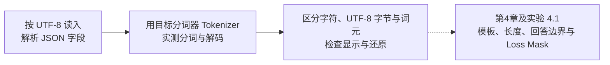

# 3.2 中文场景下的分词器（Tokenizer）与数据处理

> **本节定位**：本节只做数据检查。分词器原理见第一部分第2章，数据工程与配比见第3章，本节不重复讲解。

> **硬件要求**：CPU 即可运行。字节演示只用 Python 标准库；分词器实验需要安装支持 Qwen2.5 的 `transformers` 并下载词表，不加载模型权重。复现时记录包版本与模型版本号（revision）。
>
> **本节目标**：承接第一部分第2章的分词器原理，观察中文与英文的编码、分词差异。中文没有显式词间空格，一个汉字可能对应多个词元（Token）；但“中文一定更费词元”并不成立，必须对具体词表和语料实测。我们将检查编码、JSON 转义与分词结果；模板后的长度和回答边界留到第4章及实验 4.1，与损失掩码（Loss Mask）一起处理。

## 一、中文没有空格，按空格切会失败

分词器的原理见第一部分第 2 章，这里只做观察。先用一段代码确认：英文可以按空格切词，中文不行。

```python
en = "The cat is sleeping"
zh = "那只猫正在睡觉"

# 英文：按空格 split 就能得到词
print("英文按空格切:", en.split())          # ['The', 'cat', 'is', 'sleeping']
# 中文：按空格 split 完全失效，整句变成一个元素
print("中文按空格切:", zh.split())           # ['那只猫正在睡觉']  ← 切不开
# 中文只能退到"单字"这一层才有天然边界
print("中文按字切:", list(zh))               # ['那', '只', '猫', '正', '在', '睡', '觉']
```

英文的空格天然提供了词边界，中文没有。现代模型通常用子词或字节级方法处理这个问题，具体机制见第一部分第 2 章。

## 二、先看 UTF-8 字节数，但它不是词元数

常见英文字母占 1 个 UTF-8 字节，常见汉字通常占 3 个，部分扩展汉字占 4 个。下面用纯 Python 检查字符数和字节数；这些计数都不是模型的词元数：

```python
samples = ["cat", "猫", "你好", "人工智能", "Transformer", "深度学习"]
for s in samples:
    b = s.encode("utf-8")
    print(f"{s:>12} | 字符数={len(s)} | UTF-8字节数={len(b)} | 每字符字节={len(b)/len(s):.1f}")
```

预期输出：

```text
         cat | 字符数=3 | UTF-8字节数=3 | 每字符字节=1.0
           猫 | 字符数=1 | UTF-8字节数=3 | 每字符字节=3.0
          你好 | 字符数=2 | UTF-8字节数=6 | 每字符字节=3.0
        人工智能 | 字符数=4 | UTF-8字节数=12 | 每字符字节=3.0
 Transformer | 字符数=11 | UTF-8字节数=11 | 每字符字节=1.0
        深度学习 | 字符数=4 | UTF-8字节数=12 | 每字符字节=3.0
```

上例的 ASCII 字符各占 1 字节，所选常见汉字各占 3 字节。再看具体字节：

```python
for ch in ["猫", "能"]:
    bs = ch.encode("utf-8")
    print(f"{ch} -> {len(bs)} 字节: {[hex(x) for x in bs]}")
```

预期输出：

```text
猫 -> 3 字节: ['0xe7', '0x8c', '0xab']
能 -> 3 字节: ['0xe8', '0x83', '0xbd']
```

同一个汉字可能由多个字节词元表示，也可能合并成一个；多个汉字还可能共同合成一个词元。所以既不能假设“一汉字 = 三词元”，也不能假设词元边界一定对齐字符边界，必须以实际分词器编码为准。

## 三、同义句的字节数不等于词元数

先比较两句同义文本的字符数与字节数，但**不能据此判定哪句更费词元**：

```python
en = "Artificial intelligence is changing the world."
zh = "人工智能正在改变世界。"

print(f"英文: 字符数={len(en)}  UTF-8字节数={len(en.encode('utf-8'))}")
print(f"中文: 字符数={len(zh)}  UTF-8字节数={len(zh.encode('utf-8'))}")
```

预期输出：

```text
英文: 字符数=46  UTF-8字节数=46
中文: 字符数=11  UTF-8字节数=33
```

上例中文有 33 个 UTF-8 字节，但实际词元数可能少于 11 个；具体数量由词表、预切分和文本决定，应直接编码测量。

词元长度会影响计费、上下文窗口和训练/推理速度，所以选中文基座时，“分词器对中文的压缩率”值得和参数量一起看。

## 四、动手对比：不同分词器切中文的差异

这一步需要 `pip install transformers`（仍是 CPU 级别，只是加载分词器，不加载模型权重）。我们用同一句中文，对比一个**中文优化过的**分词器（Qwen2.5）和一个**几乎没中文优化的**（GPT-2）：

```python
from transformers import AutoTokenizer

texts = ["人工智能正在改变世界。", "Artificial intelligence is changing the world."]
qwen = AutoTokenizer.from_pretrained("Qwen/Qwen2.5-0.5B-Instruct")
gpt2 = AutoTokenizer.from_pretrained("gpt2")

for name, tok in [("Qwen2.5", qwen), ("GPT-2", gpt2)]:
    for text in texts:
        ids = tok(text, add_special_tokens=False)["input_ids"]
        pieces = tok.convert_ids_to_tokens(ids)
        restored = tok.decode(ids, clean_up_tokenization_spaces=False)
        assert restored == text
        print(f"\n{name}: {len(ids)} 个 Token | {text}")
        print("  词表内部表示:", pieces)
        print("  逐 Token 解码:", [tok.decode([i], clean_up_tokenization_spaces=False) for i in ids])
        print("  整段解码:", restored)
```

记录同一分词器下的中英文长度，再比较不同分词器对同一中文的长度。Qwen 通常能更紧凑地编码常见中文，但具体分片、比例和数量应以固定版本号（revision）的实测为准，不应假定 GPT-2 的每个汉字都恰好占三个词元。

**特别注意显示方式**：`convert_ids_to_tokens` 返回词表内部字符串，Qwen 和 GPT-2 都可能显示字节映射后的符号，**并非 Qwen 一定显示可读中文、GPT-2 才显示“乱码”**。单个词元可能只含某个 UTF-8 字符的一部分，因此逐词元 `decode` 可能出现 `�`；拼齐字节后整段解码仍可恢复原文。这是分片边界现象，不一定是文件编码损坏。

分词更紧凑说明词表对这段文本的压缩更好，不等价于模型更聪明或所有任务都更强。

> **训练自有分词器的提示**：如果要在中文语料上训练自己的 BPE（回顾第一部分 2.6 训练 Mini BPE Tokenizer），务必**用中文语料来统计合并规则**，并适当增大词表容量（中文常用字就有几千个，词表太小会导致大量汉字退回字节级）。

## 五、编码与 JSON 转义：别把转义字符串当正文

分词之前先把“文本从哪里来、以什么编码读写”确认清楚。这个问题与具体分词器无关，但在中文数据里特别容易被 `ensure_ascii`、终端编码和词元显示混在一起。

### 文件编码、JSON 转义与词元显示

读写文本文件时应明确约定 UTF-8，不依赖平台默认编码。JSON 的 `ensure_ascii=False` 只控制序列化时是否直接显示中文，并不决定反序列化后的内容是否正确：

```python
import json

sample = {"instruction": "介绍一下自己", "output": "我是一个中文助手。"}
readable = json.dumps(sample, ensure_ascii=False)
escaped = json.dumps(sample, ensure_ascii=True)
assert json.loads(readable) == json.loads(escaped) == sample
assert readable.encode("utf-8").decode("utf-8") == readable
print(readable)
```

实际 JSONL 文件仍需在读写时指定 `encoding="utf-8"`。两种转义方式都能被 `json.loads` 正确还原；训练应使用解析后的字段内容，不要把原始 JSON 转义字符串误当正文。本例在内存中演示，不创建文件。

模板后的长度统计、回答边界和损失掩码都依赖 4.1 的消息构造与标签逻辑；本节不再提前实现一套半成品。4.1 会用同一模板完成长度、词元前缀与 Loss Mask 检查。

## 六、把本节检查串起来

把本节检查按数据流串起来：



- 字节数、字符数和词元数是不同计量，不能互相替代。
- 编码与 JSON 检查对多语言都适用；词表内部符号不等于原文损坏。
- 模板后的长度、前缀与掩码检查统一放到 4.1，避免两节各维护一套消息构造逻辑。

## 实验边界

- 分词结果强依赖所选模型的词表与预处理规则，换模型会变化；
- 只覆盖中文常见问题，未覆盖多语言混排、代码、数学符号与表情；
- 示例数据量很小，不能据此评估数据质量对最终模型的影响；
- 没有训练模型，因此无法验证分词差异对 Loss 与生成质量的实际影响；
- 模板长度、截断、padding 与标签对齐属于 4.1/4.2，本节不验证。

## 本节小结

本节比较了字符与 UTF-8 字节，提供了 Qwen/GPT-2 分词及整段解码检查，并检查了 JSON 编码与转义。常见汉字通常占 3 字节，但不能据此断言一字几个词元或中文总比英文费词元。模板长度、回答边界与 Loss Mask 留到 4.1；代码尚未构造完整训练数据，也没有运行监督微调。

下一章进入 **第4章 监督微调（SFT）——指令跟随能力的训练**；随后在 [4.1 构建监督微调数据集——对话模板（Chat Template）与损失掩码（Loss Mask）实战](<./4.1%20构建监督微调数据集——对话模板（Chat%20Template）与损失掩码（Loss%20Mask）实战.md>) 中把这些检查接入训练样本构造，再到 **4.2** 微调模型。
