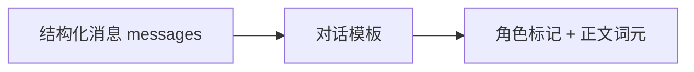
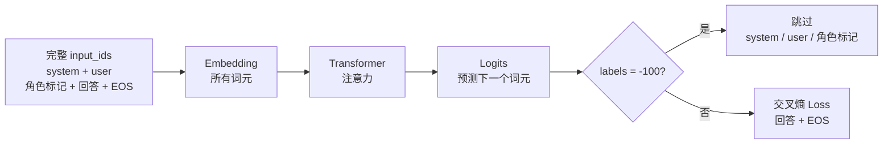
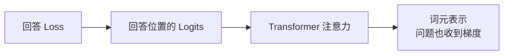
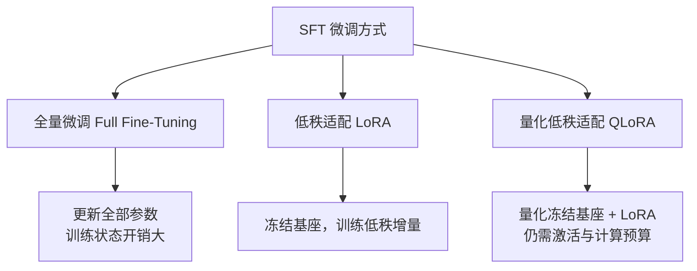

# 4. 监督微调（SFT）——指令跟随能力的训练

> **读之前**：读完第 2、3 章。知道 SFT 是监督学习，也见过一份原始语料大概长什么样。
>
> **读完你能做到**：说清 SFT 到底在学什么；看懂一条对话样本如何变成词元和损失掩码；知道 LoRA 为什么能省显存；能判断"训练损失下降"是否等于"模型变好"。

---

## 一、SFT 在做什么

第 1 章说，对齐流水线的第一步是监督微调（Supervised Fine-Tuning, SFT）。做法很朴素：**给模型看大量"指令 → 高质量回答"的示范，让它模仿。**

一条训练样本大致是这样：

```text
指令：介绍一下 Transformer。
回答：Transformer 是一种基于自注意力（Self-Attention）的神经网络结构，
      由 Google 于 2017 年提出，是现代大语言模型的基础。
```

从机器学习角度看，SFT 属于**监督学习**：每条数据都有输入（指令）和标签（期望回答），模型不断缩小"预测回答"与"示范回答"的差距。

换一个视角，SFT 和机器人领域的 **模仿学习（Imitation Learning）/ 行为克隆（Behavior Cloning）** 是同一个思路：不自己摸索规则，直接模仿专家。给模型看大量"人如何回答指令"的例子，它会把"按这种方式回答"学成行为倾向。

**SFT 最直接改变的是回答行为，但它不只改"说话方式"。** 训练样本里的事实、任务映射和表达技能，同样会写进参数。例如 SFT 可以教模型回答"公司总部在哪"，也可能让它记住样本里的新事实。区别主要来自数据覆盖和优化目标，并不存在一道"只能改行为、不能学知识"的机械边界。

---

## 二、SFT 与预训练：同一个损失，不同的数据

对自回归语言模型，两者都用下一词元预测的交叉熵（next-token cross-entropy）。真正的区别在**数据分布、监督位置和训练预算**。

|          | 预训练（Pretraining）            | 本书的指令 SFT                                                 |
| -------- | -------------------------------- | -------------------------------------------------------------- |
| 数据来源 | 广泛文本、代码等语料             | 人工或模型生成并筛选的指令—回答                               |
| 数据规模 | 可达万亿词元                     | 从少量演示到大规模混合；条数不能直接比较，要换算成词元或计算量 |
| 训练目标 | 对整段文本的每个位置预测下一词元 | 只对回答正文和结束符（EOS）预测下一词元                        |
| 训练步数 | 随总词元预算变化                 | 由样本数、有效批次和轮次决定                                   |
| 常见收益 | 语言、知识与基础任务能力         | 指令遵循、技能、领域信息和表达方式                             |
| 学习率   | 与规模、优化器和阶段有关         | 全量微调常较低；LoRA 可用不同量级                              |

把这句话写成公式会更清楚。令 $x$ 为模板渲染后的 system + user + assistant 起始标记，$y=(y_1,\ldots,y_T)$ 为助手回答（含结束符），则 SFT 最大化的条件似然是：

$$
\log p_\theta(y\mid x)=\sum_{t=1}^{T}\log p_\theta(y_t\mid x,y_{1:t-1})
$$

训练时只对回答位置计算损失；预训练则对整段文本的每个位置计算。两者用的是同一个交叉熵，只是**条件**和**求和范围**不同。

预训练并不是只学了一个笼统的 $p(\text{文本})$；自回归分解 $p(s)=\prod_t p(s_t\mid s_{1:t-1})$ 本身就包含大量“在某种前文下，下一个词元是什么”的条件分布。SFT 把训练样本集中到“指令前缀 → 助手回答”这一条件分支，并只对这些位置计损失，所以概率质量会向助手式回答移动。

**为什么目标函数没变，只换数据，行为就会变？** 可以把训练想成做题：

- 预训练给模型的是海量"填空题"：任意一段文本，遮住下一个词让它猜；
- SFT 给模型的是"阅读理解 + 作答"：题目摆在眼前，但不要求预测题目本身，只对回答部分算损失。

以"苹果公司总部位于____"为例，预训练数据里这个空后面大概率是"美国"，模型学会填"美国"。SFT 数据里反复出现的是"用户提出某类请求 → 助手给出高质量回答"，模型于是学会：看到这类请求时，按示范的内容、结构和语气回答。它学到的不是某一条固定答案，而是"在这种条件下，什么样的回答更像示范"。

**从训练方式看，标准 SFT 是离线的行为克隆（behavior cloning）。** 训练时每个位置都用数据中的真实前缀 $y_{1:t-1}$ 作为输入（teacher forcing），不采样模型自己的输出；数据固定，没有奖励，也没有在线探索。因此 SFT 本身不是强化学习，也不直接优化“回答好不好”，只优化“像不像示范”。这也意味着 token 级损失下降只说明模型更像示范，不保证事实正确、推理可靠或符合人类偏好；这些需要独立评测和后续的偏好/推理训练。

**从推理方式看，模型仍然是自回归生成。** 训练时见的是真实前缀，推理时见的是自己刚生成的词元；一旦前面出错，后续输入分布可能偏离训练分布。这是 exposure bias（暴露偏差）的来源之一，也是后面需要偏好学习和推理 RL 的原因。

> **SFT 的"配方"不在模型结构里，而在数据怎么组织、损失在哪里计算。** 实验 4.1 的核心就是这两件事：对话模板决定"模型看到什么"，损失掩码决定"模型学习什么"。

---

## 三、SFT 数据要多少、要多好

业界对"数据规模与质量"的认知，经历了三次标志性迭代：

| 工作                | 规模      | 数据来源 | 应该怎样理解                                             |
| ------------------- | --------- | -------- | -------------------------------------------------------- |
| InstructGPT（2022） | 约 13k 条 | 人工示范 | 强基座 + 高质量示范，可以明显改变输出行为                |
| Alpaca（2023）      | 约 52k 条 | 模型合成 | 降低采集成本，但仍需质量核验                             |
| LIMA（2023）        | 约 1k 条  | 精选示范 | 强基座下的特定小数据实验，不能推出"复杂任务也只要 1k 条" |

共同启示是：**质量、覆盖度和数量要一起考虑。** 重复的低质数据通常帮助有限，但高质量数据不足也会限制任务覆盖和泛化。

不要把这三次迭代读成"数据越少越好"。LIMA 的结论依赖强预训练基座、数据选择和评测设置；换成弱基座或复杂领域，结论可能不成立。

---

## 四、SFT 数据不只有"一问一答"

真实的 SFT 数据比"一问一答"复杂。现代 SFT 数据通常包含：

```text
<|im_start|>system
你是一个乐于助人的中文助手，回答简洁、准确、友好。<|im_end|>
<|im_start|>user
帮我写一封请假邮件，今天发烧了。<|im_end|>
<|im_start|>assistant
好的，以下是一封请假邮件模板……<|im_end|>
<|im_start|>user
再帮我加一句"下周补上工作进度"。<|im_end|>
<|im_start|>assistant
已加上，修改后的版本是……<|im_end|>
```

- **系统提示（System Prompt）样本**：教模型"带角色和规则的场景下如何表现"，例如客服、翻译、代码助手；
- **多轮对话样本**：教模型记住前文、处理追问；单轮数据教不会对话能力；
- **工具调用样本**：教模型何时调用工具、如何组织参数（与第三部分衔接）；
- **拒绝类样本**：教模型如何礼貌地拒绝危险或越权请求（与第 8 章衔接）。

数据构建方式也不止人工标注：人工撰写（质量最高、最贵）、模板批量生成（Alpaca 早期做法）、大模型蒸馏（用强模型生成回答训练开源模型）、真实用户日志清洗（产品上线后最宝贵的数据来源）。

---

## 五、对话模板：训练和推理必须用同一种格式

不同模型的对话标记不同：Qwen2.5 常用 `<|im_start|>user ... <|im_end|>`，Llama 3 用 `<|start_header_id|>` 等标记。 **对话模板（Chat Template）** 把结构化的"角色 + 内容"消息序列化成模型认识的文本。



一个常见的坑：**基础模型的分词器可能没有 `chat_template`**。所以实验 4.1 从同系列指令模型的分词器里取模板和结束符，但**不加载指令模型的权重**。

训练和推理必须保持一致：模板、system 提示、特殊词元、生成起点，任何一项不同，模型都可能表现得像另一个模型。**不能训练时用"指令/回答"纯文本，推理时换成 ChatML。**

---

## 六、损失掩码：只让模型学习"回答"

### 先区分三个张量

SFT 的一个批次（batch）通常有三个张量：

| 张量 | 作用 | 进入模型前向？ | 直接决定损失？ |
|---|---|---|---|
| `input_ids` | 模型实际看到的词元序列 | 是 | 否 |
| `attention_mask` | 哪些位置可见；填充（padding）位置为 0 | 是 | 间接影响 |
| `labels` | 每个位置的目标词元；`-100` 表示忽略 | 否 | 是 |

**`labels` 不是模型输入。** 前向传播只看 `input_ids` 和 `attention_mask`；`labels` 只在计算损失时使用。所以“问题位置标成 `-100`”不等于“问题没有喂给模型”。

Embedding 也一样：它处理完整的 `input_ids`。system、user、assistant 起始标记、回答和 EOS 都是词元，都会各自查表得到一个向量；`labels` 里的 `-100` 不是词元，不会进入 Embedding。批量训练时若有填充，填充词元也会占一个位置，但由 `attention_mask=0` 屏蔽。

### 因果语言模型的“错位一位”

因果语言模型在位置 `t` 输出的对数几率（logits），预测的是位置 `t+1` 的词元。以一条短样本为例：

| 位置 | `input_ids` | `labels`（与输入对齐） | 该位置 logits 预测 | 损失来源 |
|---|---|---|---|---|
| 5 | `assistant` | `-100` | `2` | `labels[6] = 2` |
| 6 | `2` | `2` | `EOS` | `labels[7] = EOS` |
| 7 | `EOS` | `EOS` | 无 | 无 |

注意第 5 行：`labels[5]` 是 `-100`，表示“不预测 `assistant` 这个词元本身”；但 `logits[5]` 仍然要预测下一个词元 `2`，所以它参与“预测 2”的损失。位置 7 的 `EOS` 标签也不是由位置 7 自己的 logits 使用，而是由位置 6 的 logits 使用——这就是“错位一位”的含义。这个对齐由框架内部完成：

```text
loss = CrossEntropy(logits[:, :-1], labels[:, 1:], ignore_index=-100)
```

这也说明：**问题位置并非所有 logits 都被丢掉。** 最后一个提示位置（assistant 起始标记）的 logits 正好用于预测第一个回答词元；它自己的 `label` 是 `-100`，但它的输出仍参与回答损失。

**不要手动再移位一次标签。** 如果你自己写损失函数，必须保持 logits 与 labels 的错位关系一致；如果用 Hugging Face 的因果语言模型，它已经在内部做了这件事。

### 交叉熵如何忽略 `-100`

设参与监督的位置集合为 $\mathcal{S}=\{t:\text{labels}_t\ne -100\}$，损失可以写成：

$$
\mathcal{L}
=-\frac{1}{|\mathcal{S}|}
\sum_{t\in\mathcal{S}}
\log p_\theta(y_t\mid x,y_{1:t-1})
$$

`-100` 是 PyTorch 交叉熵的默认忽略值：这些位置不进入分子，通常也不进入分母。不同实现对手动 reduction 的归一化方式可能不同，复现时要核对损失是按“参与损失的词元数”还是“批次大小”平均。

### 为什么只对回答算损失

如果整段对话都算损失，模型会同时学习“如何提问”和“如何回答”：

- 用户和系统 token 也会成为预测目标，模型可能学会生成用户消息、重复问题或混淆角色；
- 回答 token 的损失被大量提示 token 稀释，同样训练预算下对回答的更新更弱；
- 我们想要的是条件分布 $p(\text{回答}\mid\text{指令})$，而不是联合分布 $p(\text{整段对话})$，掩码让优化目标与这个条件分布对齐。

但要注意：**掩码只改变“哪些位置产生损失”，不改变“哪些位置可见”。** 用户内容仍然进入注意力，仍然影响回答的隐藏状态。答案位置的梯度会沿着注意力回传，影响模型对问题 token 的表示；所以“问题不直接产生损失”不等于“问题与参数更新无关”。

还要再精确一点：**参数更新不是按 token 分区的。** 模型只有一套共享参数；回答损失会沿计算图更新 Transformer 层、输出层和 embedding 矩阵。问题 token 的 embedding 行也可能收到梯度，并不是“问题部分不更新，只更新回答部分”。被忽略的只是问题位置的**损失项**，不是问题位置的全部计算。

### 掩码本身不教指令，它改变的是“梯度花在哪”

掩码不会把“指令”直接灌进模型。它做的是把有限的梯度集中到助手行为上：

| 设计 | 作用 |
|---|---|
| 条件输入（system / user / 角色标记） | 回答必须依赖指令，模型学的是条件分布，而不是答案的边缘分布 |
| 只监督回答 | 梯度集中在“怎么答”，不必拟合用户会怎么问 |
| 角色标记 + 结束符 | 学会回合边界、回答起点和停止位置 |
| 多样化指令 | 从记住单条样本，走向可迁移的“要求 → 回答”映射 |

**为什么这样能泛化到新指令？** 预训练已经让模型见过大量语言和任务模式；SFT 通过许多“指令 → 回答”样本，强化“看到某种要求就给出相应回答”的条件分支。模型学到的不是某条固定答案，而是“在这个条件下，什么样的回答更像示范”。如果数据单一、重复或只覆盖一种格式，它更可能记住模板而不是学会指令——掩码无法弥补数据覆盖不足。

所以，SFT 能训练指令，但它是**条件行为克隆**：不是从零创造能力，也不直接优化正确性、诚实或偏好。它把预训练中已有的能力引导到稳定的助手接口上；未见指令、冲突指令和长尾任务仍可能失败。

### 四个常见误解

1. **“`-100` 会把问题从输入里删掉。”** 不会。`input_ids` 仍包含完整问题，`labels` 只控制损失。
2. **“只对答案做前向传播。”** 不是。前向仍然处理整段序列，只是反向传播时只有回答位置的损失非零。
3. **“`attention_mask=0` 和 `labels=-100` 是一回事。”** 不是。前者表示填充位置不可见，后者表示该位置不作为监督目标；填充位置通常两者都要处理。
4. **“问题位置没有损失，所以问题不影响训练。”** 不是。问题通过注意力影响回答表示，回答损失会沿计算图回传到问题相关的激活和参数。
5. **“反向传播只更新回答 token 的参数。”** 不是。参数是共享的，回答损失会更新所有参与计算的权重；问题表示也会通过注意力收到梯度。

前向与损失掩码：



反向传播：



第一张图是前向：完整输入都经过 Embedding、注意力和 Logits，问题没有被跳过；第二张图是反传：梯度从回答损失出发，经过回答 logits 和注意力，回到问题与回答的词元表示。

> 反向图的方向与第一张相反，单独画是为了避免把前向和反传混在一张图里，导致节点和箭头难以阅读。

| 阶段 | 问题 / 角色 token | 回答 token |
|---|---|---|
| 前向 | 参与，影响后续隐藏状态 | 参与 |
| 损失 | `labels=-100`，不直接贡献 | 参与交叉熵 |
| 反向 | 通过注意力收到梯度 | 直接收到梯度 |

> **开卷考试类比**：题目（system / user）印在卷子上，模型答题时看得到；`labels` 只是批改范围，只批改答案。题目不被批改，不代表答题时没看题目。

再考虑两条样本：`1+1=? → 2` 和 `4-2=? → 2`。如果只看答案，两条样本在 assistant 位置完全一样，模型无法知道该根据哪个问题作答；保留问题后，它学的是两个不同的条件分布，而不是“看到 assistant 就输出 2”。

因此“问题不参与损失”只说明它不作为**预测目标**，不说明它不参与**计算**。

> **记住这一点**：SFT 不改模型结构、不改损失函数，只改两件事——数据怎么拼（对话模板）、梯度从哪里来（损失掩码）。掩码不是“删除问题”，而是“只批改答案”。

实验 4.1 会把这里落到代码：构造 `input_ids` / `attention_mask` / `labels`，断言提示词元是全文前缀，并把填充位置的标签设为 `-100`。

---

## 七、训练细节：学习率、轮次与打包

以下只是起点，不是对所有模型都成立的固定配方：

| 配置              | 需要观察什么                                                    |
| ----------------- | --------------------------------------------------------------- |
| 学习率            | 全量 SFT 常从 1e-5 量级尝试；LoRA 可用不同量级，4.2 示例取 2e-4 |
| 训练轮次（Epoch） | 以独立验证损失和任务指标选择，不保证 2 轮最优                   |
| 预热（Warmup）    | 与步数和稳定性一起设置，极小实验可能只有很少更新                |
| 损失              | 本书只监督回答正文和结束符，并忽略填充位置                      |
| 权重衰减          | 可作正则化，但不能替代数据去重和验证集                          |

**SFT 最大的风险是过拟合**：数据只有几万条、模型又足够大时，几个轮次后它就能"背下"训练集——训练损失逼近 0，验证损失不再下降甚至回升。应对手段包括更少的轮次、更高的权重衰减，以及**监控验证集损失**（呼应第一部分 nanoGPT 的训练/验证监控）。

**序列打包（Sequence Packing）** 把多条短样本拼进一个长序列，减少填充浪费。但要注意：结束符只是一个词元，**不会自动隔离跨样本注意力**。如果希望样本之间互不影响，需要确认块对角注意力（block-diagonal attention）、位置编号和损失边界的实现。4.2 为便于检查，采用动态填充，不做序列打包。

---

## 八、全量微调、LoRA 与 QLoRA

SFT 不一定更新全部参数：



- **全量微调（Full Fine-Tuning）**：更新全部参数。自由度大，但梯度、优化器状态开销高；是否更好取决于数据、优化和泛化。
- **低秩适配（Low-Rank Adaptation, LoRA）**：冻结基座，只训练插入的低秩矩阵。可训练比例由秩（rank）和目标层决定，不是固定的 0.1%～1%。
- **量化低秩适配（Quantized LoRA, QLoRA）**：把冻结基座量化到 4 比特，再训练 LoRA 增量。省权重显存，但激活、对数几率和优化器仍要资源。

一个直观的数字：`1024 × 1024` 的矩阵有 1,048,576 个参数；取秩 `r=8`，新增的 A/B 矩阵只有 `8×1024 + 1024×8 = 16,384` 个参数，约为原来的 1/64。4.2 会给出完整配置。

**什么时候考虑全量微调？** 当 LoRA 在充分调整秩、目标层和数据后仍受容量限制，且资源允许时。领域学习并不必然要求全量微调：LoRA 也能学新知识和任务映射。

---

## 九、SFT 的边界：它解决什么，不解决什么

1. **可以学知识，但不保证可靠泛化**：SFT 能更新事实、任务映射和技能；少量重复示范可能只得到"记忆"，换个问法就不行。持续更新知识也可以考虑检索增强或继续预训练。
2. **不直接表达相对偏好**：SFT 没有显式比较"两个回答哪个更好"。偏好学习提供的是另一种监督信号。
3. **数据偏差会传进模型**：长度偏好、奉承和错误事实都可能被学走。数据质量比"跑通训练"更重要。
4. **不能保证消除幻觉**：事实性示范、拒答示范能降低一些错误，但幻觉涉及知识、生成目标和校准，后续偏好优化也不会自动消除。

> **判断 SFT 是否有效，要分别测指令遵循、事实准确性、未见问题泛化和原能力保留；只用一个笼统的"更像助手"是不够的。**

---

## 十、现代 SFT 的行业实践

今天工业界的 SFT 早已不是"写几万条数据、跑一次训练"：

- **合成数据与蒸馏**：用更强的模型生成示范，再做质量、去重、许可和覆盖检查；合成数据也可能继承教师的错误。
- **多阶段 SFT**：按任务或难度分阶段是一种选择，不保证优于精心配比的混合训练。
- **冷启动 SFT**：DeepSeek-R1 在强化学习前用少量推理示范改善初始可读性；R1-Zero 路线说明冷启动不是所有 RL 训练的必要步骤（第 6 章展开）。

上面这些做法主要复用教师的**文本输出**，属于序列级数据蒸馏：学生看到的是教师写出的最终答案。

### 选读：对数几率蒸馏

如果希望学生直接模仿教师在每个位置上的完整概率分布，就需要另一套损失。设教师和学生对同一位置输出的对数几率（logits，即模型输出的未归一化分数）为 $z_T,z_S$，温度为 $T$：

$$
p_T^{(T)}=\mathrm{softmax}\left(\frac{z_T}{T}\right),\qquad
p_S^{(T)}=\mathrm{softmax}\left(\frac{z_S}{T}\right)
$$

$$
\mathcal{L}_{KD}=T^{2}\cdot \mathrm{KL}\left(p_T^{(T)}\,\|\,p_S^{(T)}\right),
\qquad
\mathcal{L}=(1-\alpha)\mathcal{L}_{CE}+\alpha\mathcal{L}_{KD}
$$

- **软标签（soft label）**：教师不只告诉学生"正确词是哪个"，还告诉它"第二、第三候选有多大可能"。
- **温度 $T>1$**：把教师原本接近 0 的小概率放大，让学生看到更多候选；$T$ 太大也会放大噪声。
- **乘 $T^2$**：让不同温度下的梯度量级可比，便于复用学习率。
- **前向 KL**：教师有概率质量的地方，学生也要覆盖；反向 KL 则倾向只拟合一个峰。
- **同词表约束**：两个分布的维度必须对应同一批词元。

实验 4.3 会对比"纯交叉熵"与"交叉熵 + 蒸馏"两条分支。它是一条独立分支，不覆盖 4.2 的 SFT 产物。

---

## 本章对应的实验

本章对应三个实验；如果还没做第 3 章的数据实验，建议先补 3.1、3.2。

| 实验                                                                                                                 | 对应概念   | 你要亲手做什么                                 |
| -------------------------------------------------------------------------------------------------------------------- | ---------- | ---------------------------------------------- |
| [4.1 构建监督微调数据集](<./4.1%20构建监督微调数据集——对话模板（Chat%20Template）与损失掩码（Loss%20Mask）实战.md>) | 第五、六节 | 拆开一条真实数据，看它如何变成词元和损失掩码   |
| [4.2 使用低秩适配（LoRA）微调模型](<./4.2%20使用低秩适配（LoRA）微调模型——从基础模型到指令模型.md>)                 | 第七、八节 | 用 QLoRA 微调，保存适配器与分词器，并核验重载  |
| [4.3 知识蒸馏](<./4.3%20知识蒸馏（Knowledge%20Distillation）——基于%20KL%20散度的分布对齐.md>)                       | 第十节     | 用教师分布计算 KL 散度，对比纯交叉熵与 CE + KD |

**主路径**：数据工程（[3.1](<./3.1%20数据清洗实战——从原始文本到训练语料.md>)、[3.2](<./3.2%20中文场景下的分词器（Tokenizer）与数据处理.md>)）→ 指令样本构造（4.1）→ 监督微调（4.2）→ 偏好优化（5.2）。4.3 是独立分支，不覆盖 4.2 的适配器。

---

## 本章小结

- SFT 用"指令 → 期望回答"示范做监督学习，改变回答行为，也可能带来新知识。
- 预训练和 SFT 都用下一词元交叉熵，区别在数据分布、监督位置和预算；SFT 通常只监督回答。
- SFT 学的是条件分布 $p(\text{回答}\mid\text{指令})$；标准 SFT 是离线行为克隆，训练时用真实前缀，推理时用自己的输出，因此存在 exposure bias。
- 数据规模没有通用答案：InstructGPT、Alpaca、LIMA 是不同实验，质量、覆盖度、数量要一起看。
- 对话模板决定模型看到什么，损失掩码决定模型学习什么；训练和推理必须使用同一套格式。
- LoRA 冻结基座、只训练低秩增量；QLoRA 再量化基座，省权重显存但不省全部开销。
- SFT 不能保证泛化、不能表达相对偏好、不能消除幻觉，需要独立评测。

> **一句话记住本章**：SFT 的功夫在数据配方，不在模型结构。

## 下一章预告

SFT 让模型学会"照着示范回答"。但如果有两个都不错的回答，模型怎么知道哪个更好？下一章进入偏好学习。

> **第 5 章 偏好学习（Preference Learning）——人类偏好的建模与优化**

---

## 思考题

1. 为什么 SFT 通常只对回答部分计算损失？如果对整段对话都计算，会发生什么？
2. 训练损失降到接近 0，但验证损失开始上升，说明什么？你会先调哪个超参数？
3. LoRA 为什么能省显存？它省的是哪一部分，"省显存"是否等于"训练一定更快"？
4. 如果对话模板训练和推理不一致，模型会出现什么症状？怎么排查？
5. SFT 与预训练的目标函数相同，为什么前者能改变指令跟随行为？如果训练时使用模型自己生成的前缀，而不是数据中的真实回答，会发生什么？

---

## 参考资料

- Ouyang et al.《Training language models to follow instructions with human feedback》（InstructGPT）：https://arxiv.org/abs/2203.02155
- Taori et al.《Stanford Alpaca》：https://github.com/tatsu-lab/stanford_alpaca
- Zhou et al.《LIMA: Less Is More for Alignment》：https://arxiv.org/abs/2305.11206
- Hu et al.《LoRA: Low-Rank Adaptation of Large Language Models》：https://arxiv.org/abs/2106.09685
- Dettmers et al.《QLoRA: Efficient Finetuning of Quantized LLMs》：https://arxiv.org/abs/2305.14314
- Hinton et al.《Distilling the Knowledge in a Neural Network》：https://arxiv.org/abs/1503.02531
