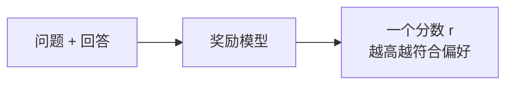
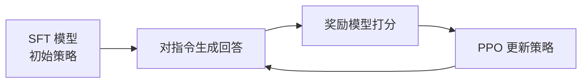
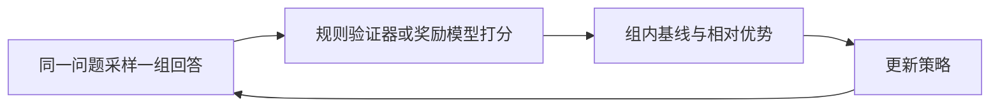

# 5. 偏好学习（Preference Learning）——人类偏好的建模与优化

> **读之前**：读完第 4 章。知道 SFT 用"指令 → 期望回答"的示范做监督。
>
> **读完你能做到**：说清偏好学习和 SFT 的分工；看懂奖励模型为什么能把"哪个更好"变成可训练的分数；理解 PPO、DPO、GRPO 各自省掉了什么；知道奖励劫持（Reward Hacking）为什么值得警惕。

---

## 一、SFT 之后还缺什么

SFT 教模型"照着示范回答"。但同一个问题往往有多个都说得通的回答，SFT 没有显式告诉模型**哪个更好**。

用户问："如何礼貌地拒绝朋友的邀请？"

```text
回答 A：不去。
回答 B：谢谢邀请，这次有安排，下次再一起吧。
```

在"礼貌沟通"的标注准则下，B 通常更合适。SFT 可以把 B 放进训练数据，让模型模仿 B；但它没有学到"在同一问题下，B 比 A 更好"这个**相对信号**。偏好学习补的就是这一块。

|          | SFT                     | 偏好学习                     |
| -------- | ----------------------- | ---------------------------- |
| 数据     | 一条指令 + 一个期望回答 | 一个问题 + 两个回答 + 谁更好 |
| 监督信号 | "应该这样回答"          | "这个比那个更好"             |
| 主要解决 | 会不会执行指令          | 回答是否符合人的偏好         |

两者是互补关系，不是替代关系。偏好学习也不保证"无限变好"，更不代表所有人的偏好一致。

---

## 二、偏好数据长什么样

偏好数据的基本单元不是"一条问答"，而是"一个问题 + 两个回答 + 谁更好"：

```text
问题：如何学习 Python？
回答 A：学习语法。
回答 B：建议先学习基础语法，再完成几个小项目，最后阅读优秀开源代码。
标注：B 更好
```

模型学的不是"把 B 背下来"，而是"为什么 B 更好"的隐含规律：更具体、更可执行、结构更清楚。换一个问题时，它应当把这种偏好迁移过去。

偏好数据主要有三种来源：

| 来源         | 做法                                                                    | 优缺点                                       |
| ------------ | ----------------------------------------------------------------------- | -------------------------------------------- |
| 人工标注排序 | 让标注员对多个回答排序（InstructGPT 约 33k 条提示，每条可产生多组比较） | 质量最高，但贵、慢，标注员之间也有分歧       |
| AI 对比生成  | 用更强的模型判断哪个回答更好                                            | 便宜、可扩展，但会继承"裁判模型"的偏好与偏见 |
| 产品隐式反馈 | 从采纳、点赞、复制、重新生成等行为推断偏好                              | 最真实，但噪声大，需要清洗                   |

构造偏好对时，两个回答的质量差距要有区分度：

- 差距太大（一个完整、一个答非所问），模型只学会"哪个明显更好"，学不到细粒度取舍；
- 差距太小（两个几乎一样），标注噪声大，模型也难得到稳定信号。

常见做法是让同一个模型用不同温度采样两次，再由标注员选更好的那个，使两个回答"各有道理，但有一个更符合偏好"。

---

## 三、奖励模型：把"哪个更好"变成分数

**一句话**：训练一个模型，给"问题 + 回答"打分，让被偏好的回答分数更高。

为什么需要它？经典 RLHF 要让策略不断生成新回答，而人工偏好只覆盖有限的回答对。奖励模型可以给任意新回答即时打分，替代昂贵的人工。



奖励模型通常由一个语言模型改造而来：去掉预测下一个词元的输出层，换成一个输出标量的回归头，只取最后一个有效位置的隐藏状态。

它不需要预测"绝对正确"的分数，只需要让优选回答（chosen）的分数高于劣选回答（rejected）。这种"只比较相对顺序"的建模方式来自 Bradley–Terry 模型。假设两者得分是 `2.0` 和 `0.5`，差值为 `1.5`；经过 S 形函数（Sigmoid）后，模型认为前者更好的概率约为 `0.818`。

成对损失写成：

```math
L_{RM}=-\log\sigma\big(r(x,y_w)-r(x,y_l)\big)
```

- `x`：问题或指令；
- `y_w`：chosen，更受偏好的回答；
- `y_l`：rejected，较差的回答；
- `r(x,y)`：奖励模型给整段"问题 + 回答"的分数；
- `σ`：Sigmoid，把分数差转成 0～1 的概率；
- `-log`：chosen 概率越低，惩罚越大。

若两个回答得分相同，概率为 0.5，Loss 为 `-log(0.5) ≈ 0.693`；chosen 分数明显更高时，Loss 接近 0。实验 5.1 会用代码观察这个差值如何拉开。

**两个常见误解**：

1. **奖励模型的分数不是"绝对质量分"**。它只是人类偏好的近似，可能偏爱长回答、某种文风，或者被策略利用。
2. **不是"没有奖励模型就不能学偏好"**。离散偏好标签本身也能构造成对损失；奖励模型的必要性来自经典 PPO-RLHF 需要在线给新回答打分。

---

## 四、PPO：用奖励更新模型

有了奖励模型，下一步是让策略模型（policy model，也就是正在训练、负责生成回答的模型）生成高分回答。这是个强化学习问题。经典做法是**基于人类反馈的强化学习（Reinforcement Learning from Human Feedback, RLHF）**，用**近端策略优化（Proximal Policy Optimization, PPO）**更新：



可以把它想成"老师批改作业"：

1. 学生（策略模型）做题（生成回答）；
2. 老师（奖励模型）打分；
3. 学生根据分数调整答题方式（更新参数）。

但这里还有一个角色：**评论家（Critic）**。它估计"这个状态原本大概能拿多少分"，和实际得分一起算出**优势（Advantage）**——这次回答比预期好多少。PPO 用优势决定更新方向和幅度。

更新时还要限制"一次改多少"：PPO 比较新旧策略对同一动作的概率比，把它裁剪在一个范围内（例如 `[0.8, 1.2]`），避免一次更新过猛。裁剪约束的是代理目标，不是对参数步长或真实策略变化的严格上限。

**KL 惩罚**是另一道约束。RLHF 会在奖励里减去一项：

```math
r_{shaped}=r_{RM}-\beta\,D_{KL}(\pi_\theta\|\pi_{ref})
```

- `r_RM`：奖励模型的分数；
- `π_ref`：冻结的参考模型，通常来自 SFT；
- `D_KL`：当前策略与参考策略的分布差异；
- `β`：惩罚强度，越大越保守。

为什么需要它？因为奖励模型只是近似。如果模型拼命刷高分，可能把回答变得又长又怪——分数上去了，人却不满意。KL 惩罚让模型"别偏离 SFT 太远"，能减轻这种刷分，但不能彻底杜绝。

> **奖励劫持（Reward Hacking）**：模型找到让代理奖励变高的方式，但实际质量没有同步提高。KL 只能限制偏移，不能保证消除它。

### 选读：PPO 的裁剪目标

常见写法是：

```math
J^{PPO}(\theta)=\mathbb{E}_t\!\left[\min\!\left(r_t(\theta)\hat A_t,\ \operatorname{clip}(r_t(\theta),1-\epsilon,1+\epsilon)\hat A_t\right)\right]
```

其中 `r_t(θ)=π_θ(a_t|s_t)/π_old(a_t|s_t)` 是新旧策略概率比，`Â_t` 是优势，`ε` 是裁剪宽度。理解主线只需要记住"概率比 + 优势 + 裁剪"，完整公式可以以后再回来看。

---

## 五、DPO：跳过奖励模型和强化学习

PPO 的工程复杂度很高：要训练奖励模型、维护评论家、在线采样、调 KL 系数。2023 年的**直接偏好优化（Direct Preference Optimization, DPO）**提出：能不能直接用偏好数据优化策略？

DPO 仍然使用"问题 + 优选 + 劣选"的偏好对，但**不单独训练奖励模型，也不运行 PPO 的在线采样循环**。

先看两个中间量。这里用到一个词：**对数概率**，就是"概率取对数"。概率越小，对数越负；概率接近 1，对数接近 0。DPO 比较的是同一个回答在策略模型和参考模型下的对数概率差。

第一步，比较策略模型与参考模型对同一个回答的对数概率：

```math
r_{impl}(x,y)=\beta\left[\log\pi_\theta(y|x)-\log\pi_{ref}(y|x)\right]
```

这可以理解成一个"隐式奖励"：当前策略比参考模型更偏向这个回答多少。

- `π_θ`：正在训练的策略模型；
- `π_ref`：冻结的参考模型；
- `log π(y|x)`：模型对完整回答的词元对数概率之和；
- `β`：缩放系数。

第二步，像奖励模型的成对损失一样，让优选回答的隐式奖励高于劣选回答：

```math
L_{DPO}=-\log\sigma\left(r_{impl}(x,y_w)-r_{impl}(x,y_l)\right)
```

把第一步代入第二步，就得到论文里的完整形式：

```math
L_{DPO}=-\log\sigma\!\left(\beta\log\frac{\pi_\theta(y_w|x)}{\pi_{ref}(y_w|x)}-\beta\log\frac{\pi_\theta(y_l|x)}{\pi_{ref}(y_l|x)}\right)
```

实验 5.1 会用四个具体对数概率算一遍：chosen 隐式奖励 `0.07`，rejected `-0.11`，差值 `0.18`，最终 `Loss ≈ 0.607`。这个数值链比背公式更重要。

"Direct"的意思是：偏好数据可以直接构造策略模型的监督式损失，不再显式训练奖励模型或执行 PPO。但它不意味着没有超参数或稳定性问题：`β` 的取值、参考模型的选择、数据分布都会影响结果。

### 选读：隐式奖励从哪来

在 KL 正则化的 RLHF 目标下，最优策略与奖励之间可以写出解析关系：

```math
r(x,y)=\beta\log\frac{\pi^*(y|x)}{\pi_{ref}(y|x)}+\beta\log Z(x)
```

`Z(x)` 只依赖问题，不依赖具体回答；比较同一问题的优选与劣选回答时，它会在差值中抵消。这个推导解释了 DPO 为什么成立，但不是使用 DPO 前必须掌握的内容。

---

## 六、GRPO：用组内比较代替评论家

**组相对策略优化（Group Relative Policy Optimization, GRPO）**在 DeepSeekMath（2024）提出，后来用于 DeepSeek-R1（2025）。

它的想法是：对同一个问题采样一组回答，用组内平均奖励作为基线，算每个回答的相对优势，从而不必单独训练评论家模型。



举例：四个回答的奖励是 `[1, 1, 0, 0]`，平均值 0.5。高于平均的两个得到正优势，低于平均的两个得到负优势。正优势的回答更可能被保留，负优势的更可能被抑制。

几个边界：

- **"免去评论家"不等于"免去奖励来源"**：奖励可以来自可验证规则、学习到的奖励模型，或二者组合。
- **组内全对或全错时，相对优势接近 0**，这一步没有学习信号；可以调整题目难度或采样策略，但不能靠归一化"创造"正确样本。
- **GRPO 与 RLVR 是不同维度**：GRPO 是策略更新算法，可验证奖励强化学习（RLVR）描述奖励来源。GRPO 可以用 RLVR 奖励，PPO 也可以用；反过来，GRPO 也可以配学习型奖励模型。

---

## 七、方法怎么选

| 方法         | 核心思想                      | 需要奖励模型？ | 需要在线强化学习？ | 适合什么情况               |
| ------------ | ----------------------------- | -------------- | ------------------ | -------------------------- |
| PPO-RLHF     | 奖励模型打分 + PPO + KL       | 通常需要       | 是                 | 有可靠奖励、能承担采样成本 |
| DPO          | 相对参考策略的对数概率比      | 不显式训练     | 否（离线）         | 有偏好对，想简化工程       |
| GRPO         | 组内基线替代评论家            | 取决于奖励来源 | 是                 | 推理任务、可验证奖励       |
| ORPO / SimPO | 在 SFT 目标上加偏好项         | 不需要         | 否                 | 想减少组件、简化训练       |
| KTO          | 用单条回答的"可取/不可取"标签 | 不需要         | 否                 | 只有单边反馈，没有成对比较 |

这些不是"PPO → DPO → GRPO 逐代淘汰"的同一条路线。离线偏好优化和在线奖励优化解决不同约束；选择取决于是否有可靠奖励、是否负担得起采样、数据覆盖和评测目标。

---

## 本章对应的实验

| 实验                                                                                                       | 对应内容           | 你要亲手做什么                                            |
| ---------------------------------------------------------------------------------------------------------- | ------------------ | --------------------------------------------------------- |
| [5.1 训练奖励模型（Reward Model）与回答评分分析](<./5.1%20训练奖励模型（Reward%20Model）与回答评分分析.md>) | 第三节、DPO 数值例 | 训练一个最小奖励模型，观察 chosen/rejected 分数差如何拉开 |
| [5.2 直接偏好优化（DPO）实战](<./5.2%20直接偏好优化（DPO）实战.md>)                                         | 第五节             | 加载 4.2 的 SFT 产物，用 DPO 继续训练并比较未见题         |

5.1 的奖励模型**不参与** 5.2：DPO 不需要显式奖励模型。两条支线各自独立。

---

## 本章小结

- SFT 学"应该这样回答"，偏好学习学"这个比那个更好"；两者互补。
- 偏好数据是"问题 + 两个回答 + 谁更好"；差距要适中，来源有人工、AI 和产品反馈。
- 奖励模型把偏好变成可微分数，用成对损失训练；它只是代理指标，可能被利用。
- PPO 用奖励更新策略，靠裁剪和 KL 惩罚控制更新幅度；KL 能减轻刷分，但不能消除奖励劫持。
- DPO 用参考模型的对数概率比构造隐式奖励，省去显式奖励模型和在线 PPO。
- GRPO 用组内相对优势替代评论家；它和 RLVR 是不同维度。

> **一句话记住本章**：偏好学习把"哪个更好"变成可优化的信号，方法不同，但都依赖数据质量和独立评测。

## 下一章预告

模型已经会执行指令，回答也更符合偏好。但让它做一道数学题，它可能"一本正经地写出错误的推理过程"。下一章看推理能力怎么训练。

> **第 6 章 推理对齐（Reasoning Alignment）——推理能力的训练与对齐**

---

## 思考题

1. SFT 和偏好对分别表达什么监督信号？为什么"没有显式相对偏好"不等于"SFT 不能泛化"？
2. KL 参考约束和 PPO 的裁剪各防什么问题？把 `β` 设为 0 会立刻崩坏吗？
3. DPO 为什么能省去显式奖励模型和在线 PPO？推导里 KL 目标和 Bradley-Terry 假设各起什么作用？
4. 为什么优化代理奖励存在奖励劫持风险，但不是每次训练必然发生？怎么用独立评测发现它？
5. GRPO 与 RLVR 分别描述什么？各举一个"GRPO + 学习型奖励"和"PPO + 规则奖励"的配置。

---

## 参考资料

- Ouyang et al.《Training language models to follow instructions with human feedback》（InstructGPT、33k 偏好数据）：https://arxiv.org/abs/2203.02155
- Rafailov et al.《Direct Preference Optimization: Your Language Model is Secretly a Reward Model》：https://arxiv.org/abs/2305.18290
- Anthropic《Training a Helpful and Harmless Assistant with RLHF》：https://arxiv.org/abs/2204.05862
- Shao et al.《DeepSeekMath》（GRPO 出处）：https://arxiv.org/abs/2402.03300
- DeepSeek《DeepSeek-R1》：https://arxiv.org/abs/2501.12948
- HuggingFace《Alignment Handbook》：https://github.com/huggingface/alignment-handbook

---

## 附录：工程工具箱

| 框架               | 特点                                                               |
| ------------------ | ------------------------------------------------------------------ |
| TRL（HuggingFace） | 支持 PPO / DPO / ORPO / GRPO / KTO，与 transformers 集成，应用最广 |
| OpenRLHF           | 开源 RLHF 平台，支持大规模分布式 PPO/DPO                           |
| verl（字节跳动）   | 新一代 RL 训练框架，重点支持 GRPO / RLVR                           |
| DeepSpeed-Chat     | 微软的完整 RLHF 流水线（SFT + RM + PPO）                           |
