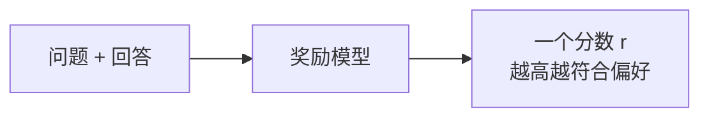
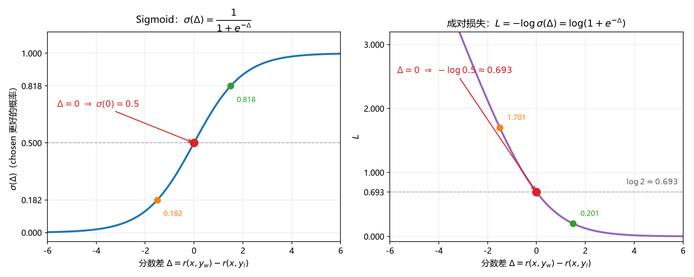
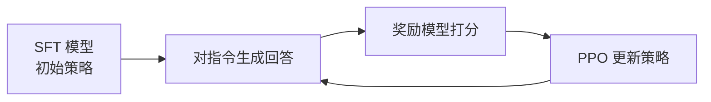
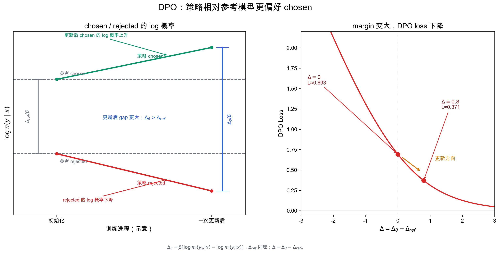
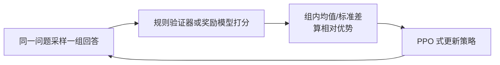

# 5. 偏好学习（Preference Learning）——人类偏好的建模与优化

> **读之前**：读完第 4 章。知道 SFT 用"指令 → 期望回答"的示范做监督。
>
> **读完你能做到**：说清偏好学习和 SFT 的分工；看懂奖励模型为什么能把"哪个更好"变成可训练的分数；理解 PPO、DPO、GRPO 各自省掉了什么；知道奖励劫持（Reward Hacking）为什么值得警惕。

---

## 一、SFT 之后的偏好学习需求

SFT 教模型"照着示范回答"。但同一个问题往往有多个都说得通的回答，SFT 没有显式告诉模型**哪个更好**。

用户问："如何礼貌地拒绝朋友的邀请？"

```text
回答 A：不去。
回答 B：谢谢邀请，这次有安排，下次再一起吧。
```

在"礼貌沟通"的标注准则下，B 通常更合适。这里的 A 和 B 是数据集中已有的两段回答，标注只需回答"哪个更好"，并不要求模型自己生成它们。SFT 可以把 B 放进训练数据，让模型模仿 B；但它没有学到"在同一问题下，B 比 A 更好"这个**相对信号**。偏好学习补的就是这一块。

B 就是优选回答（chosen），A 是劣选回答（rejected）。

|          | SFT                     | 偏好学习                     |
| -------- | ----------------------- | ---------------------------- |
| 数据     | 一条指令 + 一个期望回答 | 一个问题 + 两个回答 + 谁更好 |
| 监督信号 | "应该这样回答"          | "这个比那个更好"             |
| 主要解决 | 会不会执行指令          | 回答是否符合人的偏好         |

两者是互补关系，不是替代关系。偏好学习也不保证"无限变好"，更不代表所有人的偏好一致。

---

## 二、偏好数据的形式

偏好数据的基本单元不是"一条问答"，而是"一个问题 + 两个回答 + 谁更好"：

```text
问题：如何学习 Python？
回答 A：学习语法。
回答 B：建议先学习基础语法，再完成几个小项目，最后阅读优秀开源代码。
标注：B 更好
```

模型学的不是"把 B 背下来"，而是"为什么 B 更好"的隐含规律：更具体、更可执行、结构更清楚。换一个问题时，它应当把这种偏好迁移过去。

偏好数据主要有三种来源：

| 来源         | 做法                                                                    | 优缺点                                       |
| ------------ | ----------------------------------------------------------------------- | -------------------------------------------- |
| 人工标注排序 | 让标注员对多个回答排序（InstructGPT 约 33k 条提示，每条可产生多组比较） | 质量最高，但贵、慢，标注员之间也有分歧       |
| AI 对比生成  | 用更强的模型判断哪个回答更好                                            | 便宜、可扩展，但会继承"裁判模型"的偏好与偏见 |
| 产品隐式反馈 | 从采纳、点赞、复制、重新生成等行为推断偏好                              | 最真实，但噪声大，需要清洗                   |

构造偏好对时，两个回答的质量差距要有区分度：

- 差距太大（一个完整、一个答非所问），模型只学会"哪个明显更好"，学不到细粒度取舍；
- 差距太小（两个几乎一样），标注噪声大，模型也难得到稳定信号。

常见做法是让同一个模型用不同温度采样两次，再由标注员选更好的那个，使两个回答"各有道理，但有一个更符合偏好"。

---

## 三、奖励模型：把"哪个更好"变成分数

**一句话**：训练一个模型，给"问题 + 回答"打分，让被偏好的回答分数更高。

为什么需要它？经典 RLHF 要让策略不断生成新回答，而人工偏好只覆盖有限的回答对。奖励模型可以给任意新回答即时打分，替代昂贵的人工。



奖励模型通常由一个语言模型改造而来：去掉预测下一个词元的输出层，换成一个输出标量的回归头，只取最后一个有效位置的隐藏状态。

### 回归头：回答级打分

「头」（head）指模型最外面那几层，负责把内部表示变成任务输出；「回归」表示输出连续实数，而不是在若干类别里挑一个。奖励模型保留语言模型的骨干网络，只替换最后的输出头：

|        | `lm_head`（语言模型头） | 回归头（`value_head`） |
| ------ | ------------------------- | ------------------------ |
| 形状   | `d_model → vocab_size` | `d_model → 1`         |
| 后面接 | Softmax + Cross Entropy   | 什么都不接               |
| 任务   | 分类：下一个词元是哪个    | 回归：这段回答得多少分   |

从文本到分数是一条逐级收缩的路径：

```text
文本                      T 个 token
  → Embedding + 骨干网络  (T, d_model)   每个 token 一个 d_model 维向量
  → 取最后一个有效位置    (d_model,)     整段回答浓缩成一个向量
  → 回归头 W·h + b        (1,)           一个标量 r(x,y)
```

`nn.Linear(d_model, 1)` 的两个参数分别是输入维度和输出维度。骨干网络为每段回答给出一个 `d_model` 维向量，回归头将其与权重做点积并加偏置，得到一个标量分数，取值可以是任意实数。对 batch 内的 n 段回答各算一次，输出形状为 `(n, 1)`，每行对应一段回答的分数。

所有回答共用同一组回归头权重，分数之间的差异来自隐藏向量本身。若隐藏向量缺乏区分度，或回归头尚未有效训练，不同回答的分数会趋于接近，成对损失的差值随之接近 0，损失停留在 `0.693` 附近。

由于两端都已压成标量，比较两个回答只需要相减：`r(x,y_w) - r(x,y_l)`。让高维向量直接比较（如余弦相似度）属于 CLIP 式图文匹配的思路；奖励模型关心的是"哪段更好"这一序关系，因此先降到一维。

它不需要预测"绝对正确"的分数，只需要让优选回答的分数高于劣选回答。这种"只比较相对顺序"的建模方式来自 Bradley–Terry 模型。假设两者得分是 `2.0` 和 `0.5`，差值为 `1.5`；经过 S 形函数（Sigmoid）后，模型认为前者更好的概率约为 `0.818`。

成对损失写成：

$$
L_{RM}=-\log\sigma\big(r(x,y_w)-r(x,y_l)\big)
$$

- `x`：问题或指令；
- `y_w`：chosen，更受偏好的回答；
- `y_l`：rejected，较差的回答；
- `r(x,y)`：奖励模型给整段"问题 + 回答"的分数；
- `σ`：Sigmoid，把分数差转成 0～1 的概率；
- `-log`：chosen 概率越低，惩罚越大。



`log` 的输入是 Sigmoid 的输出，即 chosen 更好的概率。代入几个典型的分数差：

| 差值 `r(x,y_w) - r(x,y_l)` | Sigmoid 输出 | Loss        | 含义                     |
| ---------------------------- | ------------ | ----------- | ------------------------ |
| `1.5`                      | `0.818`    | `≈0.20`  | chosen 明显更好          |
| `0`                        | `0.5`      | `≈0.693` | 无区分能力，等同随机猜测 |
| `-1.5`                     | `0.182`    | `≈1.70`  | 顺序颠倒，惩罚较重       |
| `→ -∞`                   | `→ 0`     | `→ +∞`  | 损失发散                 |

「得分相同」指 `r(x,y_w) - r(x,y_l) = 0`，此时 `σ(0) = 0.5`，损失为 `-log(0.5) = log 2 ≈ 0.693`。这个值对应模型尚未具备偏好区分能力的状态，是训练起点的基线；随着 chosen 的分数拉开，损失向 0 靠近。实验 5.1 会用代码观察这一过程。

偏好对中的 `y_w` 与 `y_l` 是两段不同的文本，但奖励模型作为函数未必给出不同分数，正如 `f(x)=x²` 中 `f(-1)=f(1)`。若两段文本确实相同，损失同样停在 `0.693`，两个梯度落在同一批参数上并相互抵消，训练得不到信号。因此偏好对必须由两个不同的回答构成。

关于奖励模型的分数与必要性，有两点需要说明：

1. **分数不是"绝对质量分"**。它只是人类偏好的近似，可能偏爱长回答、某种文风，或者被策略利用。
2. **学偏好不一定需要奖励模型**。离散偏好标签本身也能构造成对损失；奖励模型的必要性来自经典 PPO-RLHF 需要在线给新回答打分。

---

## 四、RL 的最小基础：策略、回报与优势

PPO、DPO、GRPO 不是三套互不相干的公式。它们都在回答同一个问题：**怎样根据“回答好不好”的信号，调整生成回答的策略。**

先把强化学习的几个词对齐到语言模型。

### 状态、动作、回报与轨迹

- **状态（state）**：当前上下文。对 LLM 来说，是提示加上已经生成的词元；
- **动作（action）**：下一步生成什么。可以细到“下一个词元”，也可以粗到“整条回答”；
- **策略（policy）**：给定状态，选择动作的概率分布，记为 $\pi_\theta(a\mid s)$；
- **回报（return）**：从当前时刻到轨迹结束累计得到的奖励；
- **轨迹（trajectory）**：从提示开始，经过若干次动作，直到结束的一整条序列。

语言模型生成一条回答，就是一条轨迹：每个词元是一个动作，回答结束得到一个奖励（可能来自奖励模型、规则验证器或环境终态）。

### 策略梯度：让高回报的动作更可能发生

设一条轨迹的回报为 $R(\tau)$，策略参数为 $\theta$。策略优化的目标是最大化期望回报：

$$
J(\theta)=\mathbb{E}_{\tau\sim\pi_\theta}\left[R(\tau)\right]
$$

对 $\theta$ 求梯度，可以得到策略梯度：

$$
\nabla_\theta J
=
\mathbb{E}_{\tau\sim\pi_\theta}
\left[
\sum_{t=0}^{T-1}
\nabla_\theta\log\pi_\theta(a_t\mid s_t)\,
R(\tau)
\right]
$$

直觉是：**如果一条轨迹回报高，就提高这条轨迹中每个动作的概率；回报低，就降低。**

但直接用 $R(\tau)$ 做权重，方差很大：同一道题采样几次，回报可能差很多，梯度方向会剧烈摆动。

### baseline 与优势

减掉一个**基线（baseline）**$b(s_t)$，不改变期望，却能降低方差：

$$
A_t=R_t-b(s_t)
$$

$A_t$ 就是**优势（advantage）**：这次动作比“在这个状态下通常能拿多少”好多少。

- $A_t>0$：比预期好，提高该动作概率；
- $A_t<0$：比预期差，降低该动作概率；
- $A_t\approx0$：没有相对信号，几乎不更新。

基线可以是一个学习出来的**价值函数（value function）**$V_\phi(s)$，也就是评论家（critic）；也可以像 GRPO 那样，用同一组样本的平均回报代替。**PPO 用评论家（critic），GRPO 用组内均值**，区别主要在这里。

**评论家（critic）到底是什么？** 它是一个额外的价值网络，输入是“当前状态”（提示 + 已生成的前缀），输出一个标量：**从这个状态继续，预期还能拿到多少回报**。它不判断哪段回答更好，也不使用偏好标签；它只是给策略梯度提供一个基线。

| 角色 | 看什么 | 输出 | 训练信号 |
|---|---|---|---|
| 奖励模型（reward model） | 问题 + 完整回答 | 偏好分数 | 成对偏好 |
| 评论家（critic） | 当前状态 / 前缀 | 预期回报 $V(s)$ | 实际回报 / TD 误差 |

因此：

- 奖励模型回答“这段回答好不好”；
- 评论家回答“从这个前缀继续，大概能得多少分”；
- PPO 用 $A=R-V(s)$ 降低方差；
- GRPO 不再训练评论家，直接用同一组样本的平均奖励当基线。

> **评论家不是人类评委，也不是奖励模型。** 它只是 PPO 里的一个方差缩减组件；去掉它不影响“奖励从哪里来”，但会影响优势和训练稳定性。

### GAE：把终点奖励分回每一步

语言模型通常只在回答结束时得到一个分数。这个分数该怎样分配给每个词元？**泛化优势估计（Generalized Advantage Estimation, GAE）** 用价值函数和时序差分误差做加权：

$$
\delta_t=r_t+\gamma V(s_{t+1})-V(s_t),
\qquad
\hat A_t=\sum_{l=0}^{T-t-1}(\gamma\lambda)^l\delta_{t+l}
$$

- $r_t$：单步奖励；
- $\gamma$：折扣因子，越接近 1 越看重长期回报；
- $\lambda$：偏差-方差权衡；$\lambda=0$ 更依赖单步 TD，$\lambda=1$ 更接近完整回报；
- $T$：轨迹长度；
- $V(s_t)$：状态 $s_t$ 的价值估计；
- $\delta_t$：第 $t$ 步的 TD 误差。

不用背公式，只要知道：**GAE 是用评论家（critic）把稀疏的终点奖励拆成每一步的优势估计。** 没有评论家时，就只能用整条轨迹的回报或组内相对值。

### on-policy 与 off-policy

- **同策略（on-policy）**：训练数据由当前策略采样。PPO 属于这一类；策略更新后，旧数据不能直接反复使用。
- **异策略（off-policy）**：可以使用旧策略或其他策略产生的数据。DPO 更接近离线偏好优化，不需要在线采样。

这解释了三者的工程差异：

| 方法 | 数据从哪来 | 是否需要在线采样 | 额外模型 |
|---|---|---|---|
| PPO | 当前策略生成 | 是：| 奖励源 + 评论家（critic，通常有 RM） |
| DPO | 已有偏好对 | 否：| 参考模型 |
| GRPO | 当前策略对同一问题采样一组 | 是：| 奖励源（验证器或 RM），通常无评论家（critic） |

### 回到语言模型

| RL 概念 | 在 LLM 对齐里对应什么 |
|---|---|
| 状态 $s_t$ | 提示 + 已生成的词元 |
| 动作 $a_t$ | 下一个词元，或整条回答 |
| 策略 $\pi_\theta$ | 语言模型 |
| 轨迹 $\tau$ | 一条完整回答 |
| 奖励 $R$ | 奖励模型分数、规则验证结果、环境终态 |
| 价值函数 $V$ | 评论家（critic）对“当前前缀最终能得多少分”的估计 |
| 优势 $A$ | 某个词元/回答比基线好多少 |

这也解释了为什么“只给一个最终分数”很难训练：信用分配不明确。后面的 PPO、DPO、GRPO，本质上是在用不同方式解决**奖励从哪里来、优势怎么估、数据要不要在线采** 这三个问题。

---

## 五、PPO：用奖励更新模型

有了奖励模型，下一步是让策略模型（policy model，也就是正在训练、负责生成回答的模型）生成高分回答。这是个强化学习问题。经典做法是**基于人类反馈的强化学习（Reinforcement Learning from Human Feedback, RLHF）**，用 **近端策略优化（Proximal Policy Optimization, PPO）** 更新：



可以把它想成"老师批改作业"：

1. 学生（策略模型）做题（生成回答）；
2. 老师（奖励模型）打分；
3. 学生根据分数调整答题方式（更新参数）。

但这里还有一个角色：**评论家（Critic）**。它估计"这个状态原本大概能拿多少分"，和实际得分一起算出**优势（Advantage）**——这次回答比预期好多少。PPO 用优势决定更新方向和幅度。

更新时还要限制"一次改多少"：PPO 比较新旧策略对同一动作的概率比，把它裁剪在一个范围内（例如 `[0.8, 1.2]`），避免一次更新过猛。裁剪约束的是代理目标，不是对参数步长或真实策略变化的严格上限。

**KL 惩罚** 是另一道约束。RLHF 会在奖励里减去一项：

$$
r_{shaped}=r_{RM}-\beta\,D_{KL}(\pi_\theta\|\pi_{ref})
$$

- `r_RM`：奖励模型的分数；
- `π_ref`：冻结的参考模型，通常来自 SFT；
- `D_KL`：当前策略与参考策略的分布差异；
- `β`：惩罚强度，越大越保守。

为什么需要它？因为奖励模型只是近似。如果模型拼命刷高分，可能把回答变得又长又怪——分数上去了，人却不满意。KL 惩罚让模型"别偏离 SFT 太远"，能减轻这种刷分，但不能彻底杜绝。

> **奖励劫持（Reward Hacking）**：模型找到让代理奖励变高的方式，但实际质量没有同步提高。KL 只能限制偏移，不能保证消除它。

### 选读：PPO 的裁剪目标

常见写法是：

$$
J^{PPO}(\theta)=\mathbb{E}_t\!\left[\min\!\left(r_t(\theta)\hat A_t,\ \mathrm{clip}(r_t(\theta),1-\epsilon,1+\epsilon)\hat A_t\right)\right]
$$

其中 `r_t(θ)=π_θ(a_t|s_t)/π_old(a_t|s_t)` 是新旧策略概率比，`Â_t` 是优势，`ε` 是裁剪宽度。理解主线只需要记住"概率比 + 优势 + 裁剪"，完整公式可以以后再回来看。

---

### PPO 的完整损失与训练循环

上面只写了策略的裁剪目标。真实的 PPO 训练通常同时优化三部分：

$$
\mathcal{L}^{\mathrm{PPO}}
=
-\mathbb{E}\left[
\min\left(\rho_t\hat A_t,\ \mathrm{clip}(\rho_t,1-\epsilon,1+\epsilon)\hat A_t\right)
\right]
+
c_1\mathbb{E}\left[(V_\phi(s_t)-R_t)^2\right]
-
c_2\mathbb{E}\left[\mathcal{H}(\pi_\theta(\cdot\mid s_t))\right]
$$

- $\rho_t$：新旧策略在动作 $a_t$ 上的概率比；
- $\hat A_t$：GAE 估计的优势；
- $\epsilon$：clip 宽度；
- $V_\phi(s_t)$：参数为 $\phi$ 的 critic 对状态 $s_t$ 的价值估计；
- $R_t$：从该状态起累计的回报（或回报目标）；
- $c_1,c_2$：价值损失和熵奖励的权重；
- $\mathcal{H}$：策略分布的熵；
- 第一项：策略损失，鼓励高优势动作，同时用 clip 限制一次更新；
- 第二项：价值损失，训练 critic 拟合回报；有的实现用 clip 或 Huber；
- 第三项：熵奖励，鼓励探索、防止策略过早变确定性；系数不能太大，否则会牺牲质量。

一轮 PPO 的典型顺序：

1. 用当前策略采样一批轨迹，记录旧 logprob、奖励和价值；
2. 用 GAE 算优势 $\hat A_t$，常做归一化；
3. 把同一批数据分成 minibatch，做若干 epoch 的更新；
4. 用 clip 限制策略变化，用 KL 控制器或固定 $\beta$ 约束参考模型；
5. 丢弃这批数据，重新采样。

它是 **on-policy** 的：同一批数据只能做有限次更新，更新太久就会离采样策略太远。奖励模型、critic 和参考模型是三个不同角色，不能混用。

---

## 六、DPO：跳过奖励模型和强化学习

PPO 的工程复杂度很高：要训练奖励模型、维护评论家、在线采样、调 KL 系数。2023 年的 **直接偏好优化（Direct Preference Optimization, DPO）** 提出：能不能直接用偏好数据优化策略？

DPO 仍然使用"问题 + 优选 + 劣选"的偏好对，但**不单独训练奖励模型，也不运行 PPO 的在线采样循环**。

### 两个回答与两个模型

这一节同时出现两组各含两个对象的东西，需要先分清：

|                            | 是什么                 | 从哪来                 | 训练中是否变化                      |
| -------------------------- | ---------------------- | ---------------------- | ----------------------------------- |
| 回答 `y_w`、`y_l`      | 两段**文本**     | 数据集，标注给出谁更好 | 不变，不重新生成                    |
| 权重 `π_θ`、`π_ref` | 两套**模型参数**| 同一个 SFT 模型        | `π_θ` 每步更新，`π_ref` 冻结 |

- 两个**回答** 是偏好对里的数据；DPO 只给它们重新算对数概率，不生成新的回答。
- 两个**模型** 是给同一段回答打分的两套权重。比较的对象是"同一段回答在两套权重下的概率"，不是"两段回答之间比大小"。

下面按顺序推：先定义一个回答的抬升量，再把它代入两段回答，最后合并成一个标量损失。

先明确一个词：**对数概率**，就是"概率取对数"。概率越小，对数越负；概率接近 1，对数接近 0。DPO 比较的是同一个回答在策略模型和参考模型下的对数概率差。

`策略模型(π_θ)` 和 `参考模型(π_ref)` 都从同一个 SFT 模型出发：参考模型在SFT之后整份冻结，策略模型则继续进行偏好学习训练——参数每一步都在变。训练开始时两者权重相同，同一个回答在两侧的对数概率完全一样，于是 `r_impl = 0`、差值也为 0，损失正是前面算过的 `-log 0.5 ≈ 0.693`。因此 DPO 优化的不是"回答的绝对质量"，而是策略相对参考模型抬升了多少；实验 5.2 会用这个初始值检查参考模型是否被正确加载。

第一步，比较策略模型与参考模型对同一个回答的对数概率：

$$
r_{impl}(x,y)=\beta\left[\log\pi_\theta(y|x)-\log\pi_{ref}(y|x)\right]
$$

这可以理解成一个"隐式奖励"：当前策略比参考模型更偏向这个回答多少。

- `π_θ`：正在训练的策略模型；
- `π_ref`：冻结的参考模型（训练开始前的 SFT 副本，参数固定不动）；
- `log π(y|x)`：模型对要预测的完整回答的词元概率的对数之和；假设一个回答有3个词元，则π=回答的第一个词元的概率×第二个×第三个。其对数之和log π(y|x) = log(第一个) + log(第二个) + log(第三个)。
- `β`：缩放系数。

这是通式：把 `y` 换成 `y_w` 算一次、换成 `y_l` 再算一次，就得到两段回答各自的抬升量。

第二步像奖励模型的成对损失一样，把这两个量相减，让优选回答的抬升高于劣选回答：

$$
L_{DPO}=-\log\sigma\left(r_{impl}(x,y_w)-r_{impl}(x,y_l)\right)
$$

### 从两步到完整形式

把两次代入的结果相减并展开：

$$
\Delta=r_{impl}(x,y_w)-r_{impl}(x,y_l)=\beta\Big[\log\pi_\theta(y_w|x)-\log\pi_{ref}(y_w|x)\Big]-\beta\Big[\log\pi_\theta(y_l|x)-\log\pi_{ref}(y_l|x)\Big]
$$

按模型重新分组，把同一个模型的项放在一起：

$$
\Delta=\beta\underbrace{\Big[\log\pi_\theta(y_w|x)-\log\pi_\theta(y_l|x)\Big]}_{\text{策略更看好 chosen 多少}}-\beta\underbrace{\Big[\log\pi_{ref}(y_w|x)-\log\pi_{ref}(y_l|x)\Big]}_{\text{参考模型更看好 chosen 多少}}
$$

把它代入 $L=-\log\sigma(\Delta)$，就得到论文里的完整形式：

$$
L_{DPO}=-\log\sigma\!\left(\beta\log\frac{\pi_\theta(y_w|x)}{\pi_{ref}(y_w|x)}-\beta\log\frac{\pi_\theta(y_l|x)}{\pi_{ref}(y_l|x)}\right)
$$

下图把两套 margin 的关系画在一起：



> 左图纵轴是 `log π(y|x)`：灰色虚线是参考模型的 chosen/rejected log 概率，绿色/红色实线是策略模型更新前后的轨迹。
>
> - 两段括号分别表示 `Δref/β` 与 `Δθ/β`；
> - 初始时 `πθ = πref`，两者差值相同；
> - 一次更新后 `Δθ > Δref`，差值 `Δ = Δθ − Δref > 0`；
> - 右图：`Δ` 越大，`L = −log σ(Δ)` 越小。
>
> 图中数值仅示意，实际取决于数据与 `β`。

同一组差值还可以合并成比值，读起来更直观：

$$
\Delta=\beta\log\frac{\pi_\theta(y_w|x)\,/\,\pi_\theta(y_l|x)}{\pi_{ref}(y_w|x)\,/\,\pi_{ref}(y_l|x)}
$$

分子是"策略认为 chosen 比 rejected 好多少倍"，分母是"参考模型认为好多少倍"。Δ 衡量的是**这个倍数被抬高了多大**。分子只用到策略模型对两段回答的打分，分母只用到参考模型对两段回答的打分，合起来正是实验 5.1 里那四个对数概率。

### 初始差值为 0 时的学习

$\Delta=0$ 时损失落在 $-\log 0.5\approx0.693$，损失对 $\Delta$ 的导数是：

$$
\frac{\partial L}{\partial \Delta}=\sigma(\Delta)-1
$$

在 Δ=0 处等于 `-0.5`，正是 Sigmoid 中心最陡的位置。梯度带负号，会抬高 `log π_θ(y_w|x)`、压低 `log π_θ(y_l|x)`；一次更新之后两侧不再相等，Δ 从 0 变成一个小正数，下一轮就有差值可比。随着 Δ 增大，梯度逐渐减小，损失从 0.693 向 0 移动。

如果 Δ 变成负数——模型反而更看好 rejected——损失会超过 0.693，梯度更大，方向被纠正回来。

实验 5.1 会用四个具体对数概率算一遍：chosen 隐式奖励 `0.07`，rejected `-0.11`，差值 `0.18`，最终 `Loss ≈ 0.607`。这个数值链比背公式更重要。

"Direct"的意思是：偏好数据可以直接构造策略模型的监督式损失，不再显式训练奖励模型或执行 PPO。偏好对是离线数据——训练中模型不生成新回答，只是重新计算已有两段回答的对数概率。但它不意味着没有超参数或稳定性问题：`β` 的取值、参考模型的选择、数据分布都会影响结果。

### 从 Δ 到参数更新：一次 DPO step

**Δ 不是可训练参数，loss 也不是被直接修改的对象。** 每次前向都会用当前策略重新计算四个对数概率，再算出新的 Δ 和 loss。

```python
# 伪代码：省略了 token 掩码与长度归一化
for batch in dataloader:
    # 同一个 prompt 下的 chosen / rejected
    logp_w = logprob(policy, batch.x, batch.y_w)       # 策略对 chosen
    logp_l = logprob(policy, batch.x, batch.y_l)       # 策略对 rejected
    with torch.no_grad():
        logp_w_ref = logprob(reference, batch.x, batch.y_w)  # 参考模型，冻结
        logp_l_ref = logprob(reference, batch.x, batch.y_l)

    delta = beta * ((logp_w - logp_w_ref) - (logp_l - logp_l_ref))
    loss = -F.logsigmoid(delta).mean()   # batch 内偏好对求平均

    loss.backward()        # 只更新 policy
    optimizer.step()
    optimizer.zero_grad()
```

逐段看：

1. **前向**：$\pi_\theta$ 生成四个对数概率；$\pi_{\text{ref}}$ 只做前向，不建梯度。
2. **算 Δ**：得到每个偏好对的 margin；初始化时 Δ=0。
3. **算 loss**：$L=-\log\sigma(\Delta)$，一个标量（batch 内平均）。
4. **反向**：梯度只写回 $\pi_\theta$；$\pi_{\text{ref}}$ 不变。
5. **下一次迭代**：用更新后的 $\pi_\theta$ 重新算四个对数概率，得到新的 Δ。

关键是：

| 步骤 | 会变化 | 不变 |
|---|---|---|
| 前向 | Δ、loss | $\pi_{\text{ref}}$ |
| 反向 | 梯度 | $\pi_{\text{ref}}$ |
| optimizer step | $\pi_\theta$ | $\pi_{\text{ref}}$ |

梯度方向也可以直接看出来：

$$
\frac{\partial L}{\partial \Delta}
=
\sigma(\Delta)-1
<0
$$

最小化 $L$ 会推高 $\Delta$。$\Delta$ 对策略参数的梯度会提高 $\log\pi_\theta(y_w)$、降低 $\log\pi_\theta(y_l)$，所以更新后：

$$
\Delta_\theta>\Delta_{\text{ref}}
$$

注意：**不是每一轮都拿“上一轮策略”当参照。** 参照始终是同一个冻结的 $\pi_{\text{ref}}$；也不是和“更新后的奖励模型”比较，因为 DPO 没有独立奖励模型。

loss 不保证单调下降。它可能因为学习率、$\beta$、batch 难度或过拟合而波动；要用验证集和生成结果判断，而不是只盯训练 loss。

### 选读：隐式奖励从哪来

在 KL 正则化的 RLHF 目标下，最优策略与奖励之间可以写出解析关系：

$$
r(x,y)=\beta\log\frac{\pi^*(y|x)}{\pi_{ref}(y|x)}+\beta\log Z(x)
$$

`Z(x)` 只依赖问题，不依赖具体回答；比较同一问题的优选与劣选回答时，它会在差值中抵消。这个推导解释了 DPO 为什么成立，但不是使用 DPO 前必须掌握的内容。

---

### DPO 家族：ORPO、SimPO 与 KTO

DPO 之后出现了多种变体，主要是在改“参考模型、长度归一化和反馈形式”。它们不是简单的版本号升级，各自的假设不同。

**IPO（Identity Preference Optimization）** 仍然使用偏好对和参考模型，但把 DPO 的 log-sigmoid 目标换成平方损失，目标是让策略与参考模型的 margin 差更接近一个固定值，缓解 DPO 对确定性偏好的过拟合。它不改变“需要成对偏好”的前提。

**ORPO（Odds Ratio Preference Optimization）** 把 SFT 和偏好优化合成一个阶段：对 chosen 继续做监督学习，同时用 odds ratio 压低 rejected。它通常**不需要单独的参考模型**，因此省一份权重和显存；代价是偏好项与 SFT 项耦合，超参数和数据类型要一起调。

**SimPO（Simple Preference Optimization）** 也去掉参考模型，直接用长度归一化的平均对数概率构造 margin：

$$
L_{\mathrm{SimPO}}
=
-\log\sigma\left(
\frac{\beta}{|y_w|}\log\pi_\theta(y_w\mid x)
-
\frac{\beta}{|y_l|}\log\pi_\theta(y_l\mid x)
-
\gamma
\right)
$$

- $x$：提示；
- $y_w,y_l$：优选/劣选回答；
- $|y_w|,|y_l|$：两条回答的词元数；
- $\beta$：缩放系数；
- $\gamma$：目标 margin，要求 chosen 的平均对数概率比 rejected 高出至少这么多；
- $\sigma$：Sigmoid。

长度归一化是为了避免模型靠“写得更长”取胜，但也会改变短回答与长回答的相对权重。

**KTO（Kahneman–Tversky Optimization）** 不要求成对比较，只需要单条回答的“可取/不可取”标签（或正负反馈）。它借用前景理论里的效用函数，分别处理正负样本；适合只有点赞/点踩、没有 chosen/rejected 对的场景。它通常仍需要一个参考模型来约束偏移。

| 方法 | 需要参考模型 | 偏好数据形式 | 主要改动 |
|---|---|---|---|
| DPO | 是 | 成对 chosen/rejected | log-sigmoid margin |
| IPO | 是 | 成对 | 平方损失目标 |
| ORPO | 通常否 | 成对 + SFT 数据 | SFT 与 odds ratio 合并 |
| SimPO | 否 | 成对 | 长度归一化 margin + 目标 margin |
| KTO | 通常是 | 单条正/负反馈 | 前景理论效用 |

这些变体的共同点仍是：**优化的是偏好代理，不是“真实质量”**。去掉参考模型会省工程复杂度，但也少了 KL 式的锚点；是否更稳，要看数据、模型和评测，不能只凭“更新、更简单”判断。

---

## 七、GRPO：用组内比较代替评论家

**组相对策略优化（Group Relative Policy Optimization, GRPO）** 在 DeepSeekMath（2024）提出，后来用于 DeepSeek-R1（2025）。

PPO 需要一个评论家（critic）来估计“这个状态本来能拿多少分”，再算优势。GRPO 换了一个更简单的基线：对同一个问题采样一组回答，用组内平均奖励作为基线。

### 一次 GRPO 更新

1. **同一个 prompt 采样 G 条回答**
   用当前策略、较高温度采样，得到 $y_1,\dots,y_G$。

2. **给每条回答打分**
   奖励可以来自规则验证器、奖励模型，或两者组合，得到 $R_1,\dots,R_G$。

3. **算组内相对优势**
   对每条回答：
   $$
   A_i=
   \frac{R_i-\bar R}{\sigma_R+\epsilon_{\mathrm{std}}},
   \qquad
   \bar R=\frac{1}{G}\sum_{j=1}^{G}R_j,
   \qquad
   \sigma_R=\sqrt{\frac{1}{G}\sum_{j=1}^{G}(R_j-\bar R)^2}
   $$

   | 符号 | 含义 |
   |---|---|
   | $G$ | 同一个问题采样的回答数（组大小） |
   | $y_i$ | 第 $i$ 条回答 |
   | $R_i$ | 第 $i$ 条回答的奖励 |
   | $\bar R$ | 组内平均奖励 |
   | $\sigma_R$ | 组内标准差；实现可能用总体或样本标准差，需与代码一致 |
   | $\epsilon_{\mathrm{std}}$ | 防止除以 0 的小常数，例如 $10^{-8}$；**不是 PPO 裁剪里的 $\epsilon$**|
   | $A_i$ | 第 $i$ 条回答的相对优势 |

   高于组内平均的回答得到正优势，低于平均的得到负优势。若整组奖励相同，分子为 0，$A_i=0$，该组没有学习信号。

   > 这里除以标准差是为了把不同题目的奖励尺度归一化；有些 GRPO 变体只减均值、不除标准差。分母里的 $\epsilon_{\mathrm{std}}$ 与 PPO 裁剪公式里的裁剪宽度 $\epsilon$ 是两个不同的量，只是符号容易混。

4. **用优势更新策略**
   把 $A_i$ 当作这条回答的权重，做 PPO 式的概率比裁剪和 KL 约束；常见实现会把整条回答的 $A_i$ 用在它的所有 token 上。

**这不是在“拉大奖励差距”。**$A_i$ 在更新前已经算好，训练不会去改奖励函数，也不会直接最大化组内奖励的方差。更新实际改变的是策略生成各条回答的概率：

- $A_i>0$ 的回答，其 token 概率被推高；
- $A_i<0$ 的回答，其 token 概率被压低；
- 奖励仍由验证器或奖励模型给出，下一轮重新采样、重新打分、重新算 $A_i$。

所以更准确地说：**训练是在提高“高优势回答被生成”的概率，而不是把 $R_i-\bar R$ 这个数值本身拉大。**



### 数值示例

四条回答的奖励是：

```text
R = [1, 1, 0, 0]
```

- 均值 `0.5`；
- 标准差 `0.5`；
- 优势：

```text
A = [+1, +1, -1, -1]
```

前两条被推高，后两条被压低。

如果四条全对：

```text
R = [1, 1, 1, 1] → A = [0, 0, 0, 0]
```

全错也一样。**组内没有差异，就没有相对学习信号。** 这不是实现 bug，而是“相对比较”的固有边界。

### GRPO 损失函数

忽略裁剪时，策略梯度的直觉是：

$$
\nabla_\theta J
\approx
\frac{1}{G}
\sum_{i=1}^{G}
A_i\,
\nabla_\theta\log\pi_\theta(y_i\mid x)
$$

实际 GRPO 和 PPO 一样，会计算新旧策略的概率比：

$$
\rho_{i,t}
=
\frac{\pi_\theta(y_{i,t}\mid x,y_{i,1:t-1})}
{\pi_{old}(y_{i,t}\mid x,y_{i,1:t-1})}
$$

再做裁剪：

$$
\min\left(\rho_{i,t}A_i,\;
\mathrm{clip}(\rho_{i,t},1-\epsilon,1+\epsilon)A_i\right)
$$

并加 KL 惩罚，防止策略偏离参考模型太远。区别主要在于：**优势来自组内统计，不来自评论家（critic）。**

### 训练循环与对象更新时机

GRPO 最容易看晕的地方，是同时出现了三个“旧”：

| 对象 | 从哪来 | 何时更新 | 用途 |
|---|---|---|---|
| $\pi_\theta$ | 当前策略 | 每个 optimizer step | 被训练、要部署的模型 |
| $\pi_{old}$ | 本轮开始时的策略快照 | 每轮 rollout 前刷新，轮内固定 | 算概率比 $\rho$，限制更新幅度 |
| $\pi_{ref}$ | SFT 模型副本 | 整个训练过程冻结 | KL 惩罚的锚点 |

**$\pi_{old}$ 不是 $\pi_{ref}$。**$\pi_{old}$ 只负责“这一批数据是哪个策略采的”；$\pi_{ref}$ 负责“不要偏离 SFT 太远”。两者混在一起，代码就会看起来不可理解。

一轮完整 GRPO：

```python
for iteration in range(num_iterations):
    # 1. 固定本轮的行为策略：记录采样时的 logprob，或复制一份 old policy
    groups = []
    for prompt in prompt_batch:
        responses = sample(policy, prompt, num_return_sequences=G)  # 从当前策略采样
        rewards = reward_fn(prompt, responses)                       # 规则或 RM
        advantages = (rewards - rewards.mean()) / (rewards.std() + eps)

        old_logp = logprob(policy, prompt, responses).detach()       # 本轮固定
        groups.append((prompt, responses, advantages, old_logp))

    # 2. 用同一批组数据做 PPO 式更新
    for epoch in range(update_epochs):
        for prompt, responses, advantages, old_logp in groups:
            new_logp = logprob(policy, prompt, responses)
            ratio = torch.exp(new_logp - old_logp)
            surrogate = torch.minimum(
                ratio * advantages,
                torch.clamp(ratio, 1 - eps_clip, 1 + eps_clip) * advantages,
            )
            kl = kl_divergence(policy, reference, prompt, responses)
            loss = -surrogate.mean() + beta * kl
            loss.backward()
            optimizer.step()
            optimizer.zero_grad()

    # 3. 本轮结束：丢弃 groups；下一轮重新采样并刷新 old_logp
```

注意几个顺序：

1. **先采样，再更新**：组数据来自更新前的策略；更新后这批数据就旧了。
2. **$\pi_{old}$ 在轮内不变**：同一批数据可以做多个 epoch，但概率比始终对比采样时的 logprob。
3. **下一轮重新采样**：不是把同一组回答反复“拉大差距”，而是用新策略生成新组。
4. **$\pi_{ref}$ 始终不变**：KL 锚点不随 iteration 更新。
5. **奖励函数/验证器在本轮固定**：如果它也会更新，就进入 iterative RLHF 的范畴，需要重新定义数据新鲜度和评测。

每个阶段解决的问题也不同：

| 阶段 | 解决的问题 | 产物 |
|---|---|---|
| rollout | 数据从哪来 | 一组回答 |
| reward | 好坏怎么定义 | $R_i$ |
| group advantage | 题目难度和奖励尺度怎么归一 | $A_i$ |
| PPO 更新 | 参数往哪走、走多远 | 新 $\pi_\theta$ |
| 下一轮 rollout | 数据过期怎么办 | 新组、新 $A_i$ |

训练结束通常看验证集任务指标、平均奖励和生成质量，而不是只看训练 loss；全对/全错组长期没有优势时，还应检查题目难度和采样策略。

### 去掉评论家的条件

评论家（critic）的作用是估计基线 $V(s)$。GRPO 用“同一 prompt 的一组采样平均奖励”代替它：

- 同一个问题内比较，题目难度被抵消；
- 不需要额外的价值网络，省一份模型和优化器状态；
- 但每条 prompt 要采样多次，采样成本可能更高。

它省掉的是**评论家**，不是奖励来源：

- 奖励可以来自规则验证器；
- 也可以来自学习到的奖励模型；
- “GRPO 不需要奖励模型”是错的，准确说法是“不需要评论家（critic）”。

### 边界

- **GRPO 与 RLVR 是不同维度**：GRPO 是策略更新算法；RLVR 描述“奖励来自可验证规则”。GRPO 可以配 RLVR，也可以配学习型 RM；PPO 也可以配规则奖励。
- **全对/全错组没有信号**：需要调整题目难度、采样温度或组大小，不能靠归一化“创造”差异。
- **优势是回答级的**：整条回答共用一个 $A_i$，长思维链内部的每一步没有单独信用分配；这是它的粗粒度局限。
- **组大小是超参数**：G 太小，均值噪声大；G 太大，采样成本高。
- **仍是在线方法**：数据由当前策略采样，策略更新后旧组会过期。
- **KL 仍然重要**：没有评论家（critic）不代表没有约束；偏离参考模型仍可能带来退化。

> **一句话**：GRPO 把 PPO 的“评论家（critic）估基线”换成“同一道题采样一组、用组内均值当基线”；它省掉评论家，但没有省掉奖励、采样和 KL 约束。

---

## 八、方法选择

| 方法         | 核心思想                      | 需要奖励模型？ | 需要在线强化学习？ | 适合什么情况               |
| ------------ | ----------------------------- | -------------- | ------------------ | -------------------------- |
| PPO-RLHF     | 奖励模型打分 + PPO + KL       | 通常需要       | 是：                | 有可靠奖励、能承担采样成本 |
| DPO          | 相对参考策略的对数概率比      | 不显式训练     | 否（离线）         | 有偏好对，想简化工程       |
| GRPO         | 组内基线替代评论家            | 取决于奖励来源 | 是：                | 推理任务、可验证奖励       |
| ORPO / SimPO | 在 SFT 目标上加偏好项         | 不需要         | 否：                | 想减少组件、简化训练       |
| KTO          | 用单条回答的"可取/不可取"标签 | 不需要         | 否：                | 只有单边反馈，没有成对比较 |

这些不是"PPO → DPO → GRPO 逐代淘汰"的同一条路线。离线偏好优化和在线奖励优化解决不同约束；选择取决于是否有可靠奖励、是否负担得起采样、数据覆盖和评测目标。

---

## 本章对应的实验

| 实验                                                                                                       | 对应内容           | 你要亲手做什么                                            |
| ---------------------------------------------------------------------------------------------------------- | ------------------ | --------------------------------------------------------- |
| [5.1 训练奖励模型（Reward Model）与回答评分分析](<./5.1%20训练奖励模型（Reward%20Model）与回答评分分析.md>) | 第三节、DPO 数值例 | 训练一个最小奖励模型，观察 chosen/rejected 分数差如何拉开 |
| [5.2 直接偏好优化（DPO）实战](<./5.2%20直接偏好优化（DPO）实战.md>)                                         | 第六节             | 加载 4.2 的 SFT 产物，用 DPO 继续训练并比较未见题         |

5.1 的奖励模型**不参与** 5.2：DPO 不需要显式奖励模型。两条支线各自独立。

---

## 本章小结

- SFT 学"应该这样回答"，偏好学习学"这个比那个更好"；两者互补。
- 策略梯度、baseline/优势与 on/off-policy 是理解 PPO、DPO、GRPO 的共同语言；区别主要在数据是否在线、奖励是否显式、优势怎么估。
- 偏好数据是"问题 + 两个回答 + 谁更好"；差距要适中，来源有人工、AI 和产品反馈。
- 奖励模型把偏好变成可微分数，用成对损失训练；它只是代理指标，可能被利用。
- PPO 用奖励更新策略，完整目标同时包含策略裁剪、critic 价值损失和熵奖励；KL 能减轻刷分，但不能消除奖励劫持。
- DPO 用参考模型的对数概率比构造隐式奖励，省去显式奖励模型和在线 PPO。
- GRPO 用组内相对优势替代评论家；它和 RLVR 是不同维度。

> **一句话记住本章**：偏好学习把"哪个更好"变成可优化的信号，方法不同，但都依赖数据质量和独立评测。

## 下一章预告

模型已经会执行指令，回答也更符合偏好。但让它做一道数学题，它可能"一本正经地写出错误的推理过程"。下一章看推理能力怎么训练。

> **第 6 章 推理对齐（Reasoning Alignment）——推理能力的训练与对齐**

---

## 思考题

1. SFT 和偏好对分别表达什么监督信号？为什么"没有显式相对偏好"不等于"SFT 不能泛化"？
2. KL 参考约束和 PPO 的裁剪各防什么问题？把 `β` 设为 0 会立刻崩坏吗？
3. DPO 为什么能省去显式奖励模型和在线 PPO？推导里 KL 目标和 Bradley-Terry 假设各起什么作用？
4. 为什么优化代理奖励存在奖励劫持风险，但不是每次训练必然发生？怎么用独立评测发现它？
5. GRPO 与 RLVR 分别描述什么？各举一个"GRPO + 学习型奖励"和"PPO + 规则奖励"的配置。
6. 奖励模型用回归头把整段回答压成一个标量，为什么这一降维是比较偏好所必需的？若训练若干步后损失仍停在 `0.69` 附近，可以从哪些环节查找原因？

---

## 参考资料

- Sutton & Barto《Reinforcement Learning: An Introduction》：http://incompleteideas.net/book/the-book.html
- Schulman et al.《Proximal Policy Optimization Algorithms》（PPO）：https://arxiv.org/abs/1707.06347
- Schulman et al.《High-Dimensional Continuous Control Using Generalized Advantage Estimation》（GAE）：https://arxiv.org/abs/1506.02438
- Ouyang et al.《Training language models to follow instructions with human feedback》（InstructGPT、33k 偏好数据）：https://arxiv.org/abs/2203.02155
- Rafailov et al.《Direct Preference Optimization: Your Language Model is Secretly a Reward Model》：https://arxiv.org/abs/2305.18290
- Anthropic《Training a Helpful and Harmless Assistant with RLHF》：https://arxiv.org/abs/2204.05862
- Shao et al.《DeepSeekMath》（GRPO 出处）：https://arxiv.org/abs/2402.03300
- DeepSeek《DeepSeek-R1》：https://arxiv.org/abs/2501.12948
- HuggingFace《Alignment Handbook》：https://github.com/huggingface/alignment-handbook

---

## 附录：工程工具箱

| 框架               | 特点                                                               |
| ------------------ | ------------------------------------------------------------------ |
| TRL（HuggingFace） | 支持 PPO / DPO / ORPO / GRPO / KTO，与 transformers 集成，应用最广 |
| OpenRLHF           | 开源 RLHF 平台，支持大规模分布式 PPO/DPO                           |
| verl（字节跳动）   | 新一代 RL 训练框架，重点支持 GRPO / RLVR                           |
| DeepSpeed-Chat     | 微软的完整 RLHF 流水线（SFT + RM + PPO）                           |
