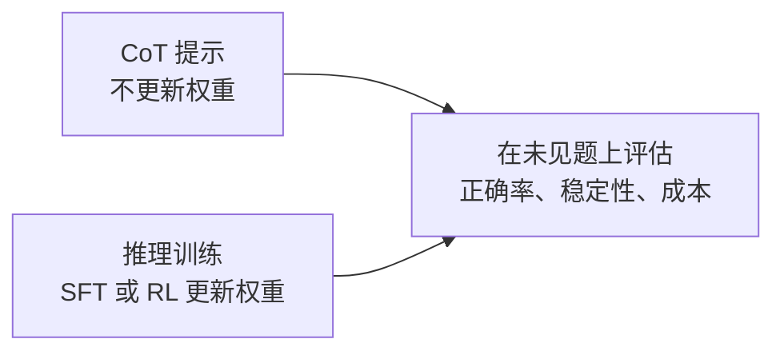
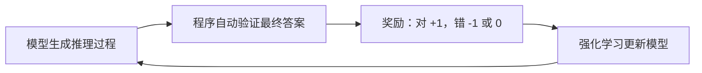

# 6. 推理对齐（Reasoning Alignment）——推理能力的训练与对齐

> **读之前**：读完第 4、5 章，知道 SFT 和偏好学习分别提供什么监督信号。
>
> **读完你能做到**：区分"写了推理过程"和"真的会推理"；说清结果监督与过程监督的差别；理解可验证奖励为什么适合数学和代码；知道 R1 的四阶段大致在做什么。

---

## 一、过程很长，答案却可能是错的

第一部分 13.3 节用 "Let's think step by step" 引导模型逐步推理。但模型有时会写一大段过程，结论却错了。

例如问 `23 × 17 = ?`，模型可能输出：

```text
23 × 17
= 23 × 10 + 23 × 7
= 230 + 161
= 381   ← 这里故意写错
```

过程格式很漂亮，但 `230 + 161 = 391`，不是 381。

这件事说明两点：

1. **解释写得流畅，不等于结论正确**。模型可能生成一段看起来合理、实际算错的过程。
2. **预测下一个词元的训练并非只能学表面文体**。它也可能学到可迁移的计算规律和解题策略；只是目标函数只检查"下一个词元像不像训练数据"，不会逐步验证逻辑。

反过来，经过强化学习（RL）的模型也可能推理出错。所以判断推理能力，要看模型在**未见题**上的正确率、稳定性和成本，而不是把模型简单分成"只会模仿"和"真正会推理"两类。

---

## 二、两条路线：改提示，还是改参数

提升推理能力有两条路线。

**路线一：思维链提示（Chain-of-Thought, CoT）。** 在示例里给出中间步骤，引导模型分步解答。2022 年的 *Chain-of-Thought Prompting Elicits Reasoning in Large Language Models* 系统展示了这个方法。

提示不更新权重，但能改变解题策略、分配更多生成计算，从而改善部分任务。它不只是"换一种文体"，但也有边界：效果依赖模型、题型和示例，可能随措辞波动，也不保证过程正确。

**路线二：推理对齐（Reasoning Alignment）。** 用推理数据做 SFT，或用结果/过程奖励做强化学习，真正更新参数。



两条路线不互斥。实践中常常先用提示摸清模型能力，再用训练把行为固化下来。

---

## 三、监督信号：只看结果，还是看过程

训练推理能力时，第一个设计决策是：**"对错"这个信号从哪里来、监督到什么粒度？**

| 监督方式 | 监督对象 | 优点 | 缺点 |
|---|---|---|---|
| **结果监督（Outcome Supervision）** | 只看最终答案对不对 | 简单、成本低 | 无法判断过程是否合理，可能"蒙对"；无法定位错在哪一步 |
| **过程监督（Process Supervision）** | 对推理的每一步分别打分 | 能定位错误步骤 | 细粒度标注与校验成本高 |

实验 6.1 只核验最终数值，属于**结果验证器（Outcome Verifier）**；它不证明中间过程正确。

数学、代码等部分任务可以用规则代替逐条人工评分，这让**可验证奖励（Verifiable Rewards）**成为推理训练的重要信号。但题目、参考答案、测试和验证器本身仍需构建与质检。

---

## 四、可验证奖励：能自动判分，但不是免费

**可验证奖励强化学习（Reinforcement Learning with Verifiable Rewards, RLVR）**描述的是奖励来源：比较数值答案、运行代码测试、检查形式化证明。

相对于人工逐条打分，它有三个好处：规则明确、可扩展、便于审计。但有三个边界：

1. **验证有成本**：题库制作、答案审计、测试执行、沙箱维护都要资源；大批量采样（rollout）和长序列生成也可能成为主要开销。
2. **验证会出错或不完整**：答案解析错误、浮点误差、参考答案错误、测试覆盖不足，都可能错奖或漏奖。"通过现有测试"不等于程序对所有输入都正确。
3. **人类反馈没有消失**：开放任务、数据质检、奖励设计和安全评测仍依赖人工；奖励设计还要防**奖励劫持（reward hacking）**——模型利用验证漏洞刷分。

一个结果奖励训练循环可以概括为：



**真正的难点是奖励稀疏。** 如果模型在一道题上几乎采不到正确解，奖励只能反复告诉它"全错"，却无法指出哪一步走偏；回答越长，把最终对错归因到具体步骤也越难。

所以可验证奖励能否奏效，取决于：基座是否具备基本解题能力、题目难度是否合适、采样预算是否足够、验证器是否可靠。把"对/错"信号接上去，并不自动等于模型能学会推理。

### 选读：GRPO 的优势怎么算

**组相对策略优化（Group Relative Policy Optimization, GRPO）**是一种策略优化算法，和"奖励从哪来"（RLVR）不是一回事。

同一问题采样四个回答，结果奖励是 `[1, 1, 0, 0]`：

```text
平均奖励 r̄ = (1 + 1 + 0 + 0) / 4 = 0.5
标准差 σ = 0.5
优势 A_i = (r_i - r̄) / (σ + δ)
        ≈ [1, 1, -1, -1]
```

- 正优势：这个回答比组内平均好，提高它的概率；
- 负优势：比平均差，降低它的概率。

若组内全错 `[0,0,0,0]`（或全对），均值相减都为零，优势为零：**这一项结果奖励没有组内学习信号**。这不等于所有损失都为零，KL 项或其他奖励仍可能贡献梯度。

这里用总体标准差只是为了手算清楚；实际库的标准差与归一化约定要看实现。手算只展示优势，不是完整训练器——真实实现还要处理 token mask、概率比、clip、KL 和长度归一化。

---

## 五、DeepSeek-R1 的四阶段流水线

以下按 DeepSeek-R1 原论文 arXiv:2501.12948v1（2025 年 1 月）介绍一条公开实践，不把它当成所有推理模型的统一标准。

先区分两个模型：

- **R1-Zero**：从 DeepSeek-V3-Base 直接做 RL，没有前置 SFT；
- **R1**：为了改善可读性、语言混杂和通用能力，加入下面的四阶段流程。


**第一阶段：冷启动 SFT。** 数据来自长 CoT 少样本提示、直接提示生成含反思与验证的详细解答、可读的 R1-Zero 输出，以及人工后处理等多种渠道，并非全部由人从零编写。收集数千条样本后微调 V3-Base。

**第二阶段：推理 RL。** 用 GRPO 训练，奖励主要看答案是否正确，以及语言是否一致（避免中英混杂）。这一阶段让模型学会更长的推理和自我检查。

**第三阶段：拒绝采样 + 重新 SFT。** 用第二阶段模型对大量问题采样，只保留通过验证的候选，再混入非推理数据，重新在 V3-Base 上做 SFT。这样得到的模型更可读，也能处理推理之外的任务。

**第四阶段：全场景 RL。** 在推理任务上用规则奖励，在通用任务上用学习到的偏好奖励，继续强化。

**注意**：R1 之后的这一轮 SFT 用的是筛选过的生成数据，所以不能称为"冷启动"。四阶段是 R1 的配方，不是所有推理模型的必经流程。

---

## 六、思考不是免费的

推理导向模型常在数学、代码等任务上生成更长的轨迹，消耗更多词元、KV Cache 和时间。但不是每次都更长，也没有通用的固定成本倍数。普通对话模型同样可以输出分步推理；一些模型还支持"思考/非思考"模式切换。

**测试时计算（Test-Time Compute）不是推理模型独有。** 普通模型也能通过多次采样、自一致性（Self-Consistency）、搜索或验证器重排来增加推理时计算。推理训练可能让模型更有效地利用这些预算，但预算增加有时提高准确率，也可能只带来重复、错误累积或收益饱和。

**更长不保证更好。** `max_new_tokens` 只是生成上限，不保证模型有效思考到该长度。实际决策要看同一评测集上的"质量—成本曲线"：多花这些计算，准确率提升了多少，延迟增加了多少。

**可见文本也不等于内部机制。** R1 可以展示推理文本；部分商业产品只提供摘要，不暴露原始推理轨迹。没有 `<think>` 标签不代表没有推理，有标签也不证明解释忠实、正确。

---

## 七、还没解决的问题

- **思考效率**：怎么按题目难度分配生成或搜索预算，而不是所有问题都长篇回答？
- **验证器边界**：开放任务很难完整形式化。规则能验证部分约束；用 LLM 当裁判又会引入裁判误差。
- **推理与安全**：更强能力、更长输出和工具使用会改变风险面，需要分别评测最终回答和系统行为（第 7 章衔接）。

---

## 本章对应的实验

- [6.1 推理模型（Reasoning Model）与对话模型（Chat Model）的输出对比](<./6.1%20推理模型（Reasoning%20Model）与对话模型（Chat%20Model）的输出对比.md>)：观察推理模型的输出格式、截断和成本，理解结果验证器能检查什么、不能检查什么。

## 本章小结

- 过程写得长不等于答案正确；判断推理能力要看未见题上的正确率、稳定性和成本。
- CoT 提示不更新权重；推理对齐用 SFT 或 RL 更新参数。
- 结果监督只看最终答案，过程监督看每一步；两者成本和用途不同。
- 可验证奖励适合数学、代码等能自动判分的任务，但有验证成本、误差和奖励劫持风险；奖励稀疏时很难学。
- GRPO 是策略优化算法，RLVR 是奖励来源，两者不是一回事。
- R1 的四阶段是"冷启动 SFT → 推理 RL → 拒绝采样再 SFT → 全场景 RL"；这是 R1 的配方，不是通用标准。
- 测试时计算不是推理模型独有，更长不保证更好。

> **一句话记住本章**：不要只问"模型想了多长"，还要问"验证器测了什么、在新题上有没有效、付出了多少计算"。

## 下一章预告

更强的能力、更长的输出和更广的工具权限，都会改变风险面。下一章从防御视角看安全对齐。

> **第 7 章 安全对齐（Safety Alignment）——风险边界与多层防护**

---

## 思考题

1. 结果监督和过程监督各适合什么任务？如果只能选一种，你会怎么选？
2. GRPO 去掉评论家带来什么收益和代价？组内全错时为什么没有学习信号？
3. 测试时计算和训练时计算有什么区别？为什么"让模型多想一会儿"有时有效、有时无效？
4. 如果模型输出的推理过程看起来完美但答案错误，你会优先怀疑哪一环？

---

## 参考资料

- DeepSeek《DeepSeek-R1》（四阶段与数据量以 v1 为准）：https://arxiv.org/html/2501.12948v1
- OpenAI《Learning to Reason with LLMs》（o1 与测试时计算）：https://openai.com/index/learning-to-reason-with-llms/
- Wei et al.《Chain-of-Thought Prompting Elicits Reasoning in Large Language Models》：https://arxiv.org/abs/2201.11903
- Lightman et al.《Let's Verify Step by Step》（过程监督）：https://arxiv.org/abs/2305.20050
- Shao et al.《DeepSeekMath》（GRPO）：https://arxiv.org/abs/2402.03300
