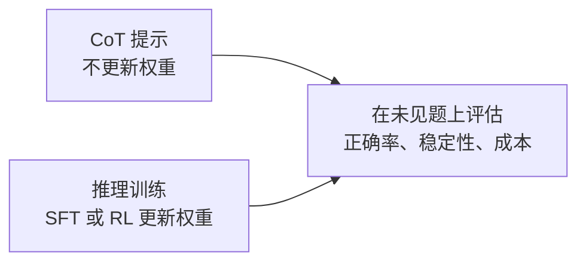
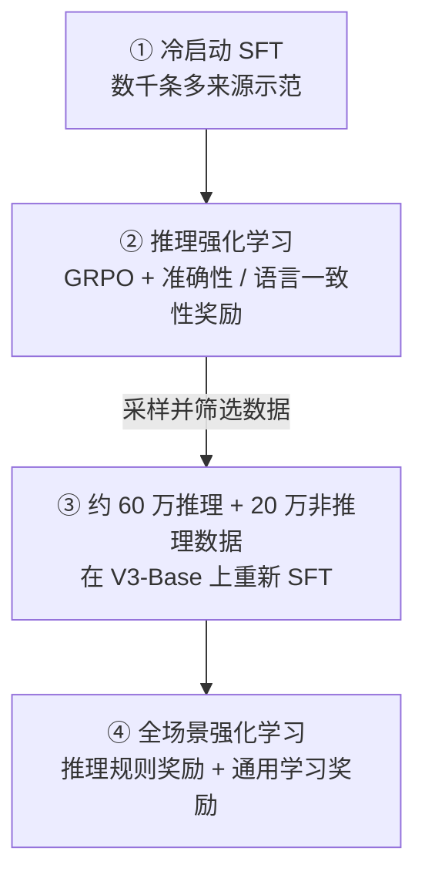

# 6. 推理对齐（Reasoning Alignment）——推理能力的训练与对齐

> **读之前**：读完第 4、5 章，知道 SFT 和偏好学习分别提供什么监督信号。
>
> **读完你能做到**：区分"写了推理过程"和"真的会推理"；说清结果监督与过程监督的差别；理解可验证奖励为什么适合数学和代码；知道 ORM/PRM 怎么训练、GRPO 在推理任务里怎么更新；理解 R1 的四阶段大致在做什么。

---

## 一、过程很长，答案却可能是错的

第一部分 13.3 节用 "Let's think step by step" 引导模型逐步推理。但模型有时会写一大段过程，结论却错了。

例如问 `23 × 17 = ?`，模型可能输出：

```text
23 × 17
= 23 × 10 + 23 × 7
= 230 + 161
= 381   ← 这里故意写错
```

过程格式很漂亮，但 `230 + 161 = 391`，不是 381。

这件事说明两点：

1. **解释写得流畅，不等于结论正确**。模型可能生成一段看起来合理、实际算错的过程。
2. **预测下一个词元的训练并非只能学表面文体**。它也可能学到可迁移的计算规律和解题策略；只是目标函数只检查"下一个词元像不像训练数据"，不会逐步验证逻辑。

反过来，经过强化学习（RL）的模型也可能推理出错。所以判断推理能力，要看模型在**未见题** 上的正确率、稳定性和成本，而不是把模型简单分成"只会模仿"和"真正会推理"两类。

---

## 二、两条路线：改提示，还是改参数

提升推理能力有两条路线。

**路线一：思维链提示（Chain-of-Thought, CoT）。** 在示例里给出中间步骤，引导模型分步解答。2022 年的 *Chain-of-Thought Prompting Elicits Reasoning in Large Language Models* 系统展示了这个方法。

提示不更新权重，但能改变解题策略、分配更多生成计算，从而改善部分任务。它不只是"换一种文体"，但也有边界：效果依赖模型、题型和示例，可能随措辞波动，也不保证过程正确。

**路线二：推理对齐（Reasoning Alignment）。** 用推理数据做 SFT，或用结果/过程奖励做强化学习，真正更新参数。



两条路线不互斥。实践中常常先用提示摸清模型能力，再用训练把行为固化下来。

---

## 三、监督信号：只看结果，还是看过程

训练推理能力时，第一个设计决策是：**"对错"这个信号从哪里来、监督到什么粒度？**

| 监督方式                                  | 监督对象               | 优点           | 缺点                                                 |
| ----------------------------------------- | ---------------------- | -------------- | ---------------------------------------------------- |
| **结果监督（Outcome Supervision）**| 只看最终答案对不对     | 简单、成本低   | 无法判断过程是否合理，可能"蒙对"；无法定位错在哪一步 |
| **过程监督（Process Supervision）**| 对推理的每一步分别打分 | 能定位错误步骤 | 细粒度标注与校验成本高                               |

实验 6.1 只核验最终数值，属于**结果验证器（Outcome Verifier）**；它不证明中间过程正确。

### 奖励模型：ORM 与 PRM 的训练

先区分两个东西：

- **验证器（verifier）**：规则程序，比较答案、跑测试、检查格式；不需要训练；
- **奖励模型（reward model, RM）**：从数据里学出来的打分器；推理任务里常见 ORM 和 PRM。

**结果奖励模型（ORM）** 输入完整回答，输出一个分数。若数据只有“对/错”标签 $z\in\{0,1\}$，可以用二分类损失：

$$
\mathcal{L}_{\mathrm{ORM}}
=
-\left[
z\log\sigma(r_\phi(x,y))
+(1-z)\log(1-\sigma(r_\phi(x,y)))
\right]
$$

若数据是“哪个回答更好”的成对偏好，就换成第 5 章的 Bradley–Terry 成对损失。二分类形式本质上就是 Bernoulli 负对数似然：把 $\sigma(r_\phi)$ 当作“答对概率”，$z$ 是观测到的对错。

**过程奖励模型（PRM）** 输入问题加一段前缀，输出“这一步是否合理/是否推进了解题”。监督信号可以来自：

- 人工标注每一步对错；
- 用 Monte Carlo rollout 估计“从这一步继续，最终答对的概率”，把它当作软标签；
- 强模型生成步骤标签后再抽检。

若第 $t$ 步的标签是 $z_t$，一个简化的逐步损失是：

$$
\mathcal{L}_{\mathrm{PRM}}
=
-\sum_{t}
\left[
z_t\log\sigma(r_\phi(x,y_{1:t}))
+(1-z_t)\log(1-\sigma(r_\phi(x,y_{1:t})))
\right]
$$

若 $z_t$ 来自 Monte Carlo rollout，它表示“从这一步继续最终成功”的概率；用 BCE 拟合这个概率，用 MSE 则是在拟合一个价值。两者都能当 PRM，区别在标签含义与损失形式。

| 信号 | 从哪来 | 密度 | 主要风险 |
|---|---|---|---|
| 规则验证器 | 答案比较、测试、格式检查 | 只在终态 | 覆盖不足、答案/测试错误 |
| ORM | 结果标签或成对偏好 | 终态 | 学到表面特征、被刷分 |
| PRM | 步骤标签或 Monte Carlo | 每步 | 步骤标签主观、训练贵、奖励劫持 |

ORM/PRM 是**学习出来的代理**；验证器是**规则程序**。RLVR 可以完全不用奖励模型，直接用验证器；需要更密的信号时，才引入 ORM/PRM。

数学、代码等部分任务可以用规则代替逐条人工评分，这让**可验证奖励（Verifiable Rewards）** 成为推理训练的重要信号。但题目、参考答案、测试和验证器本身仍需构建与质检。

---

## 四、可验证奖励：自动判分与代价

**可验证奖励强化学习（Reinforcement Learning with Verifiable Rewards, RLVR）** 描述的是奖励来源：比较数值答案、运行代码测试、检查形式化证明。

相对于人工逐条打分，它有三个好处：规则明确、可扩展、便于审计。但有三个边界：

1. **验证有成本**：题库制作、答案审计、测试执行、沙箱维护都要资源；大批量采样（rollout）和长序列生成也可能成为主要开销。
2. **验证会出错或不完整**：答案解析错误、浮点误差、参考答案错误、测试覆盖不足，都可能错奖或漏奖。"通过现有测试"不等于程序对所有输入都正确。
3. **人类反馈没有消失**：开放任务、数据质检、奖励设计和安全评测仍依赖人工；奖励设计还要防**奖励劫持（reward hacking）**——模型利用验证漏洞刷分。

一个结果奖励训练循环可以概括为：


**真正的难点是奖励稀疏。** 如果模型在一道题上几乎采不到正确解，奖励只能反复告诉它"全错"，却无法指出哪一步走偏；回答越长，把最终对错归因到具体步骤也越难。

所以可验证奖励能否奏效，取决于：基座是否具备基本解题能力、题目难度是否合适、采样预算是否足够、验证器是否可靠。把"对/错"信号接上去，并不自动等于模型能学会推理。

### GRPO 在推理 RL 中的更新

**组相对策略优化（Group Relative Policy Optimization, GRPO）** 是一种策略优化算法，和"奖励从哪来"（RLVR）不是一回事。完整推导与三个“旧”对象见第 5 章第七节；这里给出推理 RL 需要的推导与闭环。

#### 推导：从策略梯度到组内优势

设问题为 $x$，策略 $\pi_\theta$ 采样回答 $y$，奖励为 $R(x,y)$。目标是最大化期望奖励：

$$
J(\theta)=\mathbb{E}_{x\sim D,\ y\sim\pi_\theta(\cdot\mid x)}
\left[R(x,y)\right]
$$

对策略参数求梯度：

$$
\nabla_\theta J
=
\mathbb{E}
\left[
\sum_t
\nabla_\theta\log\pi_\theta(y_t\mid x,y_{1:t-1})
\,R(x,y)
\right]
$$

直接用 $R$ 当权重，方差很大：同一道题采样几次，分数可能差很多。减掉一个只依赖问题 $x$ 的基线 $b(x)$，不改变期望，却能降低方差：

$$
A(x,y)=R(x,y)-b(x)
$$

PPO 用评论家（critic）$V_\phi(s_t)$ 估计这个基线，并引入新旧策略概率比：

$$
\rho_{i,t}
=
\frac{\pi_\theta(y_{i,t}\mid x,y_{i,1:t-1})}
{\pi_{\mathrm{old}}(y_{i,t}\mid x,y_{i,1:t-1})}
$$

再最大化裁剪后的代理目标，并减去 KL：

$$
\mathbb{E}
\left[
\min\left(\rho A,\ \mathrm{clip}(\rho,1-\epsilon,1+\epsilon)A\right)
\right]
-
\beta D_{\mathrm{KL}}(\pi_\theta\|\pi_{\mathrm{ref}})
$$

**GRPO 的关键替换**：不训练 $V_\phi$，而是对同一个问题采样 $G$ 条回答，用组内平均奖励作为基线：

$$
b(x)=\bar R=\frac{1}{G}\sum_{j=1}^{G}R_j,
\qquad
A_i=R_i-\bar R
$$

因此：

- 减均值：抵消“这道题本身难不难”，只保留同一题内的相对好坏；
- 除标准差：把不同题目的奖励尺度归一化，避免简单题主导更新；
- 不需要 critic：组内均值是同一问题下期望奖励的 Monte Carlo 估计；
- 全对/全错时 $A_i=0$：组内没有相对信息，这一步没有学习信号。

实际实现常写成：

$$
A_i=
\frac{R_i-\bar R}{\sigma_R+\epsilon_{\mathrm{std}}}
$$

其中 $\epsilon_{\mathrm{std}}$ 是防止除以 0 的小常数，不是 PPO 的裁剪宽度。

> 这一步的推导只说明“优势怎么来”；它不改变策略梯度的大框架，也不把奖励变成可微函数。$A_i$ 在更新前算好，作为权重使用。

同一问题采样四个回答，结果奖励是 `[1, 1, 0, 0]`：

```text
平均奖励 r̄ = (1 + 1 + 0 + 0) / 4 = 0.5
标准差 σ = 0.5
优势 A_i = (r_i - r̄) / (σ + δ)
        ≈ [1, 1, -1, -1]
```

- 正优势：这个回答比组内平均好，提高它的概率；
- 负优势：比平均差，降低它的概率。

若组内全错 `[0,0,0,0]`（或全对），均值相减都为零，优势为零：**这一项结果奖励没有组内学习信号**。这不等于所有损失都为零，KL 项或其他奖励仍可能贡献梯度。

这里用总体标准差只是为了手算清楚；实际库的标准差与归一化约定要看实现。手算只展示优势，不是完整训练器——真实实现还要处理 token mask、概率比、clip、KL 和长度归一化。

有了 $A_i$，实际更新用 PPO 式的裁剪目标：

$$
\mathcal{L}_{\mathrm{GRPO}}
=
-\frac{1}{G}
\sum_{i=1}^{G}
\frac{1}{|y_i|}
\sum_{t}
\min\left(
\rho_{i,t}A_i,\;
\mathrm{clip}(\rho_{i,t},1-\epsilon_{\mathrm{clip}},1+\epsilon_{\mathrm{clip}})A_i
\right)
+
\beta\,D_{\mathrm{KL}}(\pi_\theta\|\pi_{\mathrm{ref}})
$$

- $G$：同一问题的回答数；
- $|y_i|$：回答词元数，用来做长度归一化；不同实现可能不除长度，需看代码；
- $\rho_{i,t}=\pi_\theta(y_{i,t}\mid x,y_{i,1:t-1})/\pi_{\mathrm{old}}(y_{i,t}\mid x,y_{i,1:t-1})$：新旧策略概率比；
- $\epsilon_{\mathrm{clip}}$：裁剪宽度，不是优势公式里的数值稳定项；
- $\pi_{\mathrm{old}}$：本轮采样时的策略快照；
- $\pi_{\mathrm{ref}}$：冻结的参考模型，用于 KL；
- $\beta$：KL 惩罚强度。

#### 闭环：一轮 GRPO 从采样到下一次迭代

| 阶段 | 输入 | 操作 | 产物 | 完成判据 |
|---|---|---|---|---|
| 1. Rollout | 一批问题 | 当前策略每题采样 $G$ 条回答，记录采样时的 logprob | 回答组 + `old_logp` | 每条问题都有 $G$ 条可评分回答 |
| 2. 奖励 | 回答组 | 验证器/RM 打分；格式错误、超时单列 | $R_i$ 与失败类型 | 奖励可复现、异常有标记 |
| 3. 优势 | $R_1,\dots,R_G$ | 算组内均值/标准差，得到 $A_i$ | 每条回答的优势 | 组内有差异；全同组标记为无信号 |
| 4. 策略更新 | 回答组 + $A_i$ + `old_logp` | 算概率比、clip、KL，反向传播 | 新的 $\pi_\theta$ | 梯度有限、KL 未失控 |
| 5. 评估与下一轮 | 验证集 + 新策略 | 跑留出题、格式率、长度/成本；不达标则继续 | 指标与检查点 | 指标不再提升或预算耗尽时停止 |

对应伪代码：

```python
for iteration in range(num_iterations):
    groups = []
    for prompt in prompt_batch:
        responses = sample(policy, prompt, G)
        rewards = verify(prompt, responses)          # 规则或 RM
        advantages = (rewards - rewards.mean()) / (rewards.std() + eps)
        old_logp = logprob(policy, prompt, responses).detach()
        groups.append((prompt, responses, advantages, old_logp))

    for epoch in range(update_epochs):
        for prompt, responses, advantages, old_logp in groups:
            new_logp = logprob(policy, prompt, responses)
            ratio = torch.exp(new_logp - old_logp)
            loss = grpo_loss(ratio, advantages, policy, reference)
            loss.backward()
            optimizer.step()
            optimizer.zero_grad()

    metrics = evaluate(policy, val_set)
    if should_stop(metrics):
        break
    # 下一轮重新采样；old_logp 刷新，reference 继续冻结
```

三个对象的生命周期：

- $\pi_\theta$：每个 optimizer step 更新；
- $\pi_{\mathrm{old}}$：每轮 rollout 前刷新，轮内固定，只用于概率比；
- $\pi_{\mathrm{ref}}$：整个训练冻结，只用于 KL；
- 验证器/奖励模型：本轮固定；若它也要更新，就属于 iterative RLHF，需要重新定义数据新鲜度和评测。

停止条件不能只看训练奖励：至少同时看**留出题通过率、格式合法率、平均长度/成本**。奖励上升但通过率不动，通常说明验证器被钻空子或题目泄漏；组内长期全对/全错，则要调整题目难度或采样策略。

PPO 也能做同一件事，但它额外需要一个评论家（critic）估基线；GRPO 用组内均值代替评论家，省掉一份价值网络，但采样次数更多。

---

## 五、DeepSeek-R1 的四阶段流水线

以下按 DeepSeek-R1 原论文 arXiv:2501.12948v1（2025 年 1 月）介绍一条公开实践，不把它当成所有推理模型的统一标准。

先区分两个模型：

- **R1-Zero**：从 DeepSeek-V3-Base 直接做 RL，没有前置 SFT；
- **R1**：为了改善可读性、语言混杂和通用能力，加入下面的四阶段流程。



**第一阶段：冷启动 SFT。** 数据来自长 CoT 少样本提示、直接提示生成含反思与验证的详细解答、可读的 R1-Zero 输出，以及人工后处理等多种渠道，并非全部由人从零编写。收集数千条样本后微调 V3-Base。

**第二阶段：推理 RL。** 用 GRPO 训练，奖励主要看答案是否正确，以及语言是否一致（避免中英混杂）。这一阶段让模型学会更长的推理和自我检查。

**第三阶段：拒绝采样 + 重新 SFT。** 用第二阶段模型对大量问题采样，只保留通过验证的候选，再混入非推理数据，重新在 V3-Base 上做 SFT。这样得到的模型更可读，也能处理推理之外的任务。

**第四阶段：全场景 RL。** 在推理任务上用规则奖励，在通用任务上用学习到的偏好奖励，继续强化。

**注意**：R1 之后的这一轮 SFT 用的是筛选过的生成数据，所以不能称为"冷启动"。四阶段是 R1 的配方，不是所有推理模型的必经流程。

### 完整机制：从基座到推理模型

四个阶段首尾相接，前一步的权重或筛选出的数据就是后一步的输入：

| 阶段 | 输入 | 操作 | 产物 |
|---|---|---|---|
| ① 冷启动 SFT | V3-Base + 数千条长篇演示 | 监督微调（见第 4 章） | 会按推理格式作答的起点模型 |
| ② 推理 RL | ① 的权重 + 数学、代码题集 | GRPO，奖励 = 答案正确性 + 语言一致性 | 推理更长、会自我检查的策略 |
| ③ 拒绝采样 + 重新 SFT | ② 对大量题目的采样 + 非推理数据 | 只保留通过验证的候选，混入通用数据后重新 SFT | 可读性回升、通用能力恢复的模型 |
| ④ 全场景 RL | ③ 的权重 + 推理与通用任务混合 | 推理用规则奖励，通用用偏好奖励 | 最终发布的模型 |

**完成判据**：每一阶段都看留出题目的通过率，而不是训练时的平均奖励；①③ 还看格式合法率是否到了预期起点；④ 还要确认通用能力没有为推理指标让路。训练奖励继续上升而留出题目通过率不动，通常说明验证器被钻了空子或题目已经泄漏。

**失败边界**：② 若长期整组全对或全错，优势恒为零（见第四节），继续训练只是在消耗采样；若平均长度单调膨胀而通过率不变，说明模型学到的是"写得更长"而不是"想得更对"；③ 用结果验证器筛数据时会保留"过程错、答案碰对"的样本，筛完仍需抽检过程，否则错误推理会被当作示范重新教回模型。

---

## 六、推理成本

推理导向模型常在数学、代码等任务上生成更长的轨迹，消耗更多词元、KV Cache 和时间。但不是每次都更长，也没有通用的固定成本倍数。普通对话模型同样可以输出分步推理；一些模型还支持"思考/非思考"模式切换。

**测试时计算（Test-Time Compute）不是推理模型独有。** 普通模型也能通过多次采样、自一致性（Self-Consistency）、搜索或验证器重排来增加推理时计算。推理训练可能让模型更有效地利用这些预算，但预算增加有时提高准确率，也可能只带来重复、错误累积或收益饱和。

**更长不保证更好。**`max_new_tokens` 只是生成上限，不保证模型有效思考到该长度。实际决策要看同一评测集上的"质量—成本曲线"：多花这些计算，准确率提升了多少，延迟增加了多少。

**可见文本也不等于内部机制。** R1 可以展示推理文本；部分商业产品只提供摘要，不暴露原始推理轨迹。没有 `<think>` 标签不代表没有推理，有标签也不证明解释忠实、正确。

---

## 七、还没解决的问题

- **思考效率**：怎么按题目难度分配生成或搜索预算，而不是所有问题都长篇回答？
- **验证器边界**：开放任务很难完整形式化。规则能验证部分约束；用 LLM 当裁判又会引入裁判误差。
- **推理与安全**：更强能力、更长输出和工具使用会改变风险面，需要分别评测最终回答和系统行为（第 8 章衔接）。

---

## 八、过程奖励与搜索

结果奖励只看最后答案，过程奖励看中间步骤。两者不是互斥的；在推理任务里，常见组合是“结果验证器保底 + 过程奖励提供更密的信号”。

### ORM 与 PRM

- **结果奖励模型（Outcome Reward Model, ORM）**：输入问题 + 完整回答，输出一个最终分数；它不关心中间步骤。
- **过程奖励模型（Process Reward Model, PRM）**：输入问题 + 到某一步为止的前缀，输出“这一步是否合理/是否推进了解题”；它给出步骤级分数。

PRM 的训练数据通常比 ORM 贵得多：

- 人工标注每一步对错；
- 用 Monte Carlo rollout 估计“从这一步继续，最终答对的概率”；
- 用强模型生成步骤标签，再抽检校准。

PRM 也不是“更细就一定更好”：步骤标签主观、标注成本高，而且模型可能学会迎合 PRM，而不是真正解题。

### PRM 的使用：重排、搜索与验证

有了步骤分数，可以在推理时做：

1. **重排（Reranking）**：采样多条完整回答，用 ORM/PRM 打分，选最高分；
2. **束搜索（Beam Search）**：每步保留若干候选，用 PRM 剪枝；
3. **树搜索（MCTS 等）**：在选择、扩展、模拟、回传之间迭代，用价值/过程分数引导探索。

### 自一致性：最便宜的测试时计算

**自一致性（Self-Consistency）** 对同一问题采样多条推理路径，再对最终答案投票。它不需要额外训练，也不依赖 PRM；代价是采样和验证成本。

它适合“答案可比较”的任务（数学数值、选项、代码测试结果）。开放写作没有唯一答案，投票没有意义。

### MCTS 的直觉

蒙特卡洛树搜索（Monte Carlo Tree Search, MCTS）把推理过程看成树：

- **选择（Selection）**：从根节点按“分数高 + 探索不足”选一个分支；
- **扩展（Expansion）**：生成下一步候选；
- **模拟（Simulation）**：从该节点继续生成，得到结果；
- **回传（Backpropagation）**：把结果分数回传给路径上的节点。

它把“生成”和“搜索”分开：策略模型负责扩展，价值/过程模型负责评估。代价是多次前向、树管理复杂，且搜索预算与延迟强相关。

### 风险

- **PRM 奖励劫持**：模型学会写出 PRM 喜欢的步骤，而不是正确步骤；
- **搜索成本**：树搜索的节点数随深度增长，不能只看准确率；
- **验证器泛化**：在分布内题目上准，换题型/语言可能失效；
- **过程标签偏差**：标注者认为“合理”的步骤，不一定是唯一正确路径。

> **一句话**：过程奖励和搜索买的是“更多推理时计算 + 更密的信号”，不是免费的准确率；先确认结果验证器可靠，再考虑 PRM 和树搜索。

---

## 本章对应的实验

- [6.1 推理模型（Reasoning Model）与对话模型（Chat Model）的输出对比](<./6.1%20推理模型（Reasoning%20Model）与对话模型（Chat%20Model）的输出对比.md>)：观察推理模型的输出格式、截断和成本，理解结果验证器能检查什么、不能检查什么。

## 本章小结

- 过程写得长不等于答案正确；判断推理能力要看未见题上的正确率、稳定性和成本。
- CoT 提示不更新权重；推理对齐用 SFT 或 RL 更新参数。
- 结果监督只看最终答案，过程监督看每一步；两者成本和用途不同。
- 可验证奖励适合数学、代码等能自动判分的任务，但有验证成本、误差和奖励劫持风险；奖励稀疏时很难学。
- GRPO 是策略优化算法，RLVR 是奖励来源，两者不是一回事。
- R1 的四阶段是"冷启动 SFT → 推理 RL → 拒绝采样再 SFT → 全场景 RL"；这是 R1 的配方，不是通用标准。
- 测试时计算不是推理模型独有，更长不保证更好。
- ORM 只看结果，PRM 看步骤；PRM 可以用 Monte Carlo rollout 训练，但也会被奖励劫持，搜索成本随预算增长。

> **一句话记住本章**：不要只问"模型想了多长"，还要问"验证器测了什么、在新题上有没有效、付出了多少计算"。

## 下一章预告

推理模型已经会"先想再答"，但如果让它多步行动、根据环境反馈调整策略呢？下一章把强化学习放到智能体的交互场景里。

> **第 7 章 智能体强化学习（Agentic RL）——在环境中训练会使用工具的智能体**，配套实验 [7.1 搭建一个最小多轮工具调用强化学习循环](<./7.1%20搭建一个最小多轮工具调用强化学习循环.md>)

更强的能力、更长的输出和更广的工具权限，也会改变风险面；第 8 章从防御视角看安全对齐。

> **第 8 章 安全对齐（Safety Alignment）——风险边界与多层防护**

---

## 思考题

1. 结果监督和过程监督各适合什么任务？如果只能选一种，你会怎么选？
2. GRPO 去掉评论家带来什么收益和代价？组内全错时为什么没有学习信号？
3. 测试时计算和训练时计算有什么区别？为什么"让模型多想一会儿"有时有效、有时无效？
4. 如果模型输出的推理过程看起来完美但答案错误，你会优先怀疑哪一环？
5. 自一致性和 MCTS 都在增加测试时计算，它们分别适合什么任务？为什么开放写作不适合投票？

---

## 参考资料

- DeepSeek《DeepSeek-R1》（四阶段与数据量以 v1 为准）：https://arxiv.org/html/2501.12948v1
- OpenAI《Learning to Reason with LLMs》（o1 与测试时计算）：https://openai.com/index/learning-to-reason-with-llms/
- Wei et al.《Chain-of-Thought Prompting Elicits Reasoning in Large Language Models》：https://arxiv.org/abs/2201.11903
- Lightman et al.《Let's Verify Step by Step》（过程监督）：https://arxiv.org/abs/2305.20050
- Shao et al.《DeepSeekMath》（GRPO）：https://arxiv.org/abs/2402.03300
- Wang et al.《Self-Consistency Improves Chain of Thought Reasoning in Language Models》：https://arxiv.org/abs/2203.11171
- Yao et al.《Tree of Thoughts: Deliberate Problem Solving with Large Language Models》：https://arxiv.org/abs/2305.10601
