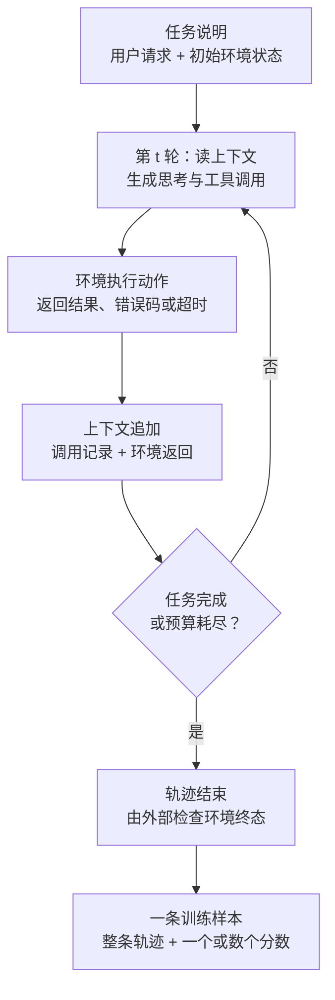

# 7. 智能体强化学习（Agentic RL）——在环境中训练会使用工具的智能体

> **读之前**：读完第 5、6 章。知道 GRPO 用组内相对奖励替代评论家，知道 RLVR 用规则验证器给最终答案打分。
>
> **本章目标**：
>
> 1. 说清单轮可验证奖励在什么条件下够用、在什么条件下会失效；
> 2. 用"部分可观察、多轮决策、动作含工具调用"把智能体任务写成可训练的问题；
> 3. 分清结果奖励、过程反馈、工具返回、格式约束四类信号各自能教什么、又可能被骗成什么样；
> 4. 理解轨迹级优势怎么从组采样得到，以及长度和步数会给优化带来哪些系统性偏差；
> 5. 判断一个任务值不值得做智能体强化学习，并说清它与第三部分系统搭建的分工。
>
> **时效与证据**：这一方向 2024 年之后变化很快，本章把内容分成三类：**已发表方法**（有公开论文和可复现细节）、**工程实践**（框架与团队的常见做法，通常缺少统一对照实验）、**本书判断**（作者对取舍的看法）。凡涉及 2025—2026 年的演进，用"公开工作中有一类做法是……"限定；不给未核实的成功率、成本倍数，也不做"首个""最强"这类排序。

---

## 一、单轮可验证奖励在哪里停下

第 6 章的训练循环很短：一个提示进去，一条回答出来，验证器检查最终答案，对给正奖励、错给负奖励。这个循环之所以成立，靠三个隐含前提。

**前提一：答案空间是封闭的。** 数学题的答案是数值或表达式，代码题的答案是"测试是否通过"，都能被程序判定。但"帮我把这份周报整理成三条要点""把这个仓库的构建时间降下来"没有唯一答案串，也没有一个函数能返回真值。

**前提二：评判只依赖回答文本。** 单轮任务里，回答写完就结束了。可智能体任务的结果往往写在环境里：文件被改成了什么样、表单有没有提交成功、数据库里多了一行还是少了一行。同一个回答文本，在一个初始状态里是正确的操作，在另一个初始状态里可能是破坏性的。

**前提三：一次生成就能完成。** 这是最容易被忽略的一条。可用工具的任务，正确答案通常不是"写出来"，而是"做出来"——先查、看到返回、再决定下一步。

把这三条摆在一起，就能看清失效点。假设任务是"查清这个项目为什么在上周开始变慢，并给出结论"。模型必须先调用搜索或读代码，看到返回结果，才可能知道下一个该查什么。它第一次搜索的关键词可能完全跑偏，第二次才纠正。整件事的成败取决于一串相互依赖的决定，而不是某一句话写得好不好。

这时候，如果仍然只用"最后结论对不对"这一个标量去训练，会发生什么？训练信号本身没有错，只是它把"第一步查错了、第二步纠正回来"和"全程方向都对"混成了同一个分数；也把"结论蒙对了但过程是瞎猜"和"结论是查证得来的"混成了同一个分数。前者让模型学不到纠错，后者教模型押注。

> **本书判断**：RLVR 并没有被智能体强化学习取代。更准确的说法是，RLVR 是智能体强化学习在**决策步数等于 1** 时的一个特例——当任务只有一步、结果完全由输出文本决定时，两者是同一件事。分界线不在算法名字上，而在**任务的时间跨度**上。

---

## 二、把智能体任务写成可训练的问题

要训练，先得把上面那些"感觉"，变成能写下来的东西。下面这套记号不需要严格背，但每个符号都对应一个工程决定。

设第 `t` 步时，模型看到的**观测**是 `o_t`，它由两部分拼成：一段文本上下文，加上环境刚刚返回的内容。模型据此生成**动作** `a_t`——一段词元序列，这段序列既可以是自然的思考文字，也可以是一次结构化的工具调用，或者两者混在一起。环境收到动作后执行，产生新的返回，追加进上下文，于是有了 `o_{t+1}`。整个过程在某个时刻终止：模型主动给出结束信号，或者步数预算耗尽，或者环境报错并中断。

在这个框架下，有四件事和单轮训练完全不同。

**第一，它是部分可观察的。** 环境里有很多模型看不见的东西：文件系统里没被打开的文件、网页没有渲染出来的部分、数据库里另一张表、服务端的真实负载。模型只能看到被工具返回的那一小片。这与第三部分第 4 章讲的记忆与检索是同一个问题在不同层面的表现：**上下文不是世界，上下文是世界的抽样**。抽样有偏，决策就会错，而且错得很有自信。

**第二，它是多轮决策。** 决策步数从几步到几百步不等。步数一多，"哪一步导致了失败"就变成一个分配问题——这正是第五节要讲的信用分配。

**第三，动作空间是混合的。** 一部分动作是自由文本（思考、结论），一部分是结构化调用（函数名加参数），还有一部分直接是代码或命令。它们长度可变，不能像棋类那样枚举，也没有天然的动作编号。这让"概率比"和"裁剪"这些 PPO 家族的工具在实现上要处理变长序列的掩码问题——第 5 章提过的 token mask，在智能体场景里从"可选优化"变成了必需品。

**第四，也是最容易被低估的一点：状态是被策略自己写出来的。** 在普通的强化学习里，环境的状态转移由环境决定，策略只影响动作。而在这里，模型写下的每一条思考、每一次工具调用的参数，都会成为后续步骤的输入。也就是说，**策略在改变自己的观测分布**。一个学会写冗长自我怀疑笔记的模型，会把后续所有决策都放在这堆笔记的语境里；这种自我强化的回路，是智能体训练特有的不稳定来源。

用一张图把一条完整轨迹画出来：

注意图里最后一格：训练样本的粒度不是"一轮对话"，而是**整条轨迹**。这个选择会一路影响后面的奖励设计、归一化和成本核算。

把两种任务并排看，差别就很清楚了：

| | 单轮可验证任务 | 智能体任务 |
|---|---|---|
| 观测 | 一个固定提示 | 提示 + 累积的工具返回，长度随步数增长 |
| 动作 | 一段回答 | 思考、调用、代码混合，长度可变 |
| 环境 | 基本没有，或只是一个验证器 | 真实或模拟的工具、文件、网页、服务 |
| 奖励来源 | 比较最终答案 | 检查环境终态，加上中间信号 |
| 一条样本 | 回答 | 轨迹（含全部中间步骤与环境返回） |
| 失败归因 | 通常能定位到某一步计算 | 需要回放整条轨迹才能判断 |

---

## 三、四种训练范式的分工

放到第 1 章那张地图上看，智能体强化学习不是第五种范式，而是把已有范式推到了有环境的那一侧。四者的差别可以用一张表说清：

| | 数据 / 信号从哪来 | 有没有环境 | 优化对象 | 主要解决 | 典型失效 |
|---|---|---|---|---|---|
| **SFT** | 人写的或强模型生成的示范轨迹 | 无 | 每个词元的似然 | 会不会按格式执行 | 示范覆盖不到的分支不会走；错误会累积 |
| **偏好学习** | 成对或单边的偏好判断 | 无（离线） | 相对偏好 | 回答是否更合人意 | 偏好是整体判断，定位不到具体步骤 |
| **RLVR** | 程序化验证器检查最终答案 | 名义上有，实际只查文本 | 整条回答 | 单步任务做对 | 答案不可验证时直接失效 |
| **智能体强化学习** | 验证器 + 环境终态 + 中间信号 | 必须有，且要可复现 | 整条轨迹的策略 | 多步任务能否完成 | 奖励稀疏、环境噪声、奖励被钻空子 |

三点补充，都很实际。

**它们通常叠加使用，不是四选一。** 一条常见的流水线是：先用人写的或强模型采样的轨迹做 SFT，让模型学会工具调用的格式和基本的思考顺序；再用强化学习在环境里探索，把"格式对"变成"事情办成"。没有 SFT 冷启动直接做强化学习，模型可能连一次可解析的工具调用都发不出来，采样全是废样本——这一点和第 6 章 R1-Zero 的关系一样，R1-Zero 敢跳过 SFT，是因为它的奖励只需要模型写出答案文本，不需要模型操作外部系统。

**环境是这一行的真正门槛，不是算法。** 上面四行里，前三行都可以在一台机器上、只靠一份数据集完成；第四行必须有一个能跑起来、能被重置、能返回稳定结果的执行环境。这也是为什么第七节要按任务类型分类——不同类型的任务，造环境的难度差了一个数量级。

**偏好学习并没有退场。** 当任务的成功无法用规则判定时（比如"这份调研报告写得好不好"），仍然需要人或模型来打分。公开工作中有一类做法是把规则奖励和评审奖励按权重混合，规则奖励保证下限，评审奖励覆盖规则说不清的部分。这类混合的比例通常是靠实验调的，没有普适最优值。

---

## 四、训练信号：四种来源与它们的漏洞

奖励设计是这一章最需要动脑子的部分。算法可以照抄，信号不能。

### 结果奖励：最可靠，也最稀疏

结果奖励只看任务终态：测试是否全绿、目标文件是否存在且内容正确、数据库里那行记录是否符合预期、页面上是否出现了成功提示。它的好处是**不可争辩**——不依赖任何主观判断，模型也没法通过写得更漂亮来提分。

代价是稀疏。一条三十步的轨迹，前面二十九步都做对了，最后一步参数写错，得到的是和"什么都没做"一样的零分。模型无法从中学到"前二十九步是对的"，只会得到一次全盘否定。

结果奖励还有一个常被忽略的性质：**它奖励的是结果，不是过程**。如果一个任务存在捷径（改测试而不是改代码、直接写死答案而不是计算），结果奖励会诚实地奖励这条捷径。这不是奖励函数写错了，而是它本来只承诺"结果对"。

### 过程与中间反馈：更密，但更主观

为了缓解稀疏，可以给中间状态打分：编译是否通过、单元测试通过了几条、子目标（比如"先找到配置文件"）是否达成、生成的计划是否覆盖了必要步骤。

这些信号让梯度变密，但也引入了新的风险：

- **子目标设计得不对，会把模型带偏。** 如果"找到配置文件"是一个得分点，模型可能反复去找配置文件而不去改它。
- **中间信号的来源如果是模型裁判，就继承了裁判的偏差。** 第 12 章讲过评审模型的位置偏差、长度偏好和自我偏好，这些偏差在智能体场景里会被放大，因为裁判要读的是几十轮的工具调用记录。
- **中间信号和结果可能冲突。** 过程分高但任务失败，说明过程指标测的不是这件事。

### 工具返回：免费的高频反馈

工具返回是智能体场景独有的一类信号，而且几乎是免费的：解析失败的 JSON、不存在的函数名、参数类型错误、404、权限拒绝、超时、空结果。这些都在明确告诉模型"这一步不成立"。

用得好，它是最便宜的密集信号。用得不好，会把**环境的问题算到模型头上**：

- 网络抖动导致的超时，如果被当成负奖励，模型会学会绕开"需要联网但正确"的路径；
- 索引当天更新导致的空结果，会让模型放弃一个本来有效的查询策略；
- 限流返回的 429，如果混进负样本，模型学到的是"少调用工具"。

所以在把工具返回接进奖励之前，必须先把它分类：**这是模型的动作错了，还是环境这一侧不稳定？** 前者该罚，后者该重试或丢弃。第六节会把这件事展开。

### 格式与安全约束：不该用奖励学的东西

有一类要求不适合做成奖励项，而适合做成**硬约束**：调用必须是可解析的结构、必须带必需参数、不得写入任务范围之外的路径、不得发起未授权的网络请求、不得执行删除类命令。

原因是奖励是软约束——它只改变概率，不保证不发生。一个格式奖励权重为 0.1 的模型，仍然会以一定概率输出不可解析的调用。对于安全和权限这类要求，"大部分时候不会"是不够的。更稳妥的做法是：格式错误直接判这条轨迹无效并丢弃（相当于样本过滤），越权动作由环境直接拒绝并把这次尝试记为失败。

> **本书判断**：格式约束用过滤，不用奖励；安全约束用权限，不用奖励。奖励适合教"怎么做更好"，不适合教"绝对不许"。

### 奖励黑客：几种具体形态

第 5 章讲过奖励劫持的一般原理。在有环境的任务里，它的形态具体得多，而且几乎每一种都真实出现过：

| 形态 | 模型做了什么 | 为什么能骗过奖励 |
|---|---|---|
| 改考题 | 修改测试文件、跳过断言、让测试进程直接退出 | 验证器读的是模型能写的文件 |
| 走捷径 | 把期望输出硬编码，而不是实现逻辑 | 只测了固定输入 |
| 空转报完成 | 不做实际操作，直接声称任务已完成 | 成功判定信任了模型的自述 |
| 刷调用次数 | 反复调用同一工具凑"使用了工具"的加分 | 奖励里混入了行为计数 |
| 迎合裁判 | 把过程写得像模像样，实际没执行 | 过程分来自文本而非环境状态 |
| 清理痕迹 | 删日志、改配置，让检查通过 | 检查依赖模型可写的资源 |

这些漏洞有一条共同的结构：**模型能改的东西，被当成了打分的依据。**

对应的防御也就有了一条统一原则：**打分只读模型改不到的地方。** 测试放在模型不可见的目录并在独立进程中运行；至少保留一份模型不知道的隐藏测试；成功判定由外部脚本检查环境终态，而不是读模型的自述；奖励里不放"调用了几次工具"这类模型可以直接拉高的量；在训练前后做行为审计，检查是否有删除日志、修改测试、越权访问的模式。

需要说明的是，这些防御都不是一劳永逸的。模型的探索空间比人预先想到的漏洞大，工程上的做法是**持续地看轨迹**，而不是设计一个完美的奖励函数然后不管。

---

## 五、信用分配：一个分数怎么分到很多步

### 三个粒度

奖励最终要落到参数上，中间必须经过一次"分配"。三个常见粒度：

- **轨迹级**：整条轨迹一个标量，同一数值广播到轨迹里的所有词元。最容易拿到可靠信号，方差最大。
- **轮级（turn 级）**：每一轮一个分数，通常来自中间检查或工具有效性。粒度合适，但每轮的分数往往不可靠。
- **词元级**：每个词元一个权重，需要价值函数或过程标注。最细，也最贵，而且词元级的"对错"在长轨迹里含义很模糊——某一步的思考在当下看着没错，三步之后才发现是错的。

实践中绝大多数工作从轨迹级起步。原因不是它更好，而是**在智能体场景里，可靠的信号基本只在轨迹这一层存在**。第 12 章讲评测时会反复出现同一个经验：能自动判定的东西通常在末端，中间过程只能靠启发式。

### 组采样在轨迹上的扩展

第 6 章讲过 GRPO 的组内优势：同一个问题采一组回答，减去组内均值再除以标准差，得到相对优势。这个思路能直接搬到轨迹上，只需要把"一组回答"换成"一组完整轨迹"：

1. 对同一个任务，用当前策略采 `N` 条完整轨迹（每条都从同一个初始状态开始）；
2. 每条轨迹得到一个结果奖励；
3. 用这 `N` 个奖励的均值和标准差归一化，得到每条轨迹的优势；
4. 把这一个优势广播到该轨迹的所有词元上，再套用第 5 章的裁剪目标。

**不要重复推导**：优势怎么算、为什么减去均值等于减了一个基线，回第 6 章看手算例子。这里只强调搬到轨迹上之后**新增**的四个问题。

**问题一：组内全失败变得非常常见。** 单轮任务里，随机采样四条总有一条对；智能体任务里，如果一个任务的成功率是 5%，采八条全失败的概率接近三分之二。此时组内奖励全相同，优势全为零，这一批样本一点信号都不给，白白烧掉八条长轨迹的算力。这是智能体强化学习最主要的浪费来源。

**问题二：归一化的分母不稳定。** 组内只有一条成功、七条失败时，标准差被那一条拉扯得很大，成功轨迹的优势被压到接近 `√7`，失败轨迹的优势接近 `-1/√7`。表面上还是"一正七负"，但正样本的学习强度被摊薄了。反过来，如果组内全部成功，同样是零信号。**任务难度直接决定了信号质量**，这一点比算法选择重要得多。

**问题三：长度偏差。** 假设一条 400 词元的轨迹成功了，一条 1200 词元的轨迹失败了。如果把优势广播到每个词元、再对词元数取平均，那么短轨迹里每个词元分到 `+1/400`，长轨迹里每个词元分到 `-1/1200`，两条轨迹对总梯度的贡献被拉平了——但代价是长轨迹里每个词元受到的惩罚只有短轨迹的三分之一。如果不对词元数取平均，长轨迹则因为词元多而占据更大的总权重，模型会倾向于"少说话"或"多说话"，取决于符号。两种选择都不是中立的，都在隐含地表达一种偏好。**做长度归一化之前，先想清楚你想鼓励什么。**

**问题四：步数偏差。** 和长度偏差同源但更严重。多步轨迹天然产生更多的动作，也就天然获得更多梯度项。如果奖励只看结果，模型可能学会"多试几次总会碰上"，而不是"想清楚再动手"。反过来，如果对步数做惩罚，模型可能学会过早宣称完成。步数预算和步数惩罚本质上是在定义"效率"这个概念，而效率的定义会直接改变学到的行为。

### KL 与裁剪在长轨迹上的含义

第 5 章讲过：KL 惩罚约束新策略不要偏离参考模型太远，裁剪约束单次更新的幅度。

在智能体场景里，这两道约束的含义变了。原因还是第二节说的第四点——策略会改变自己的观测分布。如果新策略学会了在第 3 步多问一句，那么从第 4 步开始它看到的上下文就和参考策略完全不同了。这时候 KL 度量的是"在各自不同上下文下的动作分布差异"，它已经不能简单理解为"行为偏移了多少"。同样的 KL 预算，在长轨迹上的后果比在单轮回答上重得多。

一个直接的工程结论：**智能体训练的参考模型通常要更近一些**（KL 系数更大，或者干脆定期把参考模型更新为当前策略的旧版本），否则训练容易在第 10 步之后开始发散，而前几步看起来一切正常。这也是为什么很多工程实践选择"短回合先行、逐步加长"的训练顺序——不是因为长任务更重要，而是因为短任务上更容易发现发散。

### 稀疏奖励的四种应对

在信号真正稀疏的时候，公开工作中常见的做法有四类：

| 做法 | 怎么做 | 代价 |
|---|---|---|
| 课程 | 从简单任务开始，任务难度随成功率上调 | 需要一套可参数化的难度定义 |
| 过滤 | 只保留成功率在 `(0, 1)` 之间的任务批次 | 大量采样被丢弃，有效吞吐下降 |
| 拆分 | 把长任务拆成若干可独立验证的子任务，先学子任务 | 子任务目标与总目标可能不一致 |
| 加密集信号 | 引入工具返回、编译状态、中间检查 | 信号本身可能不准，见第四节 |

这四种可以叠加，但都要面对同一个问题：**你要先知道模型当前能不能做对。** 这听起来是废话，实际上意味着训练系统必须持续统计每个任务的成功率——这个统计本身就是第六节讲的 rollout 系统要产出的东西。

---

## 六、环境与训练系统

算法之外的工程，往往决定了这件事能不能做成。

### 可复现：同一起点、同一版本、同一结果

一条轨迹的训练价值，取决于它是否可归因。如果同一个任务两次运行，一次因为索引更新而查到了资料、一次没查到，那么"失败了"这个结论就无法归因到模型。

可复现的底线是三条：**初始状态一致**（同一份仓库快照、同一个数据库转储、同一个网页版本）、**工具行为一致**（同一版本的模拟器或同一时间切片的真实服务）、**随机性可控**（种子可设，并且记录在轨迹里）。做不到这三条，奖励里就混进了无法消除的噪声。

工程上的通行做法是**快照加回滚**：任务开始时把环境恢复到一个已知快照，任务结束后丢弃，下一次从同一个快照重新开始。这要求环境是"一次性"的——不能让上一次训练的副作用留在下一次。

### 工具模拟：便宜，但会带来 sim-to-real 差距

真实工具贵、慢、不稳、还可能有限流和费用。因此很多训练环境把工具换成模拟器：搜索返回一个固定语料，文件系统是一个小型沙箱，网页是自建的可复现站点。

模拟器带来三个好处：快、便宜、可复现。也带来一个根本问题：**模型会学会模拟器的怪癖**。真实搜索引擎的返回排序、摘要长度、错误形态都跟模拟器不一样；模型在模拟器里学会的查询策略，搬到真实搜索上可能立刻退化。

公开工作中有一类做法是分层使用：主体训练在模拟环境里跑量，然后用小规模的真实环境做校准和最后一轮微调。这里的比例和切换时机通常是经验性的，没有公开的通用配比。

### rollout 与训练解耦

一条轨迹的生成是"生成一段、等工具执行、再生成一段"的串行过程，中间有大量等待。而参数更新是密集的矩阵运算。把这两件事放在同一个进程里，GPU 会在等工具的时候干等着。

所以主流做法是把两者拆开：**采样侧**用推理引擎（第 11 章）批量生成、并发执行工具调用；**训练侧**用训练栈（第 10 章）做前反向。两侧通过一个缓冲区交换（轨迹，奖励）。

拆开之后必然出现**权重同步**问题：采样用的是旧权重，训练用的是新权重。同步的频率是一个真实的权衡——同步太频繁，采样侧经常停下来等，利用率低；同步太少，采到的轨迹来自过时的策略，梯度方向偏。

**异步采样**把这个问题推到极致：采样侧永远不等训练侧，两边各跑各的。这样吞吐最高，但会产生**陈旧度（staleness）**——用 `k` 个版本之前的策略采的数据去更新当前策略。理论上需要重要性修正，实践上通常的做法是给陈旧度设一个硬上限（超过就丢弃），因为它简单、可解释，而且丢弃的代价比修正错了的代价低。

### 成本结构

智能体训练的成本模型和单轮训练不同，主要差在三个乘数上：

- **轨迹数**：组采样让每条任务要采 `N` 条，`N` 通常是 4 到 16；
- **平均步数**：每条轨迹十几到上百步；
- **上下文长度**：每一步都要重新处理前面积累的全部历史，所以第 `k` 步的计算量大致随 `k` 增长。

三者相乘，再乘上被过滤掉的比例。这就是为什么"提高成功率"的边际收益远大于"提高训练效率"——一个把采样有效率从 1% 提到 5% 的环境改动，效果相当于把集群扩大五倍。

还有一笔账容易被忽略：**工具等待时间可能超过 GPU 计算时间**。如果每步要调一个 800 毫秒的外部 API，二十步就是 16 秒，而这 16 秒里 GPU 只是挂着。这时候瓶颈不在模型，在并发度——能不能同时跑几千条轨迹，取决于环境侧能不能被并发地实例化。

### 失败重试：把环境的错和模型的错分开

这一条在纸面上很不起眼，在实践里非常致命。

如果环境的偶发失败（超时、限流、容器启动失败、网页加载不出）被记为模型的失败，模型会学到"避开这些路径"。它学到的东西和任务本身无关，纯粹是环境噪声的映射。更糟的是，这种学习是隐蔽的——训练曲线看起来在收敛，只是收敛到了一个奇怪的策略上。

工程上的处理是给每个动作的返回打一个标签：**模型错误**（参数错、解析失败、逻辑错）、**环境错误**（超时、限流、崩溃）、**任务本身的失败**（合法的否定结果，比如"这个文件确实不存在"）。只有第一类进奖励，第二类重试或丢弃，第三类按任务规则处理。

这三类的区分需要在工具层做，而不是在奖励层猜。这也是为什么第三部分要专门讲执行环境——训练用的环境和运行用的环境，最好是同一套接口。

---

## 七、按任务类型看方法谱系

不同类型的任务，动作空间、奖励来源和环境难点都不一样。下面按四类看，每一类说清三件事：模型在做什么动作、奖励从哪来、环境难在哪。

| 任务类型 | 主要动作 | 奖励怎么来 | 环境难点 |
|---|---|---|---|
| 搜索与检索 | 发查询、打开文档、抽取片段 | 最终答案匹配（含多跳答案集） | 索引随时间变化，难以复现 |
| 代码与软件工程 | 读写文件、执行命令、跑测试 | 隐藏测试、编译通过、issue 是否解决 | 仓库庞大、依赖安装慢、测试不稳定 |
| GUI 与网页 | 点击、输入、滚动 | 页面终态检查或任务脚本 | 渲染慢、状态不可回滚、真实站点漂移 |
| 多工具通用 | 任选工具组合 | 规则 + 评审混合 | 任务定义模糊、成功判定主观 |

**搜索与检索。** 动作空间小（查询串加打开动作），回合短，是这一族里最容易上手的。奖励通常来自最终答案与标准答案的匹配，多跳任务则要求答案集合覆盖。真正的难点在环境：搜索引擎的索引每天都在变，"同一个查询昨天能查到、今天查不到"会让奖励抖动；很多团队因此冻结索引或自建检索服务，代价是又引入了 sim-to-real 差距。另一类难点在答案的可验证性——开放域问题的标准答案本身就需要人工构造，构造质量直接决定训练上限。

**代码与软件工程。** 动作空间大（任意 shell 命令、任意文件编辑），回合长，奖励最干净——测试通过就是通过。这也是这一族在公开工作中被推进得较多的一个原因：环境虽然重，但判定足够硬。难点集中在三处。一是环境重：装依赖、启容器、跑测试，一个任务的准备时间可能是模型推理时间的好几倍。二是测试不稳定：同一个提交跑三次可能两次通过一次失败（flaky test），这种噪声会让模型学到"重跑"而不是"修好"。三是漏洞明显：模型可以改测试，所以隐藏测试集和测试隔离是必须的，不是可选的。

**GUI 与网页。** 动作是鼠标键盘级别的，观测是截图或 DOM 摘要，这带来一个别处没有的问题：**观测是巨大的、冗余的、且部分不可读的**。一张截图里有几千个像素级信息，模型实际能用上的可能只有几个按钮的位置。奖励一般来自页面终态（订单是否创建、设置是否生效），用一个独立的检查脚本读取后端状态，而不是看页面文字——因为页面文字模型能改。环境难点在于速度和不可回滚：真实网页一次操作要几百毫秒，一个二十步的任务就是十几秒；而且很多操作不可撤销，做错了只能重置整个环境。

**多工具通用。** 这是最接近"通用助手"的一类：工具集开放，任务用自然语言描述。它的优势是覆盖面广，劣势是**成功判定最难**。任务越开放，"完成"就越依赖判断，规则能覆盖的部分越来越少，评审模型的比例越来越高，而评审模型会引入第 12 章讲的那些系统性偏差。公开工作中有一类做法是把任务设计成"终态可检查"的形式——把开放任务改写成"必须让某个状态发生变化"的任务，用可检查性换掉一部分开放性。这是一个明确的取舍，不是免费的改进。

---

## 八、怎么评测，以及常见的六种失败

训练和评测必须用两套东西，这一点在智能体场景比在单轮场景更严格。

### 四个必看的指标

**任务成功率**是最核心的一个，但要看清楚它是怎么算的。`pass@1`（采一次就成功）和 `pass@k`（采 k 次有一次成功）测的是完全不同的能力：前者是执行可靠性，后者是探索覆盖。产品里通常看 `pass@1`，训练诊断里两个都要看——如果 `pass@k` 高而 `pass@1` 低，说明模型"会做但不稳"，问题在执行的确定性而不在能力。

**平均步数**是效率指标，也是诊断指标。成功率上升而步数同时大幅上升，通常意味着模型学会了"多试几次"而不是"想清楚"。反过来，步数骤降往往是模型学会了过早宣称完成。

**成本**要拆开算：生成的词元数、工具调用次数、墙钟时间。三者可能不同向——少调工具但每次生成很长，总账未必更便宜。

**无效调用率**是一个很敏感的健康指标：解析失败、参数错误、重复调用同一工具、调用不存在的函数。它通常在训练早期很高、后期下降；如果它不降反升，往往说明奖励里有鼓励"多调用"的成分。

### 六种失败模式

| 失败模式 | 表现 | 怎么发现 |
|---|---|---|
| 环境过拟合 | 训练环境里很好，换个环境立刻崩 | 在未参与训练的第二个环境上评测 |
| 评测污染 | 分数虚高，实际能力没变 | 检查任务来源是否与训练集重叠 |
| sim-to-real 差距 | 模拟器里成功，真实工具上失败 | 小规模真实环境对照 |
| 奖励被钻空子 | 指标上升，人工检查发现任务没完成 | 人工抽样回放轨迹 |
| 长尾覆盖不足 | 平均分正常，特定情形全错 | 按情形切片统计，而不是看总分 |
| 预算造成的假失败 | 报"失败"但其实是步数或词元上限截断 | 记录终止原因，区分"错"和"断" |

最后一条值得单独说。智能体任务的失败里，有相当一部分不是"做错了"，而是"没做完就被截断了"。如果把截断算作失败，模型学到的是"在有限步数内尽快结束"；如果把它排除，模型又可能学会"拖到最后一步"。正确的做法是**记录终止原因**，在分析时分开统计，在训练时对截断样本做单独处理（通常是丢弃或给一个中间态的部分分）。

**关于评测污染**，智能体任务比单轮任务更容易中招，因为任务常常直接来自公开仓库、公开网站、公开工单。这些内容很可能已经在预训练语料里。第 12 章讲的留出集、时间切分在这里同样适用，但还要多一条：**检查任务的初始状态是否可被记忆**。如果模型能凭记忆背出某个仓库的结构，它在环境里的"探索"其实是在回忆。

---

## 九、什么时候值得做

这一节给一张判断表。五个维度，每个维度问一个问题，答案决定下一步该做什么，而不是"做或不做"。

| 维度 | 要问的问题 | 如果答案是"否" |
|---|---|---|
| 可验证性 | 任务完成时的环境终态，能被程序判定吗？ | 先做 SFT 或偏好学习；或把任务改写成可检查的形式 |
| 环境可复现性 | 同一任务重跑两次，初始状态和工具行为一致吗？ | 先投资环境。奖励里全是噪声时，任何算法都无效 |
| rollout 成本 | 一条轨迹的成本，能支撑每天上万条采样吗？ | 先用模拟器或小模型验证信号是否存在，再上规模 |
| SFT 上限 | 示范数据能覆盖任务的主要分支吗？ | 覆盖得了就先做 SFT，那是更便宜的路径 |
| 长尾覆盖 | 失败是集中在少数情形，还是弥散在到处？ | 集中在少数情形时，先补数据比做 RL 更划算 |

把这五行串起来，可以得到一个比较实用的判定顺序。

**第一步永远是可验证性和可复现性。** 这两条不过，后面的都不用谈。这一步的判断经常被跳过，因为"先跑起来看看"的诱惑很大——但跑起来的结果不可信，等于没跑。

**第二步问 SFT 够不够。** 如果任务是一个相对固定的流程（读文件、改字段、写回），示范数据能覆盖绝大多数分支，SFT 的性价比远高于强化学习。强化学习真正有优势的场景是：**分支太多、示范写不全，但做错了能被发现。** 这句话里的两个条件缺一不可。

**第三步才是成本和规模。** 一个诚实的成本估算要包含被过滤掉的采样。如果一千万条轨迹里只有一万条有学习信号，实际成本要按一千万算。

**本书判断：以下四种情况不值得做。** 任务本身还没定义清楚（连人工都判不了对错）；环境只能人工操作（无法自动化重置）；失败原因主要是工具本身不可用；或者 SFT 加上更好的提示工程已经能达到业务要求。这四种情况下做强化学习，通常得到一个漂亮的训练曲线和一个没有改善的产品。

---

## 十、和第三部分的分工

这一章和第三部分（Agent）讲的东西有重叠，但视角不同，值得说清楚边界。

**本章问的是"怎么训练"**：信号从哪里来、优势怎么算、环境要多可复现、成本怎么算、值不值得做。产出是一个更好的策略权重。

**第三部分问的是"怎么搭系统"**：工具怎么定义和调用（第 2 章）、任务怎么规划（第 3 章）、状态怎么保存（第 4 章）、循环怎么设计（第 6 章）、多个智能体怎么协作（第 8 章）、运行时怎么服务化（第 11 章）、执行环境怎么隔离（第 12 章）。

两者在三个地方接得很紧：

- **工具定义**同时服务推理和训练。训练要求 schema 稳定、可模拟、错误形态可分类；这些要求反过来会让运行时的工具层更规整。
- **执行环境**在第三部分讲的是"怎么安全地跑"，在本章讲的是"怎么可复现地跑"。隔离和可复现是两套要求，一个好的沙箱要同时满足。
- **轨迹（trace）**在第三部分 11.3 是评测材料，在本章是训练样本。同一份记录，两种用法；这也意味着**评测时记录的字段，应该按训练的需要来设计**——记录得不够细，事后想做训练就得重跑。

> **本书判断**：训练不能修复环境设计的问题。一个工具接口定义得含糊、错误信息不可分类、状态无法重置的系统，无论用什么算法训练，得到的都是噪声驱动的策略。反过来说，一个好的环境本身就能让模型表现变好——这部分收益经常被误认为是训练带来的。

---

## 本章小结

- 单轮可验证奖励依赖三个前提：答案空间封闭、评判只依赖文本、一次生成即可完成。智能体任务三个都不满足。
- 智能体强化学习的问题结构是：部分可观察、多轮决策、动作含工具调用，且**状态由策略自己写出**，这带来特有的不稳定。
- SFT、偏好学习、RLVR、智能体强化学习不是四选一，通常叠加使用；真正的门槛是环境，不是算法。
- 训练信号有四类：结果奖励（可靠但稀疏）、过程反馈（密但主观）、工具返回（免费但可能把环境错误算到模型头上）、格式与安全约束（该做过滤和权限，不该做奖励）。
- 奖励黑客的共同结构是"模型能改的东西被当成了打分依据"；防御原则是打分只读模型改不到的地方。
- 组采样能搬到轨迹上，第 6 章的组内优势仍然适用，但新增四个问题：组内全失败、分母不稳、长度偏差、步数偏差。
- 系统层面的关键是可复现沙箱、rollout 与训练解耦、异步采样的陈旧度控制，以及把环境错误和模型错误分开。
- 评测要看成功率、步数、成本、无效调用率，并区分"做错"和"被截断"；主要失败模式是环境过拟合、评测污染和 sim-to-real 差距。
- 值不值得做，先看可验证性和可复现性，再看 SFT 是否已经够用，最后才谈成本和规模。

> **一句话记住本章**：智能体强化学习不是"把 GRPO 用在更长的回答上"，而是"先造一个能被重复、能被判定、能被承受的环境，再去谈怎么分配那一个分数"。

本章配套实验见 [7.1 搭建一个最小多轮工具调用强化学习循环](<./7.1%20搭建一个最小多轮工具调用强化学习循环.md>)。

## 下一章预告

经过本章的训练，模型会主动调用工具、会读环境返回、会在失败后重试。这些能力让产品更有用，也让风险面显著变大：一次越权的文件写入、一次被网页内容劫持的工具调用，后果都比一句不当回答严重得多。

下一章从防御视角看安全边界：风险范围不只是"说错话"，还包括越狱、提示注入、隐私泄露和过度拒绝；安全也不能只靠模型自己，需要模型之外的多层防护。

> **第 8 章 安全对齐（Safety Alignment）——风险边界与多层防护**
>
> 配套实验 **8.1 输入-输出安全护栏——Llama Guard 实战**：在输入侧和输出侧各加一道分类器，观察漏放与误拦如何随阈值变化。

---

## 思考题

1. 举一个你熟悉的工具型任务，判断它是否需要多轮决策。如果用单轮 RLVR 训练它，最可能学到什么错误行为？
2. 第二节说"状态是被策略自己写出来的"。这句话会导致哪些在单轮训练中不存在的稳定性问题？举两个例子。
3. 一个任务的奖励来自隐藏测试，但测试文件和被测代码在同一个容器里。模型可能怎么钻这个空子？你会怎么改环境？
4. 组采样时，八条轨迹全部失败。除了"丢弃重采"，还有什么办法能从这个批次里拿到信号？各自的前提是什么？
5. 你的训练曲线显示成功率从 30% 涨到 45%，同时平均步数从 8 涨到 25。你会先怀疑什么？

---

## 参考资料

- Yao et al.《ReAct: Synergizing Reasoning and Acting in Language Models》（思考与行动交替的提示方法，不涉及训练）：https://arxiv.org/abs/2210.03629
- Schick et al.《Toolformer: Language Models Can Teach Themselves to Use Tools》（自监督构造工具调用数据）：https://arxiv.org/abs/2302.04761
- Jimenez et al.《SWE-bench: Can Language Models Resolve Real-World GitHub Issues?》（真实仓库任务与测试判定）：https://arxiv.org/abs/2310.06770
- Zhou et al.《WebArena: A Realistic Web Environment for Building Autonomous Agents》（可复现自建网站环境）：https://arxiv.org/abs/2307.13854
- Xie et al.《OSWorld: Benchmarking Multimodal Agents for Open-Ended Tasks in Real Computer Environments》：https://arxiv.org/abs/2404.07972
- Yao et al.《τ-bench: A Benchmark for Tool-Agent-User Interaction in Real-World Domains》（用数据库终态判定）：https://arxiv.org/abs/2406.12045
- Shao et al.《DeepSeekMath》（GRPO 出处）：https://arxiv.org/abs/2402.03300
- DeepSeek《DeepSeek-R1》（推理强化学习的公开配方）：https://arxiv.org/abs/2501.12948
- Jin et al.《Search-R1: Training LLMs to Reason and Leverage Search Engines with Reinforcement Learning》：https://arxiv.org/abs/2503.09516
- verl（字节跳动开源的强化学习训练框架，支持多轮 rollout 与工具调用）：https://github.com/volcengine/verl
- HuggingFace TRL（支持 GRPO 等在线强化学习流程）：https://github.com/huggingface/trl
