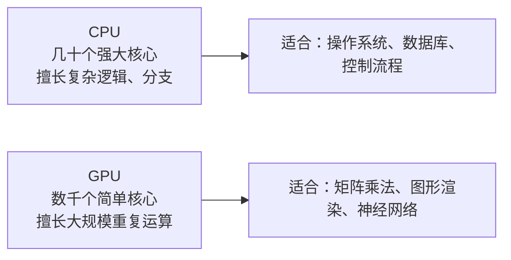
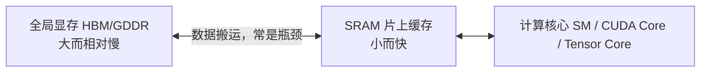
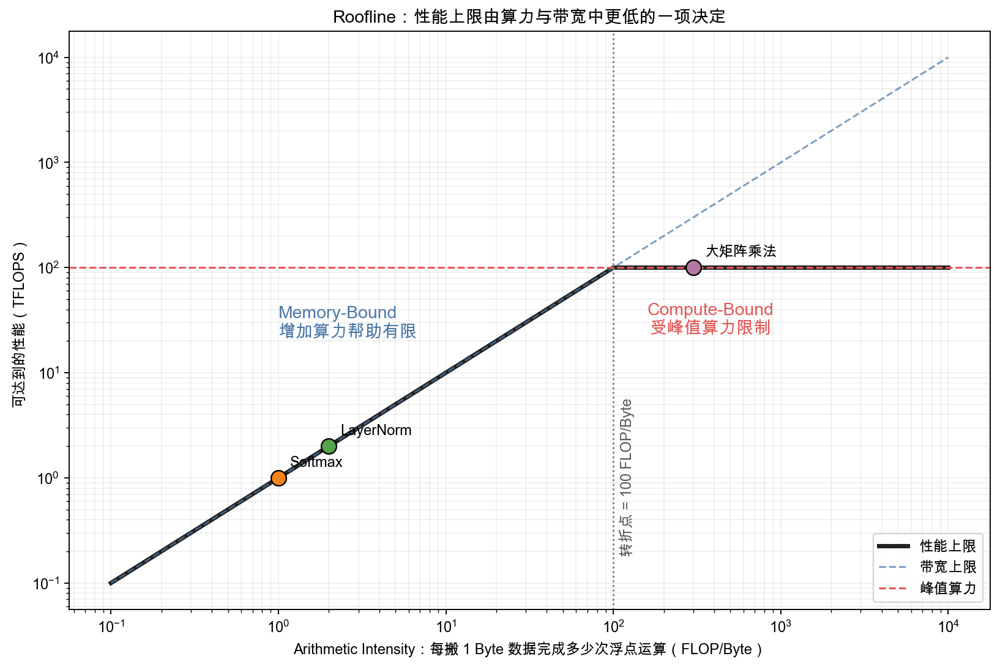
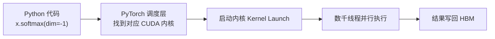
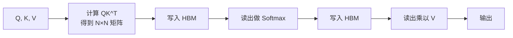

# 9. 图形处理器（GPU）基础与算子——训练与推理的硬件基础

> **读之前**：读完第一部分，知道矩阵乘法、Attention 和 Transformer 的基本结构。
>
> **读完你能做到**：说清 GPU 和 CPU 的设计差异；用屋顶线模型判断一个算子是"算得慢"还是"搬得慢"；理解 FlashAttention 为什么能省显存；知道训练显存都被什么占走了。

---

## 一、为什么先讲硬件

下一章的并行训练、零冗余优化器（ZeRO）、连续批处理、分页注意力，全部建立在一个共同前提上：**它们都在和显存、算力这两个物理资源打交道**。

不理解 GPU 怎么工作，这些方案就会变成一堆要背的名词。本章退回硬件层，把地基补上。

---

## 二、CPU 与 GPU：两种设计目标

CPU 的设计目标是"把一件复杂的事尽快做完"：少量核心（几个到几十个），每个核心都很强，擅长分支、跳转、复杂逻辑。

GPU 的设计目标完全不同：**把同一件简单的事，同时做成千上万遍**。一张消费级显卡有数千个计算核心，但每个核心都很简单，只擅长加法、乘法这类规整运算。



神经网络的核心运算——矩阵乘法——恰好契合 GPU。一次 `[1000,1000] @ [1000,1000]` 会产生一百万个输出元素；每个元素是长度为 1000 的点积，总计约十亿次乘加。不同输出元素可以并行，单个点积内部也能分块并行。

---

## 三、GPU 内部：SM、CUDA Core、Tensor Core、Warp

打开一张 NVIDIA GPU 的结构图，会看到几个关键概念：

| 概念 | 类比 | 作用 |
|---|---|---|
| 流式多处理器（Streaming Multiprocessor, SM） | 一个车间 | GPU 由多个 SM 组成，每个 SM 有自己的计算核心、缓存和调度器 |
| CUDA 核心（CUDA Core） | 车间里的工人 | 最基础的计算单元，一次做一次标量加/乘 |
| 张量核心（Tensor Core） | 专用生产线 | 为矩阵乘加设计的硬件单元，一次完成一小块矩阵运算 |
| 线程束（Warp） | 一个班组 | GPU 调度的基本单位，32 个线程一组，同步执行同一条指令 |

**Tensor Core 是现代深度学习加速的核心。** 它针对"矩阵乘加"做专用设计，同样规模的矩阵乘法可以比纯 CUDA Core 快数倍。这也是为什么 PyTorch 会努力把矩阵乘法路由到 Tensor Core，以及为什么半精度（FP16/BF16，两种 16 位浮点格式）训练能明显提速：Tensor Core 对低精度矩阵乘法的吞吐通常更高。BF16 的动态范围更大，FP16 的精度更高但更容易溢出。

Tensor Core 本身也在为 Transformer 演进：Volta 引入第一代 FP16 支持，Ampere 加入 TF32/BF16，Hopper 引入 Transformer Engine（自动选择 FP16/BF16/FP8），Blackwell 进一步强化 FP8/FP4。**硬件为低精度提供了更高吞吐，软件才更有动力围绕低精度设计训练和推理流程。**

---

## 四、显存层级与屋顶线模型

"显卡算力越高，程序就越快"——不一定。真实程序经常卡在"数据搬得够不够快"，而不是"算得够不够快"。

GPU 内部至少有两层存储：

| 层级 | 容量 | 速度 | 类比 |
|---|---|---|---|
| 设备全局显存（高带宽内存 High Bandwidth Memory, HBM；或图形双倍数据率内存 GDDR） | 大（常见 8～192 GB） | 相对慢，带宽从数百 GB/s 到数 TB/s | 仓库：容量大，但搬运距离远 |
| 片上缓存（静态随机存取存储器 Static Random-Access Memory, SRAM） | 很小（每个 SM 几十 KB 到几百 KB） | 极快，比 HBM 快一个数量级以上 | 工作台：东西不多，但拿取几乎零延迟 |



判断瓶颈前，先看一个指标：**算术强度（Arithmetic Intensity）**，即每从显存搬运 1 Byte 数据，完成多少次浮点运算。

- 读入大量数据、只做几次加减 → 算术强度低；
- 一块数据被反复用于大量乘加 → 算术强度高。

**屋顶线模型（Roofline Model）**把性能看成两个上限中较低的那个：

```math
\text{Attainable Performance}
\le
\min\left(\text{Peak Compute},\ \text{Memory Bandwidth}\times\text{Arithmetic Intensity}\right)
```

- `Peak Compute`：GPU 理论峰值算力；
- `Memory Bandwidth`：HBM 每秒最多搬运的数据量；
- `Arithmetic Intensity`：每 Byte 数据对应的浮点运算次数；
- `Attainable Performance`：两个物理上限下可能达到的性能。

**一个例子**：GPU 峰值算力 100 TFLOPS、带宽 1 TB/s。

- 算术强度 2 FLOP/Byte 的算子，带宽上限只有约 `1 TB/s × 2 = 2 TFLOPS`，算力再高也用不上；
- 算术强度 300 FLOP/Byte 的大矩阵乘法，会先碰到 100 TFLOPS 的算力上限。



- **Memory-Bound**：位于斜线区域，主要受数据搬运限制。Softmax、LayerNorm 等逐元素算子常在这一侧；
- **Compute-Bound**：位于水平屋顶附近，主要受峰值算力限制。足够大的矩阵乘法更容易进入这一侧。

朴素 Attention 的多个阶段会频繁读写大型中间矩阵，因此包含大量 HBM 流量。FlashAttention 的关键就是改变分块和读写方式，降低数据搬运，而不是改变 Attention 的数学定义。

---

## 五、真实 GPU 规格与三个直觉

| GPU | 显存 | HBM 带宽 | FP16 Tensor Core 算力 | 定位 |
|---|---|---|---|---|
| RTX 4090 | 24 GB GDDR6X | ~1 TB/s | ~330 TFLOPS | 消费级旗舰 |
| RTX 5060 Ti | 16 GB GDDR7 | ~448 GB/s | ~100+ TFLOPS | 消费级入门（本书实验主力） |
| A100 80GB | 80 GB HBM2e | ~2 TB/s | ~312 TFLOPS | 数据中心经典款 |
| H100 | 80 GB HBM3 | ~3.35 TB/s | ~990 TFLOPS | 数据中心旗舰 |

三个需要建立的直觉：

1. **显存决定"装得下什么"**：7B 模型 FP16 权重约 14 GB，8 GB 消费卡放不下，需要量化（实验 11.2）或拆到多卡（第 10 章）。
2. **带宽决定"搬得快不快"**：把 14 GB 权重从 HBM 读一遍，在 1 TB/s 的卡上约 14 毫秒。推理时每个词元都要过一遍全部权重，这决定了单次生成时间的下限。
3. **算力只有"算得足够多"时才用得上**：矩阵越大，计算密度越高，越接近算力上限；小算子则被带宽拖累。

---

## 六、训练显存都花在哪

训练一个模型，显存里不只有参数。以下用一套**用于估算的混合精度 AdamW 账本**：参数数目为 \(P\)，BF16 参数和梯度各 2 字节，FP32 主权重、一阶矩、二阶矩各 4 字节；不做分片或卸载。

| 项目 | 70B 模型占用 | 计算方式 |
|---|---|---|
| 模型参数（BF16） | 140 GB | \(2P\) 字节 |
| 梯度（BF16） | 140 GB | \(2P\) 字节，与参数相等 |
| FP32 主权重与 Adam 一、二阶矩 | 840 GB | \(12P\) 字节 |
| **模型状态小计** | **1120 GB = 1.12 TB** | **\(16P\) 字节，不含激活与缓冲** |
| 激活值、临时张量与通信缓冲 | 另计 | 取决于批次、序列长度、算子和重计算策略 |

这不是所有框架的固定实现：FP32 梯度累积、不同优化器、没有独立主权重的 AMP 路径，都会改变账本。**估算先统一精度和存储假设，实测再核对实现。**

三个关键结论：

1. **优化器状态往往比参数本身还大**——这是 ZeRO（第 10 章）要切分的第一样东西；
2. **激活值会随批次大小和序列长度暴涨**——这是梯度检查点（Gradient Checkpointing）存在的理由；
3. **"训练一个模型"不是"把参数装进显存"这么简单**——显存是训练工程的第一约束。

---

## 七、算子与算子融合

你在 PyTorch 里写 `torch.matmul(a, b)` 或 `x.softmax(dim=-1)`，底层并不是"直接跑在 GPU 上"，而是经过这样一条链路：



这里的 CUDA 内核（Kernel），是一段专门为 GPU 编写、会被成千上万线程同时执行的小程序。框架把每个基本计算单元称为**算子（Operator）**——矩阵乘法、Softmax、LayerNorm 都是算子。一个模型的 forward，本质上是几十上百个算子按顺序被调度执行。

两个容易被忽略的开销：

1. **内核启动开销**：每次启动算子都有固定调度成本，算子越碎，占比越高；
2. **中间结果读写**：算子 A 算完先写回 HBM，算子 B 再读出来。即使数据本来能放进 SRAM，只要它们是两个独立算子，这次"写出去再读回来"就会发生。

**算子融合（Kernel Fusion）**把多个连续小算子合并成一个大算子，让中间结果留在 SRAM 里直接传给下一步，同时减少内核启动次数。`torch.compile`、Triton、XLA 的核心工作之一，就是自动发现并融合可合并的算子。

---

## 八、CUDA 生态

NVIDIA 的软件栈从下到上大致是：

| 层级 | 名称 | 作用 |
|---|---|---|
| 驱动层 | NVIDIA Driver | 操作系统与 GPU 硬件通信的最底层接口 |
| 平台层 | CUDA Toolkit | 编译器（nvcc）、运行时 API |
| 算子库 | cuBLAS / cuDNN | 官方优化过的矩阵运算与深度学习算子库 |
| 通信库 | NCCL | 多卡/多机梯度同步、集合通信（All-Reduce 等） |
| 框架层 | PyTorch / TensorFlow | 我们写的 Python 代码，底层自动路由到上面的库 |

你写的每一行 `model(x)`，最终都会经过"PyTorch → cuDNN/cuBLAS → CUDA Toolkit → Driver → 硬件"这样一条链路。

> **AMD 显卡（ROCm）**：AMD 提供了与 CUDA 对应的软件栈 ROCm，其中 HIP 对应 CUDA 编程接口，MIOpen 对应 cuDNN。主流框架已支持 ROCm，`torch.cuda` 这套接口在 ROCm 后端下同样可用。本书实验默认基于 CUDA，但显存层级、算子、融合这些结论对 ROCm 同样成立。

---

## 九、FlashAttention：一次经典的算子级优化

把前面的知识拼起来，看一个真实例子。朴素 Self-Attention 大致是：



问题之一是反复物化大型中间矩阵。单个头在 \(N=4096\) 时有 \(4096^2\) 个分数，FP16 下占约 **32 MiB**，实际还要乘 batch 和头数。

**FlashAttention 的思路是分块（tiling）**：把 Q、K、V 切成小块，在 SRAM 里完成一小块的注意力计算，用在线 Softmax 累积结果，避免把完整的 \(N\times N\) 矩阵写回 HBM。

效果：

- **显存**：从 \(O(N^2)\) 降到 \(O(N)\)，长上下文时差距更明显；
- **速度**：减少 HBM 读写，通常更快，但收益取决于序列长度、硬件和实现；
- **数学结果**：与标准 Attention 等价（实数意义上），但浮点运算顺序不同，不保证逐位一致。

FlashAttention 之后，MLA、DeepSeek-V3 等对 Attention 的改造，本质都沿着"减少显存读写"这条思路继续走。

---

## 十、数值误差：为什么同一公式结果会略有不同

同一个 `y = tanh(Wx + b)`，用 NumPy 和 PyTorch 分别算，结果可能有细微差异，也可能完全相同。原因主要有两个：

1. **浮点加法不满足结合律**：`(a+b)+c` 和 `a+(b+c)` 在实数中相等，在浮点数下未必逐位相等。矩阵乘法包含大量乘加，分块、归约顺序和融合乘加都会影响舍入。
2. **执行后端和内核不同**：NumPy 可能链接 OpenBLAS、MKL 或 Accelerate；PyTorch 可能用 BLAS、oneDNN 或自己的内核。GPU 上还会受算子版本、融合策略和 TF32 设置影响。

误差会随层数传播，可能放大、衰减或抵消，不能简单说"越深一定越大"。实践中的处理方式：

- **调试时**：关键路径临时切到 `float64` 跑一遍对照，判断差异是正常浮点噪声还是真 Bug；
- **要可复现**：固定随机种子，调用 `torch.use_deterministic_algorithms(True)`，并关闭 TF32；但换机器、换 GPU 型号，数值仍可能变化；
- **大规模归约**：优先用框架自带的稳定实现（如 LayerNorm 的 Welford 算法），不要手写朴素累加；
- **混合精度训练**：梯度累积、优化器状态用 FP32，只在矩阵乘法上用 BF16/FP16。

> **延伸阅读**：强化学习里训练引擎和采样引擎精度不一致，可能导致同一词元的对数概率出现偏差。Qi et al.（2025）的 *Defeating the Training-Inference Mismatch via FP16* 报告在其评估配置中，统一使用 FP16 能缓解这种不匹配。这个结果不能推广为"FP16 总比 BF16 稳定"；实际决策要记录 dtype、内核、模型和并行设置，测偏差、溢出和训练稳定性。

---

## 本章对应的实验

- [9.1 实现 Triton 算子——FlashAttention 与标准注意力的显存与速度对比](<./9.1%20实现%20Triton%20算子——FlashAttention%20与标准注意力的显存与速度对比.md>)：先写一个向量加法内核，再对比标准 Attention 与 PyTorch 内置 FlashAttention 的显存和速度。需要 NVIDIA GPU。

## 本章小结

- CPU 擅长复杂逻辑，GPU 擅长大规模重复运算；SM、CUDA Core、Tensor Core、Warp 是不同层面的概念。
- 显存层级和屋顶线模型帮助判断瓶颈是"算得慢"还是"搬得慢"；理论峰值不是程序必达的性能。
- 训练显存账本：BF16 参数 \(2P\) + 梯度 \(2P\) + FP32 主权重与 Adam 状态 \(12P\)，70B 合计约 1.12 TB，另加激活与缓冲。
- 算子融合和 FlashAttention 通过减少中间结果读写来提速；FlashAttention 不改变 Attention 的数学定义，但不保证浮点逐位一致。
- 数值误差由精度、运算顺序和后端共同决定；可复现和跨平台一致是两个不同目标。

> **一句话记住本章**：训练和推理的很多"工程技巧"，本质上都是在省显存或省数据搬运。

## 下一章预告

一个 70B 模型光模型状态就超过 1 TB，单卡装不下。怎么把它拆到成百上千张卡上协同训练？

> **第 10 章 大模型训练栈（LLM Training Stack）——现代大模型训练工程**

---

## 思考题

1. 为什么说"算力越高的卡，程序一定越快"是错的？举一个 memory-bound 的例子。
2. 70B 模型训练时，为什么优化器状态比参数本身还占显存？
3. 算子融合省的是哪两部分开销？为什么它不改变计算结果的数学定义？
4. FlashAttention 的显存从 \(O(N^2)\) 降到 \(O(N)\)，代价是什么？

---

## 参考资料

- NVIDIA《An Even Easier Introduction to CUDA》：https://developer.nvidia.com/blog/even-easier-introduction-cuda/
- NVIDIA CUDA 文档：https://docs.nvidia.com/cuda/
- NVIDIA CUTLASS：https://github.com/NVIDIA/cutlass
- Triton 官方教程：https://triton-lang.org/
- Dao et al.《FlashAttention: Fast and Memory-Efficient Exact Attention with IO-Awareness》：https://arxiv.org/abs/2205.14135
- Qi et al.《Defeating the Training-Inference Mismatch via FP16》：https://arxiv.org/abs/2510.26788
- Horace He《Making Deep Learning Go Brrrr》：https://horace.io/brrr_intro.html
