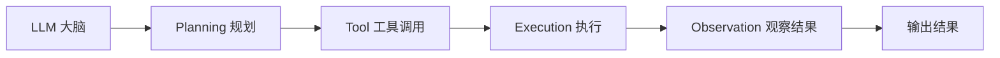
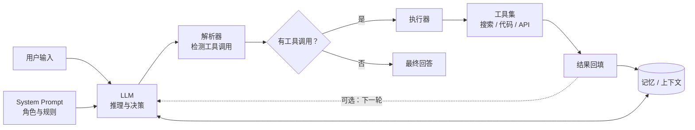

# 1. 智能体（Agent）——定义、组成与执行循环

## 本章目标

完成本章学习后，你将理解：

- LLM 与 Agent 的本质区别
- 为什么"会回答"不等于"会做事"
- Agent 的核心组成部分
- Agent 出现的必然性，以及 Agent Harness 这一层的职责与边界
- Prompt Engineering 的四个组成部分与核心技巧

---

## 行为对比示例

单独的语言模型面对“帮我订一张明天去上海的机票”，只能生成建议；接入获授权工具的应用才可能查询航班、填写订单。支付等重要操作还应经过用户确认，并不因为叫 Agent 就自动拥有权限。**模型负责生成决策建议，运行时负责把获准的动作真正执行。**

本书采用两层术语：广义的 **agentic system / 智能体应用** 包含固定的智能体工作流（Agent Workflow）；狭义的 **自主 Agent** 则根据观察动态决定下一步动作与何时结束。第 1～5 章主要从有界工作流入手，第 6 章讨论更开放的自主闭环。区分依据是决策权，不是代码中是否出现 `for` 或 `while`。

## LLM 与 Agent 的区别

| | LLM | Agent |
|---|---|---|
| 能力 | 理解、生成语言 | 理解 + 规划 + 调用工具 + 执行 + 观察结果 |
| 输出 | 一段文字 | 一系列真实发生的动作 |
| 与世界的关系 | 被动响应 | 主动感知环境并采取行动 |

## Agent 的核心组成



- **大脑（LLM）**：负责理解任务、做出决策；
- **工具（Tool）**：给模型提供操作真实世界的"手"，例如搜索、计算器、代码执行、浏览器操作；
- **执行（Execution）**：校验模型提出的工具调用请求，执行获准的操作；
- **观察结果（Observation）**：读取工具执行结果，作为生成最终回答的依据。

这张图是一条**直线**：规划、调用工具、执行、观察，然后输出。这是一个可用的智能体工作流参考结构，不意味着所有 Agent 都必须拆成这几个独立模块。

> **关于"循环"（Loop）**：如果一次执行不足以完成任务，可以把 Observation 送回规划环节，形成"思考—行动—观察"的多轮循环。但**它属于可选的执行编排方式，不是 Agent 的核心组件**——很多生产系统只调用一次工具就直接回答。ReAct 是这种闭环的代表性实现之一，不是"Agent 必须采用"的唯一范式。第 2～5 章的实验都采用**固定流程（Workflow）** 实现，第 6 章再专门讨论何时需要循环、以及它带来的代价。
>
> 还要区分两个层次：**记忆（Memory）是状态层**，负责保存对话、工具结果和长期知识；**Workflow / Loop / Graph 是控制流层**，决定下一步调用谁。二者正交——固定流程同样可以有记忆，自主循环也不等于一定具备长期记忆。

## 组件全景：工具型智能体的参考架构

上面的“大脑—工具”方便建立直觉。下面拆开一个工具型智能体工作流的常见职责；它是教学参考架构，不是 Agent 的六项普适必要条件，框架也可能把多项职责合并：



实线是**一次工具调用** 的完整路径；虚线表示“把结果送回 LLM 再推理一轮”的可选循环。System Prompt 和记忆是 LLM 的输入与状态，不是两个串行执行步骤。

| 职责 | 本例中的安排 | 作用 | 本书对应位置 |
|---|---|---|---|
| LLM（推理核心） | 模型调用 | 理解任务、生成候选行动 | 本章 |
| System Prompt（角色与规则） | 常用但非独立必需模块 | 描述工具与输出约定，也可由模板/服务封装 | 本章 Prompt Engineering |
| 工具集 Tools | 本例使用 | 提供模型之外的能力；无外部工具的编排也可有 agentic 特征 | 第 2 章 |
| 解析与校验 Parser | 可由 SDK/服务端承担 | 识别结束或调用请求，校验名称与参数 | 1.1 节 `parse_action()`；2.1 节 |
| 执行器 Executor | 本例显式实现 | 执行已获授权的工具请求 | 1.1 节 `tools[tool_name](tool_input)` |
| 上下文/记忆 Memory | 当前请求上下文；长期记忆按需 | 保存并回填观察，不等于必须有向量库或跨会话记忆 | 第 4 章 |
| 执行编排 Orchestration | **总会存在**，可只是几行普通代码 | 决定顺序、分支、停止与错误处理；Loop/Graph 及专用框架可选 | 第 6 章 |

用伪代码把这些组件串成一次完整执行，比文字描述更直观。注意这里是**一条直线**，没有循环：

```python
def agent(user_input):
    messages = [system_prompt, user_input]     # System Prompt + 初始记忆

    response = llm(messages)                    # LLM 推理，输出里已包含"是否要调用工具"

    if response.has_tool_call():                # 解析器：检测工具调用
        tool_name = response.tool_name
        args = response.arguments

        result = execute(tool_name, args)        # 执行器：真正调用工具集里的函数

        messages.append(response)                # 记忆：保留模型这一步的 Action
        messages.append({                        # 记忆：结果回填（Observation）
            "role": "tool",
            "content": result,
            "tool_call_id": response.id
        })

        return llm(messages).content             # 带着 Observation 生成最终答案

    return response.content                      # 无工具调用 → 直接就是最终答案
```

这份伪代码和 1.1 节的 `agent_workflow()` 展示相近职责，只是解析方式不同：1.1 节解析自定义 `Action:` 文本，这里用抽象的 `response.has_tool_call()` 表示原生调用协议。伪代码借用了 OpenAI 风格的调用 ID 配对；不同本地模板未必使用 ID，见 2.1 节。

**一句话总结**：这个参考架构的核心动作是“识别请求 → 校验与执行 → 回填真实结果 → 输出”。职责可以合并，循环方式可以变化，但执行编排不会凭空消失。第 2～5 章分别展开工具、规划、记忆与反思。

## Agent 的出现背景

大模型的能力已经足够强，但仅仅"会说"已经无法满足真实场景的需求——用户希望模型能真正帮忙查资料、写代码并运行、订机票、发邮件。**Agent 的出现，本质上是大模型能力从"语言智能"向"行动智能"延伸的必然结果。**

## Agent Harness：模型与执行之间的那一层

2026 年，行业讨论的重心已经从"用拖拽把流程画死"，转向运行时本身：谁负责管上下文、谁负责执行工具、谁在危险动作前拦住模型。今天业界把"模型推理与真实执行之间的那一层"称为 **Agent Harness（智能体外壳）**，它通常自带这些能力：

| 职责 | 具体内容 |
|---|---|
| 上下文管理 | 历史压缩、窗口预算、检索结果注入 |
| 工具与执行 | 工具注册与校验、Shell/文件系统访问、隔离沙箱 |
| 人机协作 | 高风险操作审批、中断、恢复 |
| 记忆 | 会话状态、跨会话事实 |
| 可观测性 | Trace/Span、Token 与延迟统计 |

对照前面的参考架构，Harness 把模型接入、上下文、工具执行与控制流等职责打包成可复用运行时。不同产品的模块划分会变，但权限校验、结果回填、预算与可观测性仍需要明确承担者。

## 一个值得记住的区分：模型能力 vs 工程外壳

Agent 实验的提升可能来自模型，也可能来自运行时。例如 CodeAct 把工具组合、过滤和聚合放进一段受限执行的程序，可能减少模型往返与上下文搬运；原生 Tool Calling 同样可以一轮返回多个调用，所以不能把这种比较简化成“一次只能调一个工具”。评测必须同时报告模型、工具、预算与运行时配置。

所以读后面的章节时，不妨始终问两个问题：这个提升来自模型，还是来自外壳？如果换一个更弱的模型，这套外壳还成立吗？

## 动手之前：Prompt Engineering 基础

在进入 Agent 之前，先补上一块地基——**Prompt Engineering（提示词工程）**。它是所有 LLM 应用（包括 Agent）的起点，一个结构良好的 Prompt 通常包含四个部分：

| 组成部分 | 作用 | 示例 |
|---|---|---|
| **指令**| 明确要模型做什么 | "把下面这段中文翻译成英文" |
| **上下文**| 提供必要的背景信息 | "这是一段技术文档，注意术语准确性" |
| **示例（Few-shot）**| 用 1~3 个范例示范期望的格式与风格 | "输入：你好 / 输出：Hello" |
| **输出格式**| 约束回答的结构 | "只输出 JSON，不要任何解释" |

几条经过实践验证的核心技巧：

1. **明确角色与约束**：`你是一名资深 Java 工程师，回答要简洁、只给可运行的代码`——角色设定比"你是一个 AI"能显著提升专业度；
2. **给示例（Few-shot）**：模型"模仿示例"的能力极强（第一部分 13.2 节 In-Context Learning 亲手验证过），不确定格式时就给 1~2 个范例；
3. **让模型"一步步想"（CoT）**：对推理类任务，加一句"先一步步分析，再给出答案"（第一部分 13.3 节有完整实验）；
4. **约束输出格式**：需要程序解析时，明确"只输出 JSON"，必要时用第2章的约束解码从生成机制上保证合法。

**Prompt 与 Agent 的关系**：1.1 节的固定 Workflow 借鉴 Thought/Action/Observation 表达，用模板说明指令、上下文与格式；这不是完整的自主 ReAct 循环。提示词只是约定，程序仍需校验输出和执行边界。后续章节继续叠加工具、记忆、规划与编排。

---

想亲手串起模型与工具，可以看实验：**1.1 实现最小智能体工作流（Agent Workflow）——思考（Thought）、行动（Action）与观察（Observation）**。

---

## 本章实验

- [1.1 实现最小智能体工作流（Agent Workflow）——思考（Thought）、行动（Action）与观察（Observation）](<./1.1%20实现最小智能体工作流（Agent%20Workflow）——思考（Thought）、行动（Action）与观察（Observation）.md>)

## 本章总结

本章我们理解了：

- LLM 提供智能，Agent 在此基础上增加了规划、工具调用和执行能力
- 工具型智能体的参考架构包含模型、提示、工具、解析执行与上下文，但不是普适的六项必需模块
- 执行编排总会存在；自主循环、状态图与专用框架按需选择（第 6 章）
- 广义智能体应用包含 Workflow；狭义自主 Agent 根据观察动态决定行动
- Agent Harness 封装上下文、工具、审批、记忆与可观测性等工程职责
- 榜单与案例里的性能提升可能来自模型，也可能来自外壳，读数据时要分开看

> **LLM 是智能的大脑，而 Agent 是拥有大脑、双手和行动能力的完整智能体。**

## 下一章预告

Agent 要真正"行动"，第一步必须先学会调用工具。下一章，我们将进入：

> **第2章 Tool Calling——Agent 如何连接真实世界？**

---

## 参考资料

- 微软《AI Agents for Beginners》（Agent 模式、框架、流式与生产化，10 课）：https://github.com/microsoft/ai-agents-for-beginners
- Datawhale《Agentic AI》教程（Agent 原理、工具、安全与实战）：https://github.com/datawhalechina/agentic-ai
- 迪迪粒粒《AI Agents 从零到一》（Agent 全栈实战：提示工程、Function Calling、记忆、多智能体）：https://github.com/didilili/ai-agents-from-zero

---

## 思考题

1. LLM 与 Agent 的本质区别是什么？“会回答”和“会做事”差在哪几个组件上？
2. 为什么说 Loop 是“可选的编排方式”而不是 Agent 的核心组件？什么样的任务必须引入循环？
3. 参考架构中的解析与校验职责可以交给谁？为什么“没有独立 Parser 类”不等于“没有解析职责”？
