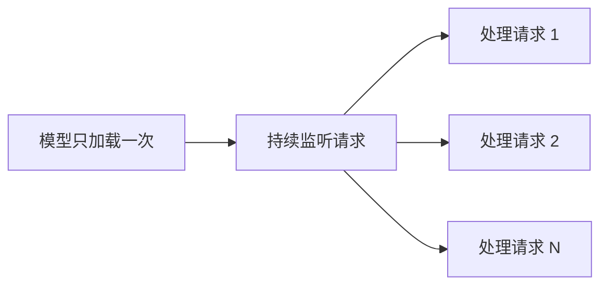
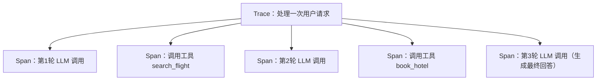

# 10. 智能体运行时（Agent Runtime）——执行架构与服务化运行

## 本章目标

完成本章学习后，你将理解：

- "写一个 Agent 脚本"与"运行一个 Agent 服务"的区别
- Agent Runtime 需要解决的核心问题
- 会话状态（Session）管理的必要性
- Agent Runtime 与普通 Web 服务的区别
- 为什么生产级 Agent 离不开可观测性（Observability）
- 流式输出（Streaming）为什么是 Agent 的体验刚需
- Agent 评测：成功率、步数、工具调用正确率

---

## 脚本与服务的区别

前面不少实验采用“一次启动、执行任务、随后退出”的脚本形态，进程重启时通常要重新加载模型和状态；这并不意味着每调用一次函数都会重新加载，也不意味着脚本不能实现并发。要让 Agent 真正对外提供服务，需要把它变成一个**持续运行的服务**，这正是 **Agent Runtime** 要解决的问题。

## Agent Runtime 的核心变化

关键变化在于：服务进程常驻、请求处理与进程生命周期解耦。但"模型只加载一次、所有请求复用同一个实例"是一种**简化模型**，只对"单机、本地部署、单副本、低并发"的场景近似成立：

- 调用云端 API 时，模型根本不在你的进程里，"加载"发生在服务商侧；
- 本地部署时，生产环境通常是**多副本 + 请求队列 + 动态批处理（Continuous Batching）**，每个副本各自持有模型，靠负载均衡分发；
- 显存有限，副本数、并发度、上下文长度和 KV Cache 之间要权衡，扩容也不是"加机器"就线性见效。

因此 Runtime 与脚本的本质区别，更准确地说是：**把一次性的执行过程，变成有生命周期、有状态、可调度、可观测的服务**。

## 会话状态管理

一个真实的 Agent 服务需要同时服务成百上千个用户，每个用户的对话历史、Memory 状态必须互相隔离，不能串台。通常的做法是给每个会话分配一个 `session_id`，服务端为每个 `session_id` 单独维护一份状态（生产环境中通常存储在 Redis 或数据库里，而不是简单的内存字典，这样服务重启后状态也不会丢失）。

## 一次请求在 Runtime 内的完整生命周期

会话管理、Trace、流式与评测看似是四个独立特性，其实是同一次请求经过的五个阶段——任何一段缺失，Runtime 就退化回"能跑但不能运维"的脚本：

| 阶段 | 输入 | 操作 | 产物 |
|---|---|---|---|
| 接入 | HTTP/WebSocket 请求 | 鉴权、限流、解析 `session_id` 与配额 | 请求上下文（租户、剩余配额、超时预算） |
| 恢复状态 | `session_id` | 从外部存储读对话与长任务进度（第 6 章 Checkpoint） | 可续跑的初始状态 |
| 执行循环 | 上下文 + 工具集 | 多轮"模型 → 工具 → 观察"（第 6 章），每步开 Span | 中间结果与逐步 Span |
| 增量输出 | 生成中的 Token 与工具事件 | 通过 SSE 推送 | 前端可见的进度流 |
| 收尾 | 完整 Trace + 最终状态 | 写会话状态、写 Trace、结算配额 | 一致的状态 + 可回放记录 |

**完成判据** 是"状态已落盘且 Trace 完整"，而不是"处理函数返回了"——否则进程重启后这次请求既无法续跑，也无法复盘。**失败边界**：超时、用户取消、人工介入都必须走到同一个收尾阶段，否则租约（Lease）与配额不会被正确释放；重试则要带幂等键（Idempotency Key），否则工具副作用会被执行两次。

## Agent Runtime 与普通 Web 服务的区别

| | 普通 Web 服务 | Agent Runtime |
|---|---|---|
| 核心资源 | 数据库连接池 | 已加载到显存里的模型 |
| 状态 | 请求级通常无状态，但也会有会话/缓存；状态多放在外部存储 | 除会话/记忆外，还要维护长任务进度、工具副作用与断点 |
| 单次请求耗时 | 通常几十毫秒 | 可能几秒到几分钟（涉及多步推理循环） |
| 扩展方式 | 加无状态实例，水平扩展相对直接 | 受显存、副本数、批处理与队列长度约束 |
| 失败恢复 | 同样需按副作用设计幂等与事务，不能盲目重试 | 还需考虑长链路中的任务恢复、检查点与补偿 |
| 长连接 | 可选 | 流式输出、取消、人工介入常需长连接 |

## 2026 年的形态：托管 Agent 运行时

上面这些要求（生命周期、会话隔离、扩缩容、可观测）可由托管平台承担一部分。选型时应逐项核查产品及具体版本，而不是把某个平台的能力当作所有 Hosted Agents 的共同保证：

- **扩缩容**：是否支持缩容到零？冷启动与持久存储是否仍计费？
- **状态可续**：保留的是磁盘、会话记录还是实际执行栈？恢复从哪个已提交检查点开始？
- **会话隔离**：边界是进程、容器还是独立 VM？共享凭据与挂载如何控制？
- **可观测性接入**：支持哪些 OTel 字段、导出通道与采样策略？

这对学习者的影响是双向的：一方面，"部署成 HTTP 服务 + 进程内存存 session"的玩具写法确实过时了；另一方面，**"什么算一次会话""状态存在哪里""重启后从哪继续"仍然是你必须回答的设计问题**——平台只负责把答案执行得更稳。

## 从脚本到平台

一旦 Agent 变成持续运行的服务，就自然引出了更多工程问题：如何在服务重启后不丢失正在进行的任务？如何管理同时运行的大量 Agent 实例？前者在第 6 章的持久化执行（Checkpoint）里已打下基础，其余问题正是接下来几章（Execution Environment、Agentic Runtime、Agentic OS）要逐步展开的内容。

## 光能运行还不够：Agent 可观测性（Observability）

普通 Web 服务出了问题，通常看几行错误日志就能定位；但一个 Agent 请求背后，可能是"模型思考 → 调用工具 A → 观察结果 → 再思考 → 调用工具B → ……"这样一条长达十几步的链路，任何一步出错，最终用户看到的往往只是一句"抱歉，我遇到了问题"。**这正是 Agent Runtime 必须内置可观测性（Observability）能力的原因**：不把中间过程记录下来，出了问题根本无从排查。

生产级 Agent 通常会把每一次运行完整记录成一棵"Trace（追踪）树"：

每一个 **Span（跨度）** 记录一次独立的操作——一次 LLM 调用、一次工具执行——包含它的输入、输出、耗时、Token 消耗、是否报错。这套"Trace 由多个 Span 组成"的数据模型，正是可观测性领域标准 **OpenTelemetry** 的核心概念，LangSmith、Langfuse 等平台提供面向 LLM/Agent 的追踪与分析，并可按各自版本支持 OpenTelemetry 接入或互操作；这不等于它们的所有内部数据模型与底层实现都建立在同一标准之上。

要做到**可复现**，Trace 不能只记"输入输出"，还应记录影响结果的版本与配置：

| 必须记录 | 原因 |
|---|---|
| 完整 Prompt（含 System Prompt 与模板版本） | Prompt 一改，行为就变 |
| 工具 Schema 与实现版本 | 同名工具的参数或行为可能已变更 |
| 模型名与版本/快照 | 服务商侧模型更新会导致结果漂移 |
| 采样参数（temperature、top_p、max_tokens） | 直接影响随机性与长度 |
| 工具原始返回（或可回放的引用） | 区分"模型判断错"与"工具返回错" |
| 时间戳、耗时、重试次数、错误码 | 定位超时、限流与重试风暴 |
| 会话/用户标识（脱敏后） | 关联同一用户的多轮问题 |

同时要设好**脱敏与保留策略**：Prompt 和工具结果可能含隐私与密钥，不能原样长期落盘。有了这样的 Trace，排查"Agent 为什么给出错误答案"才能从"猜"变成"按证据定位"。

---

## 光有输出还不够：流式交互（Streaming）

可观测性解决"出了问题怎么查"，还有一个体验问题：一个 Agent 请求可能要跑几秒到几十秒（本章前面说过），如果用户要等全部生成完才看到结果，体验会非常糟糕。**流式输出（Streaming）** 让模型把结果**逐 token 推送** 给用户：首段完整文本就绪后即可显示，后面的内容一边生成一边显示——就像 ChatGPT 官网打字机式的输出。

为什么 Agent 场景尤其需要流式？普通对话还可以"等"，Agent 任务更长（多轮"思考 → 调工具 → 再思考"），如果不流式，用户面对的可能是一两分钟的空白等待。此外，流式还能把中间状态（正在调用哪个工具、找到了什么信息）实时暴露给前端，让用户"看得见 Agent 在干什么"。

工程上，流式通常基于 **SSE（Server-Sent Events）**：服务端将缓存解码得到的文本块或状态事件编码成 JSON，再以 `data: <JSON>\n\n` 事件帧推送给客户端（HTTP 长连接，单向）；文本块不必与 token 一一对应。LangGraph 的 `stream()` 方法、transformers 的逐 token 生成，都能作为流式的数据源。想亲手对比"非流式 vs 流式"并实现 SSE 封装，可以看这一节实验：**10.2 Agent 流式输出——首 Token 延迟与增量响应**。

---

## Agent 评测

普通模型的评测我们很熟悉（第二部分第 12 章：Perplexity、Benchmark）。但 Agent 是"多步决策系统"，评测维度完全不同——**不仅要看最终答案对不对，还要看过程好不好**：

| 指标 | 含义 |
|---|---|
| 任务成功率 | 最终答案正确的比例（最核心） |
| 平均步数 | 完成任务平均需要多少轮推理——越少越高效 |
| 工具调用正确率 | 调用的工具/参数是否正确 |
| 平均耗时/成本 | 每任务的时间与 Token 消耗 |

工业界还有专门的 Agent 基准，按"测什么"可以分成几类（版本更替很快，引用时务必写明版本与评测日期）：

| 基准 | 测什么 | 备注 |
|---|---|---|
| GAIA | 通用助手：搜索、多模态、多步推理 | 成绩需附任务划分、模型、工具条件与排行榜日期，不在此给无来源快照 |
| τ-bench 系列 | 工具型 Agent：数据库终态校验 + 业务规则遵循 | 可观察重复运行全部成功的稳定性 |
| SWE-bench Verified / Pro | 编码 Agent：真实 issue 修复 | 不同数据集与难度设置的分数不能直接比较 |
| Terminal-Bench | 终端环境中的长程任务 | 引用时注明具体数据集 revision 与执行环境 |
| OSWorld / WebArena | 电脑操作与浏览器任务 | 测"操作数字世界"的能力 |

**单次通过率不能充分刻画重复可靠性**：`pass^k` 关注同一任务重复 k 次全部成功。只有对同一任务的重复结果满足独立同分布、每次成功概率均为 p 时，才有 `pass^k = p^k`；例如该假设下 p=0.7、k=3 时为 0.343。不同任务难度不同，不能把总体平均成功率直接乘方当作实际 `pass^k`；共享故障、缓存与环境变化还会引入相关性。实践中应逐任务重复 n 次；若 n 次中成功 c 次，可使用 `C(c,k)/C(n,k)`（n≥k；c<k 时为0）的组合估计再跨任务平均，并说明抽样假设。多轮任务也应单列测试，不能用单轮成绩代替。

更贴近实践的做法是：**给自己的一套任务跑一遍，记录成功率与步数，再配合上面的 Trace 逐题回放失败原因**——评测和可观测性是一对：指标告诉你"哪里不行"，Trace 告诉你"为什么不行"。想亲手给一个带工具的 Agent 跑一次完整评测并生成 Trace，可以看这一节实验：**10.3 评测一个 Agent——成功率、步数与 Trace 回放**。

---

想亲手把一个 Agent 部署成真正长期在线的服务，可以看这一节实验：**10.1 搭建智能体运行时（Agent Runtime）——用 LangGraph 部署持续运行的服务**。

---

## 本章实验

- [10.1 搭建智能体运行时（Agent Runtime）——用 LangGraph 部署持续运行的服务](<./10.1%20搭建智能体运行时（Agent%20Runtime）——用%20LangGraph%20部署持续运行的服务.md>)
- [10.2 智能体流式输出——首词元延迟与增量响应](<./10.2%20智能体流式输出——首词元延迟与增量响应.md>)
- [10.3 评测智能体（Agent Evaluation）——成功率、步数与 Trace 回放](<./10.3%20评测智能体（Agent%20Evaluation）——成功率、步数与%20Trace%20回放.md>)

## 本章总结

本章我们理解了：

- Agent Runtime 的核心是常驻服务、状态管理与可调度性，而不是字面意义上的"模型只加载一次"
- 会话状态管理是支撑多用户并发的关键，通常基于 `session_id` 隔离并落到外部存储
- 相比普通 Web 服务，Agent Runtime 还要考虑显存/副本、长耗时任务、失败恢复与幂等
- 可观测性通过 Trace/Span 记录每一步中间过程，并保留 Prompt、工具 Schema、模型版本等复现元数据
- 流式输出可提前展示生成中的文本；首文本延迟受排队、预填充、解码缓存与网络影响，不保证固定毫秒数
- Agent 评测看的不只是最终答案，还有步数、工具调用正确率等过程指标
- 托管运行时把缩容到零、会话隔离、状态续跑做成平台能力，但"会话如何定义、状态存在哪"仍是设计问题
- 评测要看稳定性（`pass^k`）与多轮表现，单次成功率会高估生产可靠性

> **LLM 决定 Agent 如何思考，而 Runtime 决定 Agent 如何持续生存和运行。**

## 下一章预告

Runtime 解决了"Agent 如何持续运行"，但 Agent 一旦真正开始执行代码、操作浏览器，就必须回答另一个问题：这些操作如何保证安全？下一章，我们将进入：

> **第 11 章 执行环境（Execution Environment）——智能体如何操作数字世界？**

---

## 参考资料

- 微软《AI Agents for Beginners》（Agent 模式、框架、流式与生产化，10 课）：https://github.com/microsoft/ai-agents-for-beginners
- 迪迪粒粒《AI Agents 从零到一》（Agent 全栈实战：提示工程、Function Calling、记忆、多智能体）：https://github.com/didilili/ai-agents-from-zero
- 慕课网《小浪助手：基于 LangChain 的单 Agent 开发实践》：https://coding.imooc.com/class/822.html

---

## 思考题

1. 为什么“模型常驻”的服务化运行比每次请求都冷启动重要得多？
2. Trace/Span 级别的可观测性对调试 Agent 有什么价值？没有它会怎样？
3. 流式输出为什么能显著改善首 Token 延迟的体验？它改变了什么？
