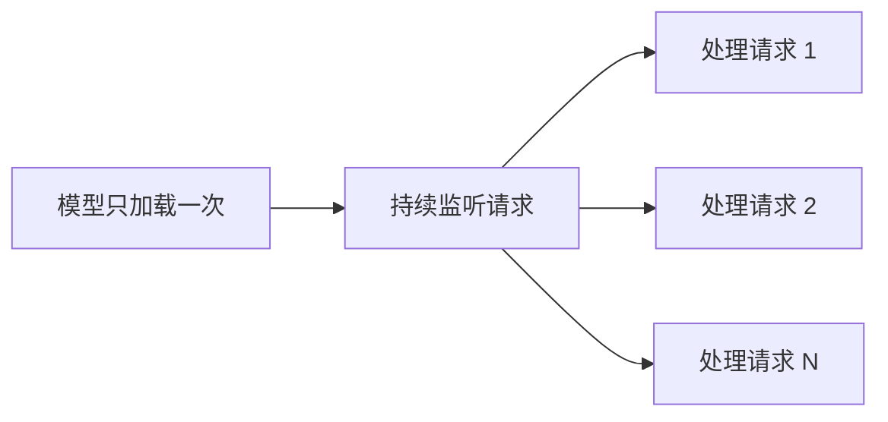
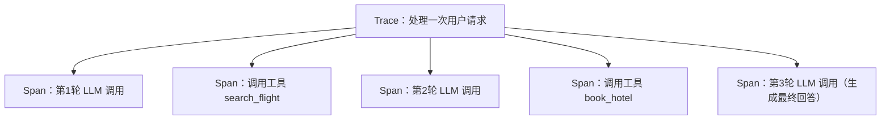

# 11. 智能体运行时（Agent Runtime）——执行架构与服务化运行

## 本章目标

完成本章学习后，你将理解：

- "写一个 Agent 脚本"与"运行一个 Agent 服务"的区别
- Agent Runtime 需要解决的核心问题
- 会话状态（Session）管理的必要性
- Agent Runtime 与普通 Web 服务的区别
- 为什么生产级 Agent 离不开可观测性（Observability）
- 流式输出（Streaming）为什么是 Agent 的体验刚需
- Agent 评测：成功率、步数、工具调用正确率

---

## 脚本与服务的区别

前面几章我们写的 Agent，本质上都是"运行一次脚本，跑完就结束"——每次调用都要重新加载模型、重新初始化状态，完全无法支撑真实的多用户并发访问。要让 Agent 真正对外提供服务，需要把它变成一个**持续运行的服务**，这正是 **Agent Runtime** 要解决的问题。

## Agent Runtime 的核心变化

关键变化在于：服务进程常驻、请求处理与进程生命周期解耦。但"模型只加载一次、所有请求复用同一个实例"是一种**简化模型**，只对"单机、本地部署、单副本、低并发"的场景近似成立：

- 调用云端 API 时，模型根本不在你的进程里，"加载"发生在服务商侧；
- 本地部署时，生产环境通常是**多副本 + 请求队列 + 动态批处理（Continuous Batching）**，每个副本各自持有模型，靠负载均衡分发；
- 显存有限，副本数、并发度、上下文长度和 KV Cache 之间要权衡，扩容也不是"加机器"就线性见效。

因此 Runtime 与脚本的本质区别，更准确地说是：**把一次性的执行过程，变成有生命周期、有状态、可调度、可观测的服务**。

## 会话状态管理

一个真实的 Agent 服务需要同时服务成百上千个用户，每个用户的对话历史、Memory 状态必须互相隔离，不能串台。通常的做法是给每个会话分配一个 `session_id`，服务端为每个 `session_id` 单独维护一份状态（生产环境中通常存储在 Redis 或数据库里，而不是简单的内存字典，这样服务重启后状态也不会丢失）。

## Agent Runtime 与普通 Web 服务的区别

| | 普通 Web 服务 | Agent Runtime |
|---|---|---|
| 核心资源 | 数据库连接池 | 已加载到显存里的模型 |
| 状态 | 请求级通常无状态，但也会有会话/缓存；状态多放在外部存储 | 除会话/记忆外，还要维护长任务进度、工具副作用与断点 |
| 单次请求耗时 | 通常几十毫秒 | 可能几秒到几分钟（涉及多步推理循环） |
| 扩展方式 | 加无状态实例，水平扩展相对直接 | 受显存、副本数、批处理与队列长度约束 |
| 失败恢复 | 重试单个请求即可 | 需考虑任务恢复、幂等与外部副作用一致性 |
| 长连接 | 可选 | 流式输出、取消、人工介入常需长连接 |

## 从脚本到平台

一旦 Agent 变成持续运行的服务，就自然引出了更多工程问题：如何在服务重启后不丢失正在进行的任务？如何管理同时运行的大量 Agent 实例？这些问题正是接下来几章（Graph Engineering、Execution Environment、Agentic Runtime、Agentic OS）要逐步展开的内容。

## 光能运行还不够：Agent 可观测性（Observability）

普通 Web 服务出了问题，通常看几行错误日志就能定位；但一个 Agent 请求背后，可能是"模型思考 → 调用工具 A → 观察结果 → 再思考 → 调用工具B → ……"这样一条长达十几步的链路，任何一步出错，最终用户看到的往往只是一句"抱歉，我遇到了问题"。**这正是 Agent Runtime 必须内置可观测性（Observability）能力的原因**：不把中间过程记录下来，出了问题根本无从排查。

生产级 Agent 通常会把每一次运行完整记录成一棵"Trace（追踪）树"：

每一个 **Span（跨度）**记录一次独立的操作——一次 LLM 调用、一次工具执行——包含它的输入、输出、耗时、Token 消耗、是否报错。这套"Trace 由多个 Span 组成"的数据模型，正是可观测性领域标准 **OpenTelemetry** 的核心概念，LangSmith、Langfuse 等 Agent 可观测性平台，本质上都是在这套标准之上，针对 LLM/Agent 场景做了专门的可视化和分析。

要做到**可复现**，Trace 不能只记"输入输出"，还应记录影响结果的版本与配置：

| 必须记录 | 原因 |
|---|---|
| 完整 Prompt（含 System Prompt 与模板版本） | Prompt 一改，行为就变 |
| 工具 Schema 与实现版本 | 同名工具的参数或行为可能已变更 |
| 模型名与版本/快照 | 服务商侧模型更新会导致结果漂移 |
| 采样参数（temperature、top_p、max_tokens） | 直接影响随机性与长度 |
| 工具原始返回（或可回放的引用） | 区分"模型判断错"与"工具返回错" |
| 时间戳、耗时、重试次数、错误码 | 定位超时、限流与重试风暴 |
| 会话/用户标识（脱敏后） | 关联同一用户的多轮问题 |

同时要设好**脱敏与保留策略**：Prompt 和工具结果可能含隐私与密钥，不能原样长期落盘。有了这样的 Trace，排查"Agent 为什么给出错误答案"才能从"猜"变成"按证据定位"。

---

## 光有输出还不够：流式交互（Streaming）

可观测性解决"出了问题怎么查"，还有一个体验问题：一个 Agent 请求可能要跑几秒到几十秒（本章前面说过），如果用户要等全部生成完才看到结果，体验会非常糟糕。**流式输出（Streaming）**让模型把结果**逐 token 推送**给用户：第一个字几百毫秒就出现，后面的内容一边生成一边显示——就像 ChatGPT 官网打字机式的输出。

为什么 Agent 场景尤其需要流式？普通对话还可以"等"，Agent 任务更长（多轮"思考 → 调工具 → 再思考"），如果不流式，用户面对的可能是一两分钟的空白等待。此外，流式还能把中间状态（正在调用哪个工具、找到了什么信息）实时暴露给前端，让用户"看得见 Agent 在干什么"。

工程上，流式通常基于 **SSE（Server-Sent Events）**：服务端把生成的每个 token 编码成 `data: <内容>` 一行行推送给浏览器（HTTP 长连接，单向）。LangGraph 的 `stream()` 方法、transformers 的逐 token 生成，都能作为流式的数据源。想亲手对比"非流式 vs 流式"并实现 SSE 封装，可以看这一节实验：**11.2 Agent 流式输出——首 Token 延迟与增量响应**。

---

## 光能跑还不够：Agent 怎么评测？

普通模型的评测我们很熟悉（第二部分第 12 章：Perplexity、Benchmark）。但 Agent 是"多步决策系统"，评测维度完全不同——**不仅要看最终答案对不对，还要看过程好不好**：

| 指标 | 含义 |
|---|---|
| 任务成功率 | 最终答案正确的比例（最核心） |
| 平均步数 | 完成任务平均需要多少轮推理——越少越高效 |
| 工具调用正确率 | 调用的工具/参数是否正确 |
| 平均耗时/成本 | 每任务的时间与 Token 消耗 |

工业界还有专门的 Agent 基准，如 **GAIA**（面向"需要多步工具使用的现实问题"）、AgentBench 等，用来衡量 Agent 在真实任务上的综合能力。更贴近实践的做法是：**给自己的一套任务跑一遍，记录成功率与步数，再配合上面的 Trace 逐题回放失败原因**——评测和可观测性是一对：指标告诉你"哪里不行"，Trace 告诉你"为什么不行"。想亲手给一个带工具的 Agent 跑一次完整评测并生成 Trace，可以看这一节实验：**11.3 评测一个 Agent——成功率、步数与 Trace 回放**。

---

想亲手把一个 Agent 部署成真正长期在线的服务，可以看这一节实验：**11.1 搭建智能体运行时（Agent Runtime）——用 LangGraph 部署持续运行的服务**。

---

## 本章实验

- [11.1 搭建智能体运行时（Agent Runtime）——用 LangGraph 部署持续运行的服务](<./11.1%20搭建智能体运行时（Agent%20Runtime）——用%20LangGraph%20部署持续运行的服务.md>)
- [11.2 智能体流式输出——首词元延迟与增量响应](<./11.2%20智能体流式输出——首词元延迟与增量响应.md>)
- [11.3 评测智能体（Agent Evaluation）——成功率、步数与 Trace 回放](<./11.3%20评测智能体（Agent%20Evaluation）——成功率、步数与%20Trace%20回放.md>)

## 本章总结

本章我们理解了：

✅ Agent Runtime 的核心是常驻服务、状态管理与可调度性，而不是字面意义上的"模型只加载一次" ✅ 会话状态管理是支撑多用户并发的关键，通常基于 `session_id` 隔离并落到外部存储 ✅ 相比普通 Web 服务，Agent Runtime 还要考虑显存/副本、长耗时任务、失败恢复与幂等 ✅ 可观测性通过 Trace/Span 记录每一步中间过程，并保留 Prompt、工具 Schema、模型版本等复现元数据 ✅ 流式输出让用户在几百毫秒内看到第一个字，是长任务体验的关键 ✅ Agent 评测看的不只是最终答案，还有步数、工具调用正确率等过程指标

> **LLM 决定 Agent 如何思考，而 Runtime 决定 Agent 如何持续生存和运行。**

## 下一章预告

Runtime 解决了"Agent 如何持续运行"，但 Agent 一旦真正开始执行代码、操作浏览器，就必须回答另一个问题：这些操作如何保证安全？下一章，我们将进入：

> **第 12 章 执行环境（Execution Environment）——智能体如何操作数字世界？**

---

## 参考资料

- 微软《AI Agents for Beginners》（Agent 模式、框架、流式与生产化，10 课）：https://github.com/microsoft/ai-agents-for-beginners
- 迪迪粒粒《AI Agents 从零到一》（Agent 全栈实战：提示工程、Function Calling、记忆、多智能体）：https://github.com/didilili/ai-agents-from-zero
- 慕课网《小浪助手：基于 LangChain 的单 Agent 开发实践》：https://coding.imooc.com/class/822.html

---

## 思考题

1. 为什么“模型常驻”的服务化运行比每次请求都冷启动重要得多？
2. Trace/Span 级别的可观测性对调试 Agent 有什么价值？没有它会怎样？
3. 流式输出为什么能显著改善首 Token 延迟的体验？它改变了什么？
