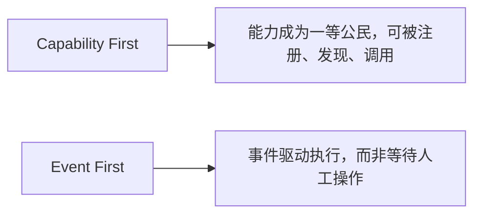
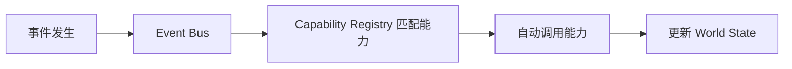

# 13. 智能体操作系统（Agentic OS）——面向智能体的操作系统架构设想

## 本章目标

完成本章学习后，你将理解：

- 传统操作系统的核心设计假设是什么
- 为什么这一假设正在被Agent 打破
- "Capability First"与"Event First"两个核心设计原则
- Agentic OS 目前仍是一个前瞻性的设想

---

## 传统操作系统早已支持事件与后台任务

GUI 的常见交互是“用户点击、应用响应”，但这不是传统操作系统的核心限制。daemon、cron、服务管理器、文件系统通知、消息队列与 CI 早已支持无人工点击的持续运行和事件驱动；新邮件自动分类、提交后运行测试也并非 Agent 才能实现。

## Agent 增加的是语义决策层

Agent 可以在既有事件机制上解释自然语言目标、结合上下文动态选择能力并修订计划。例如收到邮件后不是机械触发同一个函数，而是在授权范围内判断是否需要检索资料、起草回复或请求澄清。**新增挑战是语义决策的不确定性及其权限和可观测性边界，而不是第一次引入事件触发。**

但更准确的说法不是"Agent 打破操作系统"，而是**Agent 给操作系统提出了新的抽象需求**：如何描述能力、如何授权、如何调度长任务、如何审计自主行为。这正是"Agentic OS"这个前瞻性概念想回答的问题：**如果越来越多的操作不再由人逐步点击，操作系统的抽象是否需要演进？**

## 类比在哪里成立，在哪里失效

把 Agentic OS 类比成操作系统很有启发性，但不能直接画等号：

| 传统 OS 概念 | Agentic OS 的对应物 | 类比成立之处 | 类比失效之处 |
|---|---|---|---|
| 进程（Process） | Agent 任务/实例 | 都有生命周期、优先级、资源配额 | Agent 行为非确定，难以用固定状态机描述 |
| 系统调用（Syscall） | Capability / Tool 调用 | 都是受控的能力入口 | 参数是自然语言/半结构化，难以静态校验 |
| 调度器（Scheduler） | World Scheduler | 都要处理并发、优先级、饥饿 | 任务时长与资源需求高度不确定 |
| 文件系统（FS） | Memory / Persistent World | 都提供持久化命名空间 | 语义检索、冲突合并远比文件读写复杂 |
| 权限（Permission） | Capability 授权 | 都遵循最小权限 | 授权对象是"意图"而非具体系统调用 |
| 中断（Interrupt） | Event | 都由外部事件触发 | 事件语义模糊，需模型解释而非硬件向量 |

因此，Agentic OS 更可能是**在现有 OS 之上的一层能力/事件/权限抽象**，而不是从内核重写一个全新操作系统。

## 两个核心设计原则

- **Capability First（能力优先）**：传统操作系统管理的是"应用程序"，Agentic OS 管理的是更细粒度的"能力"——一个能力可能只是一个函数、一个 MCP Server暴露的工具，能力可以被统一注册、发现和复用，不再和某个具体的 App 绑定；
- **Event First（事件优先）**：沿用成熟事件驱动架构，把事件与能力契约作为语义决策的入口；只有实际接入动态决策，才与固定订阅规则的自动化有所区别。

## 最小原型：能力注册表与事件总线

把这两个原则落地成最简单的工程实现，大致是：一个**Capability Registry** 负责登记所有可用能力及其描述，一个**Event Bus** 负责监听事件并自动匹配、调用对应的能力，多个 Agent 共享同一个 Registry 和同一份持续存在的 **World State**：

这一雏形正是第 12 章 Persistent World、Capability Registry 与本章 Event First 思想的结合体。

### 完整机制：从事件产生到状态收敛

按这条链路走，最容易在两个地方翻车：一是**授权发生在哪一步**，二是**事件重复投递怎么办**。把它展开成阶段表，就能看清每一环的产物与责任人：

| 阶段 | 输入 | 操作 | 产物 |
|---|---|---|---|
| 事件产生 | 邮件、代码提交、定时器、其它 Agent 的信号 | 归一化为统一事件结构（类型、主体、时间、幂等键） | 事件记录 |
| 过滤与匹配 | 事件 + Capability Registry | 过滤订阅、按能力描述选出候选能力 | 候选能力列表（含匹配理由） |
| 授权与准入 | 事件主体 + 候选能力 | 按用户意图授予最小能力集，超范围转人工 | 一次性授权令牌 |
| 执行 | 授权令牌 + 事件负载 | 调用能力，重试需幂等 | 产物 + 副作用清单 |
| 收敛与审计 | 产物 + 副作用清单 | 更新 World State（带版本号），登记回滚点 | 新状态 + 审计记录 |

**完成判据**：状态按实体版本更新且审计记录落地；涉及外部动作时，还需知道动作是待提交、已确认还是结果未知，不能把“消息消费了”当作完成。

**乱序边界**：仅按 `event_time` 排序不可靠，时钟偏差、同时间戳与重放都会破坏因果关系。优先使用每个实体的单调版本/序列号、因果依赖和乐观并发条件；遇到版本间隙缓存或重同步，旧版本拒绝或按明确合并规则处理。没有可比较版本的并发事件必须设计冲突策略，不能以较晚墙钟时间自动覆盖。

**幂等边界**：至少一次投递可能重复，同一个事件 ID 也可能并发到达。去重检查与记录应使用持久化唯一键/原子事务，而不是先查集合、后发邮件、再记 ID。若状态变更和外部副作用不在同一事务，采用 transactional outbox 先原子写入状态与待发送记录，再由投递器调用支持幂等键的下游 API 并重试。Outbox 本身仍可能重复投递；下游不支持幂等时，必须处理“已经发送但确认丢失”的不确定结果，不能宣称恰好一次。

## 前瞻性定位

需要坦诚地说，Agentic OS 目前更多是一种设计理念和研究方向，而不是已经成熟落地的产品形态。至少还有这些问题没有定论：

| 未解问题 | 具体难点 |
|---|---|
| 权限与授权 | 如何把"用户意图"安全地映射为最小能力集？授权能否随时撤销？ |
| 隐私边界 | Agent 跨应用读取数据时，如何防止过度收集与意外外泄？ |
| 跨设备一致性 | 手机、PC、云端的状态如何同步？离线时谁做主？ |
| 可撤销性 | 已执行的副作用能否回滚？不可逆操作如何事前阻断？ |
| 审计与责任 | 自主行为的日志归谁所有？出错时如何定责？ |
| 互操作标准 | 能力（MCP）、Agent 间（A2A）、界面（AG-UI）、技能（SKILL.md）已有事实标准；事件格式、授权与审计仍无统一约定 |
| 资源与公平 | 多个 Agent 争夺模型配额时，如何避免饥饿与滥用？ |

不过协议生态已有实质进展：2025 年 12 月，Linux 基金会成立 **Agentic AI Foundation（AAIF）**，Anthropic 捐出 MCP、OpenAI 捐出 AGENTS.md 格式、Block 捐出 goose 框架，A2A 随后也转入同一基金会；Agent Skills（`SKILL.md`）开放为跨厂商标准。可以说**"能力如何描述、发现、调用"这一块已经基本收敛**——它恰好对应传统 OS 里"设备驱动模型 + 系统调用表"的位置。尚未收敛的是授权、审计、跨设备状态与责任划分，这些才是 Agentic OS 真正的空白区。

因此，方向是清晰的：**当 Agent 的数量和自主性持续增长，管理"能力"和"事件"会变得和管理"应用"与"点击"同样重要。** 这更可能推动操作系统抽象逐步演进，而不是在一夜之间被"重新定义"。

---

想亲手实现一个最小的 Capability Registry 和事件驱动系统，理解"Capability First"与"Event First"，可以看这一节实验：**13.1 实现一个最小 Capability Registry——用事件驱动的方式理解 Agentic OS**。

---

## 本章实验

- [13.1 实现最小能力注册表（Capability Registry）——事件驱动方式理解 Agentic OS](<./13.1%20实现最小能力注册表（Capability%20Registry）——事件驱动方式理解%20Agentic%20OS.md>)

## 本章总结

本章我们理解了：

- 传统操作系统早已支持 daemon、定时任务和事件机制，不能与 GUI 点击交互混为一谈
- Agent 在既有事件机制之上增加语义解释与动态决策，并带来新的授权与审计挑战
- Capability First 让能力成为可被发现和复用的一等公民，Event First让系统由事件而非点击驱动
- 能力描述与发现这一层已由 MCP/A2A/SKILL.md 等标准收敛，授权、审计与责任划分仍是空白
- Agentic OS 目前仍是前瞻性设想，更可能是现有 OS 之上的一层抽象，而非内核重写

> **GUI 塑造了 PC 时代的交互抽象，Agent 则可能推动 AI 时代的系统抽象继续演进——但演进不等于推倒重来。**

---

## 第三部分总结

从第 1 章的"为什么大模型开始行动"，到本章的"Agent 时代的操作系统抽象可能如何演进"，我们完整走过了 Agent 从"能调用工具"到"具备记忆"到"形成自主循环"，再到"多 Agent 协作"，最终"走向统一运行平台"的演进路径：

至此，全书从"一个 Token 如何被预测"（第一部分），到"一个 Base Model 如何变成安全可用的 AI 助手"（第二部分），再到"一个 AI 助手如何拥有行动能力、成为能够自主完成任务的 Agent"（第三部分），已经形成了一条完整的知识链路。技术为什么会出现、它解决了什么问题、又留下了哪些新的问题——这条主线贯穿全书，也将继续贯穿这个仍在快速演化的领域。

---

## 思考题

1. Capability Registry 和传统操作系统的“系统调用表”是什么类比关系？
2. 为什么事件驱动架构比轮询更适合 Agentic OS？

---

## 参考资料

- Microsoft《AI Agents for Beginners》：https://github.com/microsoft/ai-agents-for-beginners
- MCP 官方规范：https://modelcontextprotocol.io/
- Agentic AI Foundation（MCP 加入公告）：https://blog.modelcontextprotocol.io/posts/2025-12-09-mcp-joins-agentic-ai-foundation/
- Kubernetes 官方文档：https://kubernetes.io/docs/

> Agentic OS 目前没有统一标准，以上资料用于对照“能力注册、事件驱动、调度与隔离”等相邻实践，不代表存在一个公认的 Agentic OS 规范。
