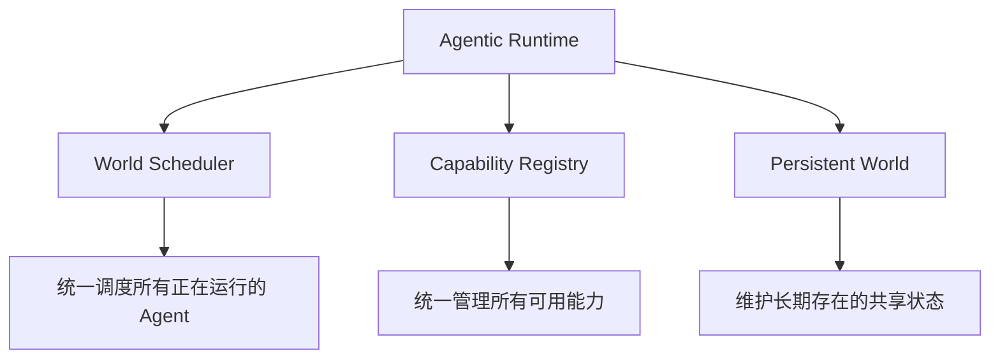

# 13. 智能体运行平台（Agentic Runtime）——面向智能体集群的运行平台架构

## 本章目标

完成本章学习后，你将理解：

- 单Agent Runtime 与Agentic Runtime 的区别
- World Scheduler、Capability Registry、Persistent World 的作用
- 为什么管理大量 Agent 类似于操作系统管理进程
- 资源隔离与优先级调度的基本思想

---

## 从"运行一个 Agent"到"运行一个 Agent 世界"

第 11 章的 Agent Runtime 解决的是"如何让一个 Agent 持续在线运行"；但当系统里同时存在几十、几百甚至成千上万个 Agent 实例时，问题的性质发生了变化——**这不再是运行"一个程序"，而是要管理一整个由众多 Agent、能力和共享环境组成的"世界"。**这正是 **Agentic Runtime** 要解决的问题。

先划清一个边界：**Agentic Runtime 是概念上的"调度与编排层"，不是真正的操作系统内核。** 它通常构建在容器编排（如 Kubernetes）、队列、数据库和模型服务之上，借用进程调度的思想，但并不直接管理 CPU、内存页表或硬件中断。把它理解成"Agent 世界的控制平面（Control Plane）"更准确。

## Agentic Runtime 的三个核心组件

- **World Scheduler**：类似操作系统的进程调度器，决定哪些 Agent 任务优先执行、同一时刻允许多少任务并发；
- **Capability Registry**：统一登记所有可用能力（工具、MCP Server、其它Agent），供任意Agent 发现和调用；
- **Persistent World**：所有 Agent 共享的、持续存在的状态存储，不会因为某个 Agent 进程重启而丢失。但"共享"会立刻带来一致性问题：多个 Agent 同时读写同一份状态时，谁赢？用乐观锁、版本号还是串行化？跨 Agent 的多步操作要不要事务？状态模型设计不好，"持久"反而会变成"持久地不一致"。

## 用进程管理的视角理解调度

管理大量并发运行的 Agent，本质上和操作系统调度进程面临的问题高度相似：**资源有限（GPU、显存、API 配额），任务有优先级差异（紧急任务应该被优先处理），需要避免某个任务耗尽全部资源**。因此，一个简化的 Agent调度器通常需要具备两个基本能力：

| 能力 | 作用 | 只做这件事的风险 |
|---|---|---|
| 优先级排序 | 让更重要或更紧急的任务优先获得计算资源 | 低优先级任务可能长期饥饿（Starvation） |
| 并发上限 | 限制同一时刻运行的 Agent 数量，避免资源被瞬间耗尽 | 粒度过粗会浪费资源，过细则调度开销高 |
| 配额（Quota） | 按用户/团队/租户限制资源总量 | 配额僵化会导致突发任务无法执行 |
| 抢占（Preemption） | 高优先级任务可中断低优先级任务 | 被中断任务需要可恢复，否则前功尽弃 |
| 公平性（Fairness） | 在优先级与吞吐之间取得平衡 | 实现复杂，指标难以定义 |

进一步地，还可以按资源类型分池调度——例如需要模型推理的任务争抢有限的 GPU 资源槽位，不需要推理的纯逻辑任务则走另一条独立的资源池，两者互不干扰。但分池也会带来**利用率下降**：某个池空闲时，另一个池未必能借用。生产系统通常需要在"隔离性"和"利用率"之间做取舍。

## 为什么这件事现在才变得重要？

在只有一两个 Agent 的阶段，简单地各自运行互不干扰即可；但随着 Agent 数量、种类持续增长，"如何统一调度""如何共享能力""如何维护一致的世界状态"逐渐变成了独立的系统工程问题——这正是 Agentic Runtime 作为一个新的基础设施层出现的原因，也是它与第 11 章"单Agent Runtime"最大的区别。

---

想用进程管理的视角亲手实现一个迷你Agent 调度器，可以看这一节实验：**13.1 实现一个迷你 Agent 调度器——用进程管理的视角理解 Agentic Runtime**。

---

## 本章实验

- [13.1 实现迷你智能体调度器——以进程管理视角理解 Agentic Runtime](<./13.1%20实现迷你智能体调度器——以进程管理视角理解%20Agentic%20Runtime.md>)

## 本章总结

本章我们理解了：

✅ Agentic Runtime 管理的不是一个 Agent，而是由众多 Agent、能力和共享环境组成的整个世界 ✅ 它是构建在容器编排、队列与模型服务之上的控制平面，不是真正的 OS 内核 ✅ World Scheduler、Capability Registry、Persistent World 是其三个核心组件 ✅ 调度不仅要"排优先级"，还要处理饥饿、抢占、配额与公平性 ✅ 共享状态必须设计并发控制与冲突解决，否则"持久"会变成"持久地不一致"

> **Runtime 管理一个 Agent，Agentic Runtime 管理一个由众多 Agent、能力和环境组成的数字世界。**

## 下一章预告

如果 Agent 的数量和重要性持续增长，操作系统本身是否也会因此被重新定义？下一章，我们将进入全书最后一章：

> **第 14 章 Agentic OS——Agent 时代的操作系统抽象可能如何演进？**

---

## 思考题

1. 用进程管理的视角类比：Agent 对应进程的哪些概念（PID、调度、退出码）？
2. 并发运行多个 Agent 时，状态隔离和资源隔离分别要怎么做？

---

## 参考资料

- Kubernetes 官方文档：https://kubernetes.io/docs/
- Ray 官方文档：https://docs.ray.io/
- OpenTelemetry 文档：https://opentelemetry.io/docs/
