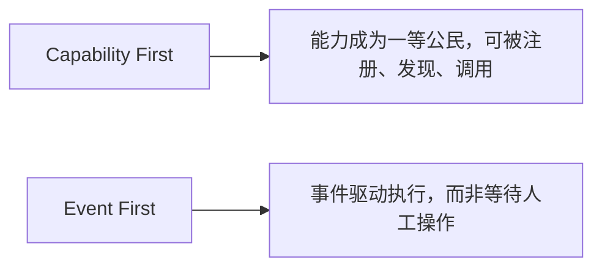
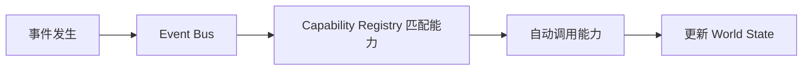

# 14. 智能体操作系统（Agentic OS）——面向智能体的操作系统架构设想

## 本章目标

完成本章学习后，你将理解：

- 传统操作系统的核心设计假设是什么
- 为什么这一假设正在被Agent 打破
- "Capability First"与"Event First"两个核心设计原则
- Agentic OS 目前仍是一个前瞻性的设想

---

## 传统操作系统的核心假设：人点击，程序响应

从Windows 到 macOS 到手机操作系统，几十年来的设计几乎都建立在同一个假设上：**用户主动发起操作，系统被动响应**——人打开一个 App 图标，App 才会启动；人点击一个按钮，功能才会被触发。这个假设非常自然，因为一直以来，只有人类才能真正"决定要做什么"。

## Agent 打破了这个假设

当 Agent 具备持续感知环境、自主决策、主动执行的能力之后，"人主动点击"就不再是唯一的触发方式——一封新邮件到达可以触发 Agent 起草回复；一次代码提交可以触发 Agent 进行代码审查。**触发源正在从"人"扩展到"事件"和"Agent 自身"。**

但更准确的说法不是"Agent 打破操作系统"，而是**Agent 给操作系统提出了新的抽象需求**：如何描述能力、如何授权、如何调度长任务、如何审计自主行为。这正是"Agentic OS"这个前瞻性概念想回答的问题：**如果越来越多的操作不再由人逐步点击，操作系统的抽象是否需要演进？**

## 类比在哪里成立，在哪里失效

把 Agentic OS 类比成操作系统很有启发性，但不能直接画等号：

| 传统 OS 概念 | Agentic OS 的对应物 | 类比成立之处 | 类比失效之处 |
|---|---|---|---|
| 进程（Process） | Agent 任务/实例 | 都有生命周期、优先级、资源配额 | Agent 行为非确定，难以用固定状态机描述 |
| 系统调用（Syscall） | Capability / Tool 调用 | 都是受控的能力入口 | 参数是自然语言/半结构化，难以静态校验 |
| 调度器（Scheduler） | World Scheduler | 都要处理并发、优先级、饥饿 | 任务时长与资源需求高度不确定 |
| 文件系统（FS） | Memory / Persistent World | 都提供持久化命名空间 | 语义检索、冲突合并远比文件读写复杂 |
| 权限（Permission） | Capability 授权 | 都遵循最小权限 | 授权对象是"意图"而非具体系统调用 |
| 中断（Interrupt） | Event | 都由外部事件触发 | 事件语义模糊，需模型解释而非硬件向量 |

因此，Agentic OS 更可能是**在现有 OS 之上的一层能力/事件/权限抽象**，而不是从内核重写一个全新操作系统。

## 两个核心设计原则

- **Capability First（能力优先）**：传统操作系统管理的是"应用程序"，Agentic OS 管理的是更细粒度的"能力"——一个能力可能只是一个函数、一个 MCP Server暴露的工具，能力可以被统一注册、发现和复用，不再和某个具体的 App 绑定；
- **Event First（事件优先）**：系统不再只等待用户点击，而是持续监听各类事件（新邮件、新消息、定时任务、其它 Agent 发出的信号），事件发生时自动匹配并调用相应的能力。

## 一个最小的雏形：Capability Registry + Event Bus

把这两个原则落地成最简单的工程实现，大致是：一个**Capability Registry** 负责登记所有可用能力及其描述，一个**Event Bus** 负责监听事件并自动匹配、调用对应的能力，多个 Agent 共享同一个 Registry 和同一份持续存在的 **World State**：

这一雏形正是第 13 章 Persistent World、Capability Registry 与本章 Event First 思想的结合体。

## 目前仍是一个前瞻性设想

需要坦诚地说，Agentic OS 目前更多是一种设计理念和研究方向，而不是已经成熟落地的产品形态。至少还有这些问题没有定论：

| 未解问题 | 具体难点 |
|---|---|
| 权限与授权 | 如何把"用户意图"安全地映射为最小能力集？授权能否随时撤销？ |
| 隐私边界 | Agent 跨应用读取数据时，如何防止过度收集与意外外泄？ |
| 跨设备一致性 | 手机、PC、云端的状态如何同步？离线时谁做主？ |
| 可撤销性 | 已执行的副作用能否回滚？不可逆操作如何事前阻断？ |
| 审计与责任 | 自主行为的日志归谁所有？出错时如何定责？ |
| 互操作标准 | 能力描述、事件格式、Agent 通信尚无统一标准 |
| 资源与公平 | 多个 Agent 争夺模型配额时，如何避免饥饿与滥用？ |

但它指出的方向是清晰的：**当 Agent 的数量和自主性持续增长，管理"能力"和"事件"会变得和管理"应用"与"点击"同样重要。** 这更可能推动操作系统抽象逐步演进，而不是在一夜之间被"重新定义"。

---

想亲手实现一个最小的 Capability Registry 和事件驱动系统，理解"Capability First"与"Event First"，可以看这一节实验：**14.1 实现一个最小 Capability Registry——用事件驱动的方式理解 Agentic OS**。

---

## 本章实验

- [14.1 实现最小能力注册表（Capability Registry）——事件驱动方式理解 Agentic OS](<./14.1%20实现最小能力注册表（Capability%20Registry）——事件驱动方式理解%20Agentic%20OS.md>)

## 本章总结

本章我们理解了：

✅ 传统操作系统建立在"人主动点击，程序被动响应"的假设之上 ✅ Agent 的出现让"事件驱动"成为另一种同样重要的触发方式 ✅ Capability First 让能力成为可被发现和复用的一等公民，Event First让系统由事件而非点击驱动 ✅ Agentic OS 目前仍是前瞻性设想，更可能是现有 OS 之上的一层抽象，而非内核重写

> **GUI 塑造了 PC 时代的交互抽象，Agent 则可能推动 AI 时代的系统抽象继续演进——但演进不等于推倒重来。**

---

## 第三部分总结

从第 1 章的"为什么大模型开始行动"，到本章的"Agent 时代的操作系统抽象可能如何演进"，我们完整走过了 Agent 从"能调用工具"到"具备记忆"到"形成自主循环"，再到"多 Agent 协作"，最终"走向统一运行平台"的演进路径：

至此，全书从"一个 Token 如何被预测"（第一部分），到"一个 Base Model 如何变成安全可用的 AI 助手"（第二部分），再到"一个 AI 助手如何拥有行动能力、成为能够自主完成任务的 Agent"（第三部分），已经形成了一条完整的知识链路。技术为什么会出现、它解决了什么问题、又留下了哪些新的问题——这条主线贯穿全书，也将继续贯穿这个仍在快速演化的领域。

---

## 思考题

1. Capability Registry 和传统操作系统的“系统调用表”是什么类比关系？
2. 为什么事件驱动架构比轮询更适合 Agentic OS？

---

## 参考资料

- Microsoft《AI Agents for Beginners》：https://github.com/microsoft/ai-agents-for-beginners
- MCP 官方规范：https://modelcontextprotocol.io/
- Kubernetes 官方文档：https://kubernetes.io/docs/

> Agentic OS 目前没有统一标准，以上资料用于对照“能力注册、事件驱动、调度与隔离”等相邻实践，不代表存在一个公认的 Agentic OS 规范。
