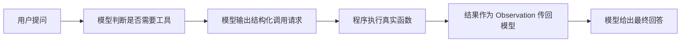
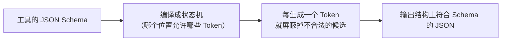

# 2. 工具调用（Tool Calling）——智能体连接真实世界的方式

## 本章目标

完成本章学习后，你将理解：

- 为什么模型必须依赖"工具"才能真正行动
- Function Calling 的基本原理
- 手写 Prompt 解析与模型原生 Tool Calling 的区别
- 推理引擎如何用约束解码限制输出结构，以及它保证不了什么
- 一次完整 Tool Calling 的执行流程
- CodeAct：把工具组合写成代码执行，以及它的收益与前提

---

## 模型没有"手"

大语言模型本质上只是一个"预测下一个 Token"的函数——它没有网络连接、没有文件系统访问权限、也无法执行代码。它唯一能做的是**输出文字**。如果我们希望它查询实时天气、执行一段代码、访问数据库，就必须给它一双"手"——这就是 **Tool（工具）**。

## Function Calling 的基本流程



模型自身并不会真正"执行"任何操作，它只负责判断"应该调用哪个工具、传什么参数"，真正的执行永远发生在我们自己编写的程序代码里——这一点是理解 Tool Calling 最关键的认知。

## 两种实现方式

早期实现 Function Calling，通常靠 Prompt 硬性约定模型只能输出特定格式的 JSON，再用程序解析。这种方式的问题是：模型是否严格遵守格式完全没有保证，一旦输出多了一句话或少了一个引号，解析就会失败。

部分开源指令模型（如支持工具格式的 Qwen、Llama、Mistral 版本）专门训练过识别工具描述和输出结构化调用。把名称、描述、Schema 通过兼容的 `tools` 接口与 chat template 传入，可以减少手写格式提示，但仍依赖具体模型、模板、服务端解析器与工具描述质量：

| | 手写 JSON 解析 | 原生 Tool Calling |
|---|---|---|
| 格式稳定性 | 依赖 Prompt 措辞，容易出错 | 训练时固定，稳定性高 |
| 适用范围 | 任意模型都能尝试 | 需要模型本身支持 |
| 工业界应用 | 早期方案，仍用于教学与兼容旧模型 | 当前主流方案，但仍需服务端校验 |
| 依赖层次 | 主要依赖 Prompt 与解析器 | 依赖模型能力、推理框架与服务端协议 |

## 一次完整的调用闭环

无论用哪种实现方式，Tool Calling 都需要经历"决策—执行—回传—回答"四个环节，缺一不可：模型决定调用什么工具，程序负责真正执行，执行结果以 Observation 的身份重新进入对话上下文，模型再基于这个新信息给出最终答案。

| 阶段 | 输入 | 操作 | 产物 |
|---|---|---|---|
| 决策（Decide） | 用户请求 + 工具清单（名称、描述、参数 Schema） | 判断是否需要工具、选哪个工具、填什么参数 | 结构化调用请求（`tool_calls`：工具名 + JSON 参数） |
| 执行（Execute） | 结构化调用请求 | 程序校验参数后调用真实函数（本地、HTTP 或数据库） | 工具返回值，或一条错误信息 |
| 回传（Return） | 工具返回值 | 按协议包装工具消息；OpenAI 风格用 `tool_call_id` 配对，本地模板可能不用 ID | 含真实 Observation 的上下文 |
| 回答（Answer） | 新上下文 | 基于观察结果组织最终回答 | 面向用户的回答，或下一轮调用请求 |

完成判据：模型拿到 Observation 后不再发出**新的** 工具调用，直接给出最终回答。若它带着相同参数反复调用同一个工具，说明这条 Observation 没有带来新信息，此时已进入失败边界——应当终止或换策略，而不是继续回传（重试上限与反思校验分别见第 6、5 章）。

## 第三种形态：把工具调用写成代码（CodeAct）

原生 Tool Calling 可以在同一轮返回多个调用，独立调用还可以并行执行；它并非天生“一轮只能调一个”。但后续参数依赖前面结果、还要过滤或聚合时，逐轮模型决策仍可能产生较多往返。**CodeAct（Code as Action）** 让模型生成一段程序，在受限环境内组合工具与控制流，把部分中间处理留在执行环境，而不是每一步都送回模型。这一思路在 2024 年的 CodeAct 论文中已有系统讨论：

```python
# 模型生成的不是 tool_call，而是这样一段代码（在沙箱里执行）
rows = search_orders(user_id="u-1024")
total = sum(get_amount(r["id"]) for r in rows if r["status"] == "paid")
print(total)
```

| | 逐次工具调用 | CodeAct |
|---|---|---|
| 一次决策的动作数 | 一个或多个调用，取决于模型/协议 | 程序内可组合多个动作，仍受执行预算限制 |
| 上下文增长 | 按调用回填结果，可截断/摘要 | 可只回传选定结果，也可能输出很大的执行日志 |
| 适合场景 | 工具少、每步都要人确认 | 工具多、有循环/聚合/过滤逻辑 |
| 代价 | 多轮延迟与 Token | 必须有可靠沙箱；权限与审计更难；不同模型写代码能力差异大 |

收益需要在相同模型、任务、工具返回体积和预算下测量；CodeAct 可能减少模型往返，但生成代码的失败率、执行环境启动成本与审计成本也可能抵消收益，不能承诺固定的延迟或 Token 降幅。

更重要的结论是**边界**：CodeAct 把"要不要调工具、按什么顺序调"从模型的多轮决策，前移到了模型生成的代码里。这让执行更紧凑，也让"沙箱、超时、只读挂载、无凭据"从可选项变成了前提——这正是第 11 章要展开的内容。

## 推理引擎的结构化输出约束

上一节的表格提到，模型原生 Tool Calling 比手写 JSON 解析"稳定性高"，但这句话背后还有一层容易被忽略的机制：模型本质上仍然是逐个 Token 采样生成文字的，就算训练得再好，也无法 100% 保证每一次输出都是语法完全正确的 JSON——万一采样到某个"不合适"的 Token，输出照样可能缺一个引号或多一个逗号。

推理引擎层面的**约束解码（Constrained Decoding，也叫 Guided Decoding）** 会按当前语法状态计算合法候选，再对非法 Token 做**硬屏蔽（logit 置为负无穷，概率为零）**，而不是仅把概率压低。它约束可生成结构；中断、截断、Schema 支持范围与实现错误仍须另外检查：



vLLM 等推理引擎提供这类能力。按官方文档（核验于 **2026-11-27**），vLLM 的 `guided_json` 等旧字段已在 **v0.12.0 移除**，在线请求应改用 `extra_body={"structured_outputs": {"json": schema}}`，或受支持的 `response_format` JSON Schema 接口；离线对应 `StructuredOutputsParams(json=schema)`。后端及 Schema 子集支持随版本而异，需要区分它保证的边界：

- **能保证**：在约束和 Schema 都被正确实现、且模型/引擎支持的前提下，输出满足给定的结构约束；
- **不能保证**：参数在业务上合理、工具真实可用、模型选对了工具，或 JSON Schema 本身没有表达出的语义约束。

因此工业级 Tool Calling 通常是三层配合：**模型训练提高调用倾向 → 约束解码保证结构 → 服务端再做 Schema、类型、权限与业务校验**。三者缺一不可。

---

想亲手体验从"手写 JSON 解析"到"模型原生 Tool Calling"的完整演进，可以看这一节实验：**2.1 实现 Function Calling——从 JSON 解析到原生 Tool Calling**。

---

## 本章实验

- [2.1 实现函数调用（Function Calling）——从 JSON 解析到原生工具调用（Tool Calling）](<./2.1%20实现函数调用（Function%20Calling）——从%20JSON%20解析到原生工具调用（Tool%20Calling）.md>)

## 本章总结

本章我们理解了：

- 模型本身没有执行能力，Tool Calling 是模型"决策"和程序"执行"分离协作的机制
- 手写 JSON 解析格式不稳定，模型原生 Tool Calling 更可靠，是当前主流方案
- 一次完整调用需要经历决策、执行、回传、回答四个环节
- CodeAct 把多步工具调用折叠成一段代码，省轮次与 Token，但前提是有可靠沙箱

> **LLM 提供智能，Tool 提供行动能力，两者结合，Agent 才能真正完成现实世界中的任务。**

## 下一章预告

一个 Agent 拥有了工具之后，下一个问题是：面对复杂任务，应该先做什么、后做什么？下一章，我们将进入：

> **第3章 Planning——Agent 如何制定行动计划？**

---

## 思考题

1. 手写 JSON 解析和模型原生 Tool Calling 的本质区别是什么？为什么后者更可靠？
2. 约束解码（Constrained Decoding）如何在“生成自由度”和“格式合法”之间取得平衡？
3. 工具的 description 写得好坏，会如何影响模型选对工具的准确率？试着举一个写得差的例子。

---

## 参考资料

- OpenAI《Function Calling》指南：https://platform.openai.com/docs/guides/function-calling
- Qwen 函数调用文档：https://qwen.readthedocs.io/en/latest/framework/function_call.html
- Outlines（约束解码库）：https://github.com/dottxt-ai/outlines
- XGrammar（结构化生成库）：https://github.com/mlc-ai/xgrammar
- vLLM Structured Outputs（含 v0.12.0 迁移说明）：https://docs.vllm.ai/en/latest/features/structured_outputs/
- Wang et al.《Executable Code Actions Elicit Better LLM Agents》：https://arxiv.org/abs/2402.01030
