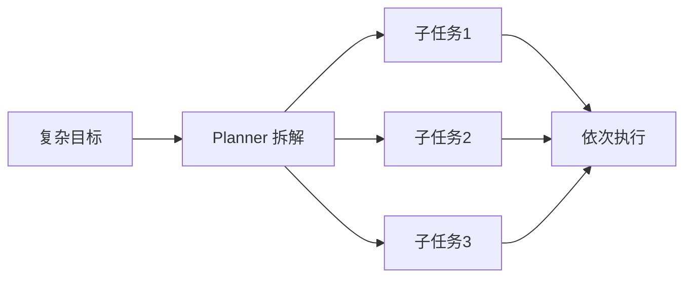

# 3. 规划（Planning）——智能体的任务分解与行动计划

## 本章目标

完成本章学习后，你将理解：

- 为什么复杂任务不能"一步到位"
- 什么是 Task Decomposition（任务拆解）
- 常见的 Planning 策略
- Planning 与 Agent Loop 的关系

---

## 复杂任务无法一步完成

用户说"帮我写一份介绍 Transformer 的科普文章"，这个任务无法靠模型"一次生成"就高质量完成——它需要先了解 Transformer 的关键知识点，再组织成通俗易懂的表达。真正合理的方式是先把大目标拆解成一系列可执行的小步骤，再依次完成——这正是 **Planning（规划）**。

## Task Decomposition：目标拆解

拆解出的子任务通常带有明确的先后顺序：先收集信息，再组织内容，最后输出成文——每一步只需要模型完成一件相对简单的事情，整体质量反而比"一步到位"更高。

### 完整机制：从目标到可执行计划

| 阶段 | 输入 | 操作 | 产物 |
|---|---|---|---|
| 目标理解 | 用户请求 + 约束 + 可用工具清单 | 澄清目标，抽出约束（时间、格式、权限） | 任务说明（目标 + 约束） |
| 拆解 | 任务说明 | 切成子任务，标出依赖关系与所需工具 | 子任务列表 + 依赖关系（有向无环图（Directed Acyclic Graph, DAG）） |
| 计划成型 | 子任务列表 | 排定顺序，为每步写明预期工具与验收标准 | 结构化计划（有序步骤，每步含输入、动作、完成判据） |
| 执行与核验 | 结构化计划 + 上一步产物 | 逐步执行，逐条检查该步是否达到自己的完成判据 | 每步产物 + 通过/不通过的判定 |
| 重规划（可选） | 未通过的判定 + 失败原因 | 局部替换步骤、插入补充步骤或放弃该分支 | 修订后的计划（循环机制见第 6 章） |

计划的完成判据是"每一步都能落到已有工具或已有子任务的输出上，且带有可检查的验收标准"。如果某一步既无工具可用、也不是模型自身能完成的事，说明拆解粒度过粗或前提假设有误——此时应退回拆解阶段，而不是带着错误前提继续执行。

## 常见的 Planning 策略

| 策略 | 本质 | 关键特征 | 主要代价 |
|---|---|---|---|
| 计划-执行（Plan-and-Execute） | 先计划、后执行 | 一次性生成完整计划，再按顺序执行，结构简单 | 计划一旦有误，后续步骤会连续偏离 |
| 无观察推理（ReWOO, Reasoning WithOut Observation） | 计划与工具调用解耦 | 先规划所需工具调用，再统一执行，减少模型往返次数 | 依赖对工具结果的预判，环境变化时计划容易失效 |
| 思维树（Tree of Thoughts, ToT） | 搜索式推理 | 探索多条推理/行动路径，评估后选择较优路径 | 调用次数与状态存储成倍增加，需要明确的评估函数 |
| 反思式修正（Reflexion-style correction） | 执行后的反馈修正 | 根据失败反馈生成反思，再调整下一轮计划 | 属于"事后纠错"，不能替代首轮计划质量 |

需要特别注意：**Tree of Thoughts 属于搜索/推理策略，Reflexion 属于执行后的反馈修正机制**，两者不在同一个分类维度上。把它们并列成"四种 Planning 策略"会暗示它们是互斥选项。

### Planning 与 Reflection 的边界

| 维度 | Planning | Reflection |
|---|---|---|
| 发生时机 | 行动之前（也可在每轮开始时重规划） | 行动之后（对结果做评估） |
| 输入 | 目标、约束、可用工具 | 已产生的轨迹、工具结果、评价信号 |
| 输出 | 任务分解与执行顺序 | 对错误的诊断与修正建议 |
| 失败方式 | 计划过粗、依赖错误前提 | 自我确认偏差、过度修正 |
| 关系 | 提供"做什么" | 提供"做得对不对" |

现实任务执行过程中常常会出现意外——某个步骤失败、某个前提不成立，这时"计划"需要能够动态调整，而不是死板地按最初的顺序执行到底。这也是为什么第 6 章的 Agent Loop 会把 Planning 设计成一个可以循环重新评估的环节，而不是执行前"一次性"想好的静态清单。但"能重规划"不等于"一定会收敛"：如果评价信号本身不可靠，反复重规划也可能在错误方向上来回震荡。

## Planning 与工程实现

用简单的 Python 循环手写 Plan → Execute 逻辑并不难，但当子任务之间出现条件分支、需要重试、需要并行执行时，代码很快会变得难以维护。这正是"框架"要解决的问题。今天主流的 Agent 框架可以分成几大家族：

| 框架 | 核心抽象 | 擅长场景 | 分支 | 状态持久化 | 迭代式规划 | 代表特性 |
|---|---|---|---|---|---|---|
| LangChain | Chain / Runnable | 把 LLM 调用串成固定流程 | 有限 | 交给 LangGraph | 弱 | 组件丰富、生态最大；1.0 起旧 Memory 等模块移除，Agent 编排交给 LangGraph |
| LangGraph | Graph（状态图） | 复杂、会循环、会分支的控制流 | 显式条件边 | 原生 Checkpoint | 强 | 节点 + 边显式建模，支持断点恢复 |
| CrewAI | Role（角色）+ Flow | 多 Agent 协作 | 任务级 / Flow 事件 | 有限 | 中 | 用"角色-任务-工具"组织多个 Agent，另有 Flows 做确定性编排 |
| Microsoft Agent Framework | Agent + Workflow | 多 Agent 编排与企业集成 | 图式 Workflow | 内置 | 中 | AutoGen 与 Semantic Kernel 合并而成，2026 年 4 月发布 1.0 |
| OpenAI Agents SDK | Agent + Handoff | 工具调用与任务移交 | Handoff | 会话（Sessions） | 中 | 轻量、以"交接"组织多 Agent，内置护栏与追踪 |

表中的"强/中/弱"是相对定位，不是绝对能力评级；具体版本的能力边界应以各框架官方文档为准。

LangChain 是最早流行起来的"全家桶"，把"调模型、拼 Prompt、接工具"都封装成组件；但随着 Agent 逻辑变复杂，固定顺序的 Chain 不够用了——Agent 的核心特征是**循环**（行动 → 观察 → 再行动）和**分支**（不同情况走不同路径），于是 LangGraph 用"状态图"把控制流显式建模成节点和边，很快成为复杂 Agent 的主流选择。

**这张表需要定期刷新**：AutoGen 与 Semantic Kernel 已在 2025 年 10 月进入维护模式（只修安全问题，不再加新功能），能力被合并进 Microsoft Agent Framework；`pip install autogen` 装到的是社区分支 AG2，而不是微软那条线。框架的更替速度就是这么快——**这也是本书把"循环、状态、工具协议"这些不变的概念放在框架之前的原因**。

**本书为什么统一用 LangGraph？** 后面的实验（3.1、6.1、10.1、11.1、11.2）会反复用 LangGraph 复现手写逻辑，原因正是它把"循环"变成图上一条真实的边、把"分支"变成显式的条件路由——和本书"从零手写、再用框架对照"的教学方式最契合：**手写版让你理解原理，LangGraph 版让你看到工程形态**。CrewAI（8.1）和 LangGraph 的持久化原语（4.1）则会作为对照出现。理解了这个全景，后面每次遇到框架代码，你就知道它在整个生态里的位置了。

---

想亲手实现一个任务分解 Planner，并对比手写版和 LangGraph 版的差异，可以看这一节实验：**3.1 实现一个任务分解 Planner，并用 LangGraph 复现同一流程**。

---

## 本章实验

- [3.1 实现任务分解规划器（Planner）——用 LangGraph 复现同一流程](<./3.1%20实现任务分解规划器（Planner）——用%20LangGraph%20复现同一流程.md>)

## 本章总结

本章我们理解了：

- 复杂任务需要先拆解成有序的子任务，再逐一完成
- Plan-and-Execute、ReWOO、Tree of Thoughts是常见的规划策略
- 真实场景中的计划需要能够根据执行反馈动态调整，而非一次性写死

> **Tool 决定 Agent 能做什么，而 Planning 决定 Agent 应该先做什么、后做什么。**

## 下一章预告

一个 Agent 拆解了任务、执行了几步之后，如何记得之前发生过什么？下一章，我们将进入：

> **第4章 Memory——Agent 如何拥有长期记忆？**

---

## 参考资料

- 微软《AI Agents for Beginners》（Agent 模式、框架、流式与生产化，10 课）：https://github.com/microsoft/ai-agents-for-beginners
- 迪迪粒粒《AI Agents 从零到一》（Agent 全栈实战：提示工程、Function Calling、记忆、多智能体）：https://github.com/didilili/ai-agents-from-zero
- 慕课网《小浪助手：基于 LangChain 的单 Agent 开发实践》：https://coding.imooc.com/class/822.html
- 极客时间《AI Agent 实战课》：https://time.geekbang.org/course/intro/101048201

---

## 思考题

1. 任务分解为什么能提升复杂任务的成功率？它同时引入了什么新风险？
2. Plan-and-Execute 和 ReAct 式“边想边做”的差异是什么？各自适合什么场景？
3. 如果 Planner 生成的计划执行失败了，应该由谁来发现并触发重新规划？
