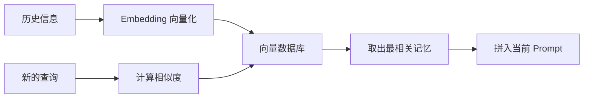
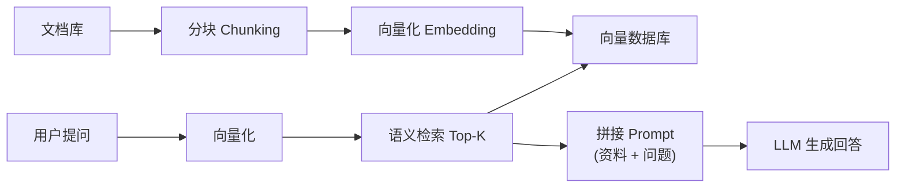

# 4. 智能体记忆（Agent Memory）与检索增强生成（RAG）——状态保存与知识检索

## 本章目标

完成本章学习后，你将理解：

- 为什么 Agent 需要记忆
- 短期记忆与长期记忆的区别
- 向量检索（RAG）在记忆机制中的作用
- **RAG 作为独立应用范式的完整流程，以及它为什么是求职必备技能**
- 主流框架的 Memory 模块设计思路

---

## 模型本身没有记忆

大语言模型每一次推理都是独立的——它并不会"记得"上一轮对话说过什么，唯一的信息来源就是当前这次输入的全部上下文（Context）。如果不做任何额外设计，一个多轮对话的 Agent，第二轮就已经"忘记"了第一轮说过的内容。要解决这个问题，需要给 Agent 增加 **Memory（记忆）**。

## 短期记忆：对话缓冲区

最简单的记忆方式是把最近几轮对话内容拼接进 Prompt——本质上就是一个不断增长（但有长度上限）的列表，能解决"这轮记得上一轮"的问题，但无法应对"三天前聊过的事情"，因为 Context 窗口终究是有限的。

## 长期记忆：向量检索

要让 Agent"记住"跨越很长时间、超出 Context 窗口的信息，通常的做法是：把历史信息转换成向量（Embedding）存储起来，需要时用语义相似度检索出最相关的片段，再拼回当前的 Prompt：

这正是 **RAG（检索增强生成，Retrieval-Augmented Generation）**最基础的原理，也是长期记忆最常用的一条**读取路径**。但要强调：**RAG 只是记忆系统的一部分，不等于完整的记忆机制**。一个可用的长期记忆至少还要回答：

- **写入策略（Write Policy）**：哪些信息值得存？原始对话、摘要、结构化事实还是向量？
- **更新与冲突（Update & Conflict）**：同一事实出现新版本时，是追加、覆盖还是保留多个版本？
- **压缩与遗忘（Compaction & Forgetting）**：历史过长时如何总结、降权或删除？
- **结构化状态（Structured State）**：用户偏好、任务进度等是否需要以表结构而非纯文本保存？

RAG 负责"取出来"，上面这些策略负责"存得对、管得住"。

## RAG：从"记忆机制"到"独立的应用范式"

上一节把 RAG 当作"长期记忆"的一种实现来讲——但 RAG 的价值远不止于此，它是当今 **LLM 应用开发的核心范式**，也是求职面试的必考题。之所以必须单独展开，是因为 RAG 解决的是大模型的三大知识硬伤：

1. **无知识**：模型训练截止之后的新闻、企业内部文档、私有数据，它一概不知；
2. **知识过期**：模型的知识冻结在训练那一刻，无法实时更新；
3. **幻觉**：不知道的东西，模型会一本正经地编造。

**RAG 的应对策略是"把知识放在外面"**：文档先被切块、向量化、存入向量库；用户提问时先检索出最相关的片段，再连同问题一起交给模型"照着资料回答"。模型不再完全依赖参数记忆，**有据可依的幻觉会显著减少，但不会消失**：检索可能没召回正确片段、片段可能相互矛盾、模型也可能误读或超出台词作答。因此 RAG 通常还要配合引用标注、低置信度拒答与答案校验，这与第 5 章安全护栏的思路一致，但两者都不能提供"绝对不幻觉"的保证。

**RAG 为什么是求职必备？** 因为现实世界绝大多数的 LLM 应用都不是"裸模型"，而是"模型 + 企业自己的知识"——客服问答、法律/医疗助手、内部知识库、文档助手，本质都是 RAG。面试官问"如何让模型回答你们公司内部的数据""如何减少幻觉"，答案都指向 RAG。理解 RAG 的完整流程（分块 → 向量化 → 检索 → 重排 → 增强生成），是 LLM 应用开发岗的基本功。

**一个容易混淆的边界**：RAG 和 Memory 共享"向量化 + 语义检索"的内核，但二者不是同义词。

| 维度 | 智能体记忆（Agent Memory） | 检索增强生成（RAG） |
|---|---|---|
| 关注问题 | 状态如何写入、保存、更新、遗忘 | 如何从外部知识中检索并注入上下文 |
| 数据来源 | 对话、工具结果、任务状态、用户偏好 | 文档库、知识库、网页、数据库 |
| 核心机制 | 写入策略 + 存储结构 + 读取路径 + 生命周期 | 分块 → 索引 → 检索 → 重排 → 增强生成 |
| 典型失败 | 记错、记旧、记忆污染、上下文膨胀 | 召回缺失、片段噪声、引用错配 |
| 关系 | 记忆系统可以**调用** RAG 作为读取路径之一 | RAG 也可以服务于非记忆场景（如企业知识问答） |

本章把它们放在一起，是因为二者共享同一套检索内核；但求职时请记住：**RAG 是一个独立领域**（第 4.2 节会亲手实现完整流程）。

**三大 RAG 框架的定位**（面试常问"你用过哪个 RAG 框架"）：**LangChain** 是通用 LLM 应用框架，RAG 只是它的一个模块（`Retriever` 抽象 + 向量库适配）；**LlamaIndex** 以"数据索引"为中心，把"文档 → 索引 → 查询"做得最专注；**Haystack** 以"可组合的 pipeline"为中心，适合生产级检索/问答流水线。比较时建议统一看三个维度：

| 维度 | 要比较什么 | LangChain | LlamaIndex | Haystack |
|---|---|---|---|---|
| 索引（Indexing） | 分块、元数据、增量更新 | 通用组件，需自行拼装 | 强，索引抽象丰富 | 中等，偏 pipeline 组件 |
| 检索（Retrieval） | 向量/关键词/混合检索、重排 | Retriever 生态广 | 检索器与查询引擎成熟 | 检索节点可组合 |
| 编排（Orchestration） | 流程控制、可观测性、部署 | Chain/Agent 生态大 | 查询工作流清晰 | Pipeline 显式、适合生产 |

三者没有绝对优劣——理解了本章和 4.2 节的底层原理，换框架主要是换 API 与工程约定。

## 短期记忆 vs 长期记忆

| | 短期记忆 | 长期记忆 |
|---|---|---|
| 存储方式 | 对话历史列表 | 向量数据库 |
| 解决的问题 | 当前对话内的上下文连续性 | 跨对话、跨会话的信息留存 |
| 容量限制 | 受 Context 窗口限制 | 存储容量可扩展，但受检索成本、召回质量与治理能力约束 |
| 典型实现 | ConversationBufferMemory | FAISS、Chroma、Milvus 等向量数据库 |

"长期"不等于"无限"：向量库可以存很多，但每次只能取回 Top-K；库越大，召回噪声、索引维护和权限治理的成本越高。

## 主流框架的 Memory 模块

LangChain 提供了 `ConversationBufferMemory`（短期记忆）和`VectorStoreRetrieverMemory`（长期记忆）等现成模块，本质上做的事情和我们自己手写的"列表 + 向量检索"完全一致，只是换成了工业级的向量数据库和更完善的接口封装，具备更好的可插拔性——换一个 Embedding 模型或向量数据库，通常只需要修改一行配置。

---

想亲手实现一套记忆机制，从手写向量记忆到 LangChain Memory，可以看这一节实验：**4.1 实现 Agent 记忆机制——从向量存储到 LangChain Memory**。

想用纯 NumPy 亲手跑通一次完整的 RAG（分块 → 向量化 → 检索 → 增强生成），可以看这一节实验：**4.2 实现一个最小 RAG——分块、向量化、检索、增强生成**。

---

## 本章实验

- [4.1 实现智能体记忆机制（Agent Memory）——从向量存储到 LangChain Memory](<./4.1%20实现智能体记忆机制（Agent%20Memory）——从向量存储到%20LangChain%20Memory.md>)
- [4.2 实现最小检索增强生成（RAG）——分块、向量化、检索与增强生成](<./4.2%20实现最小检索增强生成（RAG）——分块、向量化、检索与增强生成.md>)

## 本章总结

本章我们理解了：

✅ 模型参数本身不保存会话记忆，Memory 是 Agent 在模型外部搭建的状态系统 ✅ 短期记忆解决"这轮对话"的连续性，长期记忆解决"跨会话"的信息留存 ✅ 长期记忆不只等于向量检索，还包括写入、更新、压缩、遗忘与结构化状态 ✅ RAG 是长期记忆的一条读取路径，也是独立的 LLM 应用范式，用于缓解"无知识、知识过期、幻觉" ✅ RAG 的完整流程是"分块 → 向量化 → 检索 → 重排 → 增强生成"，是求职必备技能 ✅ 主流框架的 Memory 模块是对"存储 + 检索"的工程化封装，但仍需自行设计记忆策略

> **Planning 决定 Agent 下一步做什么，Memory 决定 Agent 是否记得过去发生了什么。**

## 下一章预告

有了记忆之后，Agent 是否也能像人一样，从过去的错误中学习？下一章，我们将进入：

> **第5章 Reflection——Agent 如何不断自我修正？**

---

## 思考题

1. 向量记忆和对话历史记忆的区别是什么？各自解决什么问题？
2. RAG 的四个环节（分块/向量化/检索/增强生成）中，哪一步最影响最终质量？为什么？
3. 什么时候该用 RAG、什么时候该微调模型？给出你的判断依据。

---

## 参考资料

- Lewis et al.《Retrieval-Augmented Generation for Knowledge-Intensive NLP Tasks》：https://arxiv.org/abs/2005.11401
- LangChain Memory 文档：https://python.langchain.com/docs/versions/migrating_memory/
- LlamaIndex RAG 文档：https://docs.llamaindex.ai/en/stable/understanding/rag/
