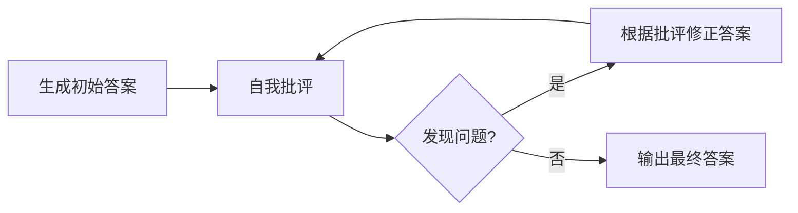

# 5. 反思机制（Reflection）——智能体的自我评估与修正

## 本章目标

完成本章学习后，你将理解：

- 为什么模型第一次生成的答案未必是最好的答案
- 什么是 Self-Refine（自我修正）
- Reflection 循环的基本结构
- Reflection 的效果边界

---

## 第一次的答案未必是最好的

人类解决问题时很少"一次就写对"——我们会检查、发现问题、修改，反复几轮才能得到满意的结果。大语言模型同样可以模拟这个过程：**生成一个初始答案，让模型自己检查这个答案，再根据检查意见修正**，这就是 **Reflection（自我反思）**，最经典的实现方式叫做 **Self-Refine**。

## Self-Refine 的基本循环

模型在"批评"这一步扮演的角色，和"回答"这一步完全不同——它需要跳出"如何解决问题"的视角，转而评估"这个解法本身是否正确"，这种角色切换正是 Reflection 能够生效的关键。

## Reflection 的效果边界

Reflection 并不是万能的：它的效果上限，取决于模型本身"识别错误"的能力。如果模型连"批评"这一步都判断错误（把正确答案误判为错误，或者没能发现真正的错误），修正循环甚至可能让答案变得更差。这也是为什么**第二部分第 6 章的推理对齐（Reasoning Alignment）**——尤其是训练模型具备更强的自我评估能力——会直接影响 Reflection 的实际效果：**Reflection 提供的是"多一次检查的机会"，而不是"绝对正确的保证"。**

几种常被混为一谈的机制，边界如下：

| 机制 | 评估信号来自哪里 | 是否修改输出 | 典型用途 | 主要风险 |
|---|---|---|---|---|
| 自我修正（Self-Refine） | 同一模型自我批评 | 是，多轮改写 | 写作、代码、答案润色 | 自我确认偏差，越改越偏 |
| 反思（Reflexion） | 环境反馈/工具结果/失败信号 | 是，形成反思并影响下一轮 | 需要试错的行动任务 | 反馈稀疏时反思质量差 |
| 评估器-优化器（Evaluator-Optimizer） | 独立评估器（模型或规则） | 是，按评估意见优化 | 有明确评价标准的任务 | 评估器本身有偏差或漏洞 |
| 推理对齐中的自我评估训练 | 训练数据中的评估信号 | 改变模型能力本身 | 提升模型识别错误的能力 | 训练成本高，可能过拟合评估格式 |

### 常见失败模式

- **自我确认偏差（Self-confirmation Bias）**：模型倾向于认可自己先前的答案，批评流于形式；
- **过度修正（Over-correction）**：把正确内容改错，尤其在缺少外部证据时；
- **局部最优（Local Optimum）**：多轮只在措辞上打转，没有触及真正的错误；
- **评估器与被评估者同源**：同一个模型既当选手又当裁判，错误会互相强化；
- **成本失控**：固定多轮反思会线性增加 Token 与延迟，收益却可能迅速递减。

因此工程上要给 Reflection 设置**明确的终止条件**（最大轮数、评估分数阈值、连续无改进即停止），并在关键任务上引入外部评估器或人工抽检。

## Reflection 与其它模块的关系

Reflection 通常不是孤立使用的：它可以放在 Planning 生成计划之后（检查计划是否合理），可以放在 Tool Calling 执行之后（检查执行结果是否符合预期），也可以放在最终答案生成之后（检查回答质量）。在第6章的完整 Agent Loop 中，Reflection 正是"观察结果之后，决定是否需要重新规划"的关键判断环节。

---

想亲手实现一次"生成→自我批评→修正"的完整循环，可以看这一节实验：**5.1 实现 Self-Reflection 循环——输出评估与修正**。

---

## 本章实验

- [5.1 实现自我反思循环（Self-Reflection）——输出评估与修正](<./5.1%20实现自我反思循环（Self-Reflection）——输出评估与修正.md>)

## 本章总结

本章我们理解了：

✅ Self-Refine 通过"生成—批评—修正"的循环，让模型有机会改进自己的初始答案✅ 模型在"批评"环节需要切换到评估者视角，这与"回答"环节的视角完全不同 ✅ Reflection 的效果取决于模型自身的判断力上限，并非稳定万能

> **Memory 让 Agent 记住过去，而 Reflection 让 Agent 从过去中学习。**

## 下一章预告

Planning、Tool Calling、Memory、Reflection 这几个模块该如何组装成一个真正完整、能够自主运转的系统？下一章，我们将进入：

> **第6章 Agent Loop——Agent 如何形成自主执行闭环？**

---

## 思考题

1. Evaluator-Optimizer 模式中，评估者和被评估者可以是同一个模型吗？有什么风险？
2. 固定反思轮数 vs 动态终止条件，各自的取舍是什么？
3. 反思为什么可能“越改越差”？从评估器自身的错误率角度分析。

---

## 参考资料

- Madaan et al.《Self-Refine: Iterative Refinement with Self-Feedback》：https://arxiv.org/abs/2303.17651
- Shinn et al.《Reflexion: Language Agents with Verbal Reinforcement Learning》：https://arxiv.org/abs/2303.11366
