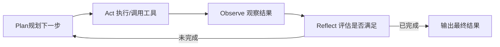
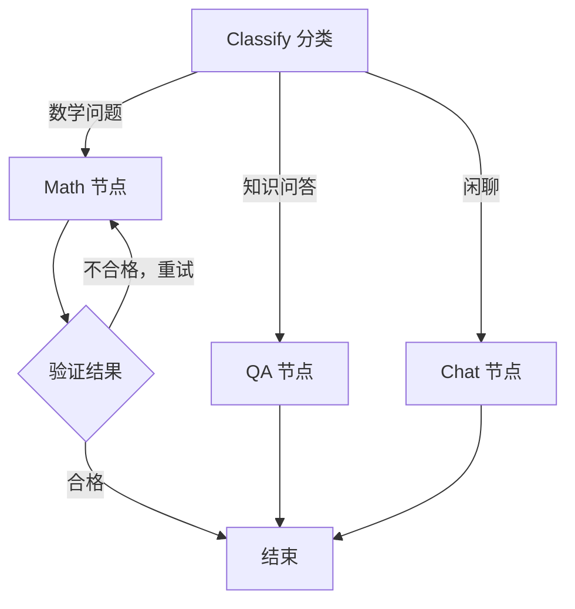

# 6. 智能体循环工程（Agent Loop Engineering）——自主执行闭环的设计与边界

## 本章目标

完成本章学习后，你将理解：

- Agent Loop 是如何把前面几章的模块串联起来的
- ReAct 循环的完整结构
- Agent Loop 的终止条件
- 为什么图结构特别适合表达 Agent Loop，以及什么时候普通的 `if/else` + `while` 已经够用
- Checkpoint、Resume 与持久化执行（Durable Execution）能恢复什么、不能恢复什么

---

## 模块集成与闭环

第1~5章我们分别学习了 Tool Calling（行动能力）、Planning（规划能力）、Memory（记忆能力）、Reflection（自我修正能力）——这一章要回答的问题是：**这些模块应该以什么方式组织在一起，才能构成一个真正能够自主运转的 Agent？** 答案就是 **Agent Loop**。

## Agent Loop 的核心结构



这借鉴了经典 **ReAct（Reasoning + Acting）** 的交替推理与行动思想：根据真实 Observation 决定下一步，直到完成或达到预算。图中的独立 Plan/Reflect 节点是教学拆分，不是经典 ReAct 必须包含的四个模块。

经典 ReAct 常把 Thought、Action、Observation 轨迹送回上下文；现代工具循环也可使用结构化动作、观察和简短决策摘要，不必暴露或保存模型内部完整推理。关键是下一轮能获得真实行动结果与必要依赖，而不是有没有某个名为 Thought 的字段。

## 终止条件：Agent 何时应该停下来

一个健壮的 Agent Loop 必须有明确的终止机制，否则很容易陷入无限循环、浪费大量计算资源：

| 终止条件 | 说明 |
|---|---|
| 任务完成 | 模型自行判断目标已达成，输出 Final Answer |
| 达到最大步数 | 防止死循环，强制在若干步后终止 |
| 连续失败 | 多次工具调用都失败，判定任务不可完成 |
| 人工介入 | 涉及高风险操作时，暂停等待人工确认 |

## 容易被忽略的细节一：错误处理与重试

"回填"这一环不该只处理成功的 Observation——工具调用失败、参数非法、JSON 解析报错，都应该被当作一种特殊的 Observation 回填给模型，让它**看到错误信息、自我纠正**，而不是让整个 Loop 直接崩溃退出：

```python
try:
    result = execute(tool_name, args)
    observation = result
except Exception as e:
    # 把错误信息也当作 Observation 回填，模型下一轮会"看到"刚才这次调用失败了
    observation = f"工具执行出错：{e}，请检查参数后重试。"

messages.append({"role": "tool", "content": observation, "tool_call_id": response.id})
```

第 6.2 节用 `verify_math → math` 演示数字格式失败后的有界重试，并把上次答案与失败原因传入下一次 Prompt。它只验证输出格式，不是算术正确性证明；完全相同的确定性 Prompt 重跑通常不会带来改进。

配合重试通常还要设一个**重试上限**（比如最多3次，对应上面终止条件表里的"连续失败"）——步数上限防的是"正常推进但没完没了"，重试上限防的是"同一个错误反复撞墙"，两者是同一件事的两个层面。

## 容易被忽略的细节二：上下文管理

Loop 每循环一轮，`messages`（即 scratchpad）里就会新增一轮 Thought/Action/Observation——步数一多，历史会迅速变长，带来两个实际问题：

- **Context 窗口爆掉**：历史长度超过模型的最大输入长度，直接报错或被截断；
- **注意力漂移**：即使没超限，历史太长也会稀释模型对"当前真正相关信息"的关注度，推理质量随之下降。

常见的缓解手段：

| 手段 | 做法 |
|---|---|
| 摘要（Summarization） | 定期把较早的几轮 Thought/Observation 压缩成一句话摘要，替换掉原始记录 |
| 裁剪（Truncation） | 只保留最近 N 轮，或只保留"结论性"的 Observation，丢弃中间过程 |
| 分层记忆 | 长期需要的信息存入第4章讲的向量记忆，短期 scratchpad 只留最近几步 |

这正是第4章"短期记忆有长度上限"这句话背后的工程含义——Loop 跑得越久，就越需要在"记住多少"和"记得住"之间做权衡。

到 2026 年，这套工作有了一个更正式的名字：**上下文工程（Context Engineering）**——不再纠结"怎么写一句好 Prompt"，而是设计"每一轮到底该让模型看到什么"。工业级 Agent Harness 已经把其中一部分自动化了：监控 Token 用量、在循环中途压缩历史、把长工具输出替换成摘要或文件引用。但这只解决了"装得下"，**"该留什么"仍然是业务判断**：哪条 Observation 是决策依据、哪条只是噪声，框架无从知道。

## 自主 Agent vs 固定 Workflow：两种工程路线

在深入 Agent Loop 的工程实现之前，值得先建立一个业界公认的边界——Anthropic 在《Building Effective Agents》这篇文章里给出了一个被广泛采纳的区分：**Workflow（固定工作流）与 Agent（自主智能体）在"谁决定下一步"上不同**。但要注意，这是一条**连续谱**，不是二选一：现实中大量系统是"外层固定 Workflow、内层局部 Agent 循环"的混合体。

- **Workflow**：在**预先定义的拓扑与约束**中调用 LLM，比如分类、路由、生成、评价。节点内选择、分支结果和提前停止可以由模型决定，所以“固定”主要指可走路径与预算，不表示每次输出或实际步数都确定；
- **Agent**：模型**动态决定下一步做什么**——自主规划、调用工具、观察结果、循环直至完成（正是本章的 Agent Loop）。灵活、能处理开放任务，但不可预测、需要更强的护栏（第 10 章 Runtime、第 11 章安全都是为此而生）。

| | Workflow（固定工作流） | Agent（自主智能体） |
|---|---|---|
| 决策范围 | 程序定义有限路径，模型可选分支或提前停 | 模型在工具与预算边界内动态选择后续任务 |
| 可预测性 | 拓扑与预算较可预测，输出仍可能变化 | 路径更开放，即使确定性解码也可能出错 |
| 适用场景 | 流程固定、质量要求稳定 | 开放任务、需要灵活决策 |
| 工程成本 | 低，易调试 | 高，需要护栏与观测 |
| 典型形态 | 固定节点 + 条件路由 | 模型自主选择工具与路径 |
| 混合形态 | 外层用 Workflow 固定主流程，内层在某个节点放开 Agent 循环 | 同左，边界由团队按风险划定 |

**Anthropic 的忠告值得记住："能用简单方案，就不要用复杂的方案。"** 文章里明确建议：先尝试最简方案（单次 LLM 调用 + 检索），复杂了再加 Workflow，只有 Workflow 无法覆盖的开放任务才上 Agent——大多数应用根本不需要"自主智能体"。同时，文章总结的五种常见 Workflow 模式（Prompt Chaining 链式、Routing 路由、Parallelization 并行、Orchestrator-Workers 编排-工人、Evaluator-Optimizer 评估-优化）可以帮助我们定位本书的结构。但要说明：**这是类比，不是官方章节映射**——第 3 章的 Planning 与 Routing/Chaining 有交集但不相等，第 7 章的多智能体也不只 Orchestrator-Workers 一种拓扑，第 5 章的 Reflection 与 Evaluator-Optimizer 都包含"评估—修正"，但前者强调自评，后者强调独立评估器。**"Agent"不是神秘的新范式，而是把已有模块按"自主循环"的方式组织起来。**

## 容易被忽略的细节三：副作用工具与幂等性

前面讨论的重试，默认工具调用是"可重复执行而无害"的。但真实工具常常有副作用：下单、发邮件、转账、写数据库。一次超时并不代表失败——请求可能已经在服务端生效，盲目重试会造成**重复下单、重复扣款**。

工程上的基本要求：

| 机制 | 作用 |
|---|---|
| 幂等键（Idempotency Key） | 同一业务操作重复提交时，服务端只执行一次 |
| 去重与状态查询 | 重试前先查"这笔操作是否已完成" |
| 补偿事务（Compensation） | 无法回滚时，用反向操作抵消已产生的副作用 |
| 人工确认 | 高风险副作用操作执行前暂停，等待审批 |

因此 Agent Loop 的重试策略必须**按工具分类**：只读工具可以自动重试，有副作用的工具必须幂等或人工确认。这条边界在本章后面的"持久化执行"、第 10 章（Runtime）、第 11 章（执行环境）会反复出现。

## 用状态图编排复杂流程

用最朴素的方式实现 Agent Loop，往往就是一个 `while` 循环加上一堆 `if/else` 判断。像 LangGraph 这样基于**状态图（State Graph）** 的框架，把"循环"变成了图上一条真实存在的边，把"分支"变成了显式的条件路由——这也是本书反复用 LangGraph 复现同一逻辑的原因。但和 Loop 一样，**状态图不是 Agent 的必需组件，而是一种可选的工程组织方式**。

### 适用边界：先用普通函数写，写不下去了再上图

第1.1 节那个两阶段 Workflow，用几十行普通 Python 就写完了，可读性也很好——**这种情况完全不需要图**。

图结构真正开始产生价值，是在同时出现下面多种情况时：不同类型的问题需要路由到不同处理逻辑、某个步骤失败需要自动重试、某些环节可以并行执行、长任务需要断点恢复。这些逻辑一旦全部塞进普通函数的 `if/else` 和 `while` 里，代码会迅速变得难以阅读、难以调试、难以修改。

### 把控制流变成显式的节点与边

状态图的核心思路是：不再把"下一步做什么"隐藏在代码逻辑里，而是把它显式地表达成图上的节点（Node）和边（Edge）：



分支变成了从一个节点发出的多条边，循环变成了一条指向上游节点的边——控制流从函数调用栈里的隐式逻辑，变成了**可检查、可测试、可恢复的显式状态机**。可视化（导出图片供团队评审）只是附带好处，**真正的价值是"状态与转移被显式建模"**：你能列出全部合法状态、为每条边写测试、在任意节点前后插入观测点。

一次图执行的生命周期如下：

| 阶段 | 输入 | 操作 | 产物 |
|---|---|---|---|
| 定义状态（State Schema） | 流程需要的字段（消息、工具结果、计数器等） | 声明字段类型与更新方式：覆盖、累加或归并 | 类型化的状态定义 |
| 建图与编译（Build & Compile） | 节点函数 + 边 + 条件路由 | 连接节点，检查入口、出口与可达性 | 可执行的图（结构性错误在编译期暴露） |
| 节点执行（Invoke Node） | 当前状态 | 节点读取所需字段，只返回**部分** 状态的更新 | 状态增量，由框架合并进全局状态 |
| 条件路由（Route） | 合并后的状态 | 条件边求值，决定下一跳或结束 | 下一节点标识，或 END |
| 持久化与恢复（Checkpoint & Resume） | 状态 + 步标识 | 按持久化策略提交超级步快照；恢复最近已提交状态 | 可能重跑未确认工作，不保证外部副作用恰好一次 |

完成判据是“走到 END 且终态满足验收条件”。恢复能力应通过明确的故障位置与存储条件测试；不能把一次协作暂停实验推广为任意崩溃都无损。6.3 显式使用 `durability="sync"`，验证独立进程从静态断点继续。

### 持久化执行：Checkpoint 与 Resume

状态被显式建模之后，就可以在每一步之后把它保存下来（Checkpoint）。如果程序执行到一半崩溃或服务重启，可以从最近的断点直接恢复（Resume），而不必从头重新执行——这就是**持久化执行（Durable Execution）**：


对于一个可能运行数分钟甚至数小时、消耗大量 Token 的 Agent 任务来说，"进程可以重启，任务状态不丢"至关重要。同一份 Checkpoint 还支撑了人工介入（在节点前暂停、等待审批后继续）与历史状态回放。

但必须划清边界：**Checkpoint / Resume 恢复图内状态，不自动回滚外部副作用，也不保证它们不会因节点重跑而重放。** 如果崩溃发生在"已下单、未记录"的窗口，恢复后可能重复下单；如果工具调用本身不幂等，Resume 也可能重复执行。这正是上一节"副作用工具与幂等性"在持久化场景下的延伸：

| 问题 | 只靠 Checkpoint 不够 | 还需要 |
|---|---|---|
| 外部副作用重复 | 恢复后可能再次调用工具 | 幂等键、去重、状态查询 |
| 多步骤事务 | 图状态与外部系统不一致 | 补偿事务（Saga）或人工对账 |
| 并发写冲突 | 多实例同时恢复同一 Checkpoint | 租约/锁、版本号、单写者 |
| 不可逆操作 | 无法"撤销" | 执行前审批与分级放行 |

换句话说，**持久化执行解决的是"算到哪儿了"，不是"世界上发生了什么"**。后者要靠事务与幂等设计，第 10 章（Runtime）与第 11 章（执行环境）会继续展开。

### 与命令式写法的对比：什么时候图是过度设计

| | 命令式写法（`if/else` + `while`） | 状态图编排 |
|---|---|---|
| 控制流表达 | 隐藏在 `if/else`、`while` 中 | 显式的节点和边 |
| 可视化 | 无 | 可直接导出图结构 |
| 状态持久化 | 需要额外手写保存/恢复逻辑 | 框架内置 Checkpoint 机制 |
| 扩展方式 | 修改现有函数逻辑 | 增加新节点 + 新的边 |
| 调试方式 | 断点、日志 | 节点级状态快照与回放 |
| 学习/维护成本 | 低 | 中高，需要理解状态模型 |
| 适用规模 | 小到中等流程 | 多分支、长任务、多团队协作 |

**什么时候图是过度设计？** 流程只有一条直线、没有重试与并行、任务在一分钟内结束、也不需要断点恢复时，引入图只会增加抽象层和调试成本。此时普通函数 + 清晰的日志更合适。

---

想把ReAct、Function Calling、Planning、Reflection 全部组装成一个完整闭环，并对比手写版与 LangGraph 版的差异，可以看这一节实验：**6.1 实现 Agent Loop 并使用 LangGraph 复现**。想亲手搭建一张带分支与重试循环的状态图，并体验 Checkpoint/Resume，可以接着看 **6.2 使用 LangGraph 构建带分支与循环的智能体图**、**6.3 为智能体增加持久化与断点恢复——LangGraph Checkpoint 实战**。

---

## 本章实验

- [6.1 实现智能体循环（Agent Loop）——用 LangGraph 复现](<./6.1%20实现智能体循环（Agent%20Loop）——用%20LangGraph%20复现.md>)
- [6.2 使用 LangGraph 构建带分支与循环的智能体图](<./6.2%20使用%20LangGraph%20构建带分支与循环的智能体图.md>)
- [6.3 为智能体增加持久化与断点恢复——LangGraph Checkpoint 实战](<./6.3%20为智能体增加持久化与断点恢复——LangGraph%20Checkpoint%20实战.md>)

## 本章总结

本章我们理解了：

- Agent Loop 可以把 Tool Calling、Planning、Memory、Reflection 组织成一个持续运转的闭环
- ReAct（Reasoning + Acting）是 Agent Loop 最经典的实现范式
- 明确的终止条件是 Agent Loop 稳定运行的前提
- 编排总会存在，Loop/Graph 形式可选；第 1～5 章的 Workflow 属于广义智能体应用，不据此等同于狭义自主 Agent
- 状态图把分支与循环显式表达成节点和边；简单流程用普通函数即可，分支、重试、并行、断点恢复同时出现时才值得上图
- Checkpoint/Resume 让长任务具备容错和恢复能力，但只恢复图内状态，外部副作用仍要靠幂等与补偿来兜底

> **当任务步骤无法预先枚举时，才把"下一步做什么"交给模型决定；这份灵活性的代价是必须自己设好终止条件。Loop 决定一次执行怎么推进，状态图决定复杂流程如何被组织和恢复——两者都是可选项。**

## 下一章预告

到这里，单个 Agent 的组件与编排方式都已讨论完毕。当一个任务需要多种不同专长分工时，就需要多个 Agent 协作。下一章，我们将进入：

> **第 7 章 多智能体（Multi-Agent）——多个智能体如何协同完成复杂任务？**

---

## 参考资料

- Anthropic《Building Effective Agents》（Workflow vs Agent 的权威区分与五种设计模式）：https://www.anthropic.com/engineering/building-effective-agents
- LangGraph 官方文档（状态图、持久化与人工介入）：https://docs.langchain.com/oss/python/langgraph/overview
- 微软《AI Agents for Beginners》（Agent 模式、框架、流式与生产化，10 课）：https://github.com/microsoft/ai-agents-for-beginners
- 迪迪粒粒《AI Agents 从零到一》（Agent 全栈实战：提示工程、Function Calling、记忆、多智能体）：https://github.com/didilili/ai-agents-from-zero

---

## 思考题

1. Agent Loop 有哪些终止条件？无限循环最常见的诱因是什么？
2. ReAct 中 Thought / Action / Observation 三者各自的作用是什么？缺一个会怎样？
3. 错误重试和上下文管理为什么是 Loop 工程的两个核心问题？
4. 什么情况下普通的 `while` 循环就够了、什么情况下该改用状态图？给出你的判断标准。
5. Checkpoint 断点恢复解决了什么真实痛点？为什么它不能防止"恢复后重复下单"？
