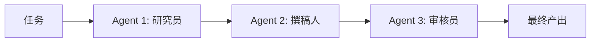

# 8. 多智能体（Multi-Agent）——协作模式与工程边界

## 本章目标

完成本章学习后，你将理解：

- 为什么单个 Agent 会遇到能力瓶颈
- Multi-Agent 协作的核心思想
- 常见的多 Agent 协作模式
- 主流 Multi-Agent 框架

---

## 一个 Agent 精力有限

即使一个 Agent 拥有完整的Plan-Act-Observe-Reflect 循环，让它同时兼顾"研究资料""撰写文案""审核校对"这几件事，效果通常不如把这几件事分别交给专门的角色去做——就像一个人同时当研究员、撰稿人、审核员，精力和专注度往往会被分散。**Multi-Agent 的核心思想，就是让多个各有专长的Agent 分工协作，而不是让一个 Agent 包揽一切。**

## 常见的协作模式

| 协作模式 | 特点 | 适用场景 | 主要代价 |
|---|---|---|---|
| 流水线（Pipeline） | 各 Agent 按固定顺序依次处理，前一个的输出是后一个的输入 | 阶段清晰、依赖线性的任务 | 单点失败会向后传播，难以并行 |
| 主从（Orchestrator-Worker） | 一个主 Agent 拆解任务、分配给多个从 Agent 并汇总 | 可分解的并行子任务 | 主 Agent 成为瓶颈与单点 |
| 层级式（Hierarchical） | 多层主从，上层编排者管理下层团队 | 大规模、跨领域的复杂项目 | 通信开销与上下文丢失随层数放大 |
| 黑板（Blackboard） | 多个 Agent 读写同一共享工作区，由控制组件决定谁先写 | 需要共享中间结果、松耦合协作 | 并发冲突、状态污染、权限治理 |
| 对等协作（Peer-to-Peer） | 多个 Agent 平等交流讨论，共同推进任务 | 开放式探索、头脑风暴 | 容易发散，收敛成本高 |
| 竞争评审（Debate） | 多个 Agent 给出不同意见并互相质疑 | 需要降低单模型偏差的决策 | 调用成本成倍增加，可能无法收敛 |

## 任务依赖与上下文传递

多 Agent 协作最容易出错的地方，是"如何把 A 的输出正确传给 B"。主流框架（如 CrewAI）可以通过声明任务依赖，让运行时自动把上游结果注入下游上下文，**减少手写拼接代码**。但"自动"不等于"无需设计"，至少要处理：

- **上下文压缩**：上游输出可能远超下游窗口，需要摘要或结构化抽取；
- **序列化格式**：自然语言、JSON、文件引用，传递方式不同，可靠性也不同；
- **冲突与版本**：多个上游同时写入时，谁覆盖谁？以哪个版本为准？
- **错误传播**：上游失败时，是跳过、重试还是终止整条流水线？
- **权限与脱敏**：下游 Agent 是否应该看到上游的全部原始数据？

因此，**框架负责"传"，架构师仍要负责"传什么、传多少、传错了怎么办"**。

## 主流 Multi-Agent 框架

| 框架 | 特点 |
|---|---|
| CrewAI | 以"角色 + 任务"为核心概念，上手简单，适合流水线式协作 |
| AutoGen | 微软出品，强调多 Agent 对话式协作，支持人工介入 |
| LangGraph | 用状态图统一表达单Agent 和多 Agent 的控制流，灵活性最高 |

## Multi-Agent 与单 Agent Loop 的关系

Multi-Agent 协作和第 6 章的 Agent Loop 并不矛盾，但要分清两个层次：

| 层次 | 关注问题 | 典型机制 |
|---|---|---|
| Agent 内部（Intra-agent） | 单个 Agent 如何规划、调用工具、观察、反思 | Agent Loop、ReAct、Reflection |
| Agent 之间（Inter-agent） | 多个 Agent 如何分工、通信、汇总、仲裁 | 流水线、主从、层级、黑板、Debate |

Crew 里的每一个 Agent，内部完全可以是一个拥有完整 Plan-Act-Observe-Reflect 循环的个体；而系统层面则额外需要**消息协议、任务状态、冲突解决和全局终止条件**。把这两层混为一谈，就会出现"每个 Agent 都很聪明，但系统整体不收敛"的情况。

此外，多 Agent 并不总是优于单 Agent：它会带来**成倍的 Token 成本、更长的延迟、更难复现的轨迹**。当任务可以单 Agent 完成，或子任务之间强耦合时，优先考虑单 Agent + 清晰工具集。

---

想亲手搭建一个真实可运行的多 Agent 协作 Demo，可以看这一节实验：**8.1 搭建一个 Multi-Agent 协作 Demo——CrewAI 实战**。

---

## 本章实验

- [8.1 搭建多智能体（Multi-Agent）协作示例——CrewAI 实战](<./8.1%20搭建多智能体（Multi-Agent）协作示例——CrewAI%20实战.md>)

## 本章总结

本章我们理解了：

✅ 单个 Agent 精力有限，让专长不同的多个 Agent 分工协作往往效果更好 ✅ 常见的协作模式包括流水线、主从、层级、黑板、对等协作、竞争评审 ✅ 框架能减少任务依赖的胶水代码，但上下文压缩、冲突处理、错误传播仍需显式设计 ✅ 多 Agent 会成倍增加成本与延迟，不是所有任务的默认答案

> **一个 Agent 可以完成任务，而多个 Agent 可以完成系统级任务。**

## 下一章预告

无论是单个 Agent 还是多个 Agent，都需要连接各种外部工具和能力——如果每接入一个新工具都要单独适配一遍，成本会越来越高。下一章，我们将进入：

> **第 9 章 智能体协议家族（Agent Protocol Family）——MCP、A2A 与 AG-UI 分别连接什么？**

---

## 思考题

1. 多 Agent 相比单 Agent 的收益和成本分别是什么？什么时候不应该用多 Agent？
2. 角色分工（如“研究员+写手+审稿员”）为什么能提升协作质量？

---

## 参考资料

- CrewAI 官方文档：https://docs.crewai.com/
- AutoGen 官方文档：https://microsoft.github.io/autogen/
- Anthropic《Building Effective Agents》：https://www.anthropic.com/engineering/building-effective-agents
