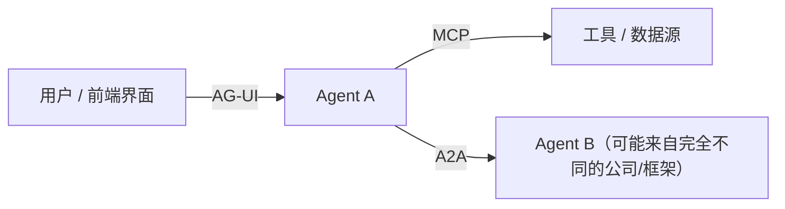
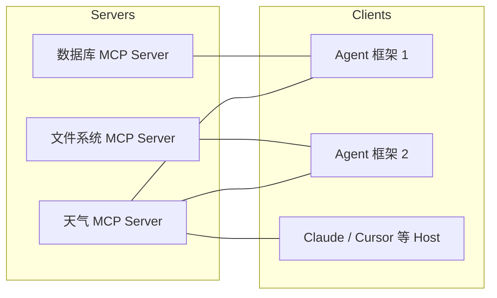
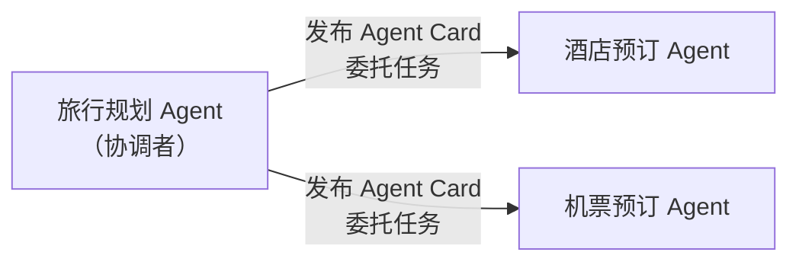
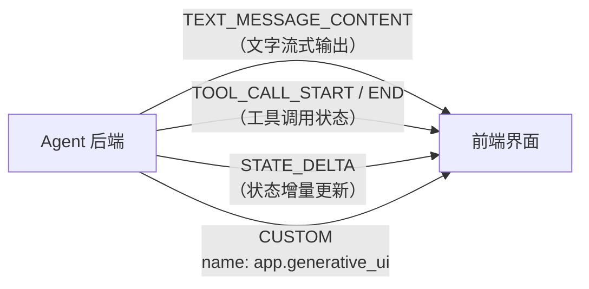

# 8. 智能体协议家族（Agent Protocol Family）——MCP、A2A 与 AG-UI 的连接对象

## 本章目标

完成本章学习后，你将理解：

- 为什么每接入一个新工具、新Agent、新前端都单独适配是不可持续的
- **MCP（Model Context Protocol）**：Agent 如何统一连接工具与数据源
- **A2A（Agent2Agent）**：Agent 如何统一连接另一个 Agent
- **AG-UI（Agent-User Interaction Protocol）**：Agent 如何统一连接用户前端界面
- 三者的分工与协作关系

---

## N×M 适配问题

假设市面上有 10 种 Agent 框架，还有 20 种常用工具（搜索、数据库、文件系统、日历……）。如果每个框架都要单独适配每一个工具，就需要写 10×20=200 套适配代码——任何一方发生变化，都可能牵动大量重复工作。**这正是 Agent 生态里反复出现的"N×M 适配难题"**，只不过它不止发生在"Agent 连工具"这一个方向，Agent 连另一个 Agent、Agent 连前端界面，都会遇到同样的问题。这也是为什么 2024~2025 年前后，围绕 Agent 陆续出现了三个定位不同、但思路一致的标准协议：

| 协议 | 连接的对象 | 解决的问题 | 发起方 |
|---|---|---|---|
| **MCP**| Agent 与工具/数据源 | Agent 如何统一调用外部能力，不用为每个工具单独适配 | Anthropic |
| **A2A**| Agent 与另一个 Agent | 两个可能来自不同公司、不同框架的 Agent，如何互相声明能力、协商任务、协作完成工作 | Google |
| **AG-UI**| Agent 与用户界面 | Agent 后端如何把"思考中""正在调用工具""生成中间结果"这些过程，以标准化的事件流实时同步给前端 UI | CopilotKit |

### 2026 年的现状：从"各家提案"到"基金会标准"

三个协议的"发起方"已经不是故事的全部：2025 年 12 月，Linux 基金会成立 **Agentic AI Foundation（AAIF）**，Anthropic 把 MCP 捐了进去（同期 OpenAI 捐出 AGENTS.md、Block 捐出 goose）；A2A 也在 2026 年 8 月转入同一基金会。截至 2026 年 11 月：

| 协议 | 最新稳定版本 | 治理 | 关键变化 |
|---|---|---|---|
| MCP | 规范 `2026-07-28`（第 5 版）；Python SDK 2.x | AAIF（Linux 基金会） | 核心改为**无状态**：删除 `initialize` 握手与会话 ID，新增 `server/discover`；Tasks、MCP Apps 变为官方扩展 |
| A2A | `1.0.0`（2026-03） | AAIF | Agent Card 迁到 `/.well-known/agent-card.json`，支持 JWS 签名；明确"不透明执行"原则 |
| AG-UI | 以官方事件 schema 与 SDK 版本为准 | CopilotKit（MIT） | 本章所对照 schema 含 31 种事件；事件包含子智能体归属，版本间集合会演进 |

这一节讲的是**协议的分工与连接对象**，这些是不随版本变化的；具体字段、方法名与废弃策略请以各自当前规范为准——下面会标出 2026 年已经变化的部分。

下面逐一展开。

---

## 一、MCP：让 Agent 统一连接工具

**MCP（Model Context Protocol）** 的解决思路很直接：定义一套统一的协议标准，工具开发者只需要按照这个协议实现一次 **MCP Server**，任何支持 MCP 协议的 Agent（无论用什么框架）都可以直接连接并使用：

N×M 的适配问题，被简化成了"N 个 Server + M 个 Client 各自实现一次协议"，适配工作量从 `N×M` 降到大致 `N+M`。注意这是**工程复杂度的量级变化，不是零成本**：每个 Server 仍要正确暴露能力，每个 Client 仍要处理连接、鉴权、超时与错误，协议本身也不能保证工具质量或数据安全。

**MCP 的三个角色**：

| 角色 | 职责 |
|---|---|
| MCP Server | 暴露具体能力（工具、资源、Prompt 模板），供外部调用 |
| MCP Client | 连接 Server，发现并调用其提供的能力 |
| Host | 承载 Client 的应用程序，例如 Claude、ChatGPT、Cursor、VS Code、GitHub Copilot 等 |

**MCP 最大的价值之一是能力可以被自动发现**：Client 连接 Server 后，可以通过标准方法枚举对方暴露的能力——工具（Tools）用 `tools/list`，资源（Resources）用 `resources/list`，提示模板（Prompts）用 `prompts/list`。所以 MCP 并不只暴露"工具"：资源适合传文件/数据库记录等只读上下文，提示模板适合分发可复用的指令模板。8.1 节的实验只覆盖了 Tools 这一种能力，但不代表 MCP 只有工具。

自动发现省掉的是"人工维护工具清单"，**并不省掉审核**：新 Server 接入时仍需确认它暴露了哪些能力、参数是否可信、权限边界在哪里。

### 2026 年的重大修订：无状态核心与扩展体系

MCP 在 2024 年 11 月发布第一版，到 2026 年 7 月已经是第 5 版。`2026-07-28` 这一版做了一次"伤筋动骨"的重构，理解它才能看懂今年的 MCP 代码：

| 变化 | 之前 | 之后 | 为什么 |
|---|---|---|---|
| 连接模型 | 先 `initialize` 握手，再维持会话（`Mcp-Session-Id`） | **完全无状态**：每个请求自带协议版本与客户端能力（`_meta`） | 请求可以落到任意网关/实例，才能水平扩展、跑在 Serverless 上 |
| 能力协商 | 握手时一次性交换 | 新增 `server/discover` RPC，客户端可先探测版本与能力 | 无握手后需要一个显式的协商入口 |
| 服务端推送 | HTTP GET + `resources/subscribe` | 统一为 `subscriptions/listen` 长连接 | 减少通道种类 |
| 长任务 | 核心协议里的 Tasks | 移出核心，成为官方扩展 `io.modelcontextprotocol/tasks` | 核心保持精简，扩展独立演进 |
| 交互式 UI | 文本/结构化结果 | 官方扩展 **MCP Apps**：工具可返回在对话内渲染的 HTML 界面 | 让"确认、填表、看图表"不必退化成纯文字 |

扩展框架（Extensions）在这次修订中被列为一等公民：客户端与服务端在能力声明里各自列出支持的扩展，不支持的扩展可以安全忽略。这也是 MCP 第一条官方扩展 **MCP Apps**（2026 年 1 月发布）能落地的前提——它用 `ui://` 资源承载界面模板，界面组件通过既有的 MCP JSON-RPC 通道与宿主通信，不另造一套协议。

> **注意废弃窗口**：`roots`、`sampling`、`logging` 三个早期特性在 2026-07-28 版进入废弃期（至少 12 个月），服务端主动发起的请求统一改为"多轮往返（MRTR）"：服务端返回 `resultType: "input_required"`，客户端补齐输入后重试原请求。SDK 1.x 的老代码里常见 `ctx.elicit()`、`ctx.sample()`，它们在 2026-era 连接下会抛 `NoBackChannelError`，必须改成客户端的 `elicitation_callback` / `sampling_callback` 配合 MRTR 循环。

**对学习者意味着什么**：8.1 节的例子必须用 SDK 2.x 的写法才能跑通；而"Server 暴露能力、Client 发现并调用"这个模型没有变——变的只是连接层如何协商版本。

**MCP 与传统 API 的区别**：

| | 传统 API | MCP |
|---|---|---|
| 接入方式 | 每个 API 有自己的文档和调用方式 | 统一协议，Schema 自描述 |
| 能力发现 | 需要人工阅读文档 | 支持自动发现（Tools / Resources / Prompts） |
| 复用性 | 每个应用需要单独适配 | 一次实现，被整个生态复用 |

---

## 二、A2A：Agent 间连接协议

MCP 的工具接口可以封装一次计算、完整工作流甚至另一个 Agent，不能把“没有自主性”作为定义。A2A 面向另一类公开契约：通过能力卡片、消息、任务状态与产物委托工作。例如旅行规划服务联系不同公司的酒店与机票服务，不需要知道它们内部是确定性程序还是模型驱动的循环。**边界在交互契约，不在实现是否会思考。**

A2A 协议的核心机制是 **Agent Card**——每个 Agent 对外发布一份标准化的"能力说明书"，声明自己叫什么、能做什么、支持哪些鉴权方式、从哪里连接。但 Agent Card 只是入口，完整的 A2A 交互还包括**任务生命周期（Task Lifecycle）**：提交任务、查询状态、流式接收进度、取消任务，以及交换**消息（Message）** 和**产物（Artifact）**。协调者委托的是一整个任务，不需要关心对方内部怎么实现——对方完全可能内部也在跑一套自己的 Agent Loop（第 6 章），经过多轮思考和工具调用才完成。

A2A 在 2026 年 3 月发布 **1.0** 稳定版，几个细节值得记住（早期文章里常见的写法已经过时）：

| 项目 | 1.0 的约定 | 早期写法（已过时） |
|---|---|---|
| Card 位置 | `https://{domain}/.well-known/agent-card.json` | `/.well-known/agent.json` |
| 必需字段 | `name`、`description`、`version`、`supportedInterfaces`（含 `url`、`protocolBinding`、`protocolVersion`）、`capabilities`、`defaultInputModes`、`defaultOutputModes`、`skills` | 只有 `name` + `skills` |
| 卡片完整性 | 可选 JWS + JCS 规范化签名；验签依赖可信密钥，身份和授权还可使用 TLS/OAuth 等机制 | 无此签名约定 |
| 传输绑定 | JSON-RPC 2.0、gRPC、HTTP+JSON（REST） | 仅 JSON-RPC over HTTP |
| 执行可见性 | **不透明执行（Opaque Execution）**：只依赖公开的 Card 与消息，不访问对方内部状态、规划过程与工具实现 | 常被误解为"共享上下文" |

"不透明执行"是 A2A 与"多 Agent 共用一个黑板"最本质的区别：它把对方当成一个有契约的服务，而不是一个可被窥探的内部模块。这也意味着 A2A 的难点不在"发现"，而在**长任务的状态一致性**：对方超时、取消、部分完成、产物格式不符时，协调者必须有明确的处理策略。

**A2A 与 MCP 的关键区别**：

| | MCP | A2A |
|---|---|---|
| 公开契约 | 工具、资源与提示模板；工具内部可包含 Agent | 能力提供方；内部也可以是确定性服务 |
| 交互方式 | 能力发现与调用，也可配合长任务扩展 | 基于 Agent Card 发现能力，围绕消息、任务生命周期交换产物 |
| 典型场景 | Agent 连接数据库、搜索引擎 | 不同公司独立开发的 Agent 互相协作 |

---

## 三、AG-UI：让 Agent 统一连接用户界面

前两个协议解决的都是 Agent"向外"连接的问题，AG-UI 解决的则是 Agent"向内"连接用户的问题：一个 Agent 的完整工作过程——多轮思考、调用工具、生成图表、请求用户确认——如果只靠最后返回一段文字，用户体验会很差；但如果每换一个 Agent 框架，就要重新设计一套前后端通信方式，成本也同样不可持续。

**AG-UI（Agent-User Interaction Protocol）** 定义了一套标准化的**事件流**，让 Agent 后端把工作过程中的每一个关键节点，都实时同步给前端：

任何遵循这套协议的前端界面，都能实时展示 Agent 后端"正在做什么"，而不需要为每一个 Agent 框架单独定制一套前后端协议——这本质上和 MCP 解决"Agent 连接工具"是同一个思路，只是换成了"Agent 连接前端界面"这一个方向。

AG-UI 把交互收敛成“一个请求进（`RunAgentInput`）、一条带类型的事件流出”。本章对照的 schema 含 31 种事件，但不把这个数量当作永远不变的兼容性条件。可按运行生命周期、文本消息、工具调用、状态同步、活动、推理、子智能体、特殊事件理解；`RAW` 与 `CUSTOM` 属于特殊事件，不能遗漏子智能体家族。官方文档另列草案与弃用事件，具体支持集合以锁定的 schema/SDK 版本为准，不在这里声称未经证实的 1.0 冻结日期。

图中的 `CUSTOM` 是标准事件类型，`name: "app.generative_ui"` 则是应用自定义名称，需要前后端约定其 `value` 格式。`GENERATIVE_UI` 不是标准事件枚举；选择自定义事件并不会让任意前端自动理解组件。

上文出现的 `TEXT_MESSAGE_CONTENT`、`TOOL_CALL_START`、`STATE_DELTA` 都是官方 schema 中存在的事件类型；其中 `STATE_DELTA` 采用 JSON Patch 表达"共享状态改了什么"，前端据此增量更新，而不是每次重传整份状态。若某个框架只实现了子集，其余事件仍需按规范处理或显式声明不支持。

---

## 四、三者的协作关系

MCP、A2A、AG-UI 互不冲突，反而经常同时出现在同一个系统里：一个 Agent 内部通过 MCP 连接各种工具，对外通过 A2A 和其他公司的 Agent 协作，同时通过 AG-UI 把整个过程实时呈现给用户。三者合在一起，覆盖了 Agent 对外连接中最常见的三个方向——**连工具、连 Agent、连用户**。

但不要理解成"三个协议就覆盖了全部场景"：身份与授权、支付、审计、数据合规等仍然需要额外标准或自研机制。

### 完整机制：从发起委托到产物交付

把三者放进一次真实的跨组织协作里，链路会依次穿过"发现 → 委托 → 执行回传 → 交付 → 收尾"五个阶段。下面以 A2A 委托为例，MCP 调用是第 2～4 阶段的局部特例（把"任务"换成"工具调用"），AG-UI 则把第 3 阶段的状态序列透传给前端：

| 阶段 | 输入 | 操作 | 产物 |
|---|---|---|---|
| 发现 | 对方端点地址 | 拉取 Agent Card；MCP 侧对应 `server/discover` 与 `tools/list` / `resources/list` | 能力清单：任务类型、参数 Schema、鉴权方式 |
| 委托 | 用户目标 + 能力清单 | 按 Schema 组装任务描述与凭据，创建任务 | 任务 ID 与初始状态（如 `submitted`） |
| 执行回传 | 任务 ID | 订阅或轮询状态，同时转成 AG-UI 事件 | 状态序列、进度消息、中间日志 |
| 交付 | 终态 + 产物（Artifact） | 取产物并校验格式与来源 | 可用的结果对象（含引用与数据版本） |
| 收尾 | 任务记录 | 落 Trace（第 10 章）、释放订阅与凭据 | 可审计的调用记录 |

**完成判据**：终态为"完成"且产物通过格式/内容校验才算成功，HTTP 200 或"对方已接收"都不算。**失败边界**：超时、取消、部分完成、鉴权失效都必须映射为显式终态，并由协调者记成一次可回放的失败观察（第 6 章），而不是悄悄退化成空结果。

---

想亲手搭建一个真实的 MCP Server，并让 Agent 通过标准协议调用它，可以看这一节实验：[8.1 搭建 MCP Server——让智能体通过 MCP 协议调用工具](<./8.1%20搭建%20MCP%20Server——让智能体通过%20MCP%20协议调用工具.md>)。想用同进程模拟理解 A2A 的能力声明与委托思想（不是协议互操作实验），可以看：[8.2 使用 A2A 协议实现两个智能体之间的协作](<./8.2%20使用%20A2A%20协议实现两个智能体之间的协作.md>)。

---

## 本章实验

- [8.1 搭建 MCP Server——让智能体通过 MCP 协议调用工具](<./8.1%20搭建%20MCP%20Server——让智能体通过%20MCP%20协议调用工具.md>)
- [8.2 使用 A2A 协议实现两个智能体之间的协作](<./8.2%20使用%20A2A%20协议实现两个智能体之间的协作.md>)

## 本章总结

本章我们理解了：

- 没有统一协议时，Agent 对外连接的每一个方向都会遇到 N×M 的重复适配问题
- MCP 通过统一的 Server/Client/Host 架构，把工具接入的适配量级从 N×M 降到约 N+M
- MCP 不只暴露 Tools，还包括 Resources 与 Prompts
- A2A 通过 Agent Card 发现能力，并围绕任务生命周期交换消息与产物；1.0 起强调"不透明执行"
- AG-UI 通过标准化事件流，让 Agent 的工作过程可以被前端实时展示
- 三者分别覆盖"连工具""连 Agent""连用户"三个常见方向，但不是全部协议需求
- MCP 与 A2A 都已进入 Linux 基金会下的 Agentic AI Foundation，协议演进不再由单一厂商决定

> **MCP 连接 Agent 与能力，A2A 连接 Agent 与 Agent，AG-UI 连接 Agent 与用户。**

## 下一章预告

三个协议解决的都是 Agent"如何连接外部"的问题，但还有一个问题一直没有回答：一个 Agent 遇到"写一份财务报表"这样需要多个步骤、大量专业知识的复杂任务时，靠零散的 Tool Calling 够用吗？下一章，我们将进入 2025 年底成为跨厂商公开标准、如今已被数十个产品采用的概念：

> **第 9 章 技能（Skill）——智能体如何封装、加载与复用专业能力**

---

## 思考题

1. MCP、A2A、AG-UI 分别连接的是什么和什么？为什么需要三个不同的协议？
2. MCP 相比“把工具写成函数直接注册给模型”多提供了什么能力？

---

## 参考资料

- MCP 官方规范（当前版本 2026-07-28）：https://modelcontextprotocol.io/
- MCP 加入 Agentic AI Foundation 的公告：https://blog.modelcontextprotocol.io/posts/2025-12-09-mcp-joins-agentic-ai-foundation/
- A2A 协议项目与 1.0 规范：https://github.com/a2aproject/A2A
- AG-UI 官方文档：https://docs.ag-ui.com/
