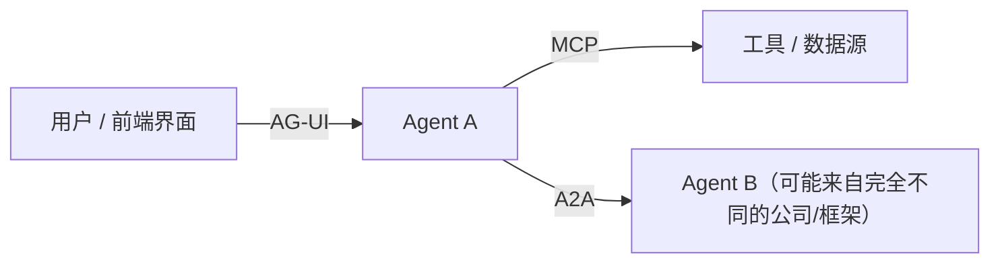
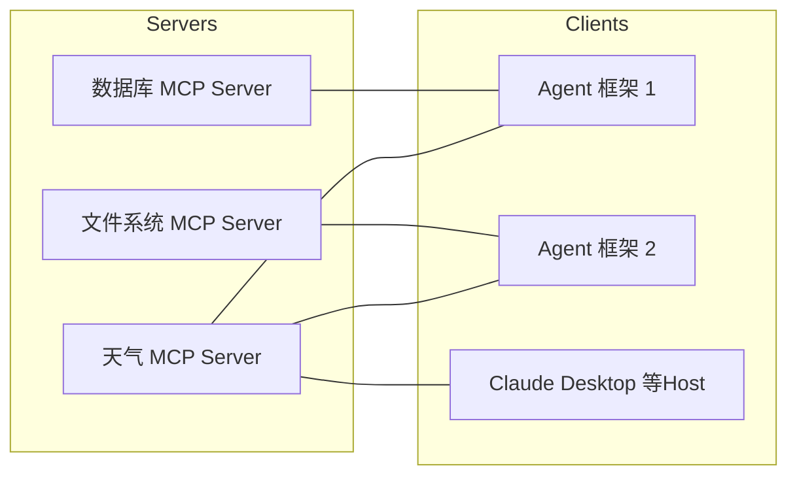
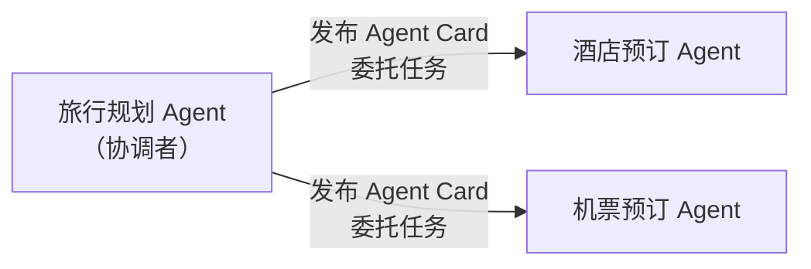
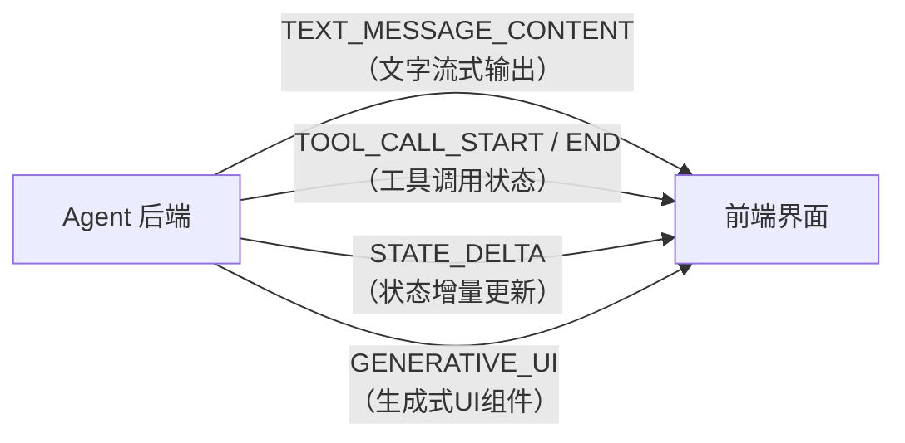

# 9. 智能体协议家族（Agent Protocol Family）——MCP、A2A 与 AG-UI 的连接对象

## 本章目标

完成本章学习后，你将理解：

- 为什么每接入一个新工具、新Agent、新前端都单独适配是不可持续的
- **MCP（Model Context Protocol）**：Agent 如何统一连接工具与数据源
- **A2A（Agent2Agent）**：Agent 如何统一连接另一个 Agent
- **AG-UI（Agent-User Interaction Protocol）**：Agent 如何统一连接用户前端界面
- 三者的分工与协作关系

---

## 一个 N×M 的适配难题

假设市面上有 10 种 Agent 框架，还有 20 种常用工具（搜索、数据库、文件系统、日历……）。如果每个框架都要单独适配每一个工具，就需要写 10×20=200 套适配代码——任何一方发生变化，都可能牵动大量重复工作。**这正是 Agent 生态里反复出现的"N×M 适配难题"**，只不过它不止发生在"Agent 连工具"这一个方向，Agent 连另一个 Agent、Agent 连前端界面，都会遇到同样的问题。这也是为什么 2024~2025 年前后，围绕 Agent 陆续出现了三个定位不同、但思路一致的标准协议：

| 协议 | 连接的对象 | 解决的问题 | 发起方 |
|---|---|---|---|
| **MCP** | Agent↔ 工具/数据源 | Agent 如何统一调用外部能力，不用为每个工具单独适配 | Anthropic |
| **A2A** | Agent ↔ 另一个 Agent | 两个可能来自不同公司、不同框架的 Agent，如何互相声明能力、协商任务、协作完成工作 | Google |
| **AG-UI** | Agent ↔ 用户界面 | Agent 后端如何把"思考中""正在调用工具""生成中间结果"这些过程，以标准化的事件流实时同步给前端 UI | CopilotKit |

下面逐一展开。

---

## 一、MCP：让 Agent 统一连接工具

**MCP（Model Context Protocol）**的解决思路很直接：定义一套统一的协议标准，工具开发者只需要按照这个协议实现一次 **MCP Server**，任何支持 MCP 协议的 Agent（无论用什么框架）都可以直接连接并使用：

N×M 的适配问题，被简化成了"N 个 Server + M 个 Client 各自实现一次协议"，适配工作量从 `N×M` 降到大致 `N+M`。注意这是**工程复杂度的量级变化，不是零成本**：每个 Server 仍要正确暴露能力，每个 Client 仍要处理连接、鉴权、超时与错误，协议本身也不能保证工具质量或数据安全。

**MCP 的三个角色**：

| 角色 | 职责 |
|---|---|
| MCP Server | 暴露具体能力（工具、资源、Prompt 模板），供外部调用 |
| MCP Client | 连接 Server，发现并调用其提供的能力 |
| Host | 承载 Client 的应用程序，例如 Claude Desktop、某个 Agent 框架 |

**MCP 最大的价值之一是能力可以被自动发现**：Client 连接 Server 后，可以通过标准方法枚举对方暴露的能力——工具（Tools）用 `list_tools()`，资源（Resources）用 `list_resources()`，提示模板（Prompts）用 `list_prompts()`。所以 MCP 并不只暴露"工具"：资源适合传文件/数据库记录等只读上下文，提示模板适合分发可复用的指令模板。9.1 节的实验只覆盖了 Tools 这一种能力，但不代表 MCP 只有工具。

自动发现省掉的是"人工维护工具清单"，**并不省掉审核**：新 Server 接入时仍需确认它暴露了哪些能力、参数是否可信、权限边界在哪里。

**MCP 与传统 API 的区别**：

| | 传统 API | MCP |
|---|---|---|
| 接入方式 | 每个 API 有自己的文档和调用方式 | 统一协议，Schema 自描述 |
| 能力发现 | 需要人工阅读文档 | 支持自动发现（Tools / Resources / Prompts） |
| 复用性 | 每个应用需要单独适配 | 一次实现，被整个生态复用 |

---

## 二、A2A：让 Agent 统一连接另一个 Agent

MCP 连接的是工具——一种**本身没有自主性**的资源，Client 单向地"调用"它，工具只会执行、不会思考。但Agent 生态里还有另一类连接需求：**一个 Agent 需要和另一个同样具备自主决策能力的 Agent协作**，例如一个"旅行规划 Agent"需要联系"酒店预订 Agent"和"机票预订 Agent"，而这两个 Agent 可能由完全不同的公司、用完全不同的框架构建——这正是 **A2A（Agent2Agent）**协议要解决的问题。

A2A 协议的核心机制是 **Agent Card**——每个 Agent 对外发布一份标准化的"能力说明书"，声明自己叫什么、能做什么、支持哪些鉴权方式、从哪里连接。但 Agent Card 只是入口，完整的 A2A 交互还包括**任务生命周期（Task Lifecycle）**：提交任务、查询状态、流式接收进度、取消任务，以及交换**消息（Message）**和**产物（Artifact）**。协调者委托的是一整个任务，不需要关心对方内部怎么实现——对方完全可能内部也在跑一套自己的 Agent Loop（第 6 章），经过多轮思考和工具调用才完成。

这也意味着 A2A 的难点不在"发现"，而在**长任务的状态一致性**：对方超时、取消、部分完成、产物格式不符时，协调者必须有明确的处理策略。

**A2A 与 MCP 的关键区别**：

| | MCP | A2A |
|---|---|---|
| 连接的对象 | 工具（没有自主决策能力） | 另一个 Agent（自己也会思考、决策） |
| 交互方式 | 调用某个具体工具，一问一答 | 基于 Agent Card 发现能力，围绕任务生命周期交换消息与产物 |
| 典型场景 | Agent 连接数据库、搜索引擎 | 不同公司独立开发的 Agent 互相协作 |

---

## 三、AG-UI：让 Agent 统一连接用户界面

前两个协议解决的都是 Agent"向外"连接的问题，AG-UI 解决的则是 Agent"向内"连接用户的问题：一个 Agent 的完整工作过程——多轮思考、调用工具、生成图表、请求用户确认——如果只靠最后返回一段文字，用户体验会很差；但如果每换一个 Agent 框架，就要重新设计一套前后端通信方式，成本也同样不可持续。

**AG-UI（Agent-User Interaction Protocol）**定义了一套标准化的**事件流**，让 Agent 后端把工作过程中的每一个关键节点，都实时同步给前端：

任何遵循这套协议的前端界面，都能实时展示 Agent 后端"正在做什么"，而不需要为每一个 Agent 框架单独定制一套前后端协议——这本质上和 MCP 解决"Agent 连接工具"是同一个思路，只是换成了"Agent 连接前端界面"这一个方向。

事件名称（如 `TEXT_MESSAGE_CONTENT`、`TOOL_CALL_START`、`STATE_DELTA`）在这里是**示例**，用于说明事件流的粒度；具体名称、字段与语义应以 AG-UI 当前规范为准，不同实现也可能有扩展事件。

---

## 四、三者的协作关系

MCP、A2A、AG-UI 互不冲突，反而经常同时出现在同一个系统里：一个 Agent 内部通过 MCP 连接各种工具，对外通过 A2A 和其他公司的 Agent 协作，同时通过 AG-UI 把整个过程实时呈现给用户。三者合在一起，覆盖了 Agent 对外连接中最常见的三个方向——**连工具、连 Agent、连用户**。

但不要理解成"三个协议就覆盖了全部场景"：身份与授权、支付、审计、数据合规等仍然需要额外标准或自研机制。

---

想亲手搭建一个真实的 MCP Server，并让 Agent 通过标准协议调用它，可以看这一节实验：[9.1 搭建 MCP Server——让智能体通过 MCP 协议调用工具](<./9.1%20搭建%20MCP%20Server——让智能体通过%20MCP%20协议调用工具.md>)。想接着体验 A2A 协议下两个 Agent 如何互相声明能力并协作，可以看：[9.2 使用 A2A 协议实现两个智能体之间的协作](<./9.2%20使用%20A2A%20协议实现两个智能体之间的协作.md>)。

---

## 本章实验

- [9.1 搭建 MCP Server——让智能体通过 MCP 协议调用工具](<./9.1%20搭建%20MCP%20Server——让智能体通过%20MCP%20协议调用工具.md>)
- [9.2 使用 A2A 协议实现两个智能体之间的协作](<./9.2%20使用%20A2A%20协议实现两个智能体之间的协作.md>)

## 本章总结

本章我们理解了：

✅ 没有统一协议时，Agent 对外连接的每一个方向都会遇到 N×M 的重复适配问题 ✅ MCP 通过统一的 Server/Client/Host 架构，把工具接入的适配量级从 N×M 降到约 N+M ✅ MCP 不只暴露 Tools，还包括 Resources 与 Prompts ✅ A2A 通过 Agent Card 发现能力，并围绕任务生命周期交换消息与产物 ✅ AG-UI 通过标准化事件流，让 Agent 的工作过程可以被前端实时展示 ✅ 三者分别覆盖"连工具""连 Agent""连用户"三个常见方向，但不是全部协议需求

> **MCP 连接 Agent 与能力，A2A 连接 Agent 与 Agent，AG-UI 连接 Agent 与用户。**

## 下一章预告

三个协议解决的都是 Agent"如何连接外部"的问题，但还有一个问题一直没有回答：一个 Agent 遇到"写一份财务报表"这样需要多个步骤、大量专业知识的复杂任务时，靠零散的 Tool Calling 够用吗？下一章，我们将进入一个刚刚兴起、但已经迅速流行的概念：

> **第 10 章 技能（Skill）——智能体如何封装、加载与复用专业能力**

---

## 思考题

1. MCP、A2A、AG-UI 分别连接的是什么和什么？为什么需要三个不同的协议？
2. MCP 相比“把工具写成函数直接注册给模型”多提供了什么能力？

---

## 参考资料

- MCP 官方规范：https://modelcontextprotocol.io/
- A2A 协议项目：https://github.com/a2aproject/A2A
- AG-UI 官方文档：https://docs.ag-ui.com/
