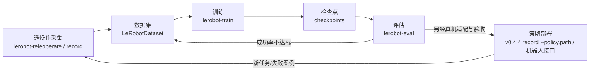

# 10.5 使用 LeRobot 实现操作策略的完整生命周期

> **本节定位**：给出锁定版本的数据、训练、检查点与评测参考链路，部署只说明接口边界；本次修订未全栈实测。
>
> **硬件要求**：CPU 可做少步 smoke test；完整训练可选 GPU，真机部署另需机器人与安全验收。
>
> **实验目标**
>
> 第 6 章我们理解了 ACT / Diffusion Policy 的算法，第 10 章正文介绍了 LeRobotDataset 格式——但把它们真正跑起来，还需要数据集加载、归一化、训练循环、检查点、评估这一整套"胶水"。本节用 Hugging Face 的 **LeRobot** 框架，给出待本机逐段验收的参考流程：
>
> **数据集 → 训练 → 检查点 →（评估/部署）**
>
> 核心数据/训练路线不需要真实机器人，使用 **pushT**（二维推块任务）。本节锁定 **LeRobot 0.4.4**。CPU 路线用于小规模 smoke test，可能很慢；GPU 加速、仿真评测和真机部署分开验收。原稿的特定 GPU 日志未在本次修订复核，以下不把它们作为新版命令的已测结果，也不承诺几分钟完成。

---

# 一、安装与自检

第 10 章第五节讲过 LeRobotDataset 的设计；本节实际用到的是 LeRobot 的三项能力：数据集加载、开箱即用的策略库（`act`、`diffusion` 等），以及统一的机器人接口（第 14 章会用到）。

安装并自检：

```bash
# 在独立的 Python 3.11 环境中；pusht extra 用于后续仿真评测
pip install "lerobot[pusht]==0.4.4"
ffmpeg -version
lerobot-info
```

检查 `lerobot-info` 的版本是否为 `0.4.4`，保存 Python、PyTorch、视频解码后端与设备信息。若 `ffmpeg` 不存在，先按操作系统/官方安装指南配置兼容的视频依赖，不能只安装 Python 包就假定 MP4 解码可用。本节不把某套 CUDA 日志冒充 CPU 安装结果；下载数据/视觉骨干需要网络、磁盘空间及相应授权。

注意脚本清单：`lerobot-record`（采集）、`lerobot-teleoperate`（遥操作）、`lerobot-train`（训练）、`lerobot-eval`（评估）、`lerobot-replay`（回放）。这些是不同环节的入口，安装自检不等于数据、策略评测或真机部署已通过。

---

# 二、数据集：lerobot/pusht

**pushT** 是 Diffusion Policy 论文（Chi et al. 2023）提出的经典基准任务：用一个圆形推块，把 "T" 形工件推到目标位置。数据集已经开源在 Hugging Face Hub 上（`lerobot/pusht`），不需要自己采集。

用 LeRobot 训练时，数据集会自动从 Hub 下载。下列是字段示意（`meta/info.json`）；计数来自原稿采用的数据快照，不是对 Hub 最新版本的保证。复现时应固定数据 revision 并核验 v0.4.4 loader 所需格式：

```json
{
  "total_episodes": 206,
  "total_frames": 25650,
  "total_tasks": 1,
  "fps": 10,
  "features": {
    "observation.image":  { "dtype": "video",  "shape": [96, 96, 3] },
    "observation.state":  { "dtype": "float32", "shape": [2] },
    "action":             { "dtype": "float32", "shape": [2] }
  }
}
```

206 条示范轨迹、25,650 帧画面——注意这个规模相比 LLM 的训练数据小到可以忽略，但第 7 章讲过：**机器人数据不能只看总量，还要看质量、多样性与任务覆盖**。每条轨迹的 `observation.image` 是俯视相机拍下的 96×96 画面（以视频形式存储），`observation.state` 和 `action` 是 2 维的推块/末端位置——这正是第 10 章正文讲的"**视频存视觉、Parquet 存数值**"分离存储设计。

---

# 三、训练：一条命令跑通 ACT

下面这条命令，用第 6 章讲过的 **ACT** 策略在 pushT 上训练：

```bash
lerobot-train \
  --dataset.repo_id=lerobot/pusht \
  --policy.type=act \
  --policy.device=cpu \
  --policy.push_to_hub=false \
  --output_dir=outputs/pusht/act_short \
  --steps 1000 \
  --log_freq 100 \
  --batch_size 32
```

几个参数的含义：`--policy.type=act` 选择策略（还支持 `diffusion`、`pi0`、`smolvla`、`vqbet` 等，用 `lerobot-train --help` 查看完整列表）；`--output_dir` 指定输出目录；`--steps 1000` 是训练步数（官方完整训练默认 10 万步，这里为了演示只跑 1000 步）；`--policy.push_to_hub=false` 告诉它训练完不要自动把模型推送到 Hub（如果去掉这个参数，还需要指定 `--policy.repo_id` 说明推到哪个仓库）。

**运行与结果边界**：CPU 首次可把 `--steps` 改成 10、`--batch_size` 改成 2 做 smoke test；确认数据解码、前后向和保存检查点后再扩大预算。1000 步仍只是短程训练，不表示收敛。GPU 路线显式把 `--policy.device=cpu` 改成 `cuda`，并单独记录设备、耗时和结果，不能把 GPU 吞吐套用到 CPU。

ACT 的训练目标包含重建与 KL 项（原始 ACT 是 L1 + βKL；推理通常取 `z=0`，见第6章），训练 loss 下降不等于闭环成功率提高。这里没有新版实测日志，也不承诺 10 万步或某个成功率就得到“工业级策略”；部署还需要分布外测试、可靠性、时延和安全验收。

---

# 四、检查点：训练留下了什么

训练成功并保存检查点后，目录结构应类似下例（**字段、文件编号与步号示意**，以实际配置为准）。`001000` 对应 1000 步，若 smoke test 只跑 10 步，后续评测路径必须改成实际生成的目录：

```text
outputs/pusht/act_short/
└── checkpoints/001000/
    ├── pretrained_model/
    │   ├── model.safetensors              # 模型权重（参数量和文件大小依配置/精度而定）
    │   ├── config.json                    # 模型架构配置
    │   ├── policy_preprocessor.json       # 输入预处理(含数据归一化器)
    │   ├── policy_preprocessor_step_3_normalizer_processor.safetensors
    │   ├── policy_postprocessor.json      # 输出后处理(含动作反归一化器)
    │   └── policy_postprocessor_step_0_unnormalizer_processor.safetensors
    └── training_state/
        ├── optimizer_state.safetensors    # 优化器状态(断点续训用)
        ├── optimizer_param_groups.json
        ├── rng_state.safetensors
        └── training_step.json
```

这个目录结构本身就是一次"工程课"：

- `model.safetensors` 是模型权重，`config.json` 是架构描述——**推理时两个都要**；
- `policy_preprocessor` / `policy_postprocessor` 是**数据归一化器**：训练时数据被归一化到标准范围，部署时输入也必须走同一套归一化，输出的动作还要反归一化回真实物理单位——这对应第6章策略输入输出与本节预处理契约的一致性，**部署时漏掉它们，策略会直接失效**；
- `training_state/` 保存了优化器状态和随机数状态，用于 `--resume=true` 断点续训（第 8 章训练循环的工程化配套）。

---

# 五、评估与部署：生命周期的另一半

训练出检查点之后，标准流程还有两步：

**评估**（在仿真环境里量化策略质量）：

```bash
lerobot-eval --policy.path=outputs/pusht/act_short/checkpoints/001000/pretrained_model \
  --policy.device=cpu --env.type=pusht --eval.batch_size=1 --eval.n_episodes=50
```

评估需要对应的仿真环境（这里就是 pushT 的二维推块模拟器），它会统计成功率等指标——本书写作环境未安装该仿真依赖，故本节没有实际运行评估；在你自己的机器上，`lerobot-eval --help` 会给出完整参数。

**回放与部署不能混淆**：在锁定的 **v0.4.4** 中，`lerobot-replay --dataset.repo_id=... --dataset.episode=0` 是把**已有数据集动作轨迹**发给机器人，不加载 checkpoint 做闭环策略推理。策略驱动的真机采集使用 `lerobot-record --policy.path=...`，还必须提供匹配的 `--robot.*`、`--dataset.*`、相机、校准与安全配置。这里不提供可直接控制任意机器人运动的通用命令，pushT 检查点也不能直接用于真实机械臂。不能把后续版本的 rollout 命令混入 v0.4.4。

已按 [v0.4.4 replay 源码](https://github.com/huggingface/lerobot/blob/v0.4.4/src/lerobot/scripts/lerobot_replay.py) 与 [record 源码](https://github.com/huggingface/lerobot/blob/v0.4.4/src/lerobot/scripts/lerobot_record.py) 核验这一区别；真机部署仍未实测。



---

# 六、实验分析：这一条流水线串起了本书的哪些知识

| 环节 | 对应的本书内容 |
|---|---|
| 数据集格式（视频 + Parquet、Hub 托管） | 第 10 章正文（LeRobotDataset） |
| ACT 策略（CVAE + Transformer、动作分块） | 第 6 章（现代模仿学习策略） |
| 训练循环（前向 → Loss → 反向 → 更新） | 第 8 章正文、第 3.1/4.1 节实验 |
| 归一化/反归一化预处理 | 第6章及本节第四节（输入输出契约） |
| 断点续训、检查点管理 | 第二部分第10章（检查点与训练工程） |
| 数据采集与迭代（飞轮） | 第 13 章（数据工程与数据飞轮） |

> **算法之外还需要数据、预处理、检查点、评测与运行时控制。LeRobot 提供统一接口，但接口可用性和策略质量仍需在固定版本与本机环境逐项验收。**

---

# 七、思考题

1. 固定模型规模、设备与数据预算，分别测量 ACT / Diffusion Policy 的训练吞吐和推理延迟，不预设谁更快。扩散训练通常采样一个噪声时刻，完整去噪链主要影响推理，不能拿推理迭代数直接解释训练耗时。
2. 如果去掉 `--policy.push_to_hub=false` 直接运行，会发生什么？提示：`train_config.py` 的校验逻辑会要求你提供什么？
3. 先测本机吞吐再估算 `--steps=20000` 的预算，观察 loss 与独立评测是否一致；实际检查点路径和保存频率是什么？
4. 检查点里的 `policy_preprocessor` 为什么必须在部署时原样带上？如果推理时跳过归一化直接输入原始像素，会发生什么？

---

# 本实验总结

- LeRobot 提供数据、策略与机器人接口；`lerobot-info` 只验证安装信息，实际链路仍需单独测试
- `lerobot/pusht` 是开源的 206 条轨迹标准数据集，视觉存视频、数值存 Parquet
- 锁定 0.4.4、显式 CPU device，先做 smoke test；本次未实测新版训练/评测，不以 loss 下降代替任务验收
- 检查点 = 权重 + 架构配置 + 归一化器 + 优化器状态，四者各有用途
- 完整生命周期是 采集 → 数据集 → 训练 → 检查点 → 评估 → 部署 的闭环，失败案例会重新进入数据集（数据飞轮）

> **第 6 章让你理解了策略的算法，本节让你拥有了策略的"生产线"。**

---

# 参考资料

- Hugging Face LeRobot 官方文档与仓库：https://github.com/huggingface/lerobot
- pushT 数据集（lerobot/pusht）：https://huggingface.co/datasets/lerobot/pusht
- Chi et al. (2023) *Diffusion Policy: Visuomotor Policy Learning via Action Diffusion*（pushT 基准的出处）
- 陈天行《Embodied-AI-Guide》"动手学习具身智能操作"章节（用 RoboTwin 走通同一生命周期的另一条路线）：https://github.com/TianxingChen/Embodied-AI-Guide
