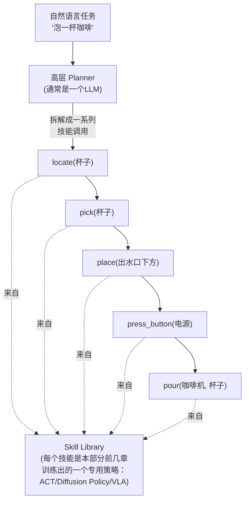
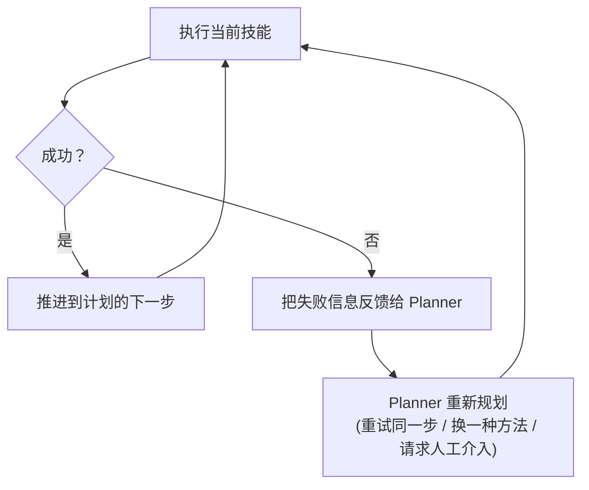

# 12. 长时程任务与分层智能体——大语言模型规划器（LLM Planner）遇上技能库（Skill Library）

> **本章目标**
>
> - 理解长时程任务的误差累积与验收难点，以及分层和端到端路线的不同取舍
> - 系统性地理解具身智能里三种根本不同的架构路线：分层式、端到端、混合式
> - 理解如何把第三部分学过的 Agent 分层规划思想，重新应用到具身智能场景
> - 理解 Skill Library（技能库）+ LLM Planner（高层规划器）这种分层架构
> - 理解失败检测与重新规划（Replanning）对长时程任务的重要性

---

# 一、为什么"泡一杯咖啡"比"抓取一个杯子"难得多

本部分从第2章到第 11 章讨论的所有内容——运动学、强化学习、模仿学习、感知、ACT/Diffusion Policy、VLA、World Model——本质上解决的都是**相对短时程、单一目标明确的动作任务**：抓取一个物体、导航到一个位置、绕开一个障碍。但真实世界里很多有价值的任务，是由一长串这样的"短时程动作"按特定顺序、特定条件组合而成的——"泡一杯咖啡"可能需要依次完成"找到杯子→拿起杯子→放到出水口下方→打开咖啡机→等待萃取完成→把杯子端走"这一整套步骤，任何一步做错顺序或者中途失败，整个任务都会失败。

**这正是第三部分讨论过的"Planning（任务分解）"问题，只是这一次，"Action"不再是调用一个数字世界的 API，而是执行一个物理世界的技能。**

---

# 二、三条技术路线：分层式、端到端、混合式

在具体讲这一章的架构之前，有必要先停下来，把本部分从第4章到现在其实已经反复用到、但从未被正式命名和归类的一个问题讲清楚：**一个机器人的"大脑"，到底应该整体设计成什么样子？** 具身智能领域通常把答案归纳为三条根本不同的路线：

**1. 分层式（Hierarchical / Modular）**：把整个任务拆解成"感知 → 规划 → 控制"这类相对独立的模块，每个模块单独设计、单独训练（甚至完全不需要训练，只是纯几何/规则计算），模块之间通过人工定义好的接口传递信息。经典机器人学的技术栈（SLAM 建图 + 路径规划 + PID/MPC 控制器），以及7.1节实验里"VLM 给出抓取像素点 → 第5章反投影成三维坐标 → 第2章逆运动学算出关节角度"这条流水线，都是分层式的典型例子。
- 优点：每一个模块都可以独立调试、独立替换、独立用较少的数据训练或标定（反投影和逆运动学甚至完全不需要任何数据，是纯数学公式）；出问题时容易定位是哪个环节出错。
- 缺点：模块之间的接口是人为设计的，很可能丢失掉一些对完成任务其实有用的信息；某个模块的误差会顺着流水线一路向下游传播、放大（7.1节实验讨论过的"如果 VLM 指错了点，误差会一路传递到最终关节角度"正是这个问题）；每个模块只针对自己的子目标单独优化，不保证拼起来对最终任务是全局最优的。

**2. 端到端（End-to-End）**：用一个模型，直接把最原始的感知信号（甚至加上语言指令）映射到最终的动作输出，中间不设置任何人工设计的模块和接口。第4、6章针对单一任务训练的行为克隆、ACT、Diffusion Policy，以及第 7 章面向多任务、多语言指令的 VLA（RT-1、RT-2、OpenVLA），都属于这条路线。
- 优点：感知到动作可以联合优化，减少手工中间表示的信息瓶颈；但**行为克隆的动作预测损失不等于任务成功率**，低 loss 仍可能因分布偏移、接触误差或长程失败而表现不佳。端到端消除不了训练目标与真实任务目标之间的差距。
- 缺点：需要海量的、针对具体任务和机器人本体采集的数据才能训练好（这正是第 13 章要讨论的数据工程问题）；一旦效果不好，很难像分层式那样逐模块排查到底是哪里出了问题。

**3. 混合式（Hybrid）**：例如高层 LLM 选择技能，低层使用学习策略或经典控制器执行，组合语言规划与可维护的技能接口。

这里必须区分**两个独立维度**：“端到端/联合训练”描述优化与输入输出路径；“时间分层”描述是否有不同时间尺度的子目标、规划与动作执行。一个模型可以同时端到端学习并具有时间层次。**π0 的 VLM 骨干 + action expert 两个计算模块，并不自动构成 LLM Planner + Skill 的任务层次**；π0.5 等模型可以结合高层子任务预测与低层动作生成，说明“端到端”和“分层”并非互斥。技能库也不要求每个技能都是神经网络，PID/MPC/规则技能同样可以封装。

| 路线 | 每一层是否需要学习 | 典型代表 | 核心权衡 |
|---|---|---|---|
| 分层式 | 可以完全不需要（纯几何/规则） | SLAM+规划+控制、7.1节VLM+反投影+IK流水线 | 可解释、易调试，但接口人工设计，误差逐级传播 |
| 端到端 | 感知到动作联合学习 | 第4/6章 BC/ACT/Diffusion Policy、第7章 VLA | 减少中间接口，但代理损失不等于成功率，调试仍困难 |
| 混合式 | 学习与规则均可，是否联合训练另论 | 本章 LLM Planner + Skill Library | 显式时间层次便于复用与验收，仍需处理模块误差 |

**这三条路线不是互相排斥、非此即彼的**，而是在"可解释性/数据效率"与"表达能力/任务目标一致性"这两端之间的不同取舍。本部分到目前为止的内容，其实已经依次覆盖了这三条路线各自的一个具体案例；本章接下来要讲的架构，正是混合式路线在"长时程任务"这个具体问题上的展开。

---

# 三、分层架构：高层 Planner + 底层 Skill Library

长时程任务**并不在数学上要求显式分层**。端到端策略可以利用记忆、历史条件和滚动重规划逐步完成长任务，不必一次性输出全程动作。显式 Planner + Skill 则便于复用技能、检查前后置条件与处理恢复，因此是本章选择的教学与工程路线，而非唯一可行路线：

- **Skill Library（技能库）**：由一组各自独立训练好的、参数化的底层策略组成——每一个技能，本质上就是第4、6、7章讨论过的一个模仿学习/VLA策略（比如 `pick(object_name)`、`place(location)`、`pour(from, to)`），只是被封装成了一个带有明确输入参数、明确成功/失败判定标准的"函数"。这和第三部分第 9 章讲过的 **Skill（Agent 如何拥有可复用的专业能力）** 是完全同一个概念——只是那里的 Skill 封装的是"读写文件、调用 API"，这里封装的是"控制机械臂完成一个具体动作"。
- **高层 Planner**：通常直接就是一个大语言模型，输入自然语言任务描述和当前的场景观测，输出一个有序的技能调用序列——这正是第三部分第3章 **Planning（任务分解）** 和第一章 **ReAct（Thought → Action → Observation）** 在物理世界里的直接复用：LLM 负责"想清楚该做什么、按什么顺序做"，具体"怎么做"则完全下放给 Skill Library 里已经训练好的专用策略。

**这套架构最大的好处是关注点分离**：训练 Skill Library 里的每一个技能，只需要针对这一个具体动作采集数据、训练模型（第2~11章讨论的所有方法都可以用在这里）；而升级"任务规划能力"，很多时候只需要更换或微调 Planner 用的 LLM，完全不需要重新训练底层的运动技能——这和第三部分强调的"LLM 负责语言理解和决策，Tool/Skill 负责具体执行"的设计哲学完全一致。

---

# 四、失败检测与重新规划：真实世界远比"计划"复杂

数字世界的 Agent 调用一个 API 大概率会成功；但物理世界的技能执行，失败是家常便饭——第 8 章讨论过真实抓取的不确定性，一次 `pick(杯子)` 完全可能因为抓取滑脱而失败。**一个只会机械地"按预先写好的计划顺序执行"的系统，一旦某一步失败，整个任务就会卡死。**

真正实用的分层智能体，必须具备**闭环的失败检测与重新规划能力**：

这个闭环，和第三部分第5章 **Reflection（Agent 如何不断自我修正）** 在结构上完全一致——只是这里的"自我批评"，评判标准从"这段代码有没有跑通"变成了"这次抓取有没有真的抓稳"。**谷歌 SayCan（2022）** 是这条路线的代表性早期工作：它让 LLM 结合"每个候选技能，在当前场景下实际可行的概率（Affordance）"，共同决定下一步该执行哪个技能，而不是完全依赖 LLM 的语言层面推理——这正是"语言智能"与"物理世界真实约束"相结合的一个具体范例。

### 完整机制：从一句话任务到执行完毕

把"规划"和"执行"两半接起来，一次长时程任务的完整链路是：

| 阶段 | 输入 | 操作 | 产物 |
|---|---|---|---|
| 1 计划生成 | 自然语言任务、场景观测 | Planner 拆解成带参数的技能序列 | 计划：`locate(杯子) → pick(杯子) → place(出水口) → ...` |
| 2 可行性校验 | 计划、场景中物体与位姿 | 逐个检查前置条件（目标物体是否存在、是否可达），必要时按 Affordance 打分重排序 | 可执行计划，或"需重新分解"的标记 |
| 3 逐步执行 | 当前技能及其参数 | 执行前查前置条件，执行后查该技能的后置条件（如"夹爪闭合且杯子随末端移动"） | 每步的成功/失败标志与末态观测 |
| 4 失败处理 | 失败标志与原因 | 局部重试同一步，或把失败上下文交回 Planner 重新规划 | 修正后的计划 |
| 5 终止判定 | 全部步骤的执行结果 | 检查最终目标条件（"杯子里有咖啡、杯子在位"）是否成立 | 任务成功 / 中止并请求人工介入 |

**完成判据**：各步后置条件依次成立、最终目标为真，才算任务完成——不能用"计划里的技能都调用过一遍"当作成功。**失败边界**：如果同一技能连续重试超过预设次数，或 Planner 连续两次产出同一份被判定为不可执行的计划，说明瓶颈不在执行而在技能能力或场景假设本身（比如杯子根本不在视野内），此时应当中止并请求人工介入，而不是无限重试把时间和硬件寿命耗在一次注定失败的任务上。

---

想亲手实现一个包含失败检测和重新规划的具身智能体，可以看这一节实验：**12.1 实现一个任务分解与技能调度的具身 Agent**。

---

# 本章总结

- 长时程任务可用显式技能分解，也可用带记忆/滚动执行的端到端策略；联合训练与时间分层是不同维度，没有“数学上必须分层”的结论
- 分层架构用"高层 LLM Planner 负责任务分解 + 底层 Skill Library 负责具体执行"，把本部分前面各章训练出的专用策略，组织成能完成复杂任务的完整系统
- 这套分层架构与第三部分的 Planning、Skill、ReAct、Reflection 等 Agent 设计思想完全同构，只是把"数字世界的工具调用"换成了"物理世界的动作技能"
- 失败检测与重新规划，是把"纸面上的计划"变成"真实世界能够可靠执行的行为"必不可少的闭环机制

> **具身智能不是要抛弃第三部分学到的 Agent 框架、另起炉灶，而是把同一套"语言驱动决策、工具/技能负责执行"的思想，重新安装进一具真实的身体里。**

## 下一章预告

无论是训练 Skill Library 里的每一个底层技能，还是训练像第 7 章那样的通用 VLA 模型，都离不开一个共同的前提——高质量的数据。下一章，我们讨论机器人数据从哪里来、如何越滚越多：

> **第 13 章 机器人数据工程与数据飞轮**

---

# 参考资料

- 陈天行《Embodied-AI-Guide》"长时程任务与具身智能体"章节：https://github.com/TianxingChen/Embodied-AI-Guide
- Ahn et al. (2022) *Do As I Can, Not As I Say*（SayCan 论文，LLM 规划 + 技能执行的经典工作）
