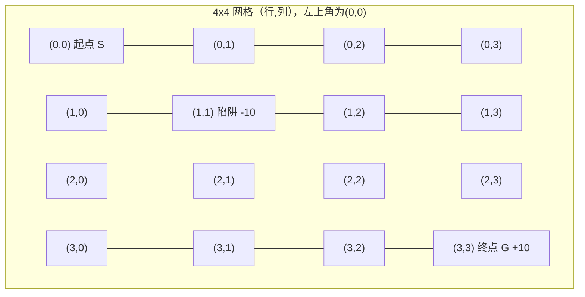

# 3.1 使用 Q-Learning 训练一个走迷宫的智能体

> **本节定位**：本节只做实践。MDP、贝尔曼更新与探索策略见第3章，本节不重复讲解。
>
> **硬件要求**：CPU 即可运行（无需 GPU 与任何机器人硬件）
>
> **本节目标**：用纯 Python 标准库手写一个 4×4 网格世界（GridWorld）和完整的表格型 Q-Learning 算法，让智能体自己通过试错，学会绕开陷阱、走最短路径从起点到达终点。

---

# 一、环境准备

本节代码只使用 Python 标准库（`random`），不依赖任何第三方框架，任何一台装有 Python 3 的电脑都能直接运行。

---

# 二、搭建一个最小的 GridWorld 环境



```python
import random

GRID_SIZE = 4
START = (0, 0)
GOAL = (3, 3)
TRAP = (1, 1)
ACTIONS = ["up", "down", "left", "right"]

def step(state, action):
    """执行一个动作，返回 (下一个状态, 奖励, 是否结束)"""
    r, c = state
    if action == "up":
        r = max(0, r - 1)
    elif action == "down":
        r = min(GRID_SIZE - 1, r + 1)
    elif action == "left":
        c = max(0, c - 1)
    elif action == "right":
        c = min(GRID_SIZE - 1, c + 1)

    next_state = (r, c)
    if next_state == GOAL:
        return next_state, 10.0, True
    if next_state == TRAP:
        return next_state, -10.0, True
    return next_state, -1.0, False   # 每走一步扣1分，鼓励尽快到达终点
```

**本实验的奖励设置**：每步 -1，陷阱 -10 并结束，终点 +10 并结束。训练时可观察这组值如何影响路径长度与到达率。奖励设计的系统讨论见第 8 章，本节不展开。

---

# 三、实现 Q-Learning

```python
def train_q_learning(episodes=2000, alpha=0.1, gamma=0.9,
                      epsilon_start=1.0, epsilon_end=0.01):
    # Q 表：用字典存储，key 是 (state, action)，初始值全部为 0
    Q = {(s_r, s_c, a): 0.0
         for s_r in range(GRID_SIZE) for s_c in range(GRID_SIZE) for a in ACTIONS}

    reward_history = []

    for ep in range(episodes):
        state = START
        epsilon = epsilon_start - (epsilon_start - epsilon_end) * (ep / episodes)  # 线性衰减
        total_reward = 0.0
        done = False
        steps = 0

        while not done and steps < 100:   # 防止死循环，最多走100步
            # ε-greedy 选动作
            if random.random() < epsilon:
                action = random.choice(ACTIONS)                      # 探索
            else:
                action = max(ACTIONS, key=lambda a: Q[(*state, a)])  # 利用

            next_state, reward, done = step(state, action)

            # Q-Learning 核心更新公式
            best_next_q = max(Q[(*next_state, a)] for a in ACTIONS)
            td_target = reward + gamma * best_next_q * (0 if done else 1)
            td_error = td_target - Q[(*state, action)]
            Q[(*state, action)] += alpha * td_error

            state = next_state
            total_reward += reward
            steps += 1

        reward_history.append(total_reward)

    return Q, reward_history
```

**这段代码和3.5节的更新公式是逐行对应的**：`td_target` 就是 `r + γ·max Q(s',a')`，`td_error` 就是这个目标值和当前 Q 表里存的旧值之间的差距，最后一行 `Q[...] += alpha * td_error` 正是"往正确方向修正一点点"。注意 `done` 为 `True`（走到了终点或陷阱）时，`best_next_q` 那一项要乘以 0——因为回合已经结束，不存在"下一个状态"了。

---

# 四、训练与结果分析

```python
Q, reward_history = train_q_learning(episodes=2000)

# 观察训练早期和后期的平均回合奖励
print("前100轮平均总奖励:", sum(reward_history[:100]) / 100)
print("后100轮平均总奖励:", sum(reward_history[-100:]) / 100)
```

**预期趋势**：训练早期，`epsilon` 接近1，智能体几乎是随机游走，经常一头撞进陷阱或者绕远路，前100轮的平均总奖励通常是负数（具体数值取决于随机种子和探索轨迹）；随着训练推进、`epsilon` 逐渐衰减，智能体越来越多地利用学到的 Q 表做决策，后100轮的平均总奖励应该明显回升，并稳定收敛到一个正数附近。

**这个环境从起点能拿到的最高未折扣总奖励是多少？** 最短安全路径为6步，前5步各扣1分，最后一步得到10分，总计 `5`；在本例 `γ=0.9` 下，更短的安全路径也有更高的折扣回报。但有限轮数、固定学习率和衰减探索并不提供必然收敛保证，后100轮训练回报还混有 `epsilon>0` 的随机动作，不能充当纯策略成绩。

下面独立评测：不更新 Q、不探索，并记录成功、路径长度和是否超时。确定性环境从同一起点重复100次不会增加统计信息，所以直接展示一条轨迹；如要检查全状态最短路径，应另从所有非终止格子评测。

```python
def evaluate_greedy(Q, start=START, max_steps=100):
    state, total, path = start, 0.0, [start]
    for _ in range(max_steps):
        action = max(ACTIONS, key=lambda a: Q[(*state, a)])
        state, reward, terminated = step(state, action)
        total += reward
        path.append(state)
        if terminated:
            return state == GOAL, total, len(path) - 1, False, path
    return False, total, max_steps, True, path

print("贪心评测(成功,总奖励,步数,截断,路径):", evaluate_greedy(Q))
```

从 `START` 学到最短路径的判据是：成功为真、总奖励5、步数6且未截断，而不是仅凭训练回报上升判断。

```python
# 打印每个状态下，Q值最大的动作，还原出学到的贪婪策略
arrow = {"up": "↑", "down": "↓", "left": "←", "right": "→"}
print("\n学到的贪婪策略:")
for r in range(GRID_SIZE):
    row_str = ""
    for c in range(GRID_SIZE):
        if (r, c) == GOAL:
            row_str += " G "
        elif (r, c) == TRAP:
            row_str += " X "
        else:
            best_action = max(ACTIONS, key=lambda a: Q[(r, c, a)])
            row_str += f" {arrow[best_action]} "
    print(row_str)
```

**参考策略示意（手工构造的全状态最短安全路径，不是一次训练的精确输出）**：

```text
 →  →  →  ↓
 ↓  X  →  ↓
 →  →  →  ↓
 →  →  →  G
```

`X` 是进入即终止的陷阱，训练探索时可能进入，只是不会从它继续选动作；`G` 是终点。有限次训练未充分访问的格子不一定学出上图策略，需要逐格评测而不能只看起点成绩。

---

# 五、和 Gymnasium 的对应关系

Gymnasium 的 `FrozenLake-v1` 也有离散格子和终止状态，但它与本实验**不是等价MDP**：默认地图的洞位置、奖励（默认到目标才得1，其余0）、整数动作编码都不同；`is_slippery=False` 只关闭滑动随机性，不会统一这些差异。下面只演示标准接口，不复用本节已训练的 Q 表：

```bash
pip install gymnasium
```

```python
import gymnasium as gym

env = gym.make("FrozenLake-v1", is_slippery=False)   # 确定性转移，但地图和奖励不同
observation, info = env.reset(seed=42)

for _ in range(100):
    action = env.action_space.sample()   # 接口演示；训练时需新建适配该环境的Q表
    observation, reward, terminated, truncated, info = env.step(action)
    if terminated or truncated:
        observation, info = env.reset()
env.close()
```

`terminated` 是到目标/掉进洞等任务终止；`truncated` 是外部时间上限等采样截断。二者都会结束当前采样回合，但通常只有 `terminated` 将TD目标的Bootstrap项置零：`target = reward + gamma * (not terminated) * max_next_q`。截断后须使用截断那一步的最终观测，不是reset后的新观测。若时限本身属于任务，应把剩余时间纳入状态再定义终止。

FrozenLake需要按整数状态和整数动作重建Q表并重新训练。CartPole的观测是连续向量，不能原样套用这张表，必须明确离散化方案或使用函数逼近；连续动作环境还需另外的动作优化/策略方法。标准API统一的是交互形式，不是状态空间、MDP语义或算法适用范围。

---

# 本实验总结

- 用纯Python实现环境、表格型Q-Learning、训练日志与独立贪心评测的最小闭环
- 训练回报用于观察学习趋势；独立 `epsilon=0` 贪心评测用成功、6步路径和未折扣总奖励5分检验起点任务表现
- 手写的环境接口与工业标准库 Gymnasium 的 `reset/step` API 高度对应，理解了这一节，就理解了几乎所有强化学习框架的通用设计模式

下一章，我们讨论强化学习的"另一条路"——不需要环境试错，直接从人类示范中学习：**4. 模仿学习——让机器人从人类示范中学习**。
