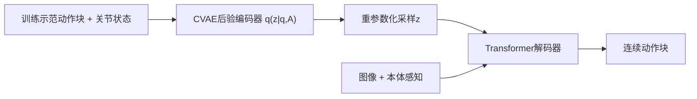
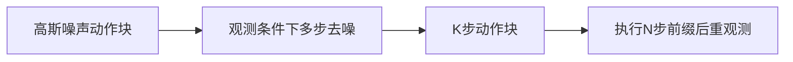

# 6. 现代模仿学习策略——动作分块（Action Chunking）、ACT 与扩散策略（Diffusion Policy）

> **本章目标**
>
> - 理解MSE点回归的条件均值化与经典mode collapse的区别
> - 区分动作表示、分布建模、解码方式和动作分块四个设计维度
> - 理解ACT的CVAE训练、默认零潜变量推理及执行前时序集成
> - 掌握Diffusion Policy与Flow Matching的最小训练目标和条件张量
> - 区分预测长度、执行长度、观测频率与推理延迟

---

# 一、MSE点回归为什么会平均掉多种合理动作

第4章讨论状态分布偏移。即使观测没有偏移，同一观测也可能有多种合理示范：面对障碍物，可以从左绕，也可以从右绕。若确定性网络只输出一个动作，用MSE拟合时，最优点预测是条件均值：

```math
\arg\min_{\hat a}\mathbb E[\|\hat a-a\|^2\mid o]=\mathbb E[a\mid o].
```

当左右动作分别为 `-1`、`+1` 且概率相同，均值为0；若0表示直行，它就可能位于障碍物中。这不是优化器没训练好，而是点估计目标与任务需求不匹配。


这里常被口语化称作“多模态坍缩”，更准确是**模式平均化（mode averaging）**；生成模型的经典 **mode collapse** 则是只生成少数真实模式、漏掉其他模式。两者不同。“概率分布建模”也不是“分布式计算”。

这项局限针对**确定性动作点回归**，并不是“凡训练损失有MSE就只能输出均值”：扩散模型对条件噪声的MSE预测与多步采样结合，仍可产生多峰动作。L1点回归对应坐标条件中位数，也不保证完整覆盖多模态，但在一些任务上足够有效。

# 二、Action Chunking：一次预测一段，但不等于独立开环执行整段

单步策略可依赖历史，并不必然在各时刻统计独立。不过，如果每步在多个方案间重新选择，缺乏一致的高层意图，就容易来回摇摆。动作分块让模型一次输出

```math
A_t=(a_t,a_{t+1},\ldots,a_{t+K-1})\in\mathbb R^{K\times d_a}.
```

`K` 是预测时域；执行前缀长度为 `N≤K`。模型可以看完最新观测后重规划，而不必把全部K步走完。块内联合建模有助于一致性，但**分块本身不保证多模态或安全**：MSE直接回归整个块仍可能平均左右两条轨迹，长开环前缀也可能放大误差。

ACT与Diffusion Policy在2023年的工作中广泛采用了动作块，但序列控制、轨迹预测与滚动时域思想早于它们，不应把Action Chunking的所有起源归给某一篇论文。

需要区分四根轴：动作是离散还是连续，输出是点估计还是概率分布，解码是自回归/并行/迭代，输出覆盖单步还是一段。离散分类、自回归与动作块也能组合；第7章将用FAST与OpenVLA-OFT进一步说明。

# 三、ACT：CVAE训练与原始部署约定

**ACT（Action Chunking with Transformers）**用条件变分自编码器处理示范差异。训练时编码器看到关节状态与真实动作块，产生后验 `q_phi(z|q_t,A_t)`；从中重参数化采样 `z`，Transformer解码器结合图像、本体状态与z并行预测动作块。



原始ACT使用 **L1重建损失 + β加权KL**，不是MSE重建：

```math
\mathcal L_{ACT}=\mathbb E_{z\sim q_\phi}[\|A_t-\hat A_t(o_t,z)\|_1]
+\beta D_{KL}(q_\phi(z\mid q_t,A_t)\|\mathcal N(0,I)).
```

L1负责重建示范，KL使潜变量与先验接近；若动作块包含padding，重建项须按有效步掩码。`z`可以承载示范风格，但有限容量、KL权重与后验坍缩都可能影响效果，不能保证每种行为都有清晰可分的z。

**一般CVAE可以从先验采样；原始ACT默认推理却固定 `z=0`（先验均值）**，去掉训练编码器。这使部署通常是确定性的动作块预测，不能声称原始ACT每次都随机选“左绕/右绕”，也不能保证零潜变量输出保持所有训练模式。修改成先验采样是另一个推理选择，需要重新验证。

**Temporal Ensembling（时序集成）**：在每个控制步重新预测一个块，把不同预测时刻对“当前同一执行时刻”的动作按年龄权重平均，再下发给控制器。集成发生在**执行前**，不是动作已经执行后再平滑。它可以减小抖动，却可能混合互不兼容的多模态方案或引入响应滞后；旋转与夹爪等特殊动作不能不顾语义地随意平均。

# 四、Diffusion Policy：对动作块进行条件去噪

Diffusion Policy将动作块当作生成对象。设归一化的干净动作块 `A⁰∈R^{B×K×d_a}`，条件 `c` 来自观测历史、图像特征和本体感知；B为批量大小。随机选扩散步k和同形状噪声 `epsilon`，构造：

```math
A^k=\sqrt{\bar\alpha_k}A^0+\sqrt{1-\bar\alpha_k}\epsilon,
\qquad \epsilon\sim\mathcal N(0,I),
```

```math
\mathcal L_{diff}=\mathbb E_{A^0,c,k,\epsilon}
[\|\epsilon-\epsilon_\theta(A^k,k,c)\|_2^2].
```

`bar(alpha)_k` 是噪声日程累计系数，不是机器人时间；网络输出与动作块同形状的噪声估计。观测可以是 `B×T_obs×D` 特征张量或含多相机维度的图像编码，条件与动作块必须时间对齐。这里展示常见epsilon预测目标；其他参数化可预测干净动作或速度，不能混用相应的采样更新式。



推理从噪声动作块开始，用与训练噪声日程相匹配的DDPM/DDIM等采样器迭代更新。不同噪声可生成不同完整方案，所以模型**能够表达多峰**；但并不保证每次样本正确、安全，也可能忠实复现示范中的坏行为。相比单次前向，反复去噪通常增加延迟，实际速度还依赖步数、网络与硬件。

# 五、Flow Matching：学习从噪声到动作的速度场

为衔接第7章π0，用一个最小线性插值路径说明Flow Matching。采用“tau=0是噪声，tau=1是数据”的约定：

```math
X_\tau=(1-\tau)\epsilon+\tau A^0,\quad
u^*=A^0-\epsilon,\quad \tau\sim U[0,1],
```

```math
\mathcal L_{flow}=\mathbb E[\|v_\theta(X_\tau,\tau,c)-(A^0-\epsilon)\|_2^2].
```

输入 `X_tau`、目标速度 `u*`、网络输出都为 `B×K×d_a`，tau嵌入与观测条件c负责告诉网络当前时间和任务。推理求解常微分方程 `dX_tau/dtau=v_theta(X_tau,tau,c)`，从 `X_0~N(0,I)` 积分到 `X_1`。例如Euler更新为 `X←X+Δtau*v_theta(...)`。

不同论文可能反过来定义时间方向、改变路径或时间采样分布，使用实现时须统一符号；这里是最小机制，不是逐项复制π0的全部训练配方。Flow与扩散都可对连续动作分布建模，但训练目标不同；“用了Flow”并不自动意味着单步生成、更快或更可靠。

# 六、方法对比：能力不是损失函数名称的保证

| 方法 | 训练/生成方式 | 多模态边界 | 常见推理方式 |
|---|---|---|---|
| 确定性BC | 单步或动作块L1/MSE点回归 | 点估计，可能中位数/均值化 | 一次前向 |
| ACT | CVAE、L1重建+βKL | 潜变量有表达能力；默认z=0不等于多模式采样 | 并行动作块+时序集成 |
| Diffusion Policy | 条件去噪分布建模 | 能表达多峰，不保证样本有效 | 多步去噪+执行前缀 |
| Flow策略 | 条件速度场匹配 | 能表达多峰，依赖数据与积分质量 | 噪声起点+ODE积分 |

这些都是可在模仿学习中采用的策略设计，不是与BC完全互斥的学习范式。视觉编码器、条件信息、数据量、训练预算与部署延迟往往比一个算法标签更影响结果。

# 七、完整执行机制：K、N与频率不能混淆

| 阶段 | 操作 | 需要核对的约束 |
|---|---|---|
| 观测 | 同步图像、关节状态，编码历史 | 时间戳、坐标系、归一化 |
| 生成 | ACT默认z=0；Diffusion/Flow从噪声生成K步 | 延迟、输出形状、动作单位 |
| 执行前融合 | ACT集成对当前时刻的重叠预测；DP常选择前缀 | 不能把冲突方案平均成危险动作 |
| 控制 | 下发当前动作或N步缓冲前缀 | 限位、速度、碰撞、急停 |
| 重规划 | 获取新观测后生成下一块 | 控制频率不等于策略推理频率 |

ACT启用原始时序集成时通常**每个控制步推理、每步下发一个融合动作**，可视为 `N=1`；Diffusion Policy常每次生成K步，仅执行N步后再规划。观测可以持续采集，但不一定每帧都进入一次策略推理。这不是完全同一条部署循环。

**完成判据**：留出回合任务成功、控制约束满足、推理及通信延迟在调度预算内。同步N步执行的可用推理预算与每步实时ACT不同，不能只拿平均推理耗时与某个“控制周期”机械比较。

**失败边界**：反馈延迟主要由执行前缀N、观测调度及推理延迟决定，不能简单说预测K越大就一定反应越慢。时序集成可能滞后；异步动作块切换可能不连续。第7章RTC讨论延迟感知的块衔接，但也不是安全保证。

动手实验见 **6.1 验证多模态坍缩问题，并用概率分布建模修复它**（沿用原文件名）。它只验证双峰点估计、分类采样和分块的最小差别，不是完整ACT/扩散训练。

# 本章总结

- MSE动作点回归趋向条件均值，不能将它与离散自回归或扩散噪声回归混为一谈。
- 分块控制时间一致性，分布建模表达多种方案，二者是独立设计轴。
- 原始ACT以L1+βKL训练、默认z=0推理，并在执行前时序集成。
- Diffusion/Flow分别学习去噪与速度场，条件、时间索引、动作张量必须一致。
- 策略能力最终要由闭环评测与实时约束共同检验。

## 下一章预告

ACT与Diffusion也可扩展为多任务策略；下一章重点是如何引入预训练视觉语言知识与语言条件，形成 **7. VLA——视觉-语言-动作模型如何统一感知、语言与动作**。

# 参考资料

- Zhao et al. (2023), *Learning Fine-Grained Bimanual Manipulation with Low-Cost Hardware*：https://tonyzhaozh.github.io/aloha/
- Chi et al. (2023), *Diffusion Policy: Visuomotor Policy Learning via Action Diffusion*：https://diffusion-policy.cs.columbia.edu/
- Lipman et al. (2023), *Flow Matching for Generative Modeling*：https://arxiv.org/abs/2210.02747
- Hugging Face LeRobot：https://github.com/huggingface/lerobot
