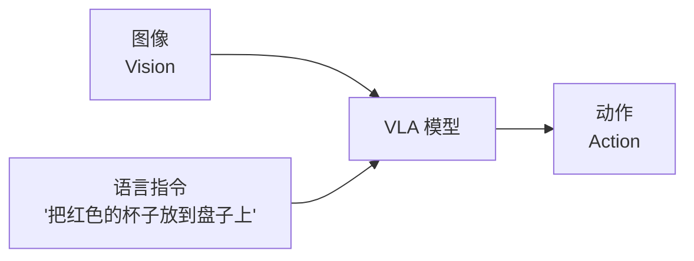
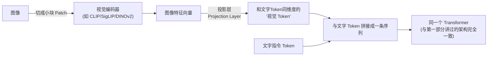
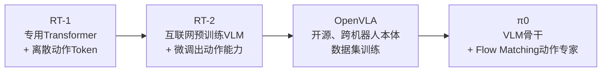
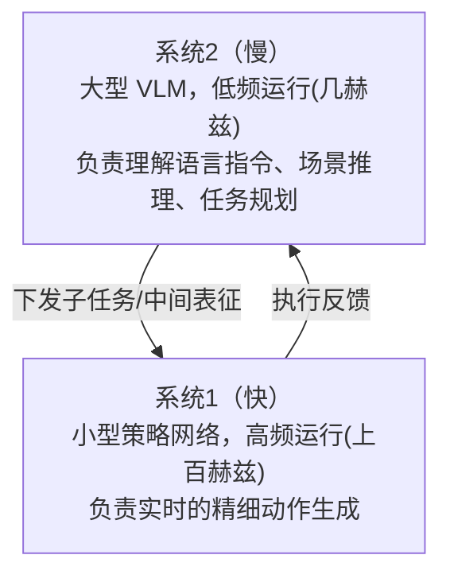

# 7. 视觉-语言-动作模型（VLA）——视觉-语言-动作模型如何统一感知、语言与动作

> **本章目标**
>
> - 理解VLA通过语言切换机器人任务的目标，以及泛化能力的评测边界
> - 回顾视觉语言模型（VLM）如何编码图像并接入语言骨干
> - 梳理RT-1/RT-2/OpenVLA/π0与2025—2026年的FAST、OFT、RTC、RECAP、记忆等发展
> - 区分动作表示、概率建模、解码方式与动作分块四根设计轴
> - 理解"快慢双系统"这一分层 VLA 设计思路
> - 理解 Open X-Embodiment 这类跨机器人本体数据集为什么重要

---

# 一、为什么需要"一个模型"

前面几章为了入门，多以特定任务举例；BC、ACT、Diffusion Policy本身并不限于单任务，也可以加入语言与任务条件。VLA进一步强调利用大规模视觉语言预训练和机器人数据，扩大任务覆盖与语言泛化。这和第一部分讲的 LLM 发展史何其相似——在 GPT 之前，NLP 领域也是"一个任务一个模型"（情感分析一个模型、翻译一个模型、问答一个模型）。GPT 的突破在于：**用一个足够大的模型、足够多样的数据，训练出一个能够通过语言指令切换任务的通用模型**。

**VLA（Vision-Language-Action Model，视觉-语言-动作模型）** 想在机器人身上复刻同样的突破：**输入一张图像（看到了什么）+ 一句自然语言指令（要做什么），输出机器人应该执行的动作**——理想情况下，同一个模型不需要为每个新任务重新训练，只需要换一句指令。



---

# 二、先补一课：视觉语言模型（VLM）是如何"看懂"图像的

第一部分已从文本模型扩展到视觉编码与多模态模型（如第14章的视觉Transformer），这里回顾与机器人有关的接口：怎样将图像信息接入语言骨干，再让其支持动作预测。对一类常见的投影拼接式 **VLM（Vision-Language Model）**，可归纳成三个步骤：



1. **把图像切成小块（Patch）**：一张图像会被切成很多个小方块（比如 16×16 像素一块），这一步和第一部分讲 Tokenizer 时"把一段文字切成一个个 Token"是同一个思路——只是这里"切"的对象从文字变成了图像。
2. **用视觉编码器把每个 Patch 编码成一个向量**：这一步通常复用一个已经在海量图像上预训练好的**视觉编码器**（比如 CLIP、SigLIP，或者 OpenVLA 用到的 DINOv2），把每个 Patch 变成一个能表达"这一小块图像里有什么"的特征向量。
3. **用一个投影层，把图像特征"翻译"成语言模型认得的格式**：视觉编码器输出的向量维度，通常和语言模型的 Token Embedding 维度不一致，需要一个简单的投影层（往往只是一两个线性层）把它们对齐到同一个维度——这一步做完之后，每一个图像 Patch，就变成了一个与文字嵌入**隐藏维度兼容**的“视觉Token”（不是离散词表中的普通文字ID）。

**关键直觉**：统一隐藏维度后，视觉与文本表征可以共同进入Transformer，复用Attention与语言骨干。但“维度一致”不等于语义不可区分：模型仍可通过位置编码、图像边界、模态标记和注意力掩码区分它们；不同VLM也可能采用跨模态注意力而不是直接拼接。图文对齐训练与数据配方不可省略，不能只加一个投影层就保证模型看懂图像。

理解了这一层，第7.1节实验里"直接让 VLM 用文字描述一个像素坐标"这种用法就不再神秘：VLM 本质上还是在做"预测下一个 Token"，只是它现在能同时"读"文字 Token 和"看懂"图像 Token 拼在一起的完整上下文，而给出的答案，恰好也是关于图像内容的文字描述。

---

# 三、VLA 发展脉络：从早期动作Token到2025—2026年的系统能力

**RT-1（Robotics Transformer 1，Google，2022）**：大规模真实机器人Transformer策略的代表性早期工作。它将末端运动、夹爪与底盘等动作分量离散成Token（连续分量分桶），以分类目标训练多任务策略。这与文本Token预测共享离散概率建模思路，但动作含义、控制时序与注意力设计并不因此和文字生成完全相同。

**RT-2（Google，2023）**：更进一步——与其单独训练一个机器人专用模型，不如直接在一个**已经在海量互联网图文数据上预训练好的视觉-语言模型（VLM）** 基础上，**继续用机器人数据做微调**，把动作 Token 也当成一种"语言"加入到模型的词表里。这个设计带来了一个意外惊喜：**模型从互联网图文数据中学到的常识和语义理解能力，能够迁移到机器人任务上**——比如模型即使没有专门在"辨认灭绝动物"的机器人数据上训练过，也能因为从网络图文数据中"读过"相关知识，正确地把"拿起恐龙玩具"这个指令对应到正确的物体，这被称为**涌现的语义泛化能力**，本质上正是第一部分讲过的"Scaling Law 与涌现能力"在机器人领域的体现。

**OpenVLA（2024）**：公开代码与权重的7B级VLA，采用DINOv2与SigLIP视觉特征、Llama 2骨干，在Open X-Embodiment的混合机器人示范上训练。OXE汇聚多个团队、多个本体的数据，不能将“机器人本体数量”误写成“机构数量”，也不能把原始OXE总集等同于OpenVLA实际筛选的训练混合。开放实现降低了复现门槛，但仍要核对权重、骨干和数据各自的许可与算力要求。

**π0（Pi-Zero，Physical Intelligence，2024）**：在VLM骨干旁加入动作专家，用第6章的Flow Matching速度场目标生成连续动作块，将视觉语言条件与连续分布建模相连。生成能力不等于精度或安全保证，仍受数据、条件编码和积分预算影响。

## 2025—2026：不能只用“离散被连续取代”概括

以下机制根据原始项目页核对（截至2026-11-27）；年份说明研究脉络，不构成跨任务性能排行榜。

| 工作 | 机制与要解决的问题 | 不应外推的边界 |
|---|---|---|
| **FAST（2025-01-16）** | 归一化动作块沿时间做DCT，量化频率系数，再用BPE压缩为离散Token；自回归预测的是压缩后的整段动作 | 不等于逐时间步等宽分桶；压缩有精度权衡，训练更快不代表自回归推理一定更快 |
| **OpenVLA-OFT（2025）** | 微调配方结合连续动作、并行动作块解码和L1回归，提高动作吞吐并减少逐Token等待 | 它是连续点回归而非扩散；项目的LIBERO/ALOHA结果不证明L1在所有多峰数据上更好 |
| **π0.5（2025-04-22）** | 将跨本体、多环境机器人数据与图文、检测、语义子任务等异质数据共训；结合高层语言子任务与低层Flow动作 | 重点是新环境泛化，不是学会任意新技能；仍会发生语义与控制失败 |
| **RTC（2025-06-09）** | 推理新块时继续执行旧块，将延迟期间已承诺的动作前缀固定，以inpainting生成衔接部分，兼顾一致性与反应 | 是实时执行机制，不是新动作表示；原版适用于扩散/Flow模型，不保证任意延迟或任意任务安全；后续有训练期版本 |
| **RECAP / π*0.6（2025-11-17）** | 结合示范、专家接管纠错与自主经验RL，利用价值函数和优势条件策略；π*0.6是经该方法训练的模型 | 接管数据不是无限免费标签；要有奖励、复位与安全预算，不能等同纯离线模仿 |
| **MEM（2026-03-03）** | 多尺度具身记忆：短期视频历史与长期自然语言记忆结合，跟踪遮挡物体、任务进度和先前失败 | 论文展示的记忆任务可达约15分钟，不是无限时程记忆或通用持续学习的保证 |
| **π0.7（2026-04-16）** | 用语言、策略元数据、控制模态与视觉子目标等多种上下文对行为消歧，整合不同质量数据及策略经验 | 组合泛化仍是有边界的研究结果；部分新任务需要语言逐步指导，不应宣称任意任务零样本可完成 |

FAST的离散概率生成、OFT的连续点回归、RTC的执行调度以及MEM的历史条件解决的是不同问题，完全可能组合。项目发布论文不等于发布代码、权重或训练数据；尤其不能仅凭MEM/π0.7研究介绍就标注“全面开源”。



---

# 四、动作生成必须分开的四个设计轴

| 设计轴 | 选项 | 需要避免的混淆 |
|---|---|---|
| **动作表示** | 逐维离散分桶、FAST等压缩Token、连续向量 | 离散表示不等于低频单步；连续也不保证没有误差 |
| **分布与目标** | 类别分布+交叉熵；L1/MSE点回归；扩散/Flow分布建模 | 连续点回归与连续生成不是同一类；损失名字不能单独决定多模态能力 |
| **解码/推理** | 自回归、并行块输出、多步去噪/ODE | 自回归是条件依赖，不是逐Token独立；并行输出也可共享全局特征 |
| **时间覆盖与执行** | 单步、K步chunk、执行N步前缀、时序集成/RTC | 预测长度、执行长度、实际控制频率不是同一个量 |

离散自回归对动作Token序列 `z=(z1,...,zM)` 建模为：

```math
p(z\mid o,l)=\prod_{j=1}^{M}p(z_j\mid z_{<j},o,l).
```

这里每个Token都依赖前缀，**能表达多峰联合分布**；它不是MSE动作均值回归。采样可选择不同模式，贪心解码可能只选其中一个；量化误差、长序列延迟与训练/推理前缀偏移仍是实际问题，但不能称为“天然独立预测导致均值坍缩”。

举例：原始OpenVLA使用离散动作Token；π0-FAST以离散自回归建模压缩动作块；OpenVLA-OFT采用连续L1点回归和并行块解码；π0用连续Flow动作专家。四者都可结合语言和视觉，设计差异不构成“离散必然落后、连续必然多模态”的单线进化。

---

# 五、分层双系统 VLA：给机器人一个"快脑"和一个"慢脑"

VLM 骨干通常参数量很大（几十亿参数级别），一次前向推理需要不短的时间——但机器人控制往往需要几十到上百赫兹的响应频率（想象一下抓取一个正在轻微晃动的物体，动作决策必须足够快）。直接用大模型做每一次控制决策，在真实机器人上往往"太慢"。

受心理学家丹尼尔·卡尼曼"系统1/系统2"双过程理论的启发，一些前沿工作（如 Figure 公司的 Helix、Hi Robot 等）采用了**分层双系统架构**：



**系统2**（"慢脑"）是那个理解"把红色杯子放到盘子上"这句话、识别出红色杯子在哪里、盘子在哪里的大模型，它不需要每个控制周期都运行，只需要在任务发生变化、或者需要重新规划时运行一次；**系统1**（"快脑"）是一个小得多、专门做精细运动控制的策略网络（很像第6章的 ACT/Diffusion Policy），以远高得多的频率持续运行，负责把系统2给出的"目标"，转化成一连串平滑、实时的具体动作。这种分工，本质上和第三部分 Agent 里"Planning（慢，负责拆解任务）+ 具体工具调用（快，负责执行）"的分层思想完全一致，只是这里的"执行"换成了物理动作。

---

# 六、Open X-Embodiment：为什么"跨机器人本体"的数据集很重要

第一部分强调过，LLM 之所以能力强，一大原因是训练数据的规模和多样性。机器人数据的采集成本远高于文本，**任何单一实验室、单一机器人本体能采集到的数据量，相比 LLM 训练用的互联网文本数据，都是九牛一毛**。

**Open X-Embodiment** 数据集的思路是：把全世界各个实验室、各种不同机器人本体（不同的机械臂、不同的夹爪、不同的相机视角）采集到的示范数据汇聚在一起，统一格式，联合训练一个模型。研究发现，**用这种跨本体数据训练出来的策略，即使只关心某一个具体机器人本体，效果也往往优于只用这一个本体自己的数据单独训练**——这是因为不同机器人执行相似任务时，底层需要理解的"物理常识"和"任务语义"是相通的，跨本体数据起到了类似"更大规模预训练语料"的作用。这也是为什么第 10 章讨论"仿真器与数据集"时，我们还会再回到这个数据集。

**存储格式统一不等于动作语义统一**。OXE采用RLDS等轨迹/步骤组织方式，让读取接口更一致，却不意味着所有动作都已自动变成相同的7维末端增量。不同数据源可能记录关节角、末端绝对位姿、增量或速度，维度相同也可能语义完全不同。

训练适配器和部署控制器至少要逐项核对：

| 字段 | 必须明确的语义 |
|---|---|
| 单位与尺度 | 米/毫米，弧度/角度；训练时的归一化统计 |
| 坐标系 | 世界、基座、工具/末端坐标系；旋转表示与左右乘约定 |
| 控制目标 | 绝对位置、相对增量、速度或力矩，不能混同 |
| 时间 | 控制频率Hz、时间戳、重采样；速度转增量需乘采样间隔 |
| 夹爪 | 开合方向、二值/连续、绝对/相对，执行阈值及迟滞 |
| 维度/本体 | 单臂/双臂/底盘，掩码与动作头路由，是否含本体条件 |
| 反归一化 | 使用与目标机器人/数据集匹配的统计；例如OpenVLA接口的 `unnorm_key`，不能随便选一个 |

可选方案包括将兼容数据转换到共同末端接口，或保留本体专用动作头、维度掩码与条件输入。但**不是每个跨本体模型都有显式“本体Token”**；也不是末端位姿能表达灵巧手、底盘与接触力的全部控制需求。无法无损转换的数据应分开处理，而不是强行padding后当成语义一致。第13章将把这些约定作为数据工程契约。

---

# 七、完整机制：训练一个 VLA 要经过哪几个阶段

本章讨论的都是架构选型，把选型落回训练流程，一个可用的 VLA 大致经过四个阶段，前一阶段的产物就是后一阶段的起点：

| 阶段 | 输入 | 操作 | 产物 |
|---|---|---|---|
| 视觉-语言预训练 | 互联网图文对 | 本章第二节那三步（切 Patch、编码、投影）的常规图文训练 | 具备语义理解能力的 VLM 骨干 |
| 动作接口接入 | VLM 骨干、动作表示选型 | 扩词表加入离散动作 Token，或在骨干外挂 Flow Matching 动作专家 | 能输出动作的模型结构 |
| 跨本体联合训练 | Open X-Embodiment等数据及逐数据源动作契约 | 适配单位/坐标/时间/归一化；选择共享或本体专用接口 | 在所覆盖本体与任务上评测的策略 |
| 目标任务微调 | 目标任务的几十到几百条示范 | 全参数或 LoRA 微调 | 可部署的专用策略 |

**完成判据**：在留出任务、物体、环境和本体上分别报告指令跟随与任务成功率，并回测原有任务。微调后原任务明显下降可能来自任务特化或灾难性遗忘，需要数据混合与保留能力评测，不能据此把第6章的ACT/DP一概定义成单任务策略。

**失败边界**：单一本体、单一视角的微调可能造成换视角后的退化，幅度应由留出评测决定。量化粒度、标定或执行误差超过任务容差时，精细装配可能失败，但不能仅凭离散表示就断言做不准。双系统中慢层目标过期时，快层可能流畅地执行错误方向，因此还需目标有效期、反馈与停止条件。

---

想亲手体验一次"用开源视觉语言模型做零样本抓取点预测，再结合前面章节学过的相机反投影和逆运动学，转换成机械臂关节角度"的完整流程，可以看这一节实验：**7.1 使用开源 VLM 做一次零样本抓取点预测，并转换为机械臂关节角度**。

---

# 本章总结

- 一类VLM通过视觉编码与投影将图像接入语言Transformer；还存在交叉注意力等不同融合架构。
- VLA希望扩大语言条件下的任务覆盖，但泛化必须注明留出任务、环境、物体与本体的边界。
- RT-1/RT-2/OpenVLA/π0奠定了不同路线；FAST/OFT、异质共训、RTC、RECAP、MEM和π0.7分别推进表示、解码、数据、实时性、交互改进与记忆。
- 动作表示、概率目标、解码与chunk是不同轴；离散自回归可以多峰，连续回归也可能只输出一个点。
- 分层推理与延迟感知调度有助于高频控制，但不自动解决观测过期、动作不连续或执行安全。
- OXE的轨迹格式统一不等于控制语义统一；跨本体训练与部署都要执行明确的单位、坐标、时间、夹爪和反归一化契约。

> **VLA 不是凭空发明了新的机器人智能，而是把 LLM 和 Agent 已经验证过的"规模化 + 通用化"范式，重新应用到了机器人的感知-语言-动作循环上。**

## 下一章预告

VLA 解决的是"策略应该学成什么样"，但无论用行为克隆还是 VLA 训练出的策略，最终要落地到真实机器人身上，都绕不开一个问题：真实世界的交互成本、危险性远高于虚拟环境，第3章的强化学习该如何在真实世界里安全地进行？下一章，我们回到强化学习这条主线，讨论它在真实机器人场景下的进阶问题：

> **第 8 章 强化学习进阶——奖励设计与真实世界强化学习**

---

# 参考资料

- 陈天行《Embodied-AI-Guide》"VLA 与基础模型"章节：https://github.com/TianxingChen/Embodied-AI-Guide
- OpenVLA: An Open-Source Vision-Language-Action Model（开源 VLA 项目页）：https://github.com/openvla/openvla
- π0 (Physical Intelligence) 技术博客与论文：https://www.physicalintelligence.company/blog/pi0
- FAST原始项目页（2025-01-16）：https://www.pi.website/research/fast
- OpenVLA-OFT项目页：https://openvla-oft.github.io/
- π0.5异质共训：https://www.pi.website/blog/pi05
- Real-Time Chunking及后续工作：https://www.pi.website/research/real_time_chunking
- RECAP与π*0.6：https://www.pi.website/blog/pistar06
- MEM多尺度记忆：https://www.pi.website/research/memory
- π0.7研究说明：https://www.pi.website/blog/pi07
- Open X-Embodiment数据与适配代码：https://github.com/google-deepmind/open_x_embodiment
