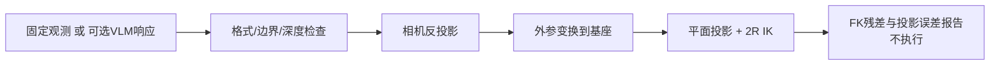

# 7.1 使用开源 VLM 做一次零样本抓取点预测，并转换为机械臂关节角度

> **本节定位**：模块化实践，不是训练端到端VLA，也不是已验证的真实抓取系统。
>
> **默认路径**：CPU + NumPy，使用显式固定的模拟观测验证解析、反投影、外参变换与平面IK。
>
> **可选路径**：自行准备图像、对齐深度和标定参数，加载Qwen2-VL，实际解析模型输出并接入同一几何链路。权重下载、GPU推理和真机抓取均不属于本轮实测。

---

# 一、先分清“固定观测验几何”与“模型联调”

默认固定返回字符串 `"(360, 250)"` 不是VLM预测结果，而是可复现的测试夹具。可选模式才真正调用模型；两种模式后面**共用同一个response解析和几何处理**，不再把模型输出只print后丢弃，再硬编码另一对坐标。

默认只需NumPy；可选模式另需与模型兼容的 `torch`、`transformers`、`accelerate`、`pillow`。不要为了运行CPU几何部分先下载几GB权重。普通VLM的像素定位可能很不准，文字格式正确也不等于可抓取。

```python
import math
import re
import numpy as np

def predict_point(image):
    # 只有显式启用可选模式才导入、加载和下载模型。
    from transformers import Qwen2VLForConditionalGeneration, AutoProcessor
    model_name = "Qwen/Qwen2-VL-2B-Instruct"
    model = Qwen2VLForConditionalGeneration.from_pretrained(
        model_name, torch_dtype="auto", device_map="auto")
    processor = AutoProcessor.from_pretrained(model_name)
    width, height = image.size
    prompt = (
        f"图像原始大小为{width}x{height}像素，左上角为(0,0)。"
        "请指出杯子把手上的候选接触点，用原始图像的整数像素坐标回答。"
        "只输出(u, v)，不要附加文字；不能可靠定位时回答UNKNOWN。"
    )
    messages = [{"role": "user", "content": [
        {"type": "image"}, {"type": "text", "text": prompt}]}]
    text = processor.apply_chat_template(messages, tokenize=False, add_generation_prompt=True)
    inputs = processor(text=[text], images=[image], return_tensors="pt").to(model.device)
    output = model.generate(**inputs, max_new_tokens=32, do_sample=False)
    return processor.batch_decode(output[:, inputs.input_ids.shape[1]:],
                                  skip_special_tokens=True)[0]

USE_VLM = False
if USE_VLM:
    from PIL import Image
    # 这四个文件必须由读者提供，并来自同一次对齐、标定的数据采集。
    image = Image.open("mug_on_table.jpg").convert("RGB")
    width, height = image.size
    depth_image = np.load("aligned_depth_m.npy", allow_pickle=False)
    K = np.load("camera_intrinsics.npy", allow_pickle=False)
    T_base_camera = np.load("camera_to_base.npy", allow_pickle=False)
    response = predict_point(image)
else:
    width, height = 640, 480
    response = "(360, 250)"  # 固定观测，不冒充模型输出
    depth_image = np.full((height, width), 0.8)  # 模拟Z-depth，单位米
    K = np.array([[500., 0., 320.], [0., 500., 240.], [0., 0., 1.]])
    T_base_camera = np.eye(4)  # 仅演示：假设相机系与基座系完全重合

print("输入来源:", "VLM（待人工核对定位）" if USE_VLM else "CPU固定观测夹具")
print("原始response:", response)
```

模型内部可能缩放图像，提示中的坐标契约是**原始图像像素**，不是0—1000归一化坐标或缩放后坐标。提示不能保证模型遵守契约；真实联调应把候选点叠画回原图检查，异常时拒绝继续。如果主动resize/crop输入，应同时正确变换坐标和内参，不能沿用旧K。

# 二、严格解析、检查深度与相机参数

不使用 `eval` 解析模型文字。超范围坐标、UNKNOWN、缺失深度、尺寸不符都应显式失败，而不是猜测或夹到图像边缘。

```python
def parse_pixel(text, width, height):
    match = re.fullmatch(r"\s*\(\s*(\d+)\s*,\s*(\d+)\s*\)\s*", text)
    if match is None:
        raise ValueError("模型未返回约定格式的整数像素坐标")
    u, v = map(int, match.groups())
    if not (0 <= u < width and 0 <= v < height):
        raise ValueError("像素坐标越界；检查分辨率与坐标约定")
    return u, v

def backproject_pixel(u, v, depth_image, K, width, height):
    if depth_image.shape != (height, width):
        raise ValueError("深度与RGB尺寸不一致，须先完成对齐")
    if K.shape != (3, 3) or not np.all(np.isfinite(K)):
        raise ValueError("无效内参矩阵")
    if not np.allclose(K[2], [0, 0, 1]) or K[0, 0] <= 0 or K[1, 1] <= 0:
        raise ValueError("内参须为合法针孔相机矩阵")
    if not np.isclose(K[0, 1], 0) or not np.isclose(K[1, 0], 0):
        raise ValueError("本实验只实现零skew针孔模型")
    Z = float(depth_image[v, u])
    if not np.isfinite(Z) or not (0.1 <= Z <= 4.0):
        raise ValueError("候选点深度无效或超出演示配置的量程")
    return np.array([(u - K[0, 2]) * Z / K[0, 0],
                     (v - K[1, 2]) * Z / K[1, 1], Z])

u, v = parse_pixel(response, width, height)
p_camera = backproject_pixel(u, v, depth_image, K, width, height)
print("相机系三维点(m):", p_camera)
```

真实深度应先转换成米、区分沿光轴Z-depth与沿射线Range、做畸变校正及RGB-depth配准。把手空洞处的深度可能属于后面的桌面，即使数值在量程内也不一定有效；需要物体分割、邻域一致性与人工/几何核验，不能盲目补值。

固定夹具的解析结果为 `(360,250)`，反投影 `p_camera=(0.064,0.016,0.8)m`。这只是该输入下的确定性几何结果，不是模型定位准确性的证据。

# 三、先变换到基座，再做有损平面投影

第5章的反投影输出在相机系。机械臂IK需要**基座系**目标：

```math
p_{base}=R_{base\leftarrow camera}p_{camera}+t_{base\leftarrow camera}.
```

```python
def to_base(p_camera, T):
    if T.shape != (4, 4) or not np.all(np.isfinite(T)):
        raise ValueError("无效外参")
    R, translation = T[:3, :3], T[:3, 3]
    if not np.allclose(T[3], [0, 0, 0, 1]):
        raise ValueError("外参齐次矩阵末行错误")
    if not np.allclose(R.T @ R, np.eye(3), atol=1e-6) or not np.isclose(np.linalg.det(R), 1):
        raise ValueError("外参旋转必须属于SO(3)")
    return R @ p_camera + translation

p_base = to_base(p_camera, T_base_camera)
# 教学2R臂仅在基座X-Z平面运动，不能控制基座Y方向。
target_x, target_z = float(p_base[0]), float(p_base[2])
plane_error = abs(float(p_base[1]))
print("基座系三维目标(m):", p_base)
print("投影丢弃的出平面误差(m):", plane_error)
```

单位外参只是默认夹具的明确假设，**不是通过了手眼标定**。真实相机常以右/下/前为轴，而机器人基座约定不同，必须使用实测外参。默认目标Y为0.016m，投影丢掉了1.6cm；即使接下来平面IK误差为零，真实三维点仍未被到达。

# 四、求平面IK并用FK检查残差

这里使用两根各0.5m的无关节限位理想连杆，只验证X-Z投影位置。肘上下符号与第2章一致，`elbow_up=True`选负theta2分支。

```python
def inverse_kinematics(x, z, l1=0.5, l2=0.5, elbow_up=False):
    if not all(math.isfinite(v) for v in (x, z, l1, l2)) or min(l1, l2) <= 0:
        raise ValueError("非法目标或连杆长度")
    d = math.hypot(x, z)
    if not abs(l1 - l2) <= d <= l1 + l2:
        return None
    cos_t2 = (d*d - l1*l1 - l2*l2) / (2*l1*l2)
    theta2 = (-1 if elbow_up else 1) * math.acos(max(-1., min(1., cos_t2)))
    theta1 = math.atan2(z, x) - math.atan2(l2*math.sin(theta2), l1+l2*math.cos(theta2))
    return theta1, theta2

def forward_kinematics(theta1, theta2, l1=0.5, l2=0.5):
    return (l1*math.cos(theta1)+l2*math.cos(theta1+theta2),
            l1*math.sin(theta1)+l2*math.sin(theta1+theta2))

angles = inverse_kinematics(target_x, target_z)
if angles is None:
    raise ValueError("投影目标对理想2R机械臂不可达，拒绝生成指令")
reached_x, reached_z = forward_kinematics(*angles)
residual = math.hypot(reached_x-target_x, reached_z-target_z)
error_3d = np.linalg.norm(np.array([reached_x, 0., reached_z]) - p_base)
assert residual < 1e-9
print("肘下关节角(deg):", tuple(round(math.degrees(a), 4) for a in angles))
print("平面FK残差(m):", residual)
print("相对原三维点的误差(m):", error_3d)
print("仅几何演示：不下发任何真实机械臂指令")
```

# 五、结果边界与完整机器人系统还缺什么



默认路径检验的是几何接口与数值一致性；可选路径可以检验模型输出是否真正传入这些接口。二者都没有验证抓取成功：

- 像素点不是完整抓取位姿，缺少朝向、夹爪宽度、接近方向和接触力；
- 2R投影不满足三维位置，更不满足6维位姿；真实机械臂要用实际模型、限位、碰撞与轨迹规划；
- 视觉/深度/外参误差、工具中心点偏移和通信延迟都会改变最终执行结果；
- 真机前需仿真、低速受控测试、急停与独立安全限制，不可将本节角度直接发送到电机。

# 本实验总结

- 固定观测CPU几何路径与未实测的可选VLM路径分开标注，模型响应被实际解析使用。
- 正确链路是像素与深度→相机点→外参变换→基座目标→IK，而不是把相机坐标当基座坐标。
- 平面FK残差为零不代表三维目标已到达，更不代表完成了真实抓取。

下一章：**8. 强化学习进阶——奖励设计与真实世界强化学习**。
