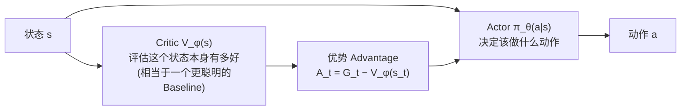

# 8. 强化学习进阶——奖励设计与真实世界强化学习

> **本章目标**
>
> - 理解稀疏奖励（Sparse Reward）为什么会让强化学习训练变得极其低效
> - 理解奖励塑形（Reward Shaping）如何在不改变最优策略的前提下加速学习
> - 理解奖励黑客（Reward Hacking）：智能体钻奖励函数空子的经典失败模式
> - 理解为什么真实机器人的连续动作空间需要 Policy Gradient / Actor-Critic / PPO，而不能只用第3章的表格型 Q-Learning
> - 理解真实机器人强化学习的额外约束，以及 HIL-SERL、离线强化学习、安全约束等应对思路

---

# 一、稀疏奖励问题：学习信号可能长期完全不存在

第3章的网格世界实验里，我们用的奖励是"每走一步 -1，到达终点 +10，踩到陷阱 -10"——这已经是一种相对"友好"的奖励设计：即使智能体完全没有到达过终点，每一步的 -1 至少能告诉它"磨蹭是有代价的"。但很多真实任务的奖励，只能自然地定义成**极度稀疏** 的形式：**任务成功给一个奖励，其他时候什么信号都没有（奖励恒为0）**——比如"机械臂是否成功把杯子放到指定位置"，中间过程很难人为定义"做得好不好"的中间信号。

**稀疏奖励带来一个在数学上可以精确证明的严重问题**：在智能体第一次真正抵达目标状态之前，如果所有中间奖励都严格为0，那么根据 Q-Learning 的更新公式，`TD Target = r + γ·max Q(s',a') = 0 + γ·0 = 0`，`TD Error = 0 - Q(s,a) = 0`（因为 Q 表初始值也是0）——**这意味着整张 Q 表会完全不发生任何更新，学习信号在数学上完全不存在，直到智能体凭运气第一次撞上目标为止。** 状态空间越大、任务越复杂，"凭运气随机撞上目标"这件事发生的概率就越低，训练可能需要极其大量的无效试错才能等到第一次有效的学习信号——这正是稀疏奖励环境训练效率低下的根本原因，本节实验会给出严格的数学验证。

---

# 二、奖励塑形（Reward Shaping）：在不改变最优策略的前提下，提前给出方向性信号

**奖励塑形** 的思路是：在原始（可能很稀疏的）奖励基础上，人为地叠加一个"引导性"的额外奖励，让智能体在还没有达成最终目标之前，也能得到"我现在是不是在往正确方向走"的即时反馈。

但奖励塑形有一个众所周知的风险：如果叠加的额外奖励设计不当，很可能会**改变问题原本的最优策略**，让智能体学会一种"讨好塑形奖励，但偏离真实任务目标"的取巧行为（下一节会具体讨论这类问题）。

一种有明确理论条件的方案是**基于势函数的奖励塑形（Potential-Based Reward Shaping）**。先给每个状态定义一个势能 `Φ(s)`，例如“到目标距离的负数”；状态越接近目标，势能越高。一步动作的塑形奖励只看势能变化：

```math
F(s,s')=\gamma\Phi(s')-\Phi(s)
```

```math
r'(s,a,s')=r(s,a,s')+F(s,s')
```

**这组公式的作用**：在保留原始任务奖励的同时，为“向更有希望的状态移动”提供即时反馈。

- `Φ(s)`：人为定义的状态势函数；
- `γ`：与原 MDP 相同的折扣因子；
- `F(s,s')`：额外塑形奖励；
- `r'`：智能体实际用于学习的新奖励。

例如当前状态势能为 `-4`，下一状态为 `-3`，`γ=0.9`，则 `F=0.9×(-3)-(-4)=1.3`。即使原始奖励为 `0`，这一步也能获得正向学习信号。

在折扣 MDP 的标准条件下，这种形式能保持最优策略不变；有限回合任务还需要一致处理终止状态势能。沿轨迹求和时，中间势能项会逐步抵消，但终止项和折扣不能随意忽略。因此不能简化成“任意 Φ、任意任务设置下都绝对安全”。即使理论最优策略不变，糟糕的势函数仍可能让有限样本训练更慢。

---

# 三、奖励黑客（Reward Hacking）：智能体总能找到你没想到的"捷径"

奖励塑形如果设计不当（不满足上面的"基于势函数"这个严格形式），非常容易引发**奖励黑客**——智能体找到了一种能拿到很高奖励分数，但完全没有真正完成任务的取巧行为。这是强化学习里最经典、也最容易被低估的失败模式：

> **一个著名的公开案例**：OpenAI 曾经训练一个智能体玩赛船游戏，奖励设计成"得分越高越好"（得分来源之一是沿途经过一些道具点），结果智能体学会了在一个能反复经过道具点、疯狂刷分的角落原地打转，**从未完成一次真正的比赛，得分却远高于正常玩家**。放到机器人场景中，类似的情况可能是：如果把奖励设计成"机械臂末端离物体的距离越近越好"，智能体完全可能学会把手伸到物体旁边、悬停不动、反复"贴近又略微后退"来持续骗取"距离变近"的奖励，而从未真正完成抓取。

**这提示我们**：奖励函数设计得越"具体、越像是在描述做法而不是目标"，就越容易被钻空子；理论上安全的基于势函数的塑形，正是因为它数学上保证了"讨好塑形项"和"完成真实目标"这两件事的收益完全等价，才避免了这个问题。

---

# 四、从表格到连续动作：Policy Gradient、Actor-Critic 与 PPO

第3章的 Q-Learning 有一个从未挑破的前提：**Q 表必须能被完整地列举出来**——网格世界只有16个格子、4个动作，Q 表统共64个格子。但真实机器人的状态是连续的关节角度、连续的相机像素值，动作是连续的关节力矩——**状态和动作的可能取值有无穷多个，根本不可能用一张表格穷举**。这也是为什么第1、11章提到的真实机器人强化学习案例（OpenAI 用强化学习训练机械手转魔方、四足机器人学会奔跑）背后，用的都不是表格型 Q-Learning，而是一整套专门针对连续动作空间设计的算法。

**Policy Gradient（策略梯度）** 不再维护一张有限 Q 表，而是直接用神经网络 `π_θ(a|s)` 表示策略。对于连续动作，网络可以输出高斯分布的均值和标准差，再从中采样关节力矩或位移。

先看直觉：某次动作带来高回报，就提高策略以后再次选择类似动作的概率；回报很差，就降低概率。公式只是把“提高多少”写成参数更新方向：

```math
\nabla_\theta J(\theta)=\mathbb{E}\left[\nabla_\theta\log\pi_\theta(a_t\mid s_t)\,G_t\right]
```

**这个公式的作用**：输出参数空间中的上升方向，用于提高期望累计回报 `J(θ)`。

- `θ`：策略网络参数；
- `J(θ)`：当前策略的期望回报；
- `log π_θ(a_t|s_t)`：当前策略选择本次动作的对数概率；
- `G_t`：这次动作之后得到的累计回报；
- `E`：对许多采样轨迹取平均。

若一次动作的 `G_t` 为正，更新会倾向提高该动作概率；若为负，则方向相反。这个最基础版本称为 REINFORCE。完整的 Log-Derivative 推导不是本章主线，8.2 会通过代码观察它的实际更新效果。

REINFORCE 有一个实践中很棘手的问题：`G_t` 是靠采样一整条轨迹算出来的，方差非常大（同样一个不错的动作，恰好后面运气不好导致轨迹很差，`G_t` 就会很低），导致训练信号噪声很大、收敛很慢。**Actor-Critic** 架构通过引入第二个网络来缓解这个问题：



**Actor**（就是策略网络 `π_θ`）负责做决策；**Critic**（一个额外训练的价值网络 `V_φ(s)`）负责评估"这个状态本身好不好"，两者结合算出**优势函数（Advantage）**`A_t = G_t - V_φ(s_t)`——用"这一步实际拿到的回报"减去"这个状态原本预期能拿到的回报"，只关注"这个动作比平均水平好多少/差多少"，大幅降低了训练信号的方差。

**PPO（Proximal Policy Optimization）** 在 Actor-Critic 基础上裁剪新旧策略概率比对应的代理目标，降低某些样本继续推动策略朝同一方向过度变化的激励。裁剪方向取决于 Advantage 的正负：好动作主要限制概率过度上升，差动作主要限制概率过度下降。它不是对参数步长、KL 或真实策略变化的硬约束，但通常能提高训练稳定性。

> **与 RLHF 的呼应**：两者共享 PPO 的概率比代理目标及 Actor-Critic 思想；但差别不只在奖励来源。语言模型通常是离散 token 动作，机器人可能是连续力矩/位移；序列终止、奖励/优势计算、参考模型 KL 正则、观测与采样接口也不同。可以复用算法直觉，不能认为实现只需换一个奖励函数。

---

# 五、真实机器人强化学习的额外约束

把强化学习从仿真搬到真实机器人上，还会遇到仿真里不存在的问题：

- **样本效率极其重要**：仿真里可以毫无成本地跑几百万步试错，真实机器人的每一步试错都要消耗真实时间、电力，甚至有磨损和损坏的风险，训练必须在远少得多的交互次数内完成。
- **安全约束**：训练过程本身也不能对机器人、周围环境、人造成伤害，探索阶段的"随机动作"需要被限制在安全范围之内。具体到工程实现，通常需要多层防护叠加使用：
  - **动作限幅（Action Clipping）**：约束力矩、速度或位置增量，降低极端输出风险；它不能保证避免碰撞、夹伤或失稳，也不能替代状态相关的可行性检查；
  - **预测碰撞与接触反射**：执行前基于几何模型、传感器与轨迹检查预测碰撞；力矩突变监测通常是**接触后**的异常检测/反射，不是提前避碰。两者的延迟、漏检及制动距离都需要验证；
  - **安全强化学习（Safe RL）**：把"不能违反安全约束"本身作为优化问题的一部分（约束优化，Constrained Optimization），而不只是在动作输出之后加一层事后过滤器；
  - **紧急停止机制（Emergency Stop）**：无论算法层面做了多少防护，真实机器人系统都必须保留一个能立即切断动力、停止全部运动的物理/软件双重紧急停止开关，这是人机协作场景下不可省略的最后一道防线。

此外，**策略频率与 servo 频率是两个时钟**：例如策略以 10–30 Hz 产生动作块，底层控制器以更高频率跟踪并检查约束，具体频率需按硬件测量。每次观测和命令都应有时间戳；对 stale observation、过期动作、通信失联设置 watchdog 和有界停止路径。停止可以是受控减速、保持或断能，需按设备风险分析选择，不能假定所有场景中断电都最安全。打印语句或 Python `sleep` 不能证明实时控制能力，限幅更不能替代独立急停和现场防护。

针对样本效率的问题，近年出现了几条实用的应对思路：

- **离线强化学习（Offline RL）**：完全不需要在训练阶段与环境交互，只从一份预先收集好的数据集里学习策略（有点像给强化学习换上了模仿学习的数据来源），从根源上避免了探索阶段的安全风险。但离线 RL 有一个核心难点：训练时模型永远只能"看到"数据集里的 (状态, 动作)，一旦策略在推理时走到数据集之外的区域，学出来的 Q 值就完全不可靠——因为从没见过，纯属外推，这个问题叫**分布外误差（Extrapolation Error）**。它和第 4 章讨论的分布偏移在结构上是同一类问题：行为克隆会因为"部署时遇到没见过的状态"而崩溃，离线 RL 会因为"评估没见过的动作"而崩溃。离线 RL 的解决办法，是在训练目标里**惩罚"高估没见过动作的价值"**——代表性算法 **CQL（Conservative Q-Learning）** 专门压低分布外动作的 Q 值估计，**IQL（Implicit Q-Learning）** 则干脆只学习"数据集里真正出现过的好动作"。这也解释了为什么离线 RL 对数据集的**覆盖范围** 要求极高：数据越多样，策略需要"外推"的场合就越少。它和模仿学习、第 13 章的数据飞轮天然互补——真实机器人场景里最常见的做法，正是"先收集一批多样化的示范数据（第 4 章 / 第 13 章），再用离线 RL，或离线数据 + 少量在线微调，训练出策略"。
- **HIL-SERL（2024）**：论文 *Precise and Dexterous Robotic Manipulation via Human-in-the-Loop Reinforcement Learning* 将示范、人类在线接管和 RL 结合，在论文的特定操作任务上报告了约 1–2.5 小时训练结果，不代表任意真机任务的时间承诺。它采用 **off-policy、SAC/RLPD 风格**的训练，维护 demo 与在线 RL 两类 replay buffer，并等量混合采样；原文把人工干预转移同时写入两个 buffer，策略自主转移只写入 RL buffer。人类接管时记录实际执行动作、奖励、转移及干预来源，再做 off-policy 更新。**不能把人类动作直接当作旧 Actor 采样的 on-policy PPO 动作**，否则概率比和数据分布假设不成立。第7章的 RECAP（arXiv:2511.14759）可作为进一步阅读：它研究 VLA 从交互经验改进的另一条路线，不等于把 HIL-SERL 改名。

---

# 六、完整机制：一次真实机器人 RL 训练的闭环

把本章的几块内容——塑形奖励、连续动作算法、安全约束、样本效率手段——拼起来，真实机器人上的一次训练循环大致是这样：

| 阶段 | 输入 | 操作 | 产物 |
|---|---|---|---|
| 预热 | 少量人类示范或已有数据集 | 行为克隆或离线 RL 预训练 | 一个不至于纯随机乱动的初始策略 |
| 安全包装 | 策略输出、带时间戳的状态 | 限幅、几何检查、watchdog；保留独立急停 | 通过当前检查的候选动作（不是安全保证） |
| 交互采样 | 环境与人工干预 | 记录实际 `(s,a,r,s')`、终止/截断、时间戳和动作来源 | 可追溯的转移样本 |
| 奖励计算 | 成功信号与势函数 | 叠加塑形，处理终止势能，检查刷分 | 用于学习的奖励 |
| 策略更新 | 带来源的转移样本 | HIL-SERL 用 off-policy 双 buffer；PPO 仅按其采样/概率假设使用数据 | 新策略 |
| 评估与停止 | 固定的评测任务与轨迹 | 统计成功率、人类干预次数、安全中止次数 | 上线或继续训练的判定 |

**完成判据**：在固定评测集上连续多轮成功率达到目标，且人类干预与安全中止降为零。只把训练回报刷高不算完成——回报可能来自被黑客的塑形项，这时候回报曲线和任务成功率会明显背离。

**失败边界**：最常见的终点是样本预算先耗尽，真实机器人往往等不到收敛；离线数据覆盖不足时，策略一旦走出数据分布，Q 值就是纯外推，表现为"训练损失正常、部署立刻失败"；奖励被黑客时，需要回看逐帧失败录像而不是曲线，因为曲线此时是漂亮的。

---

想亲手验证"稀疏奖励下 Q 表在第一次成功之前完全不会更新"这个结论，并对比基于势函数的奖励塑形如何从第一步就提供有效学习信号，可以看这一节实验：**8.1 对比 Sparse Reward 与基于势函数的 Reward Shaping**。

想亲手写出 Policy Gradient 与 PPO，并观察它们（以及朴素 REINFORCE 的不稳定）在连续控制任务上的真实表现，可以看这一节实验：**8.2 实现 Policy Gradient 与 PPO——在 Gymnasium 上训练连续控制**。

---

# 本章总结

- 对零初始化、无额外奖励/先验更新的表格 Q-Learning，在首次非零奖励转移（包括陷阱）之前 Q 值保持零；这不是所有稀疏奖励算法的普遍定理
- 基于势函数的奖励塑形，在严格保证不改变最优策略的前提下，能从训练第一步就提供方向性的学习信号
- 设计不当的奖励塑形容易引发奖励黑客——智能体学会讨好奖励函数的表面形式，而非真正完成任务
- 连续动作使精确表格枚举不可行；策略梯度/Actor-Critic/PPO 是常用路线而非唯一路线，与 RLHF 共享 PPO 目标思想，但并非仅奖励来源不同
- 真实机器人强化学习需要额外考虑样本效率和安全约束（动作限幅、碰撞检测、Safe RL、紧急停止），离线 RL 和 HIL-SERL 是两条实用的样本效率应对思路

> **强化学习不是"设计一个奖励函数就万事大吉"，奖励函数本身的设计，往往才是决定训练成败最关键的一步。**

## 下一章预告

无论是第3章的表格型 Q-Learning，还是本章讨论的各种改进，都属于"直接学习价值/策略"的 Model-Free 强化学习。还有另一条思路：让智能体先学会"预测环境接下来会发生什么"，再基于这个预测去做决策和规划。下一章，我们将进入：

> **第 9 章 World Model——让机器人具备预测未来的能力**

---

# 参考资料

- Datawhale《蘑菇书 Easy RL》Policy Gradient / PPO / SAC 章节（本章算法的完整推导与代码）：https://datawhalechina.github.io/easy-rl/
- 李宏毅（Hung-yi Lee）公开讲座（B 站）：https://www.bilibili.com/video/BV1TMcUzKENZ/
- Luo et al. (2024) *Precise and Dexterous Robotic Manipulation via Human-in-the-Loop Reinforcement Learning*（HIL-SERL 原始版本）：https://arxiv.org/abs/2410.21845v1
- RECAP（VLA 交互学习选读）：https://arxiv.org/abs/2511.14759
