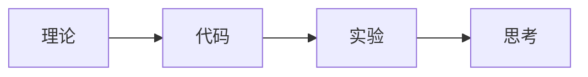
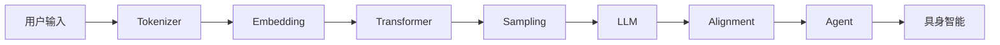

# Build-Your-Own-LLM

> **从零实践大模型，一行代码一行代码地理解 LLM、Alignment 与 Agent 的完整技术栈。**

本书的目标是**普惠**：不需要昂贵的硬件，不需要任何境外付费服务，任何人都应该能跟着书里的代码把每一个实验亲手跑一遍。

---

## 设计理念

阅读约定：**正章负责概念、原理与边界，编号子章（如 3.1、4.2）只负责实践**。子章会直接引用正章，不重复讲解理论；需要补背景时，先回到对应正章。

每一章都遵循"讲清楚概念 → 给你一段可以独立复制运行的代码 → 亲手跑出结果 → 提出思考题"的节奏。所有实验代码都可以**复制到一个 `.py` 文件中直接运行**，不需要跳转到其他文件找依赖。

---

## 硬件门槛与网络说明

| 项目 | 说明 |
|---|---|
| **第一部分第 1～12 章** | 以 NumPy 和小型 PyTorch 模型为主，普通 CPU 笔记本可运行；具体耗时取决于硬件与实验配置 |
| **第一部分第 13 章及后续训练实验** | 部分实验需要下载 0.5B～7B 开源模型，并可能依赖 CUDA GPU；以各章环境说明为准 |
| **第二、三部分** | 部分训练实验建议使用消费级 GPU；CPU 能否运行及耗时以各章说明为准 |
| **模型来源** | 全部使用开源模型（Qwen 系列），在本地运行，不需要注册任何境外付费 API |
| **国内网络** | 提供 Hugging Face 镜像（`hf-mirror.com`）和 ModelScope 备选方案；pip 清华源加速；推荐按小时计费的国内云 GPU（AutoDL 等），支持支付宝/微信，几元钱即可体验完一节实验 |

> 详见 `0. 开始之前/1. 前言.md` 中的「P0.3 硬件准备」「P0.4 环境安装」与「P0.5 模型与网络」。

---

## 全书结构

### 0. 开始之前

AI 知识地图、全书学习路线、环境准备（国内网络与硬件门槛）。

---

### 1. LLM 基础（What）

> 从零实现一个能生成文本的语言模型，逐行理解 Tokenizer、Embedding、Attention、Transformer Block 的每一处细节。

| 章 | 标题 | 核心知识点 |
|---|---|---|
| 1 | 语言模型——定义与下一词预测机制 | Bigram 统计模型、概率分布、Next Token Prediction |
| 2 | Tokenizer——文本离散化与词元表示 | Character → Word → `<UNK>` → Subword → BPE 训练全流程 |
| 3 | Embedding——Token 的向量表示 | One-Hot、Embedding Matrix、语义空间的几何直觉 |
| 4 | 神经网络——从神经元到 MLP | Linear、Activation、MLP、Softmax、Cross Entropy；4.1 用 NumPy 实现完整前向计算 |
| 5 | 固定上下文与 N-Gram 语言模型 | Context Window、Context–Target 数据集、N-Gram、数据稀疏性 |
| 6 | 神经语言模型——从 N-Gram 到分布式表示 | Concatenate；将第4章组件接入 `Context → Probability → Loss → Perplexity` |
| 7 | 反向传播与梯度下降 | 链式法则、参数梯度、Embedding 梯度、SGD、PyTorch 端到端训练 |
| 8 | 现代优化与训练工程 | Momentum、AdamW、初始化、Warmup、学习率调度；在 WikiText-2 上训练与验证 |
| 9 | RNN——循环状态与序列记忆机制 | Hidden State、RNN Cell、LSTM 门控机制与长期依赖问题 |
| 10 | Attention | Dot Product、Softmax、Weighted Sum、Q/K/V、Multi-Head Attention、注意力矩阵可视化 |
| 11 | Transformer 结构与层堆叠 | Layer Norm、残差连接、FFN、Block 组装、层堆叠与表示学习 |
| 12 | Transformer 架构演进与家族 | RoPE、RMSNorm、SwiGLU、GQA/MQA 与 KV Cache、Encoder/Decoder/Enc-Dec 架构 |
| 13 | 大语言模型（LLM） | Scaling Law、In-Context Learning、CoT、Long Context、KV Cache 原理、MoE |
| 14 | 多模态大模型——视觉信息编码与语言模型接入 | Patch Embedding、Vision Encoder、Projector 与图文对齐 |
| 15 | 多模态大模型进阶——统一理解与生成 | VQ-VAE、Diffusion、图像与音频 Tokenization、Any-to-Any 模型 |
| 16 | 总结 | 第一部分知识地图回顾 |

---

### 2. 模型对齐（Alignment）与训练工程

> 从基础模型（Base Model）到现代 AI 助手：监督微调（SFT）、基于人类反馈的强化学习（RLHF）、直接偏好优化（DPO）、组相对策略优化（GRPO）、智能体强化学习（Agentic RL），以及支撑这一切的图形处理器（GPU）、训练和推理工程。专业术语首次出现时同时给出中英文，完整对照表见第 13 章附录。

| 章 | 标题 | 核心知识点 |
|---|---|---|
| 1 | 模型对齐（Alignment）——从基础模型到对话助手 | 基础/指令/对齐模型三个概念、能力与对齐、HHH、InstructGPT 三步 |
| 2 | 三种学习范式（Learning Paradigms）——监督学习、无监督学习与自监督学习 | 标签来源、三种范式的训练流程与联系、自监督为何能规模化、模型自举 |
| 3 | 数据工程——语料来源、清洗与配比 | Common Crawl→C4、清洗四关、去重、个人身份信息（PII）脱敏、质量筛选 |
| 4 | 监督微调（SFT）——指令跟随能力的训练 | 对话模板（Chat Template）、损失掩码（Loss Mask）、低秩适配/量化低秩适配（LoRA/QLoRA）微调、对数几率蒸馏（KL 散度） |
| 5 | 偏好学习（Preference Learning）——人类偏好的建模与优化 | 奖励模型（Reward Model）、基于人类反馈的强化学习与近端策略优化（RLHF/PPO）、直接偏好优化（DPO）、ORPO/SimPO/GRPO |
| 6 | 推理对齐（Reasoning Alignment）——推理能力的训练与对齐 | 过程监督/结果监督（Process/Outcome Supervision）、组相对策略优化（GRPO）、测试时扩展（test-time scaling） |
| 7 | 智能体强化学习（Agentic RL）——在环境中训练会使用工具的智能体 | 环境与轨迹、结果/过程奖励、轨迹级信用分配、rollout 与训练解耦；7.1 最小多轮工具调用强化学习循环 |
| 8 | 安全对齐（Safety Alignment）——风险边界与多层防护 | 越狱（Jailbreak）、护栏（Guardrail）、输入输出安全审核 |
| 9 | 图形处理器（GPU）基础与算子——训练与推理的硬件基础 | 流式多处理器/张量核心（SM/Tensor Core）、高带宽内存/片上缓存（HBM/SRAM）、算子融合、Triton 实战 |
| 10 | 大模型训练栈（LLM Training Stack）——现代大模型训练工程 | 并行策略（数据/张量/流水线并行 Data/Tensor/Pipeline Parallel）、零冗余优化器（ZeRO）、Accelerate + DeepSpeed |
| 11 | 大模型推理栈（LLM Inference Stack）——现代大模型推理工程 | 连续批处理（Continuous Batching）、分页注意力（PagedAttention）、量化（Quantization）、键值缓存（KV Cache）显存构成；11.1 vLLM 服务端并发实战、11.2 本地量化推理实战 |
| 12 | 大模型评测（LLM Evaluation）——评价方法与局限 | 困惑度（Perplexity）、基准测试（Benchmark）、竞技场（Arena）、大模型评审（LLM-as-a-Judge） |
| 13 | 第二部分总结——从基础模型到现代 AI 助手 | 完整知识地图与第二部分术语对照表 |

---

### 3. 智能体（Agent）与运行平台

> 让大语言模型（LLM）从"会说"变成"会做"：工具调用（Tool Calling）、检索增强生成（RAG）、规划（Planning）、记忆（Memory）、反思（Reflection）等必需组件，再到循环（Loop）与图（Graph）两种可选编排、多智能体（Multi-Agent）、协议家族（MCP / A2A / AG-UI）、技能（Skill）、运行时（Runtime）与智能体操作系统（Agentic OS），最后以一个综合实践收尾。

| 章 | 标题 | 核心知识点 |
|---|---|---|
| 1 | 智能体（Agent）——定义、组成与执行循环 | LLM 与 Agent 的区别、六个必需组件、记忆层与控制流层的边界、最小工作流（Workflow）实现 |
| 2 | 工具调用（Tool Calling）——智能体连接真实世界的方式 | 手写 JSON 解析 → 模型原生工具调用 → 约束解码（Constrained Decoding）能保证与不能保证的边界 |
| 3 | 规划（Planning）——智能体的任务分解与行动计划 | 任务分解、Plan-and-Execute、ReWOO、Tree of Thoughts、规划与反思的边界、LangGraph 复现 |
| 4 | 智能体记忆（Agent Memory）与检索增强生成（RAG）——状态保存与知识检索 | 记忆的写入/更新/遗忘策略、RAG 完整流程（分块/向量化/检索/重排/增强）、记忆与 RAG 的区别 |
| 5 | 反思机制（Reflection）——智能体的自我评估与修正 | Self-Refine、Reflexion、Evaluator-Optimizer 的差异、自我确认偏差与过度修正 |
| 6 | 智能体循环工程（Agent Loop Engineering）——自主执行闭环的设计与边界 | ReAct 推理轨迹回填、终止条件、错误重试、上下文管理、副作用工具的幂等性 |
| 7 | 图工程（Graph Engineering）——复杂智能体流程的编排范式（**可选**） | 状态图、Checkpoint / Resume、Durable Execution 的边界、何时不该上图 |
| 8 | 多智能体（Multi-Agent）——协作模式与工程边界 | 流水线、主从、层级、黑板、对等协作与竞争评审、上下文传递与冲突处理、CrewAI 实战 |
| 9 | 智能体协议家族（Agent Protocol Family）——MCP、A2A 与 AG-UI 的连接对象 | MCP（连工具/资源/提示）、A2A（连 Agent）、AG-UI（连前端）三方协议对比与协作 |
| 10 | 技能（Skill）——智能体能力的封装、加载与复用 | SKILL.md、Progressive Disclosure、Skill 与 Tool/MCP 的层次关系、误触发与加载预算 |
| 11 | 智能体运行时（Agent Runtime）——执行架构与服务化运行 | 常驻服务、会话管理、可观测性（Observability / Trace / Span）、流式输出、评测 |
| 12 | 执行环境（Execution Environment）——智能体如何操作数字世界 | 多层沙箱、浏览器自动化风险、提示注入（Prompt Injection）的纵深防御 |
| 13 | 智能体运行平台（Agentic Runtime）——面向智能体集群的运行平台架构 | 调度、配额、抢占与公平性、共享状态一致性、Capability Registry |
| 14 | 智能体操作系统（Agentic OS）——面向智能体的操作系统架构设想 | Capability First、Event First、OS 类比的成立与失效、未解问题 |
| 15 | 综合实践——文档问答智能体（Agent）的端到端构建 | RAG + LLM + FastAPI 三层架构、失败模式与改进方向、第三部分术语对照表 |

---

### 4. 具身智能

> 从"理解语言""自主行动"，走向"拥有身体"：把 LLM、Agent 的方法论重新应用到物理世界，覆盖运动学、强化学习、模仿学习、感知、现代策略架构（ACT/Diffusion Policy）、VLA、World Model、仿真与数据、Sim2Real、长时程规划的完整链路。全部实验只需 Python/NumPy，一台普通笔记本 CPU 即可运行，无需任何机器人硬件。

| 章 | 标题 | 核心知识点 |
|---|---|---|
| 1 | Physical AI——为什么智能需要一个身体 | Moravec 悖论、感知-决策-行动闭环 |
| 2 | 机器人本体与运动学 | DOF、Joint/Task Space、正逆运动学 |
| 3 | 强化学习基础 | MDP、价值函数、贝尔曼方程、Q-Learning |
| 4 | 模仿学习 | 行为克隆、分布偏移、DAgger |
| 5 | 机器人感知 | 针孔相机模型、点云反投影、视觉表征 |
| 6 | 现代模仿学习策略 | Action Chunking、ACT(CVAE)、Diffusion Policy |
| 7 | VLA | RT-1/RT-2/OpenVLA/π0、快慢双系统 |
| 8 | 强化学习进阶 | 奖励塑形、奖励黑客、HIL-SERL |
| 9 | World Model | Model-Based RL、隐空间动态模型、MPC |
| 10 | 仿真器与数据集 | PyBullet/MuJoCo/Isaac Lab/Genesis 四款仿真器均配套动手实验、LeRobotDataset |
| 11 | Sim-to-Real | Reality Gap、域随机化、系统辨识 |
| 12 | 长时程任务与分层智能体 | 三条架构路线（分层式/端到端/混合式）、LLM Planner + Skill Library |
| 13 | 机器人数据工程与数据飞轮 | 数据飞轮（DAgger 的工程化延续） |
| 14 | 具身智能的算力与硬件 | LeRobot 开源硬件、云 GPU 租用 |
| 15 | 第四部分总结 | 完整技术栈与未来展望 |

---

### 5. 市场研究（规划中）

### 6. 附录（规划中）

---

## 开始阅读

建议从 `0. 开始之前/1. 前言.md` 开始，了解全书的整体框架、学习路线和硬件门槛，然后按顺序进入第一部分。

如果你在国内，先阅读前言中的「P0.4 环境安装」和「P0.5 模型与网络」，配置 Hugging Face 镜像和 pip 镜像。

---

## License

MIT
